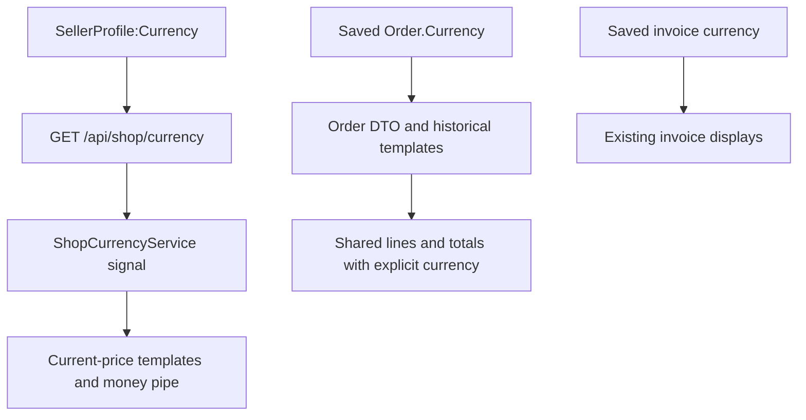

# Correct Currency Handling in LiliShop: From .NET Configuration to Angular Templates

A price can contain the correct number and still give the customer the wrong information. A product priced in euros should not appear in dollars because a template uses a default currency. An old dollar order should not become a euro order when today's shop settings change.

LiliShop's A1 change connects monetary displays to an explicit currency. It keeps current shop settings separate from saved transaction data and keeps both separate from language selection. This article follows that connection through ASP.NET Core, Angular signals, shared components and regression tests.

The implementation references below are pinned to the pushed backend commit [`269209f`](https://github.com/jahanalem/LiliShop-backend-dotnet/commit/269209ffb8c05d9d52f8485c3f467c4e57d502f3) and frontend commit [`e289d59`](https://github.com/jahanalem/LiliShop-frontend-angular/commit/e289d59c12f7d825450237e3529f350f9a2b5f47). These contain A1; they are later than the A0 baseline.

## Amount, currency and locale answer different questions

**The amount is a number. The currency tells us what that number means. The locale controls how we display it.** A locale is a set of regional presentation rules, including decimal separators and symbol placement.

Consider `29.99 EUR`. English, German and Persian can present it differently while keeping the same amount and currency. The following strings were derived locally from the installed Angular formatter using the same call as `formatMoney`, with registered locale data. They are formatter samples, not observed browser screenshots.

| Locale | Formatter output, with invisible characters escaped |
| --- | --- |
| `en` | `€29.99` |
| `de` | `29,99\u00A0€` |
| `fa` | `\u200E€\u00A029.99` |

Here `\u00A0` is a non-breaking space and `\u200E` is a left-to-right direction mark. This Persian formatter output still uses Latin digits. Reading direction and digit substitution should not be assumed to be the same operation.

Changing language does not change EUR to USD. Changing the shop setting to USD also does not calculate an exchange rate: an existing catalog number of `29.99` remains `29.99`. A historical USD order must keep its saved USD identity even when current prices use EUR.

## Why implicit formatting was inconsistent

The product detail template previously supplied only the amount:

```html
<p class="price">{{ displayPrice() | currency }}</p>
```

Source: frontend [`src/app/features/user-area/shop/product-details/product-details.component.html` before A1](https://github.com/jahanalem/LiliShop-frontend-angular/blob/aa50a2fc6988ae7c4e21bee775b81d9f2d327ebb/src/app/features/user-area/shop/product-details/product-details.component.html).

This expression did not receive the backend's currency. In the recorded before-fix tests, implicit formatting produced USD where EUR was required. Elsewhere, the generic admin formatter added a literal dollar sign, while product inputs and fixed-discount labels contained euro symbols. These independent choices could disagree on the same screen.

The corresponding expression now passes currency explicitly:

```html
<p class="price">{{ displayPrice() | money:shopCurrency.currency() }}</p>
```

Source: frontend [`src/app/features/user-area/shop/product-details/product-details.component.html`](https://github.com/jahanalem/LiliShop-frontend-angular/blob/e289d59c12f7d825450237e3529f350f9a2b5f47/src/app/features/user-area/shop/product-details/product-details.component.html). This exact line appears in its non-discount branch; the discount branch uses the same expression with additional styling.

## Start with the backend's existing setting

[`Main/LiliShop.Infrastructure/Configuration/SellerProfileOptions.cs`](https://github.com/jahanalem/LiliShop-backend-dotnet/blob/269209ffb8c05d9d52f8485c3f467c4e57d502f3/Main/LiliShop.Infrastructure/Configuration/SellerProfileOptions.cs) already defines `SectionName = "SellerProfile"` and defaults `Currency` to `"eur"`. In [`Main/LiliShop.API/Extensions/ApplicationServiceExtensions.cs`](https://github.com/jahanalem/LiliShop-backend-dotnet/blob/269209ffb8c05d9d52f8485c3f467c4e57d502f3/Main/LiliShop.API/Extensions/ApplicationServiceExtensions.cs), binding connects that section to the options object:

```csharp
services.Configure<SellerProfileOptions>(config.GetSection(SellerProfileOptions.SectionName));
```

Existing [`PaymentService.cs`](https://github.com/jahanalem/LiliShop-backend-dotnet/blob/269209ffb8c05d9d52f8485c3f467c4e57d502f3/Main/LiliShop.Infrastructure/Services/PaymentService.cs) sets `Currency = _seller.Currency` when creating a Stripe PaymentIntent, the provider's payment-attempt object. [`OrderService.cs`](https://github.com/jahanalem/LiliShop-backend-dotnet/blob/269209ffb8c05d9d52f8485c3f467c4e57d502f3/Main/LiliShop.Infrastructure/Services/OrderService.cs) copies the same setting into new orders. A1 reuses this source rather than adding another setting in Angular.

### Expose only what the browser needs

Source: backend [`Main/LiliShop.API/Controllers/ShopController.cs`](https://github.com/jahanalem/LiliShop-backend-dotnet/blob/269209ffb8c05d9d52f8485c3f467c4e57d502f3/Main/LiliShop.API/Controllers/ShopController.cs), action excerpt:

```csharp
[HttpGet("currency")]
public ActionResult<ShopCurrencyDto> GetCurrency() => Ok(new ShopCurrencyDto(seller.Value.Currency));
```

The controller receives `IOptions<SellerProfileOptions>`. Its inherited route produces `GET /api/shop/currency`. [`Main/LiliShop.Application/DTOs/ShopCurrencyDto.cs`](https://github.com/jahanalem/LiliShop-backend-dotnet/blob/269209ffb8c05d9d52f8485c3f467c4e57d502f3/Main/LiliShop.Application/DTOs/ShopCurrencyDto.cs) defines the response shape:

```csharp
public sealed record ShopCurrencyDto(string Currency);
```

A DTO is an object used to transfer selected data across an application boundary. Here the JSON is `{"currency":"eur"}`. Returning one field avoids exposing unrelated seller settings. The action projects the configured value; it does not validate or uppercase it. Display validation happens in Angular.

## Load once and expose reactive state

[`src/app/app.config.ts`](https://github.com/jahanalem/LiliShop-frontend-angular/blob/e289d59c12f7d825450237e3529f350f9a2b5f47/src/app/app.config.ts) calls `ShopCurrencyService.initialize()` alongside language and translation initialization. Startup is non-blocking: the application can render before the response arrives.

Source: frontend [`src/app/core/services/shop-currency.service.ts`](https://github.com/jahanalem/LiliShop-frontend-angular/blob/e289d59c12f7d825450237e3529f350f9a2b5f47/src/app/core/services/shop-currency.service.ts), state excerpt; other members omitted:

```typescript
private readonly current = signal<string | null>(null);
private readonly status = signal<'loading' | 'ready' | 'error'>('loading');
private initialized = false;
readonly currency = this.current.asReadonly();
readonly state = this.status.asReadonly();
```

A signal holds a value and informs Angular when it changes. The service exposes read-only signals so consumers can observe state without setting it themselves.

`initialize()` guards against repeated initialization, then resolves `HttpClient` through `Injector` and requests `${environment.apiUrl}shop/currency`. Reading a signal does not start this request. A successful response is normalized; a valid code sets `ready`, while a missing or invalid code sets `error`. HTTP failure also clears currency and sets `error`.

While currency is unknown, monetary displays show unavailable text. [`src/app/app.component.html`](https://github.com/jahanalem/LiliShop-frontend-angular/blob/e289d59c12f7d825450237e3529f350f9a2b5f47/src/app/app.component.html) adds a visible `role="alert"` when the service reaches `error`. There is no automatic retry in this service; reloading starts a new application instance and request.

## Follow the template expression all the way through

In the product detail component, `displayPrice` is itself a computed signal:

```typescript
readonly displayPrice = computed(() => this.selectedVariant()?.price ?? this.product().price);
```

Source: frontend [`src/app/features/user-area/shop/product-details/product-details.component.ts`](https://github.com/jahanalem/LiliShop-frontend-angular/blob/e289d59c12f7d825450237e3529f350f9a2b5f47/src/app/features/user-area/shop/product-details/product-details.component.ts). It returns the selected variant's numeric price when available, otherwise the product's price. The nullish fallback preserves a valid zero price. Previous prices use a separate computed signal.

Now read `{{ displayPrice() | money:shopCurrency.currency() }}` from left to right:

1. `displayPrice()` reads that numeric value.
2. `{{ ... }}` is Angular interpolation: Angular evaluates the expression and inserts its result as text.
3. `|` sends the value through a template pipe, a display transformation.
4. `money` matches the pipe's declared name.
5. The amount before `|` becomes the first `transform` argument.
6. The expression after `:` becomes the currency argument.
7. `shopCurrency.currency()` calls the signal's getter. These parentheses read current state; they do not make an HTTP request on each evaluation.

When the backend response changes the currency signal, Angular updates the consuming view. The pipe then formats the same number with the received code.

Source: frontend [`src/app/shared/pipes/money.pipe.ts`](https://github.com/jahanalem/LiliShop-frontend-angular/blob/e289d59c12f7d825450237e3529f350f9a2b5f47/src/app/shared/pipes/money.pipe.ts); `unavailableCurrency` is defined earlier in that file:

```typescript
@Pipe({ name: 'money', standalone: true, pure: false })
export class MoneyPipe implements PipeTransform {
  // Omitted: fields that inject LOCALE_ID and TranslationService.

  transform(value: number | null | undefined, currency: unknown): string {
    return formatMoney(value, currency, this.locale) ?? unavailableCurrency(this.translations);
  }
}
```

The currency argument is required and has no default. `pure: false` allows reevaluation during view checks, including when translation state changes. `LOCALE_ID` supplies presentation rules, independently of currency.

Source: frontend [`src/app/shared/currency.ts`](https://github.com/jahanalem/LiliShop-frontend-angular/blob/e289d59c12f7d825450237e3529f350f9a2b5f47/src/app/shared/currency.ts), with imports omitted:

```typescript
const supportedCurrencies = new Set(Intl.supportedValuesOf('currency'));

export function normalizeCurrency(value: unknown): string | null {
  if (typeof value !== 'string') return null;
  const code = value.trim().toUpperCase();
  return supportedCurrencies.has(code) ? code : null;
}

export function formatMoney(value: number | null | undefined, currency: unknown, locale: string): string | null {
  const code = normalizeCurrency(currency);
  if (!code || typeof value !== 'number' || !Number.isFinite(value)) return null;
  return formatCurrency(value, locale, getCurrencySymbol(code, 'wide', locale), code, '1.2-2');
}
```

Lowercase `eur` becomes `EUR`; `EURO`, `ZZZ`, empty and missing values are rejected against the runtime's supported currency list. Invalid amounts also return `null`. The pipe replaces that result with translated `Currency.Unavailable`, or the readable fallback `Currency unavailable` if the dictionary returns the key unchanged. A1 added the English seed entry.

No exchange-rate calculation occurs. Formatting returns text and leaves stored amounts unchanged. The explicit `'1.2-2'` currently displays two decimal places.

### Language changes presentation

The existing [`locale-registry.ts`](https://github.com/jahanalem/LiliShop-frontend-angular/blob/e289d59c12f7d825450237e3529f350f9a2b5f47/src/app/core/i18n/locale-registry.ts) supports eleven locales, including built-in English. [`LanguageService`](https://github.com/jahanalem/LiliShop-frontend-angular/blob/e289d59c12f7d825450237e3529f350f9a2b5f47/src/app/core/services/language.service.ts) persists language and direction, requests a profile preference update, then reloads the page. The reload rebinds `LOCALE_ID` and fetches shop currency again. A1 preserves this mechanism, including right-to-left presentation.

## Historical money takes a separate route

| Display | Currency source |
| --- | --- |
| Products, current basket, checkout and catalog admin prices | Current shop configuration |
| Saved order list, lines and totals | `Order.Currency` |
| Issued invoice list, lines and totals | Saved invoice currency |



[`Order.Currency`](https://github.com/jahanalem/LiliShop-backend-dotnet/blob/269209ffb8c05d9d52f8485c3f467c4e57d502f3/Main/LiliShop.Domain/Entities/OrderAggregate/Order.cs) already existed in storage. A1 adds nullable `Currency` to [`OrderToReturnDto`](https://github.com/jahanalem/LiliShop-backend-dotnet/blob/269209ffb8c05d9d52f8485c3f467c4e57d502f3/Main/LiliShop.Application/DTOs/OrderToReturnDto.cs) and projects `Currency = entity.Currency` in [`OrderAggregateMappers`](https://github.com/jahanalem/LiliShop-backend-dotnet/blob/269209ffb8c05d9d52f8485c3f467c4e57d502f3/Main/LiliShop.Application/Mappers/OrderAggregateMappers.cs). The mapper preserves raw saved values, including missing values, instead of substituting today's setting. No new currency column was needed.

Changing only the order list would leave a subtle defect: nested components could still label line prices and totals with current shop currency. The detail template therefore passes the historical value to both shared components.

Source: frontend [`src/app/features/user-area/orders/order-detailed/order-detailed.component.html`](https://github.com/jahanalem/LiliShop-frontend-angular/blob/e289d59c12f7d825450237e3529f350f9a2b5f47/src/app/features/user-area/orders/order-detailed/order-detailed.component.html), excerpt:

```html
<app-basket-summary [currency]="orderDetails.currency" [isOrder]="true" [isBasket]="false" [items]="orderDetails.orderItems"></app-basket-summary>
<app-order-totals [currency]="orderDetails.currency"
  [shippingPrice]="orderDetails.shippingPrice"
  [subtotal]="orderDetails.subtotal"
  [total]="orderDetails.total">
</app-order-totals>
```

Both shared components accept a nullable currency input without a shop fallback. [`basket-summary.component.html`](https://github.com/jahanalem/LiliShop-frontend-angular/blob/e289d59c12f7d825450237e3529f350f9a2b5f47/src/app/shared/components/basket-summary/basket-summary.component.html) formats unit and extended prices with `money:currency()`; [`order-totals.component.html`](https://github.com/jahanalem/LiliShop-frontend-angular/blob/e289d59c12f7d825450237e3529f350f9a2b5f47/src/app/shared/components/order-totals/order-totals.component.html) does the same for subtotal, shipping and total. Current basket and checkout parents pass the shop signal instead.

Existing [`invoice-detail.component.html`](https://github.com/jahanalem/LiliShop-frontend-angular/blob/e289d59c12f7d825450237e3529f350f9a2b5f47/src/app/features/admin-area/admin/invoices/invoice-detail/invoice-detail.component.html) already displays formatted numbers followed by saved `inv.currency | uppercase`. A1 preserves that path and tests it with USD invoices while the shop uses EUR.

## Admin labels must follow the same rule

The price branch of [`src/app/shared/pipes/format-value.pipe.ts`](https://github.com/jahanalem/LiliShop-frontend-angular/blob/e289d59c12f7d825450237e3529f350f9a2b5f47/src/app/shared/pipes/format-value.pipe.ts) now calls `formatMoney` with current shop currency. Its rendered table cells refresh after configuration arrives.

Product and variant price inputs show the configured ISO code, or an em dash while unavailable. Fixed discounts use currency; percentage discounts keep `%`.

Source: frontend [`src/app/features/admin-area/admin/discounts/edit-discount/edit-discount.component.html`](https://github.com/jahanalem/LiliShop-frontend-angular/blob/e289d59c12f7d825450237e3529f350f9a2b5f47/src/app/features/admin-area/admin/discounts/edit-discount/edit-discount.component.html):

```html
<span matSuffix>{{ tier.get('isPercentage')?.value ? '%' : (shopCurrency.currency() ?? '—') }}</span>
```

The component also computes fixed-amount tier labels from their values and the currency signal. A `12.5` fixed discount receives a monetary label; a `10%` discount stays a percentage. These changes label inputs without converting their numeric values.

## Tests that catch visible mistakes

The frontend tests in [`src/app/shared/currency.a1.spec.ts`](https://github.com/jahanalem/LiliShop-frontend-angular/blob/e289d59c12f7d825450237e3529f350f9a2b5f47/src/app/shared/currency.a1.spec.ts) render real consuming components while mocking HTTP and dependent services.

`keeps discounted current and previous catalog prices in EUR in ${locale}` runs for `en`, `de` and `fa`. It checks both `29.9` and the crossed-out `39.9` against Angular formatting with explicit EUR. Its helper normalizes non-breaking spaces and direction marks for comparison; it does not replace currencies or amounts. Another test exercises the existing language switch and a fresh test injector, preserving the saved language choice rather than claiming real browser navigation.

`passes saved USD through order detail to every nested line, subtotal, zero shipping and total` checks a USD unit price of `29.9`, quantity two, and total `59.8` while shop currency is EUR. These assertions come from that test, with setup omitted:

```typescript
expect(text(fixture, '.cart-item .price')).toBe(expectedMoney(29.9, 'USD', 'de'));
expect(text(fixture, '.cart-item .total-price')).toBe(expectedMoney(59.8, 'USD', 'de'));
// Omitted: collect the rendered subtotal, shipping and total into totals.
expect(totals).toEqual([59.8, 0, 59.8].map(amount => expectedMoney(amount, 'USD', 'de')));
expect(text(fixture)).not.toContain('€');
```

This catches a parent that displays USD correctly but forgets to pass currency to its children.

`does not assume a currency when shop configuration is ${String(currency)}` covers pending requests, HTTP failure, missing configuration and `ZZZ`. It requires unavailable text and no guessed dollar/euro symbol; the pending case then checks the view updates after EUR arrives. Historical cases cover `undefined`, `null`, empty, `EURO` and `ZZZ`. A separate test checks the application error alert.

On the backend, [`PublicCurrencyIsConfiguredValueAndExposesNoOtherSellerSettings`](https://github.com/jahanalem/LiliShop-backend-dotnet/blob/269209ffb8c05d9d52f8485c3f467c4e57d502f3/Main/Applications/Lili.Shop.Tests/API/ShopCurrencyA1Tests.cs) supplies `eur`, `gbp`, `USD` and empty settings, then asserts the configured value and exactly one JSON property. This is a controller projection test, not an HTTP pipeline test. [`OrderResponsePreservesSavedCurrencyWithoutSubstitutingCurrentShop`](https://github.com/jahanalem/LiliShop-backend-dotnet/blob/269209ffb8c05d9d52f8485c3f467c4e57d502f3/Main/Applications/Lili.Shop.Tests/Services/Mappers/OrderCurrencyA1Tests.cs) checks saved codes, empty and null values, plus unchanged total and zero shipping.

The recorded **22 October 2026 A1 run**, documented in `A1_IMPLEMENTATION_REPORT.md` and its retained logs, passed:

| Recorded check | Result |
| --- | --- |
| Frontend suite | 258 tests, including 26 currency regressions |
| Backend suite | 345 tests, including eight A1 cases |
| Cypress authentication smoke | Nine tests |
| Safe Newman scope | 26 requests and 105 assertions |

Both builds also passed. The retained HTTP smoke recorded `200` with only `{"currency":"eur"}`. These are historical run results; the relevant logs were inspected for this article, but the suites were not rerun. Targeted cases are already included in the full totals.

Authentication smoke checks and safe Newman coverage do not prove successful provider payments, checkout concurrency or recovery. Currency rendering tests establish specific display behavior; they do not verify the entire payment process.

## Configure and check locally

There is currently **no admin currency-setting screen**. Merge one of these fragments into existing API settings; do not replace the whole configuration file.

Example EUR setting:

```json
{
  "SellerProfile": {
    "Currency": "eur"
  }
}
```

Example USD setting:

```json
{
  "SellerProfile": {
    "Currency": "usd"
  }
}
```

[`Main/LiliShop.API/Program.cs`](https://github.com/jahanalem/LiliShop-backend-dotnet/blob/269209ffb8c05d9d52f8485c3f467c4e57d502f3/Main/LiliShop.API/Program.cs) adds `appsettings.json`, then the environment-specific JSON file, then environment variables. Check these overrides; `SellerProfile__Currency` is the environment-variable form. Although JSON reload is enabled, these consumers use `IOptions`, and payment/order services capture its value. Restart the API for a consistent change, then reload Angular so its one-time request runs again.

For a local manual check:

1. Read `/api/shop/currency` and confirm the effective setting.
2. Compare product, basket, delivery and admin labels across English, German and Persian. Currency identity should stay fixed.
3. In a disposable local setup, switch EUR to USD, restart and reload. Catalog numbers should remain unchanged.
4. Inspect a saved USD order and invoice while the shop uses EUR. Include nested lines and zero shipping. Use the regression fixtures when no such local record exists.
5. Block the currency request in browser developer tools and reload. Verify unavailable prices and the error alert.

Existing payment attempts can retain their original provider currency: the update branch changes their amount without setting a new currency. Testing a changed shop currency therefore requires a **fresh sandbox checkout**. These display checks do not require running payment integrations.

## Limits and next steps

This is one current shop currency with historical currency snapshots, not full multi-currency selling. Existing numeric catalog prices are not converted when settings change. Existing orders and issued invoices must not be rewritten merely because current settings change.

Missing or invalid currency is handled explicitly in the new display path rather than guessed. One older exception remains outside A1: [`InvoiceService.BuildInvoice`](https://github.com/jahanalem/LiliShop-backend-dotnet/blob/269209ffb8c05d9d52f8485c3f467c4e57d502f3/Main/LiliShop.Infrastructure/Services/InvoiceService.cs) falls back to seller currency when the source order's currency is blank. That issuance behavior was not changed here; issued invoice displays continue to use their saved currency.

Possible future work includes startup configuration validation, retry presentation, more unavailable-text translations, and currency-specific decimal precision. Exchange rates and multiple selling currencies would require separate pricing and payment design. A1 establishes explicit display inputs without claiming those broader features are complete.
