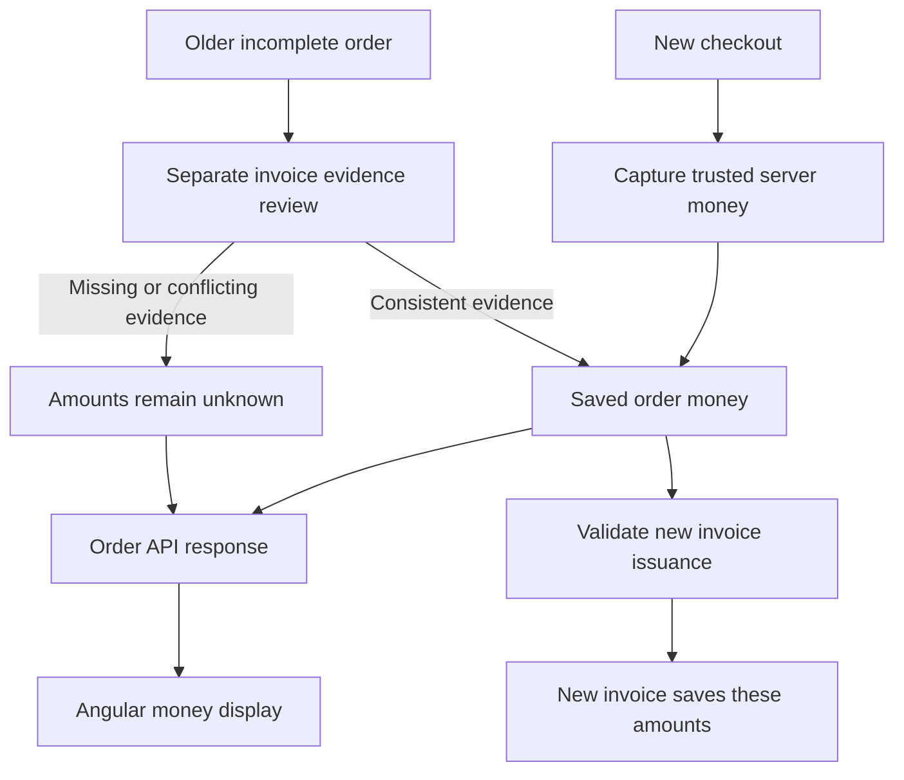
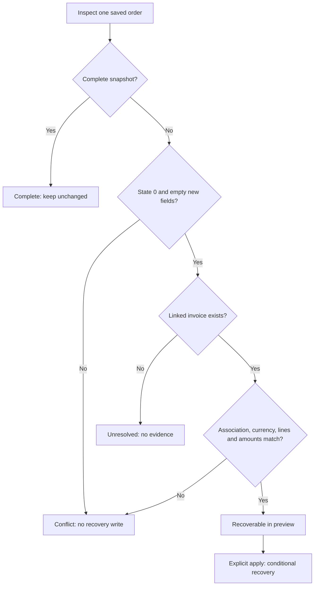

# Keeping Order Totals Stable: Shipping Snapshots in .NET and Angular

An order should keep the money agreed when it was created, even if shipping prices change later. LiliShop saves that money for new orders and treats missing historical amounts as unknown until reliable saved evidence can support them.



The left starting point is ordinary checkout. The server reads product prices and the selected shipping tariff, then saves the subtotal, shipping amount, total and currency together. Later readers use those saved values.

The other starting point is maintenance of older orders. This review is a separate operation, not a step in every checkout. A consistent existing invoice can provide evidence for missing order amounts. Missing or conflicting evidence leaves those amounts unknown. Angular displays this uncertainty instead of inventing free shipping or a zero total.

New invoice issuance has its own checks before allocating a number. An **already issued invoice remains independently readable from its saved values**, even when its order cannot be reconstructed. The diagram's new-invoice branch does not control access to existing invoices.

## The problem: a tariff is current data, an order is history

Consider one purchase:

| Moment | Items | Shipping | Payable total |
| --- | --- | --- | --- |
| Original order, EUR | 60.00 | 5.00 | 65.00 |
| Same order after a tariff change, EUR | 60.00 | **5.00** | **65.00** |
| Genuinely new order at the new tariff, EUR | 60.00 | 10.00 | 70.00 |

The delivery method still describes how the order travels. Its current `Price`, however, is a price for a new decision. It cannot tell us what an earlier customer agreed to pay.

The following is **historical code**, verified in the backend's committed version before the local snapshot changes:

```csharp
public decimal GetTotal()
{
    return Subtotal + DeliveryMethod.Price;
}
```

Source: backend `Main/LiliShop.Domain/Entities/OrderAggregate/Order.cs` (historical committed version, before the local snapshot changes).

This method recalculated history from a mutable navigation property. A navigation property is an entity reference that EF can load from a related table. After a tariff edit, the old order returned 70 instead of 65. Without a loaded delivery method, the calculation also needed an unavailable object. The historical DTO mapper separately used `entity.DeliveryMethod?.Price ?? 0m`, which could turn a missing navigation into apparent free shipping.

A **snapshot** is a saved record of the agreed money. It is not an image or a database backup. Capturing shipping adds no carrier integration, delivery policy, exchange-rate conversion or multiple selling currencies. It changes where historical readers get their numbers.

The examples below follow the current local backend and frontend source reviewed on 23 October 2026. The feature changes are not committed, so source references are accurately labeled repository-relative paths rather than links to older commits. `backend` means the `LiliShop-backend-dotnet` repository; `frontend` means the `LiliShop-frontend-angular` checkout whose root contains `src/`.

## A compact map of the implementation

The backend separates the domain, application contracts and infrastructure. Entity Framework Core (EF) maps the objects to database storage. This map covers the important additions and modifications before following the data through them.

| Type or artifact | Change | Layer | Responsibility and key collaborators |
| --- | --- | --- | --- |
| `Order` | Modified | Domain | Captures money and checks completeness; used by order, invoice, payment and recovery services. |
| `OrderMoneySnapshotState` | Added enum | Domain | Stores the three evidence states on `Order`. |
| `OrderConfiguration` | Modified | Infrastructure / EF | Maps money columns and the SQL check constraint. |
| `ShopDbContext` | Modified | Infrastructure / EF | Rejects incomplete application inserts and tracked financial changes during its save methods. |
| `OrderService` | Modified | Infrastructure | Builds trusted order lines, captures selected shipping and persists through the unit of work. |
| `OrderToReturnDto`, `OrderAggregateMappers` | Modified | Application | Transfer nullable saved money and its state to clients. |
| `InvoiceService` | Modified | Infrastructure | Returns existing invoices; guards new issuance and copies saved order money. |
| `PaymentService` | Modified | Infrastructure | Guards payment success and compares received amounts with saved totals diagnostically. |
| `OrderMoneySnapshotBackfill`, `OrderMoneyBackfillCase` | Added class and record | Infrastructure | Examine invoice evidence; selectively recover order fields through `ShopDbContext`. |
| `OrderMoneySnapshotCommand` | Added static class | API / maintenance | Validates arguments and an explicit SQL Server connection; runs preview or apply without starting the host. |
| `A3_OrderMoneySnapshots` and its Designer | Added migration artifacts | Infrastructure / migrations | Define the additive schema change and its target model. |
| `ShopDbContextModelSnapshot` | Modified generated metadata | Infrastructure / migrations | Records the current EF model for later comparisons. |

Each source path is identified with the relevant excerpt below. Supporting pre-existing types include `OrderItem`, `Invoice`, `InvoiceLine`, `IUnitOfWork` and `OperationResult<T>`. A unit of work coordinates repository writes. `OperationResult<T>` carries a status, optional data and failure information between services and the API; it is not a new snapshot result type.

## The domain: capture once, read saved money

### Existing money and the new evidence fields

`Order.Subtotal` and `Order.Currency` already existed. Saved `OrderItem.Price` and `Quantity` describe the purchased lines. The existing constructor receives items, buyer email, address, delivery method, subtotal and payment intent ID. It does not automatically capture a money snapshot: the creation service explicitly performs that next step.

```csharp
public virtual decimal? ShippingPrice { get; private set; }
public virtual decimal? Total { get; private set; }
public virtual OrderMoneySnapshotState MoneySnapshotState { get; private set; }
public virtual int? MoneySnapshotInvoiceId { get; private set; }
public virtual DateTimeOffset? MoneySnapshotRecordedAt { get; private set; }
```

Source: backend `Main/LiliShop.Domain/Entities/OrderAggregate/Order.cs` (current local working tree; excerpt, other members omitted).

The nullable `decimal?` properties can hold an amount or `null`. Here `null` means that an amount is unavailable. A shipping value of `0m` means that zero shipping was actually recorded. These are different facts.

The private setters limit ordinary callers: they cannot assign a new shipping amount or total directly. `MoneySnapshotRecordedAt` records when capture or recovery happened. `MoneySnapshotInvoiceId` identifies invoice evidence for recovered values; it is absent for newly captured money. This is **provenance**: information about where a value came from.

```csharp
public enum OrderMoneySnapshotState
{
    Unresolved = 0,
    Captured = 1,
    RecoveredFromInvoice = 2
}
```

Source: backend `Main/LiliShop.Domain/Entities/OrderAggregate/OrderMoneySnapshotState.cs` (current local working tree; excerpt, other members omitted).

These are the only persisted states. A new object starts at `Unresolved`, the enum's zero value. Normal creation moves it to `Captured`. Controlled historical recovery can move a completely empty unresolved snapshot to `RecoveredFromInvoice`. Neither path converts an already captured snapshot into a recovered one, and there is no public domain recovery method. Maintenance uses a deliberately separate conditional database write.

Snapshot state and `Order.Status` answer different questions. A pending order can already have complete captured money. A historically paid order can still lack reliable shipping and total evidence.

### Capture validates the agreed values

```csharp
public void CaptureMoneySnapshot(decimal shippingPrice, string currency)
{
    if (MoneySnapshotState != OrderMoneySnapshotState.Unresolved || ShippingPrice.HasValue
        || Total.HasValue || MoneySnapshotRecordedAt.HasValue || MoneySnapshotInvoiceId.HasValue)
        throw new InvalidOperationException("An order money snapshot cannot be recaptured.");
    if (!IsValidMoney(Subtotal) || !IsValidMoney(shippingPrice)
        || !IsValidMoney(Subtotal + shippingPrice))
        throw new ArgumentOutOfRangeException(nameof(shippingPrice), "Order money must fit nonnegative decimal(18,2).");
    if (string.IsNullOrWhiteSpace(currency) || currency.Length != 3 || !currency.All(char.IsAsciiLetter))
        throw new ArgumentException("A saved three-letter currency is required.", nameof(currency));

    ShippingPrice = shippingPrice;
    Total = Subtotal + shippingPrice;
    Currency = currency;
    MoneySnapshotState = OrderMoneySnapshotState.Captured;
    MoneySnapshotRecordedAt = DateTimeOffset.UtcNow;
}

public static bool IsValidMoney(decimal value) => value >= 0m
    && value <= 9999999999999999.99m && decimal.Round(value, 2) == value;
```

Source: backend `Main/LiliShop.Domain/Entities/OrderAggregate/Order.cs` (current local working tree; excerpt, other members omitted).

`OrderService.CreateOrderAsync` calls this method with the selected server delivery price and configured seller currency. The method returns no value; it sets the snapshot on the order before persistence.

Its first check rejects a second capture or any partial existing snapshot. The amount checks use the already assigned subtotal, the shipping argument and their sum. `IsValidMoney(decimal value)` requires a nonnegative value no greater than `9999999999999999.99m`, with `decimal.Round(value, 2) == value`. This matches the intended two-decimal money range without silently rounding an invalid input.

The currency argument must contain exactly three ASCII letters and must not be blank. This is a syntax check, not a list of currencies accepted by a payment provider. The original code's casing is retained.

Repeat capture throws `InvalidOperationException`; invalid money throws `ArgumentOutOfRangeException`; invalid currency throws `ArgumentException`. The order service's existing exception handler converts creation exceptions to a failed `OperationResult<Order>`. No successful order save is reported through that path.

The central **invariant**, a rule that must hold for complete money, is:

```text
Total = Subtotal + ShippingPrice
```

For the running example, capture saves `60 + 5 = 65`, currency `eur`, state `Captured` and the current UTC recording time. A later tariff edit does not call capture again.

### Completeness checks values and provenance

```csharp
public bool HasCompleteMoneySnapshot =>
    MoneySnapshotState is OrderMoneySnapshotState.Captured or OrderMoneySnapshotState.RecoveredFromInvoice
    && ShippingPrice is decimal shipping && Total is decimal total
    && IsValidMoney(Subtotal) && IsValidMoney(shipping) && IsValidMoney(total)
    && total == Subtotal + shipping && MoneySnapshotRecordedAt.HasValue
    && (MoneySnapshotState == OrderMoneySnapshotState.Captured
        ? MoneySnapshotInvoiceId is null : MoneySnapshotInvoiceId is > 0);
```

Source: backend `Main/LiliShop.Domain/Entities/OrderAggregate/Order.cs` (current local working tree; excerpt, other members omitted).

The property requires state 1 or 2, valid nonnegative two-decimal amounts, consistent arithmetic and a recording time. A captured snapshot must have no invoice evidence ID; a recovered one must have a positive ID.

Notice that completeness does not validate currency. Currency is checked during capture and separately by relevant consumers. This distinction matters when diagnosing old data: a missing amount and a missing currency need different explanations.

```csharp
public decimal? GetTotal() => HasCompleteMoneySnapshot ? Total : null;
```

Source: backend `Main/LiliShop.Domain/Entities/OrderAggregate/Order.cs` (current local working tree; excerpt, other members omitted).

`GetTotal()` now returns the saved nullable total. It does not add anything or access `DeliveryMethod`. A complete order therefore returns 65 even when delivery navigation is unloaded. An incomplete order returns `null`, even if a current delivery tariff is available.

## The database: storage, constraints and normal write protection

### Every added column

Source: backend `Main/LiliShop.Infrastructure/Data/Migrations/20261022152136_A3_OrderMoneySnapshots.cs`, checked against its Designer and `ShopDbContextModelSnapshot.cs` in the same directory.

| Column / property | Exact SQL type; nullability | Meaning and need | Default | Example |
| --- | --- | --- | --- | --- |
| `ShippingPrice` | `decimal(18,2)`; nullable | Retains the agreed shipping amount independently of the delivery tariff. | None | `5.00` |
| `Total` | `decimal(18,2)`; nullable | Retains the payable order total for later readers and consumers. | None | `65.00` |
| `MoneySnapshotState` | `int`; not nullable | Distinguishes unresolved, captured and invoice-recovered money. | `0` | `1` |
| `MoneySnapshotRecordedAt` | `datetimeoffset`; nullable | Records capture or recovery time, not a replacement order date. | None | `2026-10-22T15:36:06+00:00` |
| `MoneySnapshotInvoiceId` | `int`; nullable | Retains the invoice evidence ID for recovery. | None | `2001` in state `2` |

`Currency` is an existing required `nvarchar(3)` column; this migration adds no second currency field and rewrites no old currency values.

The evidence ID has **no foreign-key constraint** in the new migration or current EF relationship metadata. A positive ID is required for state 2, but that alone does not prove the referenced invoice exists. The recovery algorithm establishes its association before writing. Separately, the existing `InvoiceConfiguration` defines a unique `Invoice.OrderId` and a real invoice-to-order foreign key with restricted deletion. That relationship should not be confused with the new evidence property.

Older rows receive state 0 and retain monetary `NULL`s. A zero state marker means “unresolved”; it does not mean zero euros. Giving shipping or total a money default would hide the very absence this design needs to represent.

### What each guard actually checks

`OrderConfiguration.Configure` maps shipping and total to `decimal(18,2)`, gives the state its unresolved default, ignores the computed completeness property and defines `CK_Orders_MoneySnapshot`. A check constraint is a rule the database evaluates when a row is inserted or updated.

```csharp
builder.Property(o => o.ShippingPrice).HasColumnType("decimal(18,2)");
builder.Property(o => o.Total).HasColumnType("decimal(18,2)");
builder.Property(o => o.MoneySnapshotState).HasDefaultValue(OrderMoneySnapshotState.Unresolved);
builder.Ignore(o => o.HasCompleteMoneySnapshot);
```

Source: backend `Main/LiliShop.Infrastructure/Data/Config/OrderConfiguration.cs` (current local working tree; excerpt, other members omitted).

The mapping stores amounts as decimal money, not floating-point measurements. `Ignore` keeps the computed completeness property out of the table; the stored state is a separate column.

The SQL constraint permits state 0. For states 1 and 2, it requires non-null shipping and total, nonnegative shipping and subtotal, `Total = Subtotal + ShippingPrice`, a recording time, and the correct absence or positive presence of the invoice evidence ID. Other state values fail. Explicit `IS NOT NULL` checks prevent missing values from slipping through SQL's three-valued logic for these complete-state checks.

SQL Server's decimal types provide storage precision. The SQL constraint checks relationships between stored values; it does not repeat the three-letter currency validation, compare invoice evidence, or prevent a manual SQL update from changing one internally consistent complete snapshot into another. State 0 can also contain partial data; maintenance reports that as a conflict instead of treating it as recoverable.

Application saves provide another boundary:

```csharp
private void ValidateOrderMoneySnapshots()
{
    foreach (var entry in ChangeTracker.Entries<Order>())
    {
        if (entry.State == EntityState.Added && (!entry.Entity.HasCompleteMoneySnapshot
            || string.IsNullOrWhiteSpace(entry.Entity.Currency)))
            throw new InvalidOperationException("New orders require a complete money snapshot and currency.");
        if (entry.State != EntityState.Modified) continue;
        foreach (var name in new[] { nameof(Order.Subtotal), nameof(Order.Currency), nameof(Order.ShippingPrice),
            nameof(Order.Total), nameof(Order.MoneySnapshotState), nameof(Order.MoneySnapshotInvoiceId),
            nameof(Order.MoneySnapshotRecordedAt) })
        {
            var property = entry.Property(name);
            if (property.IsModified && !Equals(property.OriginalValue, property.CurrentValue))
                throw new InvalidOperationException("Saved order money is immutable; legacy resolution requires the controlled backfill.");
        }
    }
}
```

Source: backend `Main/LiliShop.Infrastructure/Data/ShopDbContext.cs` (current local working tree; excerpt, other members omitted).

Both overridden `SaveChanges()` and `SaveChangesAsync(CancellationToken cancellationToken = default)` call this private method before the existing timestamp updates and base save. An added order must have a complete snapshot and nonblank currency. For a modified tracked order, the guard compares original and current values for the seven listed financial/provenance fields and throws if a marked property really changed.

This also protects the older public setters on `Subtotal` and `Currency` during those tracked saves. `Status` is outside the financial list, so changing a payment status without changing money remains possible. The method returns normally when checks pass; otherwise its exception prevents that save.

These layers protect ordinary application writes. They are not a tamper-proof ledger for arbitrary SQL, detached entity misuse, every possible save overload or all concurrency scenarios. Controlled recovery intentionally uses `ExecuteUpdateAsync`, which bypasses tracked-save validation while still facing the database constraint.

### Schema migration is different from recovery

A **migration** is a versioned database schema change. `A3_OrderMoneySnapshots.Up` adds five columns and the check constraint. It does not calculate historical amounts. Previously applied migrations remain intact so existing databases keep a consistent migration history.

The matching `20261022152136_A3_OrderMoneySnapshots.Designer.cs` defines `BuildTargetModel(ModelBuilder modelBuilder)` and identifies this migration's target model. `ShopDbContextModelSnapshot.BuildModel(ModelBuilder modelBuilder)` records the latest model for EF's future comparisons. They describe EF metadata, not checkout or recovery business logic.

The generated `Down` removes the new constraint and columns. Its existence is standard migration bookkeeping; deleting saved money is not an automatic safe rollback plan.

Historical **backfill** is a separate operation: it examines existing evidence and selectively fills empty fields. Schema expansion makes this storage possible. It cannot make missing history true.

## Writing and reading orders

### New orders use authoritative server data

`OrderService.CreateOrderAsync(OrderDto orderDto)` receives a basket ID, delivery method ID and address. It obtains the authenticated email and basket, requires an existing payment intent ID and rejects item quantities outside 1–1000.

Its private `BuildOrderItemsAsync(CustomerBasket basket, List<Product> products)` reads current products and variants through repositories. It validates selected variants and available stock, snapshots variant identity and description, and chooses `variant?.Price ?? productItem.Price`. Those server price fields already carry the applicable discounted price. It does not rerun a new discount engine or trust a basket's displayed unit price. Failures return a failed result to the creation method.

After loading the selected `DeliveryMethod`, creation calculates the subtotal from the built lines:

```csharp
var subtotal = items.Sum(item => item.Price * item.Quantity);

// 5. Create Order
var address = orderDto.ShipToAddress.ToOrderAddress();
var order = new Order(items, email, address, deliveryMethod, subtotal, basket.PaymentIntentId);
// Capture server-priced order money and its currency together before persistence.
order.CaptureMoneySnapshot(deliveryMethod.Price, _seller.Currency);

await _unitOfWork.Repository<Order>().AddAsync(order);
```

Source: backend `Main/LiliShop.Infrastructure/Services/OrderService.cs` (current local working tree; excerpt, other members omitted).

The address comes from the submitted address DTO; the monetary values come from server records. The capture call precedes repository insertion and `CompleteAsync()`. With a line sum of 60 and shipping 5, the saved order contains 65. With the later tariff 10, a genuinely new order can capture 70.

Creation returns `OperationResult.Success<Order>(order)` after a successful save. Missing basket or delivery method, invalid quantities, failed item construction and failed persistence follow the existing failure paths. Capture validation exceptions are caught by the existing outer creation handler.

The existing retry branch deserves a boundary of its own. A matching **pending** order can be deleted before a payment-intent refresh, then replaced with a distinct order using current money. The refresh is called with `basket.Id`, and its failure is forwarded immediately. This is not an in-place financial edit. Snapshot immutability does not undo deletion, make the retry atomic, prevent every duplicate order, or establish a stable checkout identity.

### Historical GET paths project saved values

The authenticated order list and detail actions call `GetOrdersForCurrentUserAsync(ClaimsPrincipal user)` and `GetOrderByIdForCurrentUserAsync(int orderId, ClaimsPrincipal user)`. They use `OrdersWithItemsAndOrderingSpecification` to filter by the caller's email and load items and delivery description. They then call `OrderAggregateMappers.ToDto(this Order? entity, IConfiguration config)`.

```csharp
ShippingPrice = entity.HasCompleteMoneySnapshot ? entity.ShippingPrice : null,
// ...
Subtotal = entity.Subtotal,
Currency = entity.Currency,
Status = entity.Status.ToString(),
Total = entity.GetTotal(),
MoneySnapshotState = entity.HasCompleteMoneySnapshot ? entity.MoneySnapshotState.ToString() : "Unresolved"
```

Source: backend `Main/LiliShop.Application/Mappers/OrderAggregateMappers.cs` (current local working tree; excerpt, other members omitted).

These are selected initializer members; other DTO fields are omitted. `OrderToReturnDto.ShippingPrice` and `Total` are `decimal?`, `Currency` is `string?`, and `MoneySnapshotState` is a string initialized to `"Unresolved"`. Invalid or partial stored money is projected as unresolved with unavailable shipping and total, rather than exposing a partial value as trustworthy.

The saved subtotal and currency are retained separately. The mapper still uses `DeliveryMethod?.ShortName ?? string.Empty` for a description, but historical money does not depend on that navigation. `ToDto` returns `null` for a null entity. The surrounding read services return their existing not-found, authorization or fetch-failure results when appropriate.

Source paths: backend `Main/LiliShop.Infrastructure/Services/OrderService.cs`, `Main/LiliShop.Infrastructure/Data/Specifications/Concrete/OrdersWithItemsAndOrderingSpecification.cs`, `Main/LiliShop.API/Controllers/OrdersController.cs` and `Main/LiliShop.Application/DTOs/OrderToReturnDto.cs`.

## Invoice and payment consumers use the same saved boundary

### Return an existing invoice before considering new issuance

`InvoiceService.CreateInvoiceForOrderAsync(Order order)` first looks for an invoice whose `OrderId` matches the order. It returns that invoice immediately when present. **Idempotency** means that repeating an operation does not create an extra effect; here this lookup avoids issuing another invoice or consuming another number.

Only when no invoice exists does the method check new issuance:

```csharp
if (!order.HasCompleteMoneySnapshot || string.IsNullOrWhiteSpace(order.Currency)
    || order.OrderItems.Count == 0 || order.OrderItems.Sum(i => i.Price * i.Quantity) != order.Subtotal)
{
    return OperationResult.Failure<Invoice>(ErrorCode.InvalidData,
        "Order amounts or currency are unavailable; resolve historical evidence before issuing an invoice.");
}
```

Source: backend `Main/LiliShop.Infrastructure/Services/InvoiceService.cs` (current local working tree; excerpt, other members omitted).

This occurs before `BeginTransactionAsync()` and `AllocateNextSequenceValueAsync(string seriesKey)`. Missing money or currency, empty lines or a line sum inconsistent with the saved subtotal returns `ErrorCode.InvalidData`. No new number is allocated through this rejected path.

Normal payment and reconciliation callers select paid orders. This added guard itself checks money and lines, not payment status; completeness should not be read as proof of payment.

For permitted issuance, `BuildInvoice(Order order, string seriesKey, int sequenceValue, DateTimeOffset issueDate)` reads these values:

```csharp
var currency = order.Currency;
var shippingGross = order.ShippingPrice!.Value;
// ...
Currency = currency,
// ...
ShippingGross = shippingGross,
// ...
TotalGross = order.GetTotal()!.Value,
TotalNet = order.GetTotal()!.Value,
```

Source: backend `Main/LiliShop.Infrastructure/Services/InvoiceService.cs` (current local working tree; excerpt, other members omitted).

These are separate exact excerpts from the method; intervening invoice members are omitted. The null-forgiving `!` and `.Value` access follow the earlier completeness guard. The method assigns `Currency = currency`, `ShippingGross = shippingGross` and `TotalGross = order.GetTotal()!.Value`, and uses the same saved amounts for the current net fields. Existing tax behavior remains unchanged.

There is no fallback from a blank order currency to today's seller currency in new issuance. Seller legal details and numbering configuration still come from the existing seller options, but the invoice's shipping, total and currency come from the order snapshot. An invoice issued after the tariff becomes 10 therefore still records shipping 5 and total 65 for the original order.

The existing transaction surrounds number allocation and invoice persistence. The service handles a concurrent invoice winner through its existing lookup after rollback and catches other issuance exceptions into a failed result. This feature does not add a new invoice numbering system.

`ReconcileMissingInvoicesAsync()` finds paid orders without invoices and calls the same issuance method. It cannot bypass the money guard or fabricate missing shipping. Existing invoice lookup for the current user queries the invoice and its lines directly and checks the saved buyer email; absent or inaccessible invoices produce the existing no-data response.

The PDF renderer reads `Invoice.ShippingGross`, `TotalGross` and `Currency`; invoice email data uses the saved invoice total and currency. Their source files were not rewritten for this feature. No historical invoice, number or stored PDF is changed by recovery.

Sources: backend `Main/LiliShop.Infrastructure/Services/InvoiceService.cs`, `Main/LiliShop.Infrastructure/Data/Config/InvoiceConfiguration.cs`, `Main/LiliShop.Infrastructure/Services/Invoices/QuestPdfInvoiceRenderer.cs` and `Main/LiliShop.Infrastructure/Services/InvoiceEmailService.cs`.

### Reject unknown money before success processing

`PaymentService.UpdateOrderPaymentSucceededAsync(string paymentIntentId)` delegates to `UpdateOrderPaymentStatusByPaymentIntentIdAsync(OrderStatus orderStatus, string paymentIntentId)`. The latter loads the associated order, returns a not-found failure when needed, and applies this guard:

```csharp
if (orderStatus == OrderStatus.PaymentReceived && (!order.HasCompleteMoneySnapshot || string.IsNullOrWhiteSpace(order.Currency)))
{
    _logger.LogError("Order {OrderId} needs historical money resolution before payment completion.", order.Id);
    return OperationResult.Failure<Order>(ErrorCode.InvalidData, "Order amounts unavailable; historical resolution is required.");
}
```

Source: backend `Main/LiliShop.Infrastructure/Services/PaymentService.cs` (current local working tree; excerpt, other members omitted).

The guard precedes both the duplicate-status return and status persistence. An unresolved old order therefore cannot proceed through payment-success processing to inventory deduction or invoice creation. This also means an already-paid unresolved legacy row can reject a repeated success event. Payment-failed handling is outside this success-only condition.

For an accepted success, the existing method saves the status, then calls inventory deduction and invoice issuance. The webhook handler calls `VerifyPaidAmountMatchesOrder(PaymentIntent intent, Order order)` only after this success-processing method returns data. The diagnostic now gets `order.GetTotal()` without requiring delivery navigation. If no total is available it logs and returns; otherwise it rounds `savedTotal.Value * 100m` away from zero and compares that integer with `intent.AmountReceived`.

A mismatch generates a critical log. **It is not a fulfillment gate**, does not enforce provider currency agreement and runs after the described side effects. Complete order money does not prove that an earlier provider attempt used the same amount and currency.

When unknown money makes success processing fail, the webhook wrapper sees missing result data and returns its existing failure. `PaymentsController.StripeWebhook()` converts service failure to HTTP **400**. There is no newly added durable event inbox or guaranteed recovery/redelivery mechanism. Rejecting an unknown snapshot protects this boundary; it does not complete the payment lifecycle.

Sources: backend `Main/LiliShop.Infrastructure/Services/PaymentService.cs` and `Main/LiliShop.API/Controllers/PaymentsController.cs`.

## Recovering history from invoice evidence

### A maintenance operation with an explicit target

The API entry point detects maintenance mode before normal startup:

```csharp
if (args.FirstOrDefault() == "order-money-backfill")
{
    await LiliShop.API.Commands.OrderMoneySnapshotCommand.RunAsync(args.Skip(1).ToArray());
    return;
}
```

Source: backend `Main/LiliShop.API/Program.cs` (current local working tree; excerpt, other members omitted).

The branch awaits the maintenance command and returns before logging setup, host construction, automatic migrations, seeds and background jobs. Starting the normal application is a different path, which already applies migrations and seeds.

`OrderMoneySnapshotCommand.RunAsync(string[] args)` accepts exactly one argument: `--preview` or `--apply`. It requires `LILISHOP_ORDER_MONEY_CONNECTION` and does not fall back to application database settings. It constructs `ShopDbContext` with `UseSqlServer(connection)`, refuses to run while migrations are pending, then calls the corresponding backfill method.

It prints JSON containing `mode`, classification counts and cases. Bad arguments, a missing connection or pending migrations set process exit code 2. Unexpected exceptions set exit code 1 and print a generic error instead of leaking a connection string. A successful preview may contain conflicts; readers must inspect the counts and cases rather than equate a successful process with every order being resolved.

Source: backend `Main/LiliShop.API/Commands/OrderMoneySnapshotCommand.cs`.

### The result record and the decision order

```csharp
public sealed record OrderMoneyBackfillCase(int OrderId, int? InvoiceId, string Classification, string Reason);
```

Source: backend `Main/LiliShop.Infrastructure/Services/OrderMoneySnapshotBackfill.cs` (current local working tree; excerpt, other members omitted).

The record carries an order ID, optional invoice ID and two strings describing the classification and reason. It contains no monetary values or provider identifiers. `OrderMoneySnapshotBackfill(ShopDbContext context)` receives the database context; it adds no live provider dependency.



`PreviewAsync()` returns `Task<IReadOnlyList<OrderMoneyBackfillCase>>` and performs no recovery writes. It reads all orders with saved items and invoices with saved lines using `AsNoTracking()`, so EF does not track those read objects for later saves. It then counts nonblank payment intent associations across orders and processes orders by ID in this order:

1. A complete snapshot returns classification `Complete` immediately, with the stored state as its reason. It is not recalculated or used as an opportunity to repair currency.
2. A nonzero unexpected state or any partially populated new field returns `Conflict / PartialOrInvalidStoredSnapshot`.
3. No linked invoice returns `Unresolved / NoInvoiceEvidence`.
4. Recovery requires `PaymentReceived` and a nonblank saved payment intent ID. Missing status or association gives `PaymentAssociationOrStatusMissing`. An ID associated with more than one order gives `AmbiguousPaymentAssociation`.
5. The invoice must match the order ID, order date and buyer email. Email comparison ignores case. Failure gives `InvoiceAssociationMismatch`.
6. Saved order currency must be three ASCII letters and match invoice currency, ignoring case. Missing or conflicting currency gives `CurrencyMissingOrConflicting`. Recovery does not rewrite the saved code.
7. Both collections must contain lines. Quantities must be positive; order unit and extended prices and invoice unit prices must be valid. Every invoice line total must equal unit price times quantity. Both line sums must equal the saved order subtotal. Invoice shipping and total must be valid money, with `invoice.TotalGross == order.Subtotal + invoice.ShippingGross`. Failure gives `InconsistentSavedAmounts`.
8. Grouped line tuples must match, including product name, SKU, variant ID, quantity and unit price, with the same occurrence counts. Equal overall sums alone are insufficient. Failure gives `SavedLineIdentityMismatch`. Decimal arithmetic overflow gives `SavedAmountOverflow`.

If all checks pass, preview returns `Recoverable / ConsistentInvoiceEvidenceOnly`. It reads no current delivery method, product price or seller currency. The existing unique invoice-per-order constraint supports its invoice dictionary; unexpected database inconsistency is a command failure, not permission to guess.

### Apply performs a conditional write and preserves provenance

`ApplyAsync()` returns the same list type. It starts a serializable database transaction and obtains a fresh preview inside it. This isolation level protects the transaction's evidence reads and writes from incompatible concurrent changes; conflicts can still cause an operation to fail. Only `Recoverable` cases reach this write:

```csharp
var written = await context.Orders.Where(o => o.Id == item.OrderId
        && o.MoneySnapshotState == OrderMoneySnapshotState.Unresolved && o.ShippingPrice == null
        && o.Total == null && o.MoneySnapshotRecordedAt == null && o.MoneySnapshotInvoiceId == null)
    .ExecuteUpdateAsync(set => set.SetProperty(o => o.ShippingPrice, invoice.ShippingGross)
        .SetProperty(o => o.Total, invoice.TotalGross)
        .SetProperty(o => o.MoneySnapshotState, OrderMoneySnapshotState.RecoveredFromInvoice)
        .SetProperty(o => o.MoneySnapshotInvoiceId, invoice.Id)
        .SetProperty(o => o.MoneySnapshotRecordedAt, recordedAt));
```

Source: backend `Main/LiliShop.Infrastructure/Services/OrderMoneySnapshotBackfill.cs` (current local working tree; excerpt, other members omitted).

The predicate permits only state 0 with all four new nullable fields still empty. The write takes shipping and total from the already checked invoice, records state 2, its invoice ID and the current UTC time. It does not alter currency, subtotal, order items, invoices or invoice lines.

A one-row update becomes classification `Recovered`. An unexpected zero-row update becomes `Conflict / ChangedSincePreview`. Other classifications pass through unchanged. The method commits after processing the list and returns the results; failures escape to the command's error handling, with disposal rolling back an uncommitted transaction.

Repeating apply finds a recovered order complete, so it preserves its money, evidence ID and original recording time. That repeatability is the recovery operation's idempotency. It does not mean every checkout, webhook or side effect is now idempotent. Preview reads whole collections into memory; this is the actual maintenance implementation, not a streaming recovery platform for unlimited data.

### Concrete outcomes

| Existing evidence | Preview / apply outcome | Stored result |
| --- | --- | --- |
| Paid EUR order, subtotal 60, consistent invoice shipping 5 and total 65; today's tariff 10 | `Recoverable`, then `Recovered` | State 2, shipping 5, total 65 and invoice provenance. |
| Consistent invoice explicitly records shipping 0 and total 60 | `Recoverable`, then `Recovered` | State 2 with a known zero, not missing money. |
| No invoice | `Unresolved` | State 0; empty shipping and total remain `NULL`. |
| Saved EUR order and USD invoice | `Conflict` | No recovery write and no currency rewrite. |
| Subtotal 60, shipping 5, invoice total 66 | `Conflict` | No correction based on guessed arithmetic. |
| Two orders share the same payment intent association | `Conflict` for a candidate with invoice evidence | No assumption about which order that payment proves. |
| Previously recovered or captured complete snapshot | `Complete` | No overwrite, including provenance. |

Recovered-from-invoice means **this is what the invoice recorded**. It does not independently prove the original quote or the amount a payment provider captured. The current local model supplies status and a saved payment association, not an independent captured-amount/currency ledger. No live provider is queried by this algorithm.

An old invoice may itself contain an old calculation error. Consistency checks reduce contradictions; they cannot create independent evidence that never existed. Today's tariff, a convenient zero or a rewritten invoice is never a valid substitute.

## From the API contract to Angular text

### Nullable JSON is part of the contract

A DTO, or data transfer object, selects the fields sent across the API boundary. The following are illustrative **money-field subsets** of order GET responses for the running EUR example; personal fields and line arrays are omitted.

```json
{
  "subtotal": 60.00,
  "shippingPrice": 5.00,
  "total": 65.00,
  "currency": "eur",
  "moneySnapshotState": "Captured"
}
```

Source contract: backend `Main/LiliShop.Application/DTOs/OrderToReturnDto.cs` and `Main/LiliShop.Application/Mappers/OrderAggregateMappers.cs`. The numbers above represent complete captured money; JSON serialization need not preserve their trailing zeros.

```json
{
  "subtotal": 60.00,
  "shippingPrice": null,
  "total": null,
  "currency": "eur",
  "moneySnapshotState": "Unresolved"
}
```

Source contract: the same backend DTO and mapper. This order still has a saved subtotal and currency. Its shipping and payable total are unknown. The API does not calculate a replacement total from the current tariff or from what the frontend can see.

The corresponding model is:

```typescript
export interface IOrder {
  id            : number;
  buyerEmail    : string;
  orderDate     : string;
  shipToAddress : IAddress;
  deliveryMethod: string;
  shippingPrice : number | null;
  orderItems    : IOrderItem[];
  subtotal      : number;
  status        : string;
  total         : number | null;
  moneySnapshotState?: 'Unresolved' | 'Captured' | 'RecoveredFromInvoice';
  currency      : string | null;
}
```

Source: frontend `src/app/shared/models/order.ts` (current local working tree; excerpt, other members omitted).

In TypeScript, `number | null` allows either a numeric value or explicit absence. The optional `moneySnapshotState?` permits the property to be omitted; when present its type is one of three literal strings. The interface describes expected data but performs no runtime repair or recovery.

### Existing consuming views pass the saved values through

`OrdersService.getOrdersForUser()` requests `orders` as `IOrder[]`; `getOrderDetailed(id: number)` requests `orders/` plus the ID as `IOrder`. The list stores the received orders. The detail component uses `order = signal<IOrder | undefined>(undefined)` and calls `this.order.set(order)` when its request succeeds. A signal holds a value and informs Angular when it changes.

The existing list template formats `{{order.total | money:order.currency}}`. It uses the saved order currency, not the current shop configuration. The detail view already contains this binding:

```html
<app-order-totals [currency]="orderDetails.currency"
  [shippingPrice]="orderDetails.shippingPrice"
  [subtotal]="orderDetails.subtotal"
  [total]="orderDetails.total">
</app-order-totals>
```

Source: frontend `src/app/features/user-area/orders/order-detailed/order-detailed.component.html` (current local working tree; excerpt, other members omitted).

Its outer `@if(order(); as orderDetails)` reads the signal and gives the loaded order a local template name. Square brackets pass property values into child inputs. Thus `[total]="orderDetails.total"` passes a nullable saved number; it does not ask the child to calculate a new total. The sibling basket-summary receives the same saved currency for historical line prices. The existing invoice panel loads separately, so an available invoice can still appear beside unavailable order totals.

The shared component's relevant inputs now accept unknown amounts:

```typescript
currency = input<string | null | undefined>(null);
protected readonly TranslationKeys = TranslationKeys;

shippingPrice = input<number | null | undefined>(0);
subtotal      = input<number>(0);
total         = input<number | null | undefined>(0);
```

Source: frontend `src/app/shared/components/order-totals/order-totals.component.ts` (current local working tree; excerpt, other members omitted).

`input(...)` creates an Angular input signal. The type explicitly permits `null` and `undefined` for shipping and total. The initializer `0` is the default for an unbound input; passing an actual `null` does not turn it into zero. Subtotal remains numeric.

The existing template reads these signals:

```html
<strong>{{shippingPrice() | money:currency()}}</strong>
<!-- ... -->
<strong class="total-price">{{total() | money:currency()}}</strong>
```

Source: frontend `src/app/shared/components/order-totals/order-totals.component.html` (current local working tree; excerpt, other members omitted).

In `{{shippingPrice() | money:currency()}}`, parentheses read the input signals. Interpolation inserts text. The `money` pipe receives the value before `|` as its first argument and the expression after `:` as its currency argument. The total expression follows the same route. Neither expression adds the subtotal to current shipping.

Sources for the unchanged request/view flow: frontend `src/app/core/services/orders.service.ts`, `src/app/features/user-area/orders/orders.component.ts`, `src/app/features/user-area/orders/orders.component.html`, `src/app/features/user-area/orders/order-detailed/order-detailed.component.ts` and `src/app/shared/components/basket-summary/basket-summary.component.html`.

### Amount unavailable takes precedence over currency unavailable

```typescript
transform(value: number | null | undefined, currency: unknown): string {
  if (typeof value !== 'number' || !Number.isFinite(value)) {
    const key = TranslationKeys.Money.AmountUnavailable;
    const label = this.translations.translate(key);
    return label === key ? 'Amount unavailable' : label;
  }
  return formatMoney(value, currency, this.locale) ?? unavailableCurrency(this.translations);
}
```

Source: frontend `src/app/shared/pipes/money.pipe.ts` (current local working tree; excerpt, other members omitted).

The first branch checks that the amount is a finite number. For `null`, `undefined`, non-numeric values, `NaN` or infinity, it requests `Money.AmountUnavailable` from `TranslationService`. If the service echoes the missing key, the pipe supplies the English fallback “Amount unavailable”. This branch runs before currency formatting, including when both amount and currency are absent.

For a known numeric amount, `formatMoney` validates currency and formats the number. If it returns `null`, `unavailableCurrency` uses `Currency.Unavailable`, with “Currency unavailable” as its English key-echo fallback.

```typescript
const supportedCurrencies = new Set(Intl.supportedValuesOf('currency'));

/** Validate identity separately from locale; an unknown code must never imply another currency. */
export function normalizeCurrency(value: unknown): string | null {
  if (typeof value !== 'string') return null;
  const code = value.trim().toUpperCase();
  return supportedCurrencies.has(code) ? code : null;
}

export function formatMoney(value: number | null | undefined, currency: unknown, locale: string): string | null {
  const code = normalizeCurrency(currency);
  if (!code || typeof value !== 'number' || !Number.isFinite(value)) return null;
  return formatCurrency(value, locale, getCurrencySymbol(code, 'wide', locale), code, '1.2-2');
}
```

Source: frontend `src/app/shared/currency.ts` (current local working tree; excerpt, other members omitted).

`normalizeCurrency` accepts only a string, trims it, uppercases it and checks the installed runtime's `Intl.supportedValuesOf('currency')` set. `formatMoney` requires that valid code and a finite number, then uses Angular's wide currency symbol and `'1.2-2'` decimal formatting with the injected locale. Locale controls separators and placement, not the amount's currency identity.

| Amount | Currency | Display behavior |
| --- | --- | --- |
| `65` | `eur` | Formatted 65 EUR using the active locale. |
| `0` | `eur` | Formatted zero EUR; a known zero is money. |
| `null` | `eur` | Amount unavailable. |
| `null` | `null` | Amount unavailable, because the amount check comes first. |
| `65` | missing or invalid | Currency unavailable. |

`MoneyPipe` remains standalone and impure (`pure: false`), allowing its translation-dependent output to be reconsidered. `LOCALE_ID` still comes from the existing language setup, and the existing language change reload behavior remains. `ShopCurrencyService` still supplies current shop currency for catalog/basket displays. Historical orders continue to pass their own saved currency. There is no exchange-rate calculation or fallback from an incomplete historical order to today's selling currency.

Only five frontend files changed for this feature: `src/app/shared/models/order.ts`, `src/app/shared/components/order-totals/order-totals.component.ts`, `src/app/shared/pipes/money.pipe.ts`, `src/app/core/i18n/translation-keys.ts` and `src/app/shared/currency.a1.spec.ts`. Existing list/detail and totals templates already consumed these values; they were not all rewritten. Normal numeric basket calculations in `src/app/core/services/basket.service.ts` remain numeric.

The backend seed file `Main/LiliShop.Infrastructure/Data/SeedData/localization-entries.json` adds English `Money.AmountUnavailable`; existing multilingual entries remain intact. Other languages can use the pipe's English fallback until their translations exist. The key is exposed as `TranslationKeys.Money.AmountUnavailable` in the frontend translation-key file.

## A deliberate local development check

The following commands are examples for an explicitly selected **development** database. They are instructions for the reader, not database operations performed while preparing this article. Use the .NET SDK and EF tooling required by the checked-out projects and their normal dependencies. Do not create a duplicate migration with `migrations add`.

Normal application startup already migrates and seeds. Stop development app instances and identify the intended database before starting the updated application against it. Use matching backend and frontend versions for the nullable API contract.

### Back up and inspect the intended database

Run the following **T-SQL** in SSMS or a SQLCMD session deliberately connected to the intended development database. Replace the database and backup placeholders, choose a new backup file on a path accessible to SQL Server, and inspect the returned server/database names before the backup.

```sql
SELECT @@SERVERNAME AS ServerName, DB_NAME() AS DatabaseName;
SELECT MigrationId FROM dbo.__EFMigrationsHistory ORDER BY MigrationId;

BACKUP DATABASE [YourDevelopmentDatabase]
TO DISK = N'D:\SQLBackups\development_before_order_money_unique.bak'
WITH COPY_ONLY, CHECKSUM;

RESTORE VERIFYONLY
FROM DISK = N'D:\SQLBackups\development_before_order_money_unique.bak'
WITH CHECKSUM;
```

`VERIFYONLY` checks that the backup is readable and complete; it is not a substitute for a reviewed restore test. Keep the backup and migration review separate from historical recovery decisions.

### Build, inspect the existing migration, then apply it

Use **PowerShell**, with the working directory set to the backend's `Main\LiliShop.API` directory. This location matters because the existing `DesignTimeDbContextFactory` reads `appsettings.json` from the current directory. The explicit `--connection` below selects the intended target for the database update; do not rely on a default application connection.

```powershell
# Replace both placeholders with the reviewed development target.
$env:LILISHOP_ORDER_MONEY_CONNECTION = 'Server=YOUR_DEV_SERVER;Database=YOUR_DEV_DATABASE;Integrated Security=true;Encrypt=true'

dotnet build .\LiliShop.API.csproj --configuration Release
if ($LASTEXITCODE -ne 0) { throw 'Build failed' }

# Inspect the upgrade from the immediately preceding migration.
# Confirm the database's actual history before choosing this range.
dotnet ef migrations script 20260724120000_AddProductPhotoAttributeValues 20261022152136_A3_OrderMoneySnapshots `
  -p ..\LiliShop.Infrastructure\LiliShop.Infrastructure.csproj `
  -s .\LiliShop.API.csproj -c ShopDbContext `
  --configuration Release --no-build -o .\order-money-upgrade.sql
if ($LASTEXITCODE -ne 0) { throw 'Migration script failed' }
```

Read the generated SQL before proceeding. If the database is behind the preceding migration, review all its pending migrations as well; the example range displays only this addition. The project names and existing migration identifiers above come from current source. Source context: backend `Main/LiliShop.Infrastructure/Data/DesignTimeDbContextFactory.cs`, `Main/LiliShop.Infrastructure/LiliShop.Infrastructure.csproj` and `Main/LiliShop.API/LiliShop.API.csproj`.

After the backup and review, still in the **same PowerShell console and API directory**:

```powershell
dotnet ef database update `
  -p ..\LiliShop.Infrastructure\LiliShop.Infrastructure.csproj `
  -s .\LiliShop.API.csproj -c ShopDbContext `
  --configuration Release --no-build `
  --connection $env:LILISHOP_ORDER_MONEY_CONNECTION
if ($LASTEXITCODE -ne 0) { throw 'Database update failed' }

dotnet .\bin\Release\net10.0\LiliShop.API.dll order-money-backfill --preview
if ($LASTEXITCODE -ne 0) { throw 'Backfill preview failed' }
```

The Release build supplies the Release DLL used here. `net10.0` is the current API target framework. Environment variables set in one terminal do not automatically appear in another separately opened console; set and verify the explicit connection there too if changing consoles. With integrated authentication, the executing Windows identity needs the appropriate database permissions and the development server needs a trusted TLS configuration.

Read preview counts and reasons. Only after deliberately accepting the recoverable evidence, invoke apply in that console, then inspect another preview:

```powershell
dotnet .\bin\Release\net10.0\LiliShop.API.dll order-money-backfill --apply
if ($LASTEXITCODE -ne 0) { throw 'Backfill apply failed' }

dotnet .\bin\Release\net10.0\LiliShop.API.dll order-money-backfill --preview
if ($LASTEXITCODE -ne 0) { throw 'Backfill verification failed' }
```

Previously recovered cases should now be `Complete`. Unresolved or conflicting cases still need evidence review; repeating the command does not make them recoverable.

### Inspect saved money and the five-to-ten example

This **read-only T-SQL** shows persisted values and invoice evidence without recalculating historical shipping:

```sql
SELECT o.Id, o.Status, o.Currency, o.Subtotal,
       o.ShippingPrice, o.Total, o.MoneySnapshotState,
       o.MoneySnapshotRecordedAt, o.MoneySnapshotInvoiceId,
       i.ShippingGross AS EvidenceShipping,
       i.TotalGross AS EvidenceTotal, i.Currency AS EvidenceCurrency
FROM dbo.Orders AS o
LEFT JOIN dbo.Invoices AS i ON i.Id = o.MoneySnapshotInvoiceId
ORDER BY o.Id;
```

In a disposable development scenario, create an order with server line subtotal 60 and selected shipping 5. Save its order ID and verify state `Captured`, shipping 5 and total 65. Change that delivery method's tariff to 10 through a controlled development fixture or existing administration path. Reload the original order using a fresh request/context: it should remain 5/65. Issue its invoice later through the normal paid-order path and verify 5/65 there too. A genuinely new order should capture 10/70.

Use mocked or otherwise explicitly approved development payment handling for this scenario; no live purchase is required. Also inspect a legacy unresolved fixture: shipping and total should be `null` in the API and unavailable in the UI, while any independently issued invoice remains accessible to its owner.

## Verification: what the tests actually establish

### Persist, change the tariff, read with a fresh context

The backend regression fixture uses a real in-memory SQLite connection, `SqliteShopDbContext`, repositories and `UnitOfWork`. External payment, inventory and translation collaborators are mocked where appropriate. The helper creates two server-priced items at 30 with shipping 5, while the basket deliberately contains misleading display price `0.01` and shipping `999`.

```csharp
public async Task TariffChangeDoesNotRewriteReloadedOrderOrDto(bool checkShipping)
{
    var id = await CreateOrder();
    await ChangeTariff(10m);
    await using var context = OpenContext();
    var order = await context.Orders.AsNoTracking().Include(o => o.DeliveryMethod)
        .Include(o => o.OrderItems).SingleAsync(o => o.Id == id);
    var dto = order.ToDto(new ConfigurationBuilder().Build());

    Assert.Equal(60m, order.Subtotal);
    if (checkShipping) Assert.Equal(5m, dto.ShippingPrice);
    else Assert.Equal(65m, dto.Total);
}
```

Source: backend `Main/Applications/Lili.Shop.Tests/Services/OrderMoneySnapshotA3Tests.cs` (current local working tree; excerpt, other members omitted).

Source setup creates and saves the order, changes the persisted tariff to 10, and opens another context before these checks. The theory runs once for shipping and once for total. It tests reloaded persistence and mapping, not merely a value left in the first context.

`InvoiceCreatedAfterTariffChangeUsesOriginalOrderMoney(bool checkShipping)` repeats the delayed-invoice case and asserts EUR, shipping 5 and total 65. Its sequence allocator is mocked, so it tests invoice values without claiming to verify SQL Server numbering. `CompleteSnapshotReadsWithoutDeliveryNavigationAndNewOrderUsesNewTariff()` explicitly asserts a null delivery navigation, old 5/65 and new 10/70.

`FreeAndFractionalShippingAreCompleteSnapshots(double shipping, double total)` covers `0/60` and `4.99/64.99`. `DiscountedVariantPriceAndCurrencySurviveCatalogAndTariffChanges()` captures variant price 25, quantity 2, shipping 5 and total 55; later catalog and tariff edits leave the saved order unchanged, and recapture throws. Tracked currency/subtotal edit tests reject financial changes while allowing a status write.

### Missing evidence and repeated recovery

`LegacyWithoutEvidenceReturnsNullMoneyAndCannotMintAnInvoice()` checks nullable DTO values, `NoInvoiceEvidence`, an invalid-data issuance result, no invoice and no call to the number allocator. The conflict theory covers currency, total arithmetic, line identity, invoice date and a partially populated snapshot. Its cases remain unresolved in storage, and existing issued invoices can still be returned.

The successful recovery test includes these repeat-run assertions:

```csharp
Assert.Equal("Complete", Assert.Single(await service.ApplyAsync()).Classification);
var second = await context.Orders.AsNoTracking().SingleAsync(o => o.Id == id);
Assert.Equal(first.MoneySnapshotRecordedAt, second.MoneySnapshotRecordedAt);
Assert.Equal(first.MoneySnapshotInvoiceId, second.MoneySnapshotInvoiceId);
```

Source: backend `Main/Applications/Lili.Shop.Tests/Services/OrderMoneySnapshotA3Tests.cs` (current local working tree; excerpt, other members omitted).

The same test first recovers shipping 5 and total 65 from consistent invoice evidence while today's tariff is 10. It also checks saved currency, state 2, evidence ID and unchanged invoice amounts/number. The excerpt verifies that another apply does not change provenance.

Other tests cover an old-style insert after schema expansion and delayed success processing: an unresolved pending order fails before status and fulfillment, while a captured order keeps its saved money despite later tariff and seller-currency changes. Those use mocked provider boundaries, not signed live provider events.

Source for these tests and helpers: backend `Main/Applications/Lili.Shop.Tests/Services/OrderMoneySnapshotA3Tests.cs`. Existing invoice, currency-mapping and retry fixtures were adapted to capture their known money; their earlier assertions remain.

### Render the actual Angular consumers

The frontend regression file renders the real order list and detail components for English, German and Persian:

```typescript
for (const locale of ['en', 'de', 'fa']) {
  it(`A3 shows unresolved order amounts separately from currency and confirmed zero in ${locale}`, async () => {
    await setup(locale, 'eur', [{ ...savedOrder, shippingPrice: null, total: null, moneySnapshotState: 'Unresolved' }]);
    const list = await render(OrdersComponent);
    expect(text(list, '.mat-column-total:not(mat-header-cell)')).toContain('Amount unavailable');
    const detail = await render(OrderDetailedComponent);
    const amounts = [...detail.nativeElement.querySelectorAll('app-order-totals strong')].map((n: any) => clean(n.textContent));
    expect(amounts).toEqual([expectedMoney(59.8, 'USD', locale), 'Amount unavailable', 'Amount unavailable']);
    expect(text(detail, '.cart-item .price')).toBe(expectedMoney(29.9, 'USD', locale));
    expect(text(detail, 'app-order-totals')).not.toContain('Currency unavailable');
  });
}
```

Source: frontend `src/app/shared/currency.a1.spec.ts` (current local working tree; excerpt, other members omitted).

The test supplies null shipping/total, retains a known USD subtotal and line price, and checks the actual nested totals text. It confirms that unavailable amounts are not mislabeled as a currency failure. Existing regression cases separately cover known zero shipping and currency/locale behavior. The unavailable label is English fallback in these fixtures; the test does not demonstrate translated labels for every language.

### Recorded execution evidence, with its limits

The following results belong to the recorded implementation run on **22 October 2026**. They were reviewed for this article and **were not rerun during documentation**. The current 25 changed implementation files match the hashes from that run.

| Recorded check | Result and scope |
| --- | --- |
| Backend focused snapshot regressions | 19 passed, no failures or skips. The original four tariff/invoice cases had failed against the earlier behavior. |
| Full backend suite | 371 passed, no failures or skips; includes the focused cases. |
| Frontend focused currency/history file | 29 passed, including three added unavailable-money locale cases. |
| Full frontend suite | 261 tests in 62 files passed; includes the focused file. |
| Builds | Backend Release and frontend production builds passed. Existing package warnings remained. |
| Actual SQL Server upgrade | Applied the existing preceding schema, seeded controlled legacy rows, applied the new migration, previewed/applied/repeated recovery and inspected stored values. |
| Actual SQL Server fresh path | Applied all 44 migrations from an empty database; verified zero orders/invoices before later HTTP fixtures. |
| Safe HTTP/Newman coverage | Six money-specific HTTP checks passed; the safe collection subset ran 26 requests and 105 assertions without failures. 158 conditional items were not sent. |

SQLite's `EnsureCreated()` creates a model-shaped test schema; it does not execute the SQL Server migration history. That is why the separate actual SQL Server upgrade and fresh-database paths matter. The controlled upgrade preview found two recoverable, four conflicting and three unresolved legacy orders. Apply recovered only the two evidence-supported cases, including confirmed free shipping. Repeat left their provenance unchanged. Invoice and invoice-line hashes were unchanged. SQL Server also rejected an inconsistent complete total and retained monetary `NULL`s for an old-style writer.

The HTTP checks used a synthetic authenticated user in an isolated database. They confirmed a saved USD order at 5/65 despite shop EUR/current tariff 10, unresolved order money, and an independently readable USD invoice beside a currency-conflicting unresolved order. This is not a claim of real provider authentication or a completed provider lifecycle.

For reproducibility, the recorded default frontend fork worker failed during initialization before any tests ran. The successful focused and full runs used an external Vitest configuration containing `export default { test: { pool: 'threads', maxWorkers: 1 } };` via Angular's `--runner-config` option. Assertions and application configuration were unchanged, and the underlying fork startup problem was not claimed fixed. Recorded tools included .NET SDK 10.0.402, EF 10.0.10, Angular 22.0.0, Vitest 4.1.8 and Node 24.19.0.

Evidence identifiers reviewed include the implementation report and retained `backend-full-tests-final.log`, `frontend-full-tests-final.log`, `sqlserver-upgrade-verified.log`, `sqlserver-fresh-verified.log`, `http-money-summary.json` and the backfill preview/apply/repeat outputs. They are local validation artifacts, not claimed public download links.

## What this design does and where it stops

This implementation keeps known order money stable, preserves uncertainty for missing history, and prevents new invoice issuance or payment-success processing from using an incomplete order snapshot. Those are useful guarantees with a defined boundary.

Missing legacy evidence can remain missing. A consistent invoice supports an invoiced amount; it is not independent provider reconciliation. Snapshot completeness, payment status and agreement with provider money must be assessed separately.

Open old payment attempts need particular care. An older persisted pending order without reliable money is rejected on delayed success. A provider attempt issued before the change **without any persisted order** is different: this feature has no durable checkout-attempt version that proves whether a later newly captured order matches that old attempt. Capturing current money alone does not solve that association. Such attempts require a reviewed handover and controlled resolution before allowing automatic resumption.

The existing pending-order deletion policy remains. There is no complete atomic operation covering order creation, provider money, inventory and invoices; there is no newly durable webhook inbox or general resumable inventory recovery. Status can already be saved before later work fails. An existing duplicate-status return does not by itself resume every missing side effect. Invoice reconciliation helps its own missing-invoice case, subject to the money guard, and does not repair the whole payment lifecycle.

Failures for unknown success money use the existing HTTP 400 webhook behavior. Evidence resolution and controlled redelivery/reconciliation may be needed; retries alone are not a guaranteed repair. Matching backend/frontend versions and a reviewed handover are necessary because old readers can still calculate from current tariffs and old clients can mishandle nullable money. The additive schema does not make a mixed deployment or an old-binary rollback automatically safe. Retain saved money and provenance when reviewing recovery options.

The documentation review checked source excerpts, contract examples, schema metadata, source paths and Markdown structure. No Mermaid renderer was available in the inspected local tooling, so the two diagrams received a structural review but were not visually rendered. No application or database changes were executed to prepare this article, and no production-readiness claim follows from the recorded local checks.
