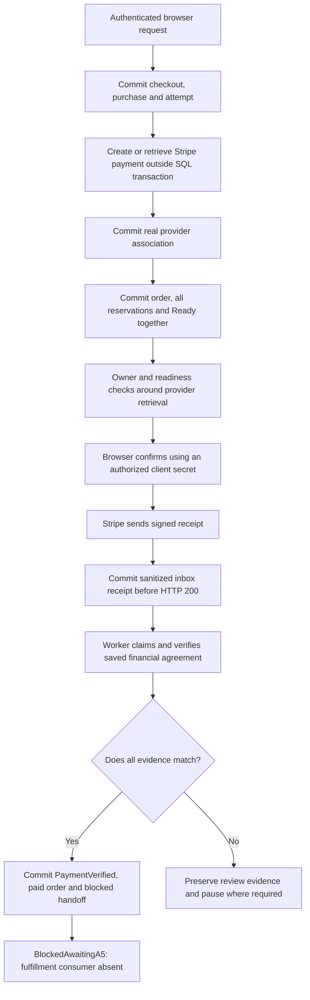
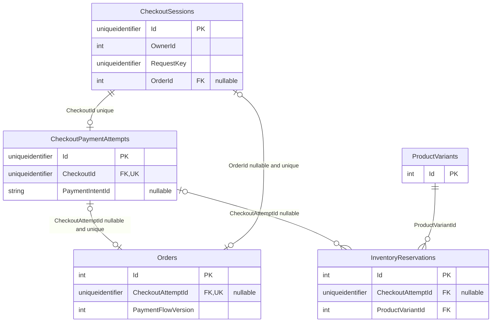
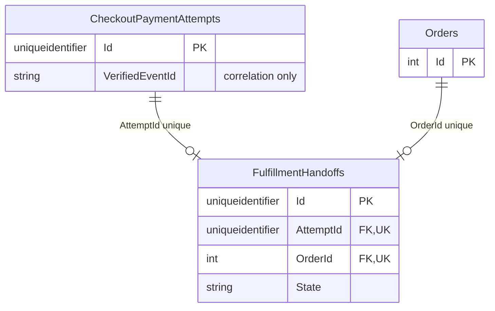
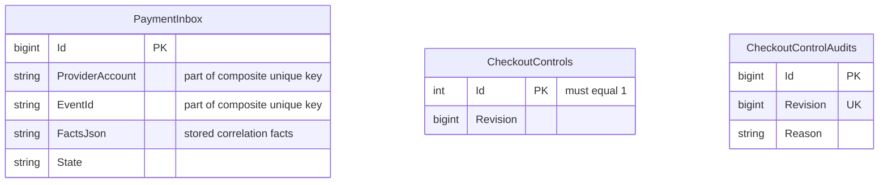
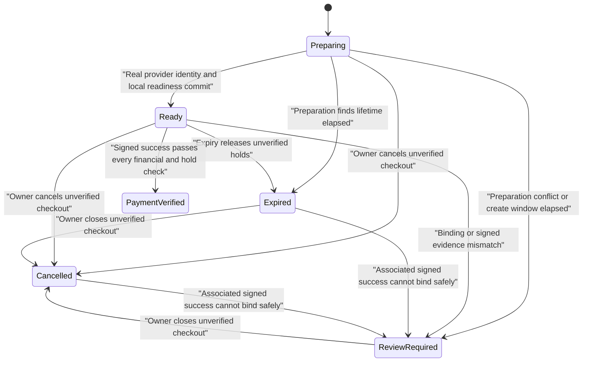
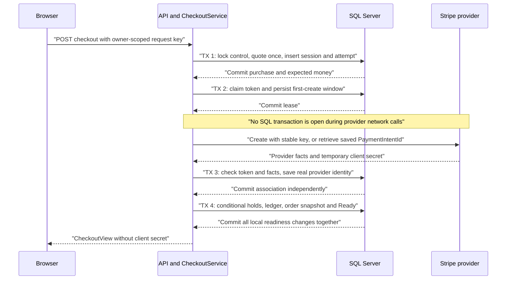
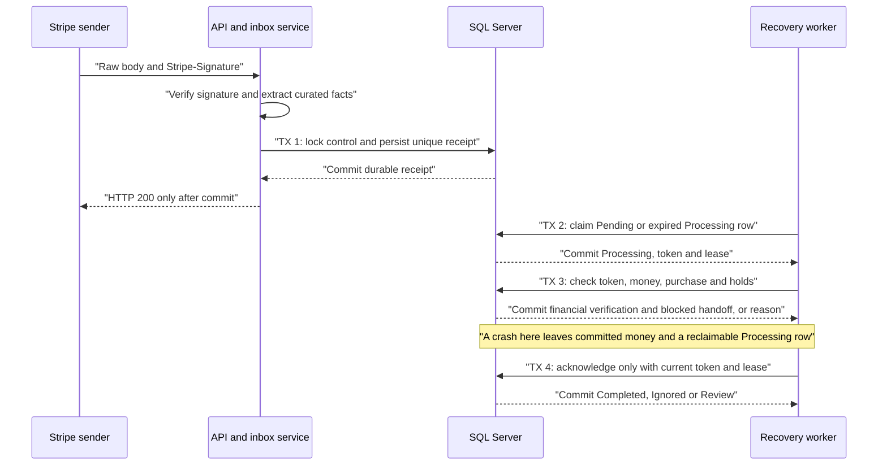

# Building a Reliable Checkout: Durable Payments, Webhooks and Recovery in LiliShop

## A customer should pay for one saved purchase

A customer selects two items at 30 EUR each and chooses shipping for 5 EUR. The agreement is simple: **60 + 5 = 65 EUR**. A reliable checkout must preserve that agreement even when the browser, payment provider or application stops responding.

The difficult part is that SQL Server and Stripe cannot share one database transaction. A transaction groups local database changes so they either all commit or all roll back. A Stripe request is a separate network operation. The provider can accept it while the application loses the response. A browser can disappear while an accepted payment continues elsewhere.

Consider these **failure scenarios**. They explain the risks; they are not claims about confirmed production incidents.

| Failure scenario | What can go wrong for the 65 EUR purchase |
| --- | --- |
| Confirmation races ahead of saving an order | Money succeeds before the application has a complete order or stock holds to associate with it. |
| Stripe accepts a request, then the connection times out | A retry with a new identity can create another payment object for the same purchase. |
| Double-clicks or concurrent requests | Two application instances can both believe they are creating the first order. Disabling a browser button alone cannot protect SQL. |
| Repeated or reordered webhook events | An old failure can arrive after success. Another success message can repeat work that already committed. |
| The process crashes between receipt, financial write and acknowledgement | An accepted message can be lost, or a completed financial change can run again after restart. |
| Amount, currency or association is wrong | A payment for 6.50 EUR, 65 USD or another order must not release this 65 EUR purchase. |

Success means that repeating one logical start request reuses its saved checkout and payment attempt. The paid money must match the saved purchase, including its currency and stock binding. Accepted messages and unfinished work must survive a process interruption. A browser's success message must never serve as the financial proof.

There is one further boundary: receiving money and delivering the purchase are different jobs. **Fulfillment** means the downstream work that turns a verified purchase into stock deduction, invoice, email and dispatch. This implementation completes the financial verification protocol and creates a durable, blocked fulfillment handoff. It does not yet contain the safe consumer that performs that downstream work. Ordinary and live checkout therefore remain closed.

## The solution from the top down

The server saves a purchase **snapshot**, a fixed record of the agreed lines, prices, address, shipping and currency. It creates separate identities for the checkout and its payment attempt before contacting Stripe. It uses **idempotency**: repeating one operation with the same identity must not produce an additional economic operation.

After the real provider identity is saved, one SQL transaction reserves every line, creates the order and marks the checkout ready. An owner-authorized endpoint checks readiness again before releasing a client secret to the browser. A **client secret** is Stripe's sensitive browser authorization for confirming one PaymentIntent; it is not an order status.

A **webhook** is a server-to-server event message. A valid signed message first enters a **durable inbox**, a SQL table that preserves accepted messages until background processing classifies them. The worker checks the money against the saved purchase, then commits financial verification and one blocked handoff together.



This overview separates provider success from SQL commits. The provider call does not run inside a SQL transaction. Neither the HTTP acknowledgement nor `PaymentVerified` says that fulfillment completed. The final blocked state is a real persisted boundary, not a hidden call to inventory or invoicing.

The examples in this article use fictional values such as `pi_example65`, `evt_example65` and order `123`. They illustrate the protocol and are not identifiers from the validation run.

### Source version and how to navigate

This guide follows backend commit [`5d463095031b0164710e8e0167a238d070993fca`](https://github.com/jahanalem/LiliShop-backend-dotnet/commit/5d463095031b0164710e8e0167a238d070993fca) and frontend baseline commit [`2f1d07ccda915567a59f0657f9d15741d2cb18e4`](https://github.com/jahanalem/LiliShop-frontend-angular/commit/2f1d07ccda915567a59f0657f9d15741d2cb18e4), both available on GitHub. It also includes the local status-route correction and Router tests reviewed on 23 October 2026. Those two frontend files are currently uncommitted, so there is no new commit permalink for them. The [routing source note](#routing-correction-source-note) identifies their exact paths and hashes. The backend and the other documented frontend implementation files remain at the linked commits; unrelated untracked frontend configuration is outside this guide.

`backend` paths start at the repository containing `Main/`. `frontend` paths start at the checkout containing `src/`; they do not have an extra `LiliShop/` prefix on GitHub. Unchanged source links below are pinned to the commits above. Current route/test references point to their local source note rather than incorrectly linking the old route as corrected code. The original full validation run and the later focused routing validation are reported separately.

- [Identity and immutable evidence](#identity-and-immutable-evidence)
- [Database relationships and checkout states](#database-relationships-and-checkout-states)
- [Preparation, provider calls and stock holds](#preparation-before-confirmation)
- [Confirmation authorization](#confirmation-is-a-controlled-release-of-authority)
- [Signed receipts and financial verification](#signed-receipts-enter-a-durable-inbox)
- [Recovery and the blocked handoff](#recovery-replays-work-without-inventing-a-new-purchase)
- [Controls and retired behavior](#controls-authorization-and-retired-behavior)
- [API reference](#api-reference)
- [Angular customer interaction](#angular-follows-the-saved-checkout)
- [Failure scenarios and test evidence](#failure-scenarios-and-test-evidence)
- [Local use and operational boundary](#local-use-and-the-current-operational-boundary)
- [Glossary](#appendix-a-glossary), [type and member reference](#appendix-b-type-and-member-reference), [database reference](#appendix-c-complete-database-reference), [coverage matrix](#appendix-d-implementation-coverage-matrix), [source index](#appendix-e-source-and-test-index)

### A first reading path

For a first pass, follow the customer and leave the reference appendices open for later:

1. Read [the customer story](#a-customer-should-pay-for-one-saved-purchase) and [overview](#the-solution-from-the-top-down). Keep three milestones separate: a receipt was accepted, money was verified, and fulfillment completed. Only the first two are implemented here.
2. Follow [identity](#identity-and-immutable-evidence), [preparation](#preparation-before-confirmation), [stock holds](#all-stock-holds-and-the-order-become-ready-together) and [confirmation](#confirmation-is-a-controlled-release-of-authority). Trace the same 60 + 5 = 65 EUR purchase. Ask what has committed before each network call and before a secret is released.
3. Read [signed receipts](#signed-receipts-enter-a-durable-inbox), [financial verification](#the-worker-verifies-money-before-recording-it) and [recovery](#recovery-replays-work-without-inventing-a-new-purchase). Use the crash examples to understand why receipt, financial commit and acknowledgement are separate.
4. Follow [Angular](#angular-follows-the-saved-checkout), the [Router regression evidence](#router-integration-evidence-for-the-status-route) and [operational boundary](#local-use-and-the-current-operational-boundary). Then use the scenario matrix to check which guarantees were tested.

On a second pass, use the glossary for terms, the type/member appendix for a method, and the database appendix for a column or constraint. The coverage matrix is a source checklist rather than a required reading order. This keeps the full reference available without making the first reading depend on every schema detail.

## Identity and immutable evidence

Five identities solve different problems. Giving them all the same role would make retries unsafe.

| Identity | Owner and purpose | Example |
| --- | --- | --- |
| Request identity | A browser-generated `CheckoutStart.RequestKey`, scoped to numeric `OwnerId`, identifies one logical start operation. | `11111111-1111-4111-8111-111111111111` |
| Checkout identity | `CheckoutSession.Id` identifies the saved purchase and lifecycle. | `22222222-2222-4222-8222-222222222222` |
| Attempt identity | `CheckoutPaymentAttempt.Id` identifies the one financial attempt allowed for this checkout in version 1. | `33333333-3333-4333-8333-333333333333` |
| Provider identity | A real Stripe `PaymentIntentId`, qualified by account and mode, identifies the provider object. | `pi_example65`, direct account `acct_example`, test mode |
| Event identity | `PaymentInbox.EventId`, scoped to provider account, identifies one accepted signed event. | `evt_example65` |

The provider operation key is a sixth useful value, derived from the attempt: `checkout-v1:<attempt-guid>:create`. It identifies the create operation at Stripe, rather than a webhook receipt or an arbitrary browser action. One checkout has at most one attempt under the actual unique constraint. This version does not support a sequence of replacement attempts under the same checkout.

### Normalize the requested purchase, then price it once

`CheckoutProtocol.Normalize` first validates the request GUID, positive delivery/product/optional variant IDs, 1–100 submitted lines and quantities of 1–1000. `BasketId` may be null but cannot exceed 100 characters. Required address strings must be nonblank; they are trimmed and limited to 200 characters each. Lines with the same product/optional-variant pair are combined, checked again against the quantity ceiling, and sorted by product and variant. The basket correlation string is trimmed too.

`StartAsync` serializes this normalized `CheckoutStart` and computes SHA-256. A hash is a fixed-size fingerprint used to detect changed data. Here it includes the request key, basket correlation, delivery choice, address and requested lines. The database stores this **`RequestHash`**, not a separate normalized-request JSON column. The browser separately stores its original sorted input so it can reconstruct a lost start request. Those are different stores and different normalization rules.

The unique SQL index on `(OwnerId, RequestKey)` chooses the existing operation. If its `RequestHash` differs, the service returns 409 `request_key_conflict`. The caller cannot replace the address, lines or delivery choice under that identity. Another owner can use the same request GUID for an independent purchase, but cannot read or confirm this checkout.

Only a new request is quoted. `QuoteAsync` reads the selected delivery row and active products, resolves exactly one active variant for each input line and requires a stock inventory row. If the variant ID is omitted, more than one active choice is ambiguous and rejected. The server checks available stock, reads `variant.Price`, builds localized variant descriptions with `VariantSnapshotBuilder`, merges lines that resolved to the same variant and sorts them by variant ID. It reads the current seller currency, trims it and lowercases it.

The resulting `PurchaseSnapshot` contains version, delivery ID/name, address, product/variant IDs, quantities, unit prices, names, picture URLs, SKU, description, attribute JSON, subtotal, shipping, total and currency. For our example, two units at 30 produce subtotal `60`, shipping `5`, total `65` and currency `eur`. An identical request replay uses this saved purchase even if the catalog later says 400, shipping becomes 99 or the seller setting changes to USD.

The snapshot is authoritative because the server constructed it from its own catalog and policy. Browser prices, Redis basket totals, basket-supplied provider IDs and a client-provided paid flag cannot establish that authority. Basket ID is correlation data; the new orchestration does not obtain financial ownership by loading an unowned Redis basket.

### Two hashes protect different comparisons

`RequestHash` answers: “Is this retry asking for the same normalized input?” `PurchaseHash = Hash(PurchaseJson)` answers: “Is this the same saved server-priced purchase?” The latter is also placed in provider metadata and recomputed during binding checks. Expected money and identity remain on the attempt as separately typed columns.

`CheckoutProtocol.Json<T>` uses `System.Text.Json` with its default options for internal evidence. Its property names therefore follow the PascalCase record members. HTTP responses use the application's camelCase serializer configuration. `Hash` returns uppercase hexadecimal SHA-256 over UTF-8 text. `Parse<T>` deserializes and rejects a null result. These are exact serialized-text comparisons, not a universal canonical-JSON standard.

A hash is not a signature, proof of provider acceptance, encryption or a defense against an administrator changing both data and hash. Immutable tracked-write guards, SQL relationships, provider signature checking and business comparisons each add a different protection. Saved JSON contains address data in readable form; hashing the JSON does not hide it.

### Minor units and current product restrictions

**Minor units** are the integer units expected by the payment API. For the supported two-decimal currencies, 65 EUR becomes `6500` cents. The service does not cast an arbitrary decimal and silently discard fractions.

```csharp
    public static long Minor(decimal total, string currency)
    {
        var minimum = currency switch { "eur" or "usd" => 50L, "gbp" => 30L, _ => throw new CheckoutProblem(422,"currency_not_supported") };
        if (!Order.IsValidMoney(total) || total > 999999.99m || total * 100 < minimum)
            throw new CheckoutProblem(422,"amount_not_supported");
        return checked((long)(total * 100));
    }
```

Source: [backend `Main/LiliShop.Infrastructure/Checkout/CheckoutProtocol.cs`, line 46](https://github.com/jahanalem/LiliShop-backend-dotnet/blob/5d463095031b0164710e8e0167a238d070993fca/Main/LiliShop.Infrastructure/Checkout/CheckoutProtocol.cs#L46).

The method requires the existing `Order.IsValidMoney` rule, a maximum of `999999.99`, and local minimums of 50 minor units for EUR/USD or 30 for GBP. It rejects unsupported currency with 422 `currency_not_supported` and invalid supported amounts with `amount_not_supported`. A positive bounded amount check also exists in SQL.

EUR/USD/GBP support, authenticated email-confirmed buyers, active stock-tracked variants and automatic card capture are **LiliShop version 1 choices**. They are not universal Stripe requirements. No exchange-rate conversion, guest checkout, manual capture or general zero-/three-decimal currency engine is implemented. Stripe's own currency rules use minor units and vary by currency; this code deliberately accepts a smaller set. [Stripe currency reference](https://docs.stripe.com/currencies).

## Database relationships and checkout states

The model adds six tables. Existing `Orders` and `InventoryReservations` gain optional attempt links. The following diagrams show real foreign keys only. They use SQL's permitted cardinalities; the application normally inserts a session and its attempt together, but a foreign key cannot require every parent to have a child.



`CheckoutPaymentAttempts.CheckoutId` is nonnull and unique: one attempt belongs to one session, and a session has at most one attempt. `Orders.CheckoutAttemptId` and `CheckoutSessions.OrderId` are independently nullable unique foreign keys. They allow an unfinished preparation and preserve legacy orders. The application must still check that the links agree; SQL does not enforce the whole cycle as one business agreement. An attempt can own many holds, with at most one per variant. A legacy hold has no attempt. The existing variant-to-reservation foreign key uses cascade deletion; all newly added checkout foreign keys use restrict deletion.



A handoff must reference one existing attempt and one existing order. Each of those can have at most one handoff. The two unique constraints prevent a second downstream instruction for the same financial purchase. `VerifiedEventId` is a stored evidence identity; it is not a foreign key to the inbox.



These tables are deliberately shown without relational arrows. Inbox facts contain attempt and checkout IDs as JSON correlation data, including unmatched/legacy evidence, rather than foreign keys. Audit revision is unique but is not a foreign key to the control row. `OwnerId` and saved buyer email on a checkout likewise have no user-table foreign key in this migration. Evidence associations must not be invented from matching-looking names.

The [complete field and constraint reference](#appendix-c-complete-database-reference) gives every persisted column, CLR/SQL type, nullability, default and lifecycle. `CheckoutConfiguration` supplies the six entity mappings; `ShopDbContext.OnModelCreating` adds order relationships, and `InventoryReservationConfiguration` maps the optional hold relationship.

### What the persisted checkout state actually means



The stored state values are strings, not a new C# enum. `Preparing` means the purchase and attempt exist; it does not promise an order. `Ready` means provider association, order and all holds committed. `PaymentVerified` means signed money was checked and a blocked handoff committed. `ReviewRequired`, `Expired` and `Cancelled` withhold confirmation. There is no automatic review-to-ready transition or operator replay endpoint.

The diagram omits same-state retries. A provider timeout can leave `Preparing` with reason `provider_outcome_uncertain`. Cancellation can close any unverified state, including review, but does not cancel/refund Stripe. Expiry changes only `Preparing`/`Ready` to `Expired`; it can release unverified holds in other states while preserving their state. A mismatch against an already verified attempt can record a review reason and pause without changing `PaymentVerified` back to an unpaid state.

`Verifying` is **response-only**. `ConfirmationAsync` can return `view with {State="Verifying"}` when Stripe retrieval says `processing` or `succeeded`, while SQL still says `Ready`. It is therefore absent from this persisted-state diagram. A status GET reads stored state and does not manufacture `Verifying` from a provider call.

## Preparation before confirmation

The call chain starts at `[Authorize] CheckoutController.Start`, which obtains the numeric owner from `ClaimTypes.NameIdentifier`. It calls `CheckoutService.StartAsync`; that method normalizes input, obtains SQL admission and either reuses an existing request or validates the database buyer and calls `QuoteAsync`. The new session and attempt commit before `PrepareAsync` does provider work.

The sequence uses a **lease**, temporary permission for one worker to prepare this checkout. A random token identifies that permission. The worker must check it again after the network call; the detailed fencing rule follows the diagram.



Each `TX` is a separate local transaction. A retry of an existing request does not repeat the quote. A provider result does not itself mark the checkout ready. If the final local transaction fails, its earlier stock updates roll back, but the separately committed real provider association remains available for retrieval and review.

### Short transactions use a common SQL lock

`BeginAsync` clears the scoped context's tracked objects, rejects non-SQL-Server storage, begins a transaction and loads control row 1 with `UPDLOCK,HOLDLOCK`. `LockedSessionAsync` then locks a requested session or throws 404. Clearing tracking avoids reusing stale entities between protocol transactions; these services are intended to own their scoped protocol context, not share unrelated unsaved edits.

```csharp
    internal async Task<(IDbContextTransaction Transaction,CheckoutControl Control)> BeginAsync(CancellationToken ct)
    {
        db.ChangeTracker.Clear();
        if(!db.Database.IsSqlServer()) throw new CheckoutProblem(503,"sql_server_required");
        var tx=await db.Database.BeginTransactionAsync(ct);
        try { return (tx,await db.CheckoutControls.FromSqlRaw("SELECT * FROM CheckoutControls WITH (UPDLOCK,HOLDLOCK) WHERE Id = 1").SingleAsync(ct)); }
        catch { await tx.DisposeAsync(); throw; }
    }
```

Source: [backend `Main/LiliShop.Infrastructure/Checkout/CheckoutService.cs`, line 22](https://github.com/jahanalem/LiliShop-backend-dotnet/blob/5d463095031b0164710e8e0167a238d070993fca/Main/LiliShop.Infrastructure/Checkout/CheckoutService.cs#L22).

The singleton lock serializes protocol state changes across application instances. Update locks are held through transaction completion; `HOLDLOCK` supplies serializable semantics for the table reference. This is a database lock, not a process-local mutex. [Microsoft SQL Server table hints](https://learn.microsoft.com/en-us/sql/t-sql/queries/hints-transact-sql-table).

This favors a simple correctness argument over parallel throughput. Every checkout, inbox claim and control change competes for the same row. The first quote also runs under that transaction and can make it longer than a simple status update. No production load or capacity claim follows from the concurrency tests. Every transition that uses this protocol follows the control-first order; unrelated legacy writers and direct SQL are not automatically covered by that lock.

### Leases and fencing protect work outside SQL

A **lease** is temporary permission to work on a row. `PrepareAsync` commits a random `LeaseToken` and `LeaseUntil = Now.AddMinutes(2)` before the network call. A **fencing token** is that exact random value checked again before publishing results. Expired permission cannot authorize a late worker just because it once owned the task.

Suppose worker A claims token `A` and stops during provider creation. Three minutes later, worker B replaces it with token `B`, reuses the same provider operation and completes readiness. When A resumes, the saved token no longer matches. A returns the current view and cannot publish another readiness transaction. Both association save and local readiness check token equality and an unexpired lease.

`PrepareAsync` first applies browser admission/ownership checks unless it is called internally with `recovery:true`. It loads the only attempt, returns current status if no preparation/unknown-identity work remains, and returns without competing when another lease is still active. It checks unknown-create deadline and checkout expiry before claiming work.

The three time policies are literal method expressions, not configuration options or named constants:

| Policy | Source expression and role | Limit |
| --- | --- | --- |
| Checkout lifetime | New `CheckoutSession.ExpiresAt = Now.AddMinutes(20)` in `StartAsync` | Local readiness/confirmation and first financial verification must occur before this expiry. It does not expire a Stripe object remotely. |
| Preparation and inbox leases | `Now.AddMinutes(2)` in `PrepareAsync` and `ClaimAsync` | Work may be reclaimed; no automatic lease renewal is implemented. A very slow legitimate worker can lose permission. |
| Unknown-create window | First call saves `FirstCreateAt=Now`, `CreateDeadline=Now.AddHours(23)` | The application stops unknown create replay at the deadline. A known provider ID is retrieved, not recreated. |

Stripe API v1 can prune idempotency keys once they are at least 24 hours old. The local 23-hour window is a conservative policy intended to stay inside that documented retention period; it is not a promise that a key is permanent or that all network failures become successful. Parameters must remain stable for a retry. [Stripe idempotent requests](https://docs.stripe.com/api/idempotent_requests).

When the provider call throws and cancellation was not requested, the service reacquires the SQL lock, clears its lease only if the token still matches, records `provider_outcome_uncertain` and returns the saved view. It cannot infer whether Stripe accepted the call. Request cancellation or a later SQL failure can leave the lease until reclaim instead. No code invents a placeholder `pi_` ID.

Unknown identity recovery may continue after checkout expiry or local cancellation if an initial create call was already recorded and the 23-hour window remains open. It recovers the same provider identity for evidence; the later readiness guard still refuses a non-`Preparing` or expired checkout. Once unknown creation is outside its deadline, a direct preparation attempt records `provider_key_window_elapsed` and `ReviewRequired` instead of creating anew. Maintenance selection has a narrower deadline filter for non-preparing rows, described below.

### The Stripe adapter has a small, explicit contract

`ICheckoutProvider` exposes only `CreateAsync(ProviderRequest, CancellationToken)` and `RetrieveAsync(string, CancellationToken)`. `StripeCheckoutProvider` receives `IOptions<CheckoutPaymentOptions>` and retains its value in `settings`. `ClientAsync` rejects live mode, a secret key without the `sk_test_` prefix and an expected account without `acct_`. It creates a scoped `StripeClient`, calls `GET /v1/account` and compares its returned ID with `ExpectedAccountId`. Each create/retrieve performs this account check. It does not mutate `StripeConfiguration.ApiKey` globally or implement Connect account routing.

`CreateAsync` additionally checks that the saved request's account/mode still match settings. It creates one PaymentIntent with the saved integer amount/currency, card method and automatic capture:

```csharp
        var intent=await new PaymentIntentService(client).CreateAsync(new PaymentIntentCreateOptions {
            Amount=request.AmountMinor,Currency=request.Currency,PaymentMethodTypes=["card"],CaptureMethod="automatic",
            Metadata=new Dictionary<string,string> { ["checkout_id"]=request.CheckoutId.ToString(),["attempt_id"]=request.AttemptId.ToString(),
                ["flow_version"]="1",["purchase_hash"]=request.PurchaseHash }
        },new RequestOptions {IdempotencyKey=request.IdempotencyKey},ct);
        return new(Map(intent,settings.ExpectedAccountId),intent.ClientSecret);
```

Source: [backend `Main/LiliShop.Infrastructure/Checkout/StripeCheckoutProvider.cs`, line 25](https://github.com/jahanalem/LiliShop-backend-dotnet/blob/5d463095031b0164710e8e0167a238d070993fca/Main/LiliShop.Infrastructure/Checkout/StripeCheckoutProvider.cs#L25).

The metadata binds `checkout_id`, `attempt_id`, `flow_version="1"` and `purchase_hash`. `RequestOptions.IdempotencyKey` supplies the saved operation key. The adapter does not update the amount or reprice an existing intent. `RetrieveAsync` gets a known ID. Both methods return a `ProviderPayment` containing curated `ProviderFacts` plus a transient client secret. Preparation discards that secret from its HTTP response; confirmation must retrieve it again through its own checks.

`Map` copies ID, status, amount, received amount, currency, mode, supplied account and the four metadata strings. Missing metadata becomes `""`. The account is established by the checked direct-account client or signed endpoint context, rather than a fictitious account property on PaymentIntent. Mapped facts do not include billing/card/customer objects.

## All stock holds and the order become ready together

The quote's stock read is only an early rejection. Another buyer can reserve stock before readiness. A **conditional update** changes a database row only while a predicate is still true; the returned affected-row count tells the service whether the reservation actually succeeded.

```csharp
                foreach(var line in p.Lines.OrderBy(x => x.VariantId))
                {
                    var affected=await db.InventoryItems.Where(x => x.ProductVariantId == line.VariantId && x.QuantityOnHand-x.QuantityReserved >= line.Quantity)
                        .ExecuteUpdateAsync(x => x.SetProperty(y => y.QuantityReserved,y => y.QuantityReserved+line.Quantity),ct);
                    if(affected != 1) throw new CheckoutProblem(409,"reservation_failed");
                    db.InventoryReservations.Add(new InventoryReservation {CheckoutAttemptId=a.Id,ProductVariantId=line.VariantId,
                        Quantity=line.Quantity,PaymentIntentId=a.PaymentIntentId!,ExpiresAt=s.ExpiresAt,Status=InventoryReservationStatus.Active});
                    db.InventoryTransactions.Add(new InventoryTransaction {ProductVariantId=line.VariantId,Delta=line.Quantity,
                        Type=InventoryTransactionType.Reserve,Reason="A4 checkout hold",PerformedBy="checkout"});
                }
```

Source: [backend `Main/LiliShop.Infrastructure/Checkout/CheckoutService.cs`, line 166](https://github.com/jahanalem/LiliShop-backend-dotnet/blob/5d463095031b0164710e8e0167a238d070993fca/Main/LiliShop.Infrastructure/Checkout/CheckoutService.cs#L166).

The readiness transaction processes saved lines in ascending variant ID order. For each line it increments `QuantityReserved` only if `QuantityOnHand - QuantityReserved >= line.Quantity`. Anything other than one affected row raises `reservation_failed`. It adds an `InventoryReservation` bound to the attempt, variant, real provider ID, quantity and the exact checkout expiry. It adds a `Reserve` inventory ledger entry too. A ledger is a saved history of stock movements; this entry records reservation, not sale.

After all lines, the service loads the delivery identity, constructs existing `OrderItem`/`ProductItemOrdered` snapshots from the purchase, copies SKU/variant description/attribute JSON, and creates an `Order` with `PaymentFlowVersion=1` and `CheckoutAttemptId`. `Order.CaptureMoneySnapshot(p.Shipping,p.Currency)` saves the agreed shipping and total using the existing money-snapshot domain rules. The first save obtains the order ID. The next save links `session.OrderId`, sets `Ready` and clears the preparation reason. **Both saves and every conditional counter update belong to the same transaction.**

If a later line cannot reserve, disposing the failed transaction rolls back earlier counter increments, holds, ledger rows and order writes. A new transaction records `ReviewRequired`/`reservation_failed` for the still-owning worker and clears its lease. That branch does not call `Pause`; it is a local stock failure, rather than the shared financial-mismatch review helper. Other persistence exceptions propagate as temporary API failure; the persisted provider ID and original lease support later retrieval/reclaim.

Multiple `ExecuteUpdateAsync` calls do not form an all-or-nothing group by themselves. LiliShop supplies the enclosing transaction and checks affected rows explicitly. Those updates bypass EF's tracked-object save guards, which is another reason to separate conditional inventory SQL from tracked evidence mutation. [Microsoft EF update and transaction behavior](https://learn.microsoft.com/en-us/ef/core/saving/execute-insert-update-delete).

Reservation is not final deduction. In the 65 EUR example, two units remain on hand and two become reserved. No `Deduct` ledger entry, invoice or shipping action is produced by preparation or financial verification.

## Confirmation is a controlled release of authority

`CheckoutController.Confirmation` calls `ConfirmationAsync(owner,id)`. In its first SQL transaction, the method runs `Admit`, locks the session, checks ownership, loads the attempt and requires `Ready`, unexpired lifetime and `BoundAsync=true`. It copies the real PaymentIntent ID and commits before calling `provider.RetrieveAsync`.

After retrieval, a new transaction repeats admission and ownership checks. It compares provider facts, then repeats readiness, expiry and complete local binding checks. This second admission check is essential: an administrator can pause while the network request is in flight. A pause in that interval must withhold the secret.

`Matches` is the common financial identity comparison:

```csharp
    internal static bool Matches(CheckoutSession s,CheckoutPaymentAttempt a,ProviderFacts f,bool captured) =>
        (a.PaymentIntentId is null || a.PaymentIntentId==f.PaymentIntentId) && f.Amount==a.AmountMinor
        && f.Currency==a.Currency && f.Account==a.ProviderAccount && f.LiveMode==a.LiveMode
        && f.CheckoutId==s.Id.ToString() && f.AttemptId==a.Id.ToString() && f.Version=="1" && f.PurchaseHash==s.PurchaseHash
        && (!captured || f.Status=="succeeded" && f.AmountReceived==a.AmountMinor);
```

Source: [backend `Main/LiliShop.Infrastructure/Checkout/CheckoutService.cs`, line 228](https://github.com/jahanalem/LiliShop-backend-dotnet/blob/5d463095031b0164710e8e0167a238d070993fca/Main/LiliShop.Infrastructure/Checkout/CheckoutService.cs#L228).

For preparation, a null local provider ID is permitted because the first real association has not been saved yet; preparation separately requires a `pi_` prefix. For confirmation and receipt application, other guards require that an actual ID already exists. `captured=false` checks expected amount and identity but not successful capture; `captured=true` additionally requires `succeeded` and exact `AmountReceived`.

`BoundAsync` checks the local purchase in depth:

1. Session flow version is 1, recomputed purchase hash matches, and order/provider IDs exist.
2. The loaded order is `Pending`, version 1, linked to this attempt/provider, and uses the saved delivery ID and buyer email.
3. The existing order money snapshot is complete. Subtotal/shipping/total/currency match the purchase; the purchase has version 1 and converts to the attempt's exact expected minor units/currency.
4. Serialized shipping address equals the saved address, and order item count matches saved line count.
5. Each line matches product ID/name/image, variant ID, quantity, unit price, SKU, description and attributes. Its stock counter has at least the required reserved quantity, and on-hand quantity covers total reservations.
6. The attempt has exactly the saved number of holds. Every saved variant has an active hold with matching quantity/provider ID, the exact checkout expiry and an expiry later than `Now`.

The check compares delivery identity, not today's tariff or a mutable delivery label. It compares saved product data, not current catalog prices. It does not prove every global stock ledger fact; it checks the local bindings and backing counters the protocol currently uses.

If provider facts conflict, `Review` records `provider_confirmation_mismatch`, pauses starts and returns a view with no secret. If binding/lifetime/readiness fails, confirmation returns 409 `checkout_not_ready`. If Stripe says `processing` or `succeeded`, the result contains response state `Verifying` and no secret. Otherwise the status must be `requires_payment_method`, `requires_confirmation` or `requires_action`, and the secret must be nonblank; failure is 409 `provider_not_confirmable`.

The second transaction is disposed when returning the read-only confirmation result; it need not commit a new financial fact. No client secret is persisted in SQL, the basket, browser identity storage or a navigation URL by these paths. A secret already handed to a browser can still be used after local pause, cancellation or expiry. Those controls prevent another release; they cannot retract existing provider authority.

## Signed receipts enter a durable inbox

`POST /api/payments/webhook` accepts at most 1,048,576 bytes under the controller's request-size limit. It reads the raw body and passes it with `Stripe-Signature` to `CheckoutInboxService.ReceiveAsync`. This route uses provider signature authentication, not customer JWT authorization.

The service requires configured `WebhookSecret` and `ExpectedAccountId`, otherwise it raises 503 `webhook_context_not_configured`. It calls Stripe.net `EventUtility.ConstructEvent(raw,signature,secret,throwOnApiVersionMismatch:false)`. `StripeException` becomes 400 `invalid_signature`; a JSON parse exception becomes 400 `invalid_payload`. Event ID must be present and at most 100 characters; account, event type and API version have corresponding size checks.

Signature verification must use the unmodified raw request. Stripe also warns that event delivery can repeat and arrive out of order. LiliShop's inbox and non-regressing financial checks address those conditions locally. [Stripe webhook guidance](https://docs.stripe.com/webhooks).



The sender's HTTP acknowledgement is distinct from worker acknowledgement. The former promises only that SQL accepted the receipt; the latter classifies completed local processing. A worker may run much later. No immediate job enqueue is required for receipt durability.

### What is retained and how repeated receipts behave

For a direct-account event with no `receipt.Account`, the configured expected account supplies context. A different explicit account or event mode produces `provider_context_mismatch`; an API version different from `StripeConfiguration.ApiVersion` produces `unsupported_api_version`. API mismatch is deliberately classified after signature validation instead of being rejected by SDK deserialization. These receipts are saved as `Review`, and starts are paused with an audit row.

For a PaymentIntent object, `StripeCheckoutProvider.Map` extracts the curated facts. Other object types save JSON `null`. The inbox stores event identity/type/API version/mode, local receive time, a hash of the original raw body and the serialized curated facts. It saves no raw payload, client secret, billing object, card details or customer object. The raw hash lets the application compare repeated identity without retaining those fields.

Inside the shared SQL lock, `ReceiveAsync` looks up `(ProviderAccount,EventId)`. A new ordinary receipt is `Pending`. An identical raw hash is an accepted no-op, including when already completed. A different raw hash under the same account/event ID changes the existing receipt to `Review`, records `event_identity_payload_conflict` and pauses. It preserves the original facts/hash rather than overwriting the evidence. Whitespace changes also change a raw-text hash; this is deliberately not a semantic JSON comparison.

Only a successful commit permits HTTP 200. `CheckoutProblem` becomes a Problem Details response with its status and code as title. Other non-cancellation exceptions become 503 `webhook_not_persisted`. A storage failure therefore asks the provider to retry instead of falsely acknowledging work. Accepted `Review` receipts still return 200 because they are durably retained; this does not promise that an order was fulfilled or even financially verified.

## The worker verifies money before recording it

`ClaimAsync` begins a control-row transaction and selects the oldest ID whose state is `Pending`, or `Processing` with an expired lease. It gives the row a new token, a two-minute lease, state `Processing` and an incremented `DeliveryAttempts`, then commits. The global SQL lock makes competing claims serial rather than relying on an in-memory queue.

```csharp
        var (tx,_)=await checkout.BeginAsync(ct); await using(tx)
        {
            var row=await db.PaymentInbox.Where(x=>x.State=="Pending" || x.State=="Processing" && x.LeaseUntil<=Now)
                .OrderBy(x=>x.Id).FirstOrDefaultAsync(ct);
            if(row is null) return null;
            var token=Guid.NewGuid(); row.State="Processing"; row.LeaseToken=token; row.LeaseUntil=Now.AddMinutes(2); row.DeliveryAttempts++;
            await db.SaveChangesAsync(ct); await tx.CommitAsync(ct); return (row.Id,token);
        }
```

Source: [backend `Main/LiliShop.Infrastructure/Checkout/CheckoutInboxService.cs`, line 53](https://github.com/jahanalem/LiliShop-backend-dotnet/blob/5d463095031b0164710e8e0167a238d070993fca/Main/LiliShop.Infrastructure/Checkout/CheckoutInboxService.cs#L53).

`ApplyAsync(id,token)` starts a new transaction. It returns without work unless state, token and lease still match. Only `payment_intent.succeeded` and `payment_intent.payment_failed` are financial event types in this implementation. Another type records `ignored_event_type`; acknowledgement later turns it into `Ignored`.

Missing facts record `missing_payment_facts` and pause. Otherwise the worker parses the attempt GUID from metadata and searches that local attempt. An absent attempt records `unmatched_or_legacy_payment`; it is retained for review without inventing an association or changing an old order. That unmatched branch does not itself pause all starts.

For a found attempt, the worker locks its session and checks the real saved provider ID, `Matches`, inbox account and mode. Expected amount (`Amount`) must be 6500 for our purchase; successful captured amount (`AmountReceived`) must independently be 6500. Checking only the requested amount would accept an incomplete capture. Currency, direct account, live/test mode, both local GUIDs, flow version and purchase hash must all agree. A failure records `financial_facts_mismatch` and invokes `Review`/`Pause`.

If the attempt was already verified, a matching stale failure cannot revert paid state or release holds. Another success must have the same curated facts hash and an existing handoff for the same attempt/order. Otherwise it records `verified_evidence_conflict` and pauses while preserving verified state. Event ID is outside `ProviderFacts`, so distinct event IDs with identical successful financial facts can acknowledge without making another handoff.

A matching failure before verification is only a decline observation. It neither marks the order paid nor changes it to `PaymentFailed`, and it does not release the hold. The customer may retry the same attempt while it remains valid. This avoids using delivery order as financial ordering.

For a first success, the session must be `Ready`, its lifetime still valid, and `BoundAsync` true. A late capture after cancellation, expiry, missing snapshot or lost holds records `purchase_or_reservation_not_ready` and requires review. The payment evidence is retained even though safe local release is impossible. This is **reconciliation**: comparing provider observations with local records and deciding how discrepancies must be handled. It is not an automatic refund or a scan for unknown remote Stripe objects.

After the checks, the order is loaded and required to remain pending. The financial changes are small but atomic:

```csharp
                            a.VerifiedAt=Now; a.VerifiedEventId=inbox.EventId; a.VerifiedFactsHash=factsHash;
                            s.State="PaymentVerified"; s.ReviewReason=null; order.Status=OrderStatus.PaymentReceived;
                            db.FulfillmentHandoffs.Add(new FulfillmentHandoff {Id=Guid.NewGuid(),AttemptId=a.Id,OrderId=order.Id,CreatedAt=Now});
```

Source: [backend `Main/LiliShop.Infrastructure/Checkout/CheckoutInboxService.cs`, line 101](https://github.com/jahanalem/LiliShop-backend-dotnet/blob/5d463095031b0164710e8e0167a238d070993fca/Main/LiliShop.Infrastructure/Checkout/CheckoutInboxService.cs#L101).

The enclosing `SaveChangesAsync`/transaction commit persist `VerifiedAt`, `VerifiedEventId`, `VerifiedFactsHash`, `PaymentVerified`, cleared review reason, `OrderStatus.PaymentReceived` and the unique blocked handoff together. There is no network operation, inventory deduction, invoice, email or dispatch in that transaction. `unexpected_order_state` is a defensive review branch; the earlier binding check already rejects a nonpending order under this protocol's shared lock.

### Acknowledgement can safely occur after the financial commit

```csharp
        var (tx,_)=await checkout.BeginAsync(ct); await using(tx)
        {
            var row=await db.PaymentInbox.SingleAsync(x=>x.Id==id,ct);
            if(row.State!="Processing" || row.LeaseToken!=token || row.LeaseUntil<=Now) return;
            row.State=row.Reason is null ? "Completed" : row.Reason=="ignored_event_type" ? "Ignored" : "Review";
            row.CompletedAt=Now; row.LeaseToken=null; row.LeaseUntil=null; await db.SaveChangesAsync(ct); await tx.CommitAsync(ct);
        }
```

Source: [backend `Main/LiliShop.Infrastructure/Checkout/CheckoutInboxService.cs`, line 114](https://github.com/jahanalem/LiliShop-backend-dotnet/blob/5d463095031b0164710e8e0167a238d070993fca/Main/LiliShop.Infrastructure/Checkout/CheckoutInboxService.cs#L114).

`AcknowledgeAsync` checks the same state/token/unexpired lease. It sets `Completed` for no reason, `Ignored` for `ignored_event_type`, or `Review` for another reason; records `CompletedAt`; and clears the lease. `ProcessOneAsync` composes claim, apply and acknowledgement, returning false only when no claim was available.

If the process stops after receipt commit, polling later finds `Pending`. If it stops after claim, another worker can reclaim the expired lease. If it stops after financial commit but before acknowledgement, a reclaim sees already verified facts and the existing handoff, avoids a second financial effect and acknowledges. A stale token cannot acknowledge the new worker's row. This provides repeated processing with guarded effects; it is not a claim that the network delivered exactly once.

## Recovery replays work without inventing a new purchase

`CheckoutMaintenance` receives `ShopDbContext`, `CheckoutService`, `CheckoutInboxService` and `TimeProvider`. `RunAsync` performs three bounded phases:

1. Process up to 100 inbox claims. Each claim/application/acknowledgement has its own transaction.
2. Select up to 100 expired, unverified sessions that still have active attempt-bound holds, then call `ExpireAsync` for each.
3. Select up to 50 unverified attempts with no live preparation lease. They qualify when their session is `Preparing`, or when provider identity is unknown but a first call exists and the create deadline is still in the future. Call `PrepareAsync(0,id,recovery:true)` for each.

The final selection orders by first-create time. Recovery bypasses browser `Admit` and owner checks, so pause does not strand accepted work. It still uses the persisted expected money/account/mode/key, token checks and provider adapter restrictions. A live or misconfigured provider remains blocked by the adapter. The internal `recovery` flag is not an HTTP request field.

`ExpireAsync` locks the session/attempt and, when expiry has passed and the attempt has no `VerifiedAt`, calls `ReleaseAsync`. Active holds are ordered by variant; each decrements reserved quantity only if the counter can cover that hold. A mismatched counter raises 409 `reservation_counter_mismatch` and rolls the transaction back. Released holds change to `Released`, with a negative `ReleaseReservation` ledger entry. Repeated expiry/cancellation sees no active hold to release again. This path does not mark them with the legacy `Expired` enum value.

`CancelAsync` is owner-authorized but is available during pause. Any session other than `PaymentVerified` can release its unverified holds, become `Cancelled` and clear its preparation lease. `ReleaseAsync` independently refuses verified attempts. `ExpireAsync` and cancellation therefore preserve verified money and reserved units, even after the original 20 minutes. They make no Stripe cancellation/refund call and do not change the pending order to a cancellation status.

The recurring Hangfire registration is `durable-checkout-recovery`, `service => service.RunAsync()`, cron `* * * * *`. `Program.cs` configures SQL Server Hangfire storage on `DefaultConnection` and calls `AddHangfireServer`. Receipt intake does not enqueue a job at all: the minute poll is the recovery mechanism. The existing Hangfire queue poll interval is 15 seconds, which is not the inbox lease duration or a guarantee of end-to-end completion latency.

### Automatic recovery has explicit limits

Inbox `Review` and `Ignored` are not claimable. A repeated identical event cannot replay a review row. A session already in `ReviewRequired` is not automatically returned to ready; unknown provider identity may still be recovered inside the safe create window, without reviving the purchase. A non-preparing unknown attempt outside that window does not match maintenance's second selection clause. There is no operator replay, refund operation or completed review dashboard.

Unexpected exceptions are not caught per row by `RunAsync`. They abort that invocation and leave a processing lease for later reclaim. There is no inbox-specific exponential backoff, poison-message maximum, dead-letter queue or automatic lease renewal. A repeatedly failing early row can delay later work after reclaim; the bounded batch is not a fairness or capacity guarantee. Hangfire provides the recurring execution infrastructure, while operational monitoring must detect the durable backlog and failures.

### The handoff is a contract with no consumer yet

`FulfillmentHandoff.Kind` is `FulfillVerifiedPaymentV1`; state is exactly `BlockedAwaitingA5`. That name means “verified payment is waiting for a safe fulfillment implementation.” It does not require the reader to know a project roadmap. The row stores its own GUID, unique attempt/order links and creation time. Tracked modifications/deletion are rejected. There are no processing lease, completion time or consumer methods on this type in the current source.

A future safe consumer must coordinate claim/reclaim/completion, per-line inventory idempotency, recovery after partial inventory work, invoice/email retries and operational resolution. Those are requirements for later work, not features supplied by this guide's source version. Verified holds remain reserved until that boundary is resolved; leaving ordinary sales open would accumulate paid but unfulfilled work.

Existing consumers explicitly avoid this work. `InventoryService.DeductForOrderAsync` rejects flow version 1; legacy hold lookup/release/expiry/active-quantity methods filter `CheckoutAttemptId == null`. `InvoiceService.CreateInvoiceForOrderAsync` can return an already existing invoice, then rejects creation for version 1. Its missing-invoice sweep selects only version 0. Thus old invoice recovery cannot bypass the blocked handoff. Existing invoice reading/PDF behavior remains independently available.

## Controls, authorization and retired behavior

`CheckoutControls` has exactly one permitted key, `Id=1`. Its seeded state is `NewFlowEnabled=false`, `StartsPaused=true`, revision 0, actor `migration` and timestamp `2026-10-23T00:00:00+00:00`. This is SQL seed data, not a process cache or a configuration-only flag.

`Admit` first rejects a disabled flow or paused starts with 503 `checkout_paused`. Even if both rollout flags admit, it requires all of the following: `AllowIsolatedTestConfirmation=true`, `LiveMode=false`, database name starting exactly `LiliShop_A4_`, and `ExpectedAccountId` starting `acct_`. Failure is 503 `fulfillment_release_not_ready`. The adapter independently requires an `sk_test_` key and a matching actual account. Flipping one control cannot make ordinary/live payment ready.

Browser start, resume and both confirmation transactions call admission. Status, cancellation, receipt intake, expiry, verification and internal recovery do not. A pause therefore stops new browser preparation/secret release while preserving the ability to learn what already happened. It cannot revoke a secret already issued.

`CheckoutController` is authenticated and uses `ResponseCache(NoStore=true,Location=None)`. Ordinary checkout operations derive owner from a positive numeric identity claim; a missing/unusable claim produces 401 `authentication_required`. Owner lookup hides other checkouts behind 404. New start creation requires a database user with confirmed email and nonblank email; replay does not re-quote or repeat that new-buyer validation.

Control GET/PUT and audit GET add `[Authorize(Roles="SuperAdmin")]`. `UpdateControlAsync` requires a nonblank reason no longer than 250 trimmed characters, compares the supplied revision under the shared lock, writes the new flags, increments revision and appends an audit record. A stale revision returns 409 `control_revision_conflict`. Revision is an application compare-under-lock mechanism, not a SQL `rowversion` column or EF concurrency annotation.

`Pause` is the verifier's automated control update: `StartsPaused=true`, incremented revision, actor `payment-verifier`, current time and a new audit row. `Review` changes any nonverified session to `ReviewRequired`, sets its reason and calls `Pause`. Verified state remains verified. Not every review reason uses this helper: stock reservation failure and create-window expiry are local session review branches; unmatched legacy events remain inbox review without pausing.

The audit endpoint returns local SQL counts and small samples, not a provider dashboard. It includes legacy pending/paid/unresolved/duplicate/missing associations, legacy active holds, accepted/uncertain preparation counts, pending/reclaimed inbox, review groups, verified attempts, handoffs and recent control changes. `blockedHandoffs` currently counts all handoff rows because every implemented handoff is blocked. `uncertainPreparations` counts current reasons rather than all historical technical failures. The API does not discover remote provider objects missing from SQL, and there is no Angular control screen accompanying these endpoints.

### Old routes no longer start purchases

Authenticated `POST /api/orders` and `POST /api/payments/{basketId}` return 409 `legacy_checkout_retired` and do not call the old creation services. This remains true while new checkout is disabled. Clients built around “prepare basket intent, then create an order” must update; there is no fallback to that old path.

`PaymentService.UpdateOrderPaymentSucceededAsync` and `UpdateOrderPaymentFailedAsync` now return a failed `OperationResult<Order>` with `InvalidData`, without saving status, deducting stock or issuing an invoice. A provider ID by itself is insufficient authority. `HandleStripeWebhookAsync` also fails closed with an instruction to use the durable inbox. The old private status mutation and post-status diagnostic amount checker were removed. The constructor retains compatibility parameters for HTTP context/invoice service but no longer stores those dependencies or the old webhook secret.

The legacy internal `CreateOrUpdatePaymentIntentAsync` and its price/reservation helpers still exist, including their separate legacy settings. They are not the new orchestration and are unreachable through the retired start routes. Documentation of route retirement must not claim those helpers were deleted or made safe for a new release.

`BasketController.GetBasketById` sets `ClientSecret` and `PaymentIntentId` to null before returning. `UpdateBasket` clears both on the mapped input before persistence. This removes basket-carried payment authority from public read/update behavior; it does not add authenticated basket ownership or guarantee that every old Redis record was scrubbed by migration. Basket deletion behavior is unchanged.

### Where immutability is enforced

`ShopDbContext.SaveChanges` and its cancellation-token async override now call `ValidateCheckoutSnapshots` before existing order-money validation and timestamp work. Session identity/purchase/time fields and attempt expected identity/money fields cannot change through these tracked save paths. Existing nonnull provider ID, create-window fields and verified evidence cannot be replaced or cleared. Inbox receipt facts/identity are immutable; state/reason/lease are processing fields. Audit/handoff modifications and evidence deletion are rejected.

`ValidateOrderMoneySnapshots` also prevents changing `Order.PaymentFlowVersion` or `CheckoutAttemptId`, in addition to existing saved-money guards. These are application-level tracked-write protections, not SQL triggers or a complete authorization boundary against direct SQL, bulk updates, every base EF overload or unrelated writers. SQL separately enforces keys, foreign keys, lengths and three new check constraints. `BoundAsync` supplies the deeper business consistency checks when money is used.

## API reference

The base route comes from `BaseApiController`'s `api/[controller]`. The following paths use the usual lowercase form; ASP.NET route matching is case-insensitive. Checkout requests/responses use camelCase JSON. String state values are returned as stored or explicitly derived, rather than converted from a new state enum.

| Verb and path | Authentication and authority | Body/result and service method | Important outcomes |
| --- | --- | --- | --- |
| `POST /api/checkout` | Authenticated numeric owner; a new session requires confirmed database email. | `CheckoutStart` → `CheckoutView`; `StartAsync` then `PrepareAsync`. | 200 can mean `Preparing`, `Ready`, review or another current state. 409 key/stock conflict; 422 invalid purchase; 403 unverified buyer; 503 admission/temporary failure. |
| `GET /api/checkout/{id:guid}` | Authenticated owner. | No body → `CheckoutView`; `StatusAsync`. | 200 saved state/money; 404 missing/other-owner session. Available during pause; no provider call. |
| `POST /api/checkout/{id:guid}/resume` | Authenticated owner; browser admission applies. | Empty body → `CheckoutView`; `PrepareAsync`. | Reuse/reclaim same attempt; active lease can return `Preparing`. 404 ownership; 503 pause; terminal state remains terminal except evidence recovery/review rules already described. |
| `POST /api/checkout/{id:guid}/confirmation` | Authenticated owner; admission checked before and after retrieval. | Empty body → `ConfirmationView`; `ConfirmationAsync`. | 200 view with secret only when authorized/confirmable; 200 no secret for `Verifying` or mismatch review; 409 not ready/not confirmable; 503 pause/provider/temporary errors. |
| `POST /api/checkout/{id:guid}/cancel` | Authenticated owner. | Empty body → `CheckoutView`; `CancelAsync`. | 200 local cancellation or unchanged verified state; 404 ownership; 409 counter mismatch. No remote cancellation/refund. |
| `GET /api/checkout/control` | Authenticated `SuperAdmin`. | No body → `CheckoutControl` row; controller SQL query. | 200 current flags/revision/actor/time; 401 anonymous, 403 wrong role, 503 SQL failure. |
| `PUT /api/checkout/control` | Authenticated `SuperAdmin` with numeric actor. | `ControlUpdate` → updated `CheckoutControl`; `UpdateControlAsync`. | 200 audited change; 409 stale revision; 422 reason invalid. This API does not override the hard release gate. |
| `GET /api/checkout/audit` | Authenticated `SuperAdmin`. | No body → aggregate object described below; controller SQL queries. | 200 local evidence; 401/403 role boundary; 503 unavailable. Queries are not wrapped in one snapshot transaction, so counters can reflect nearby moments. |
| `POST /api/payments/webhook` | Valid Stripe signature and configured endpoint context; no customer JWT required. | Raw signed event → empty 200 after durable receipt; `ReceiveAsync`. | 400 invalid signature/payload/identity; 503 missing context or storage failure; body limit can produce 413 at the host. Review receipts still acknowledge after commit. |
| `POST /api/orders` | Existing controller authentication. | Old `OrderDto` accepted only far enough to reject the route. | 409 `legacy_checkout_retired`; no creation call. Existing order/delivery/invoice GET routes remain. |
| `POST /api/payments/{basketId}` | Authenticated. | Old route retired; no secret returned. | 409 `legacy_checkout_retired`; no legacy provider-preparation call. |

Framework authentication, malformed JSON, route constraints and model validation can reject a request before these service methods run. The checkout controller's own `Run` wrapper returns `{ "code": "..." }` for `CheckoutProblem`, and `{ "code": "checkout_temporarily_unavailable" }` with 503 for other non-aborted exceptions. Webhook failures use ASP.NET Problem Details instead. Clients must not assume the two error shapes are identical.

### Request and response fields

`CheckoutStart` has `requestKey`, nullable `basketId`, `deliveryMethodId`, `shipToAddress` and `lines`. The address has `firstName`, `lastName`, `street`, `city`, `state`, `zipCode`. Each line has `productId`, nullable/omittable `productVariantId`, and `quantity`. There is no trusted client price, total, currency, provider ID or paid flag in this contract.

`CheckoutView` has `id`, `attemptId`, `state`, nullable `orderId`, `expiresAt`, `subtotal`, `shipping`, `total`, `currency`, nullable `reviewReason`. It exposes saved money and lifecycle, not card details or provider identity. `ConfirmationView` has `checkout` containing that complete view and nullable `clientSecret`.

`ControlUpdate` has expected `revision`, requested `newFlowEnabled`, `startsPaused` and `reason`. `CheckoutControl` returns `id`, both flags, new `revision`, `changedBy`, `changedAt`. Audits contain `id`, `revision`, both flags, `actor`, `reason`, `changedAt`. No administrative endpoint changes expected purchase money or force-verifies a payment.

The audit object's exact fields are:

| Fields | Meaning and shape |
| --- | --- |
| `scope` | Warning string identifying local SQL evidence only. |
| `legacyOrders`, `legacyPending`, `legacyPaid` | Version-0 order counts, with pending/paid status subsets. |
| `unresolvedMoney` | Count of all orders whose money snapshot state is `Unresolved`, not only legacy orders. |
| `legacyUnassociated`, `legacyDuplicateProviderGroups` | Legacy orders lacking a provider ID; number of nonempty provider-ID groups with more than one legacy order. |
| `legacyActiveReservations` | Active holds with null attempt link. |
| `legacySample` | First 100 legacy orders by ID: `id`, `status`, `moneySnapshotState`, `hasProviderAssociation`. |
| `acceptedPreparations`, `uncertainPreparations` | All session count; sessions currently carrying `provider_outcome_uncertain`. |
| `reclaimedInbox`, `pendingInbox`, `oldestPendingReceipt` | Receipts with `DeliveryAttempts>1`; pending/processing count; nullable earliest local receive time among them. |
| `reviewReasons` | Inbox review groups with `reason` and `count`. |
| `verifiedPayments`, `blockedHandoffs`, `oldestBlockedHandoff` | Verified-attempt count; all handoff count; nullable earliest handoff creation time. |
| `recentReviews` | Up to 50 sessions with nonnull reason, newest creation first: `id`, `state`, `reviewReason`, `orderId`. Includes uncertainty and post-verification reasons. |
| `controls` | Last 50 `CheckoutControlAudit` rows, newest ID first. |

### Small, fictional examples

This start asks the server to price two units, not to accept a browser total:

```json
{
  "requestKey": "11111111-1111-4111-8111-111111111111",
  "basketId": "basket-example",
  "deliveryMethodId": 4,
  "shipToAddress": {
    "firstName": "Example",
    "lastName": "Buyer",
    "street": "Example Street 1",
    "city": "Example City",
    "state": "Example State",
    "zipCode": "00000"
  },
  "lines": [
    { "productId": 10, "productVariantId": 20, "quantity": 2 }
  ]
}
```

If those synthetic catalog rows cost 30 EUR per unit and shipping costs 5, a ready result has this shape:

```json
{
  "id": "22222222-2222-4222-8222-222222222222",
  "attemptId": "33333333-3333-4333-8333-333333333333",
  "state": "Ready",
  "orderId": 123,
  "expiresAt": "2026-10-23T10:20:00+00:00",
  "subtotal": 60,
  "shipping": 5,
  "total": 65,
  "currency": "eur",
  "reviewReason": null
}
```

The IDs, address and time are fictional. An uncertain provider call could instead return `state="Preparing"`, `orderId=null` and `reviewReason="provider_outcome_uncertain"`, with the same saved money. An HTTP 200 is not a “charge now” instruction: the client branches on state.

Confirmation after provider retrieval may say to wait without returning a secret:

```json
{
  "checkout": {
    "id": "22222222-2222-4222-8222-222222222222",
    "attemptId": "33333333-3333-4333-8333-333333333333",
    "state": "Verifying",
    "orderId": 123,
    "expiresAt": "2026-10-23T10:20:00+00:00",
    "subtotal": 60,
    "shipping": 5,
    "total": 65,
    "currency": "eur",
    "reviewReason": null
  },
  "clientSecret": null
}
```

When confirmation is authorized, `clientSecret` is a transient sensitive string. It is intentionally not printed in an example here. A status GET after signed verification returns `state="PaymentVerified"`; Stripe's browser callback alone does not produce it.

The following control request is a pause, not activation. Its revision must first be read from SQL through the API:

```json
{
  "revision": 7,
  "newFlowEnabled": false,
  "startsPaused": true,
  "reason": "Keep checkout closed while release prerequisites are reviewed"
}
```

### Error-code reference

| Status and codes | Origin and expected response |
| --- | --- |
| 401 `authentication_required`; 404 `checkout_not_found` | Numeric owner claim and ownership/session lookup. Framework authentication/roles also yield 401/403 before service work. |
| 403 `verified_buyer_required` | New owner record missing, email unconfirmed or email blank. |
| 409 `request_key_conflict`, `stock_unavailable` | Reused owner/key changed input; initial quote lacks available stock. |
| 422 `invalid_purchase`, `invalid_address`, `invalid_quantity` | Request normalization fails. |
| 422 `delivery_unavailable`, `product_unavailable`, `tracked_variant_required`, `invalid_server_price`, `invalid_shipping` | Server quote cannot produce an allowed authoritative purchase. |
| 422 `currency_not_supported`, `amount_not_supported` | Unsupported currency/precision/range/minimum. |
| 409 `checkout_not_ready`, `provider_not_confirmable` | Secret withheld because local binding/lifetime or provider state is unsuitable. |
| 409 `reservation_counter_mismatch` | Release cannot safely decrement its backing stock counter. |
| 409 `control_revision_conflict`; 422 `control_reason_required` | Administrative compare-under-lock or reason validation fails. |
| 503 `checkout_paused`, `fulfillment_release_not_ready`, `sql_server_required` | Rollout/pause, hard isolated-release restrictions or unsupported database engine. |
| 503 `test_provider_not_configured`, `provider_account_mismatch`, `provider_context_changed` | Adapter context errors. During preparation the non-cancelled provider exception branch records uncertainty rather than necessarily returning these directly. During confirmation they can surface through `Run`. |
| 503 `checkout_temporarily_unavailable` | Other non-aborted checkout-controller failures. Retain identity rather than assuming no server work occurred. |
| 400 `invalid_signature`, `invalid_payload`, `invalid_event_identity` | Webhook rejected before durable acceptance. |
| 503 `webhook_context_not_configured`, `webhook_not_persisted` | Webhook cannot durably accept; no false 200. |
| 409 `legacy_checkout_retired` | Old start routes intentionally reject. |

`reservation_failed` is a thrown internal 409 `CheckoutProblem` used to roll back readiness; the service catches it and normally returns a review view. Other reason strings such as `provider_prepare_mismatch` are durable review classifications, not separate HTTP status contracts.

## Angular follows the saved checkout

The parent `CheckoutComponent` owns a signal-based form model for address, selected delivery and name on card. The payment child reads `checkoutForm().address().value()`, `checkoutForm().delivery.deliveryMethod().value()` and `checkoutForm().payment.nameOnCard().value()`. These are reactive form field APIs, not extra HTTP requests.

A **signal** is a value Angular can track: reading `loading()` in a template establishes a dependency, and `loading.set(true)` updates the displayed state. An **Observable** represents a stream; HTTP observables deliver a result or an error and finish. `lastValueFrom` lets the submit handler await those HTTP completions in order.

### Review only advances to the payment step

`CheckoutReviewComponent` retains its old method name `createPaymentIntent()`, because the template still calls it. The method refreshes the account, takes one current-user value and advances the stepper for an email-confirmed user. Otherwise it opens the existing translated confirmation-email dialog. It no longer calls `BasketService.createPaymentIntent`.

Its basket subscription now uses `takeUntil(destroy$)`; destruction emits/completes that subject. Review still displays the basket with current shop currency. The authoritative saved quote first arrives from the later durable start, so the payment template also displays the saved total/currency.

### Browser identity survives an uncertain response

Angular `CheckoutService` injects `HttpClient`, `AccountService`, `BasketService` and `Router`. `storageKey()` waits for one authenticated user value, requires email and token, and returns `lilishop.checkout.v1:<user.id>` or a lowercase-email suffix when ID is absent. It checks that a token exists; the server remains responsible for validating it and determining actual ownership.

```typescript
  prepareCheckout(input: CheckoutInput): Observable<CheckoutView> {
    return from(this.storageKey()).pipe(switchMap(key => {
      const normalized = {...input, lines: [...input.lines].sort((a,b) => a.productId-b.productId || (a.productVariantId??0)-(b.productVariantId??0))};
      const fingerprint = JSON.stringify(normalized);
      const saved = this.read(key);
      if (saved && saved.fingerprint !== fingerprint) throw {error: {code: 'checkout_input_changed'}};
      const identity = saved ?? {requestKey: crypto.randomUUID(), fingerprint, checkoutId: null};
      // Persist before the first HTTP request. An absent response never means the server did nothing.
      localStorage.setItem(key, JSON.stringify(identity));
      const result = identity.checkoutId ? this.http.post<CheckoutView>(`${this.baseUrl}checkout/${identity.checkoutId}/resume`, {})
        : this.http.post<CheckoutView>(`${this.baseUrl}checkout`, {...normalized, requestKey: identity.requestKey});
      return result.pipe(tap(view => localStorage.setItem(key, JSON.stringify({...identity, checkoutId: view.id}))));
    }));
  }
```

Source: [frontend `src/app/core/services/checkout.service.ts`, line 56](https://github.com/jahanalem/LiliShop-frontend-angular/blob/2f1d07ccda915567a59f0657f9d15741d2cb18e4/src/app/core/services/checkout.service.ts#L56).

This frontend normalization sorts lines by product and optional variant ID. It does not aggregate duplicate lines or trim address fields like the backend. Its `fingerprint` is the JSON string of that sorted `CheckoutInput`, not SHA-256. A semantically equivalent address with different whitespace can therefore conflict in browser storage before reaching server normalization. This is a conservative reuse check, not an exact copy of `CheckoutProtocol.Normalize`.

Before the first HTTP request, local storage receives one object with exactly:

| Stored member | Contents and purpose |
| --- | --- |
| `requestKey` | Random `crypto.randomUUID()` for this logical start, reused after a lost response. |
| `fingerprint` | JSON string containing `basketId`, `deliveryMethodId`, full `shipToAddress` including names/street/city/state/zip, and sorted product/variant/quantity lines. It preserves the original purchase input for explicit recovery. |
| `checkoutId` | Initially null; replaced with returned `view.id` after a successful response. |

This storage does contain personal address data. It excludes card fields, name-on-card form data, access tokens and client secrets from this checkout identity object. Owner-scoped naming is not encryption or a security boundary against same-origin scripts/browser access. There is no checkout-storage TTL or logout cleanup in this service. Unresolved/expired identity can remain until explicit resolution/cancellation or successful verified cleanup. Clearing storage manually removes recovery information; it does not cancel the saved server purchase.

If the fingerprint changes, `prepareCheckout` throws local `checkout_input_changed` before an HTTP request. If the saved checkout ID is known, it POSTs `/{id}/resume`; otherwise it POSTs the original start with the same key. A lost response therefore does not generate a fresh purchase identity.

`retainedStatus()` only GETs a known saved ID. With an unknown ID it returns null and does not silently restart/charge. Explicit `resumeSavedCheckout()` replays the saved input/key when necessary, or resumes the saved ID and stores the returned ID. `cancelSavedCheckout()` refuses to discard an identity whose response was lost (`checkout_outcome_uncertain`); explicit resume must first establish its server identity. When cancellation returns `Cancelled`, it removes the storage entry.

The read helper parses JSON and checks string `requestKey`/`fingerprint`; it is not a complete schema validator or an atomic multi-tab store. The server's same-key idempotency guarantee applies to requests sharing that key. Separate browser tabs or new keys can still represent separate purchases; this code does not implement a global “only one purchase per customer” rule or a cross-tab key lock.

### Submit is sequential and browser success is provisional

`submitOrder()` returns immediately if `loading()` is true or the component is destroyed, then sets loading before reading the basket. Missing basket resets loading and exits. It requires a selected delivery method and sends only product IDs, optional variant IDs, quantities, address, delivery and basket correlation.

The awaited sequence is:

1. `prepareCheckout(input)`. Accept its returned view. If it is still `Preparing`, start status polling and stop this submit action; any other nonready state also stops it.
2. `confirmation(prepared.id)`. Accept that view. If no secret is returned, poll and stop without calling Stripe.
3. `stripe.confirmCardPayment(secret,{payment_method:{card:cardNumber,billing_details:{name:...}}})`. Stripe Elements supplies card data; the checkout identity object does not collect it.
4. Report any provider error through `NotificationService`, then query server status. A successful provider callback does not navigate or clear the basket by itself.

The handler checks `destroyed` between awaited operations and always resets loading in `finally`. It does not cancel a payment already sent to Stripe when the component is destroyed. Pause/release errors show temporary-unavailability text; changed input shows a resume/cancel message; other errors preserve uncertainty and the identity. A failed HTTP response cannot prove the provider did nothing.

`pollStatus` unsubscribes the previous subscription and uses `timer(0,2000).pipe(take(15),exhaustMap(...status...))`. It attempts bounded two-second polling; `exhaustMap` avoids overlapping HTTP calls and can skip ticks while a previous request is active. It is at most 15 timer emissions, not indefinite recovery or a guaranteed completion time. `acceptStatus` updates the checkout/message signals, stops polling on verified/review/expired/cancelled states and requests navigation only for `PaymentVerified`.

Manual resume calls the server and displays the result; it does not automatically call Stripe confirmation or start a new payment. Manual cancellation displays the returned status and clears the component's checkout signal only when cancellation succeeded. On initialization, the component reads retained status and polls only `Preparing`/`Ready`; it never automatically invokes `confirmCardPayment` after reload.

### Template and Stripe Elements behavior

The payment template uses `[disabled]="isActivatedSubmitButton()"` and `(click)="submitOrder()"`. Despite its name, that method returns the **disabled** condition: loading, terminal/review checkout state, invalid payment form, or an incomplete number/expiry/CVC element. The handler's loading check still protects programmatic/repeated clicks.

`ngAfterViewInit` obtains the existing `window.Stripe` instance through `getStripeInstance`, creates number/expiry/CVC Elements, mounts them at the three required `viewChild` targets and registers `cardHandler`. `onChange` updates validity signals and card error text. The existing theme effect rebuilds resolved Element colors; destruction unsubscribes polling and destroys those Elements. These UI methods do not establish payment verification.

`statusMessage()` is rendered in a polite live region. Conditional `@if` blocks show resume/cancel actions and saved total/currency. Existing labels use `TranslatePipe`, but the newly added operational status/action strings are English literals in the current source; they are not all localized despite the broader translation infrastructure.

<a id="status-component-and-a-routing-limitation"></a>

### Status component and reload-safe routing

`CheckoutSuccessComponent.refresh()` reads the `checkout` query parameter and calls server `status(id)`. Its `checkout`/`message` signals distinguish verified, review, unavailable and unverified states. The template displays “Payment received” only for `PaymentVerified`, offers manual “Check again,” and links to the returned order ID or order history. Missing query identity does not trust router state. A new refresh/destruction unsubscribes the prior subscription.

The status route now accepts the checkout query identity without requiring `navigation.extras.state.order`. The production parent route in `USER_LAYOUT_ROUTES` still applies `authGuard`, and `GET /api/checkout/{id}` still enforces server ownership. Removing a temporary navigation-state requirement does not grant payment authority: the component displays received money only after the status API returns `PaymentVerified`. An unauthorized/missing checkout response displays unavailable status instead.

The earlier baseline attached `successMatchGuard` to the success child route. That helper required a router-state order, while the payment component sent only `{queryParams:{checkout:view.id}}`; normal navigation and direct reload could therefore return home before loading the component. The correction removes only the obsolete guard import and child-route binding from `checkout.routes.ts`. The old helper file remains unchanged but is no longer registered on this route. No provider call, new payment attempt or backend financial rule is added by opening the status URL.

The original component tests instantiate the status component directly, and payment tests mock `Router.navigate`; neither could prove this connection worked. New Router integration tests load the actual production parent route, retain its authentication guard and lazy-load the actual checkout routes. They use a real Angular Router, the real status component and `CheckoutService`, with `HttpTestingController` supplying controlled API responses. Unrelated page chrome is omitted. Their reload case recreates the injector/router while retaining URL and browser storage; it models reload locally rather than executing a browser F5 or real provider delivery.

#### Routing correction source note

The corrected working-tree route is shown in full because its new commit permalink does not yet exist:

```typescript
import { Routes } from '@angular/router';
import { CheckoutComponent } from './checkout.component';
import { CheckoutSuccessComponent } from './checkout-success/checkout-success.component';

export const CHECKOUT_ROUTES: Routes = [
  { path: '', component: CheckoutComponent },
  { path: 'success', component: CheckoutSuccessComponent },
];
```

Source: frontend `src/app/features/user-area/checkout/checkout.routes.ts`, current local correction on top of the frontend baseline. The still-authenticated parent registration is unchanged at that baseline. Do not read the baseline's old route permalink as evidence that this correction has been published.

| Current local file | State and SHA-256 of inspected bytes |
| --- | --- |
| `src/app/features/user-area/checkout/checkout.routes.ts` | Modified; `cf46adf05c473a733c09c756a4b224b1941fb872d46cc648592f89225774bbd6` |
| `src/app/features/user-area/checkout/checkout.routes.spec.ts` | Added; `185555abc00ed0df983f191183c4fa1df43b867562dfd800ef71e4c3c818e39f` |

The new test file contains the production-route harness and eight cases listed in the [routing evidence](#router-integration-evidence-for-the-status-route). Unchanged frontend references retain their verified baseline commit links. This source note makes the local correction reviewable without inventing a new commit hash.

### Basket cleanup happens only after server verification

`CheckoutService.status()` calls `finishVerified(view.id)` only when the HTTP view says `PaymentVerified`. This cleanup is asynchronous and its failure is caught without changing the verified status response. The helper checks that the owner storage entry belongs to this checkout, parses its retained input and compares current basket ID plus sorted product/variant/quantity lines with that input.

If they still match, it awaits `BasketService.deleteBasket`. That existing method sends DELETE, clears local basket/totals and removes `basket_id` on success. If the basket changed or was replaced, it preserves that basket. In either successful-cleanup or changed-basket case, it removes the retained checkout identity if the same ID is still current. If deletion throws, it exits before removal, retaining identity so a later status check can retry cleanup. There is no new dedicated cleanup-failure message or infinite cleanup worker.

The comparison occurs before an asynchronous DELETE. Another tab can change a basket between the comparison and deletion, and the existing basket API has no new optimistic version check here. The code provides matching-at-check cleanup, not a proven atomic cross-tab compare-and-delete. It also does not erase the durable SQL purchase; financial history remains available independently of the browser basket.

## Failure scenarios and test evidence

Tests prove particular assertions under particular conditions. They do not turn compilation, local signatures or a provider test double into real Stripe integration. The source index links exact test files at the documented commits.

The following matrix connects protocol guarantees with current source and actual test names. `CheckoutSqlA4Tests` means the [SQL/HTTP fixture][t-sql]; names retain their exact identifiers even though no roadmap knowledge is needed.

| Scenario and guarantee | Enforcing source | Real evidence and its limit |
| --- | --- | --- |
| Two identical starts share one checkout/attempt; no early secret | `StartAsync`, unique owner/key, lease, confirmation binding | `ConcurrentIdenticalStartsUseOneAttemptAndNoSecretBeforeReady`; separate SQL contexts with a provider barrier. |
| Changed request conflicts; another owner cannot access the checkout | Request hash, `Own`, owner-filtered status | `KeyConflictAndOwnershipAreEnforced`; another owner using the same GUID legitimately gets an independent checkout. |
| Timeout after provider acceptance keeps the same quote/key/object | Saved purchase, stable `ProviderKey`, uncertainty branch | `LostProviderResponseReusesKeyAndSavedPricesAcrossInstances`; catalog, tariff and currency are changed between attempts; provider is a double. |
| Failure before provider acceptance also retains identity | Durable insert before call; same-key retry | `FailureBeforeProviderAcceptanceRetainsTheSameDurableRequest`. |
| Provider acceptance followed by SQL association-save loss | Independent lease/association commits | `ProviderAcceptanceThenAssociationPersistenceFailureReusesTheSameProviderObject`; real SQL trigger throws after the double accepts. |
| Order save fails after association | Separate association and readiness transactions | `LocalOrderFailureAfterProviderAssociationRecoversByRetrieval`; SQL trigger failure, clock advance, known ID retrieval. |
| First or later line cannot reserve; no partial readiness | Sorted conditional updates in one transaction | `ReservationFailureRollsBackAllHoldsAndWithholdsSecret`; `FailureOnSecondLineRollsBackFirstReservationAndLedger`. |
| Old preparation worker resumes after reclaim | Token and lease checks at both publish boundaries | `ExpiredPreparationLeaseFencesTheOldWorkerAcrossConnections`; controlled interleaving, no sleep-based race guess. |
| Unknown creation cannot replay outside local retention window | First-call/deadline write; deadline guard | `UnknownProviderOutcomeCannotRecreateBeyondRetentionWindow`; fake clock advances 24 hours, no extra create. |
| Concurrent duplicate receipt, distinct events and stale failure | Inbox unique key; verified facts/handoff guard | `ConcurrentSignedReceiversWorkersAndDistinctEventsProduceOneBlockedHandoff`; one handoff, no invoice/deduction, holds retained and sensitive marker absent from stored facts. |
| Amount/captured amount/currency/hash/account/mode/order/hold mismatch | Intake context; `Matches`; `BoundAsync`; review/pause | `MismatchesNeverReleasePaidOrder`, ten data cases: `amount`, `received`, `currency`, `identity`, `account`, `mode`, `snapshot`, `incomplete`, `reservation`, `reservation_counter`. Some deeper line/address predicates are source-covered rather than separately parameterized faults. |
| Receipt commit survives without enqueue; unknown API is retained | SQL polling and intake API-version review | `DurablePollerRecoversAcceptedInboxWithoutAnEnqueueAndReviewsUnknownApi`. |
| Claim crash and financial-commit-before-ack crash | Three durable worker phases, token fencing | `ClaimCrashAndCommitBeforeAcknowledgementAreRecoverable`; independent contexts/clock advances. |
| Expiry/cancellation followed by signed success is reviewed | Lifetime/state/binding requirements; retained inbox | `ExpiryCancelAndLegacyEventsRequireReviewWithoutRegressingHistory`; `SuccessAfterCancellationIsReviewAndARepeatedCancelReleasesOnlyOnce`. |
| Verified money and holds survive cancel/expiry/repeated success | `VerifiedAt` release guard; non-regressing state | `CancelAndExpiredHoldsNeverRegressVerifiedMoney`. |
| Starts pause across instances while receipts continue | Authoritative control row; admission separate from intake/apply | `PauseIsAuthoritativeAcrossInstancesButDoesNotStopReceipts`. |
| Pause during provider retrieval withholds secret | Confirmation's second admission check | `PauseBetweenProviderRetrievalAndSecretReleaseWithholdsConfirmation`. |
| Ordinary/live release remains blocked | Hard `Admit` policy; adapter checks | `LiveModeAndOrdinaryReleaseAreHardBlocked` directly tests live mode and disabled test allowance. Database-name restriction is explicit source policy; no real key/account integration is proved. |
| Duplicate SQL identity and tracked snapshot mutation fail | Unique indexes; context guards | `SqlUniqueConstraintsAndImmutableSnapshotsRejectDuplicates`; direct duplicate owner/key insert and tracked JSON edit. Not an independent mutation test for every column/index. |
| Legacy stock workers cannot consume new verified work | Version guard, null-attempt filters, immutable version | `LegacyStockWorkersAndVersionDowngradeCannotConsumeNewFlowOrders`. |
| Legacy start and provider-ID-only authority are gone | Controller retirement; failed payment mutators | `LegacyOrderEndpointCannotStartAnUnboundCheckout`, `LegacyPaymentEndpointCannotExposeAnUnboundSecret`, `ProviderIdAloneCannotAuthorizeOrRegressPayment` in [historical regression tests][t-unsafe]. The last has success/stale-failure cases. |
| Unsupported currency/precision/range fails early | `Minor` and quote | `UnsupportedMinorUnitsAreRejected` with JPY, ISK, fractional EUR and excessive USD data. |
| Real local HTTP rejects bad signatures and failed durable acceptance | Controller body/signature path; inbox commit | `RealHttpSignatureReceiptPersistenceAndDatabaseFailureAcknowledgements`; real Kestrel/SQL, synthetic HMAC and test authentication, not the full production JWT setup or Stripe delivery. |
| Browser preserves request identity and cannot erase uncertainty | Angular storage/replay/cancel rules | [Checkout service tests][t-browser], including `reuses the same request key after a lost response`, `rejects changed purchase identity before a network request`, and `resolves a lost response with the original saved purchase before cancellation`. |
| No Stripe confirm before server preparation/authorization | Await order and loading guard | `does not confirm while server preparation is still pending` in [sequencing regression][t-sequence]; `renders a disabled submit while preparation is pending and ignores repeated clicks` and `waits for confirmation authorization and never navigates based on browser success` in [rendered tests][t-rendered]. |
| Reload restores status without charging; server alone grants success | Retained status, `acceptStatus`, success component | `restores status on reload without automatically charging`, `navigates only when server status is PaymentVerified`; success tests `does not claim payment from a success route` and `handles a missing identity without trusting navigation state`. These component cases are now complemented by the real production-route integration cases below; their eight cases include direct navigation, modeled reload, server-only status and retained parent authentication. |
| Verified cleanup preserves changed baskets or failed-delete identity | `status`/`finishVerified` | Browser tests `clears only the paid basket after server verification`, `preserves a basket edited after checkout preparation`, `retains the verified identity if paid-basket cleanup fails`; no cross-tab atomicity proof. |

### Read one concurrency test carefully

`ConcurrentIdenticalStartsUseOneAttemptAndNoSecretBeforeReady` uses the fixture's synthetic two-unit 30 EUR item and 5 EUR delivery. Its central lines are:

```csharp
        var entered=new TaskCompletionSource(TaskCreationOptions.RunContinuationsAsynchronously);
        var release=new TaskCompletionSource(TaskCreationOptions.RunContinuationsAsynchronously);
        provider.BeforeCreate=async()=>{entered.TrySetResult();await release.Task;};
        var input=Input(); var first=Start(input);await entered.Task.WaitAsync(TimeSpan.FromSeconds(20));
        var second=await Start(input);Assert.Equal("Preparing",second.State);
        await using(var db=Db()) { var e=await Assert.ThrowsAsync<CheckoutProblem>(()=>Service(db).ConfirmationAsync(owner,second.Id));Assert.Equal("checkout_not_ready",e.Code); }
        release.SetResult();var ready=await first;Assert.Equal(second.Id,ready.Id);Assert.Equal("Ready",ready.State);
        await using(var db=Db()) { Assert.Equal(1,await db.CheckoutPaymentAttempts.CountAsync());Assert.Equal(1,await db.InventoryReservations.CountAsync(x=>x.CheckoutAttemptId!=null));Assert.Equal(1,provider.CreateCalls); }
```

Source: [backend `Main/Applications/Lili.Shop.Tests/Services/CheckoutSqlA4Tests.cs`, line 86](https://github.com/jahanalem/LiliShop-backend-dotnet/blob/5d463095031b0164710e8e0167a238d070993fca/Main/Applications/Lili.Shop.Tests/Services/CheckoutSqlA4Tests.cs#L86).

The first two lines create asynchronous signals, not delays. The provider hook reports that the first create has started and waits for explicit release. The next line starts one checkout and waits, with a test timeout, until it reaches that controlled boundary. A second start with the same input must return `Preparing`. A separate database context tries confirmation and must receive `checkout_not_ready`.

After releasing the provider, the first start reaches `Ready` with the same checkout ID. The final context asserts one attempt, one new-flow reservation and one provider create call. These assertions demonstrate same-key serialization and no early secret. They do not simulate every HTTP load pattern, unrelated legacy writers or a real remote timeout.

### Read the multi-line rollback test

`FailureOnSecondLineRollsBackFirstReservationAndLedger` adds a second stocked variant, then removes its on-hand availability through another SQL context during the provider boundary:

```csharp
        int secondId;
        await using(var db=Db()) {var v=new ProductVariant {ProductId=product,Sku="A4-second-"+Guid.NewGuid(),Price=10,IsActive=true,AxisSignature="second"};db.ProductVariants.Add(v);db.InventoryItems.Add(new InventoryItem {ProductVariant=v,QuantityOnHand=10});await db.SaveChangesAsync();secondId=v.Id;}
        provider.BeforeCreate=async()=>{await using var db=Db();await db.InventoryItems.Where(x=>x.ProductVariantId==secondId).ExecuteUpdateAsync(x=>x.SetProperty(y=>y.QuantityOnHand,0));};
        var view=await Start(Input() with {Lines=[new(product,variant,2),new(product,secondId,1)]});Assert.Equal("ReviewRequired",view.State);
        await using var verify=Db();Assert.Equal(0,(await verify.InventoryItems.SingleAsync(x=>x.ProductVariantId==variant)).QuantityReserved);
        Assert.Empty(await verify.InventoryReservations.Where(x=>x.CheckoutAttemptId==view.AttemptId).ToListAsync());
        Assert.False(await verify.InventoryTransactions.AnyAsync(x=>x.ProductVariantId==variant && x.Type==InventoryTransactionType.Reserve));
```

Source: [backend `Main/Applications/Lili.Shop.Tests/Services/CheckoutSqlA4Tests.cs`, line 273](https://github.com/jahanalem/LiliShop-backend-dotnet/blob/5d463095031b0164710e8e0167a238d070993fca/Main/Applications/Lili.Shop.Tests/Services/CheckoutSqlA4Tests.cs#L273).

The initial block creates the second variant and stock. The hook changes its stock after the quote, so the initial availability read cannot make readiness safe. The saved lines are sorted by variant; reservation of the earlier line can happen before the later update fails. The result must be review. A new verification context requires the earlier counter to remain zero, no attempt-bound holds and no reserve ledger entry for that earlier line. This tests a real rollback across conditional SQL writes and tracked inserts. It uses a provider double and does not test physical warehouse stock.

### Read the crash-boundary test

`ClaimCrashAndCommitBeforeAcknowledgementAreRecoverable` first starts a ready checkout and commits a signed receipt. It then deliberately leaves work unfinished:

```csharp
        var view=await Start();await Receive(Raw(await Facts(view.Id)));
        (long Id,Guid Token) abandoned;
        await using(var db=Db()) abandoned=(await Inbox(db).ClaimAsync())!.Value;
        clock.Advance(TimeSpan.FromMinutes(3));
        (long Id,Guid Token) reclaimed;
        await using(var db=Db()) {reclaimed=(await Inbox(db).ClaimAsync())!.Value;await Inbox(db).ApplyAsync(reclaimed.Id,reclaimed.Token);}
        await using(var db=Db()) {Assert.Single(await db.FulfillmentHandoffs.ToListAsync());Assert.Equal("Processing",(await db.PaymentInbox.SingleAsync()).State);await Inbox(db).AcknowledgeAsync(abandoned.Id,abandoned.Token);Assert.Equal("Processing",(await db.PaymentInbox.AsNoTracking().SingleAsync()).State);}
        clock.Advance(TimeSpan.FromMinutes(3));await Process();await using var verify=Db();Assert.Single(await verify.FulfillmentHandoffs.ToListAsync());Assert.Equal("Completed",(await verify.PaymentInbox.SingleAsync()).State);
```

Source: [backend `Main/Applications/Lili.Shop.Tests/Services/CheckoutSqlA4Tests.cs`, line 170](https://github.com/jahanalem/LiliShop-backend-dotnet/blob/5d463095031b0164710e8e0167a238d070993fca/Main/Applications/Lili.Shop.Tests/Services/CheckoutSqlA4Tests.cs#L170).

The abandoned claim saves a token. Advancing the injected clock by three minutes expires the two-minute lease. Another context reclaims and applies the event but does not acknowledge. A fresh context confirms one handoff and state `Processing`; an acknowledgement using the abandoned token must leave that state unchanged. After another clock advance, normal processing reclaims the row, sees the already verified facts/handoff and finishes `Completed` with still one handoff.

The test models process interruption by omitting the next method call at actual committed boundaries. It does not kill an operating-system process mid-packet or prove recovery from disk loss. Signature helper timestamps use wall-clock UTC, while protocol expiry uses the injected clock, so the deliberately advanced business clock is not presented as real elapsed Stripe signature time.

### Read the rendered button test

The rendered test `renders a disabled submit while preparation is pending and ignores repeated clicks` exercises the real payment template:

```typescript
  it('renders a disabled submit while preparation is pending and ignores repeated clicks',async()=>{
    const pending=new Subject<any>();const {fixture,component,service}=render({prepareCheckout:vi.fn().mockReturnValue(pending)});
    const submitted=component.submitOrder();await component.submitOrder();fixture.detectChanges();
    expect(service.prepareCheckout).toHaveBeenCalledTimes(1);expect(stripe.confirmCardPayment).not.toHaveBeenCalled();
    expect(fixture.nativeElement.querySelector('button[mat-raised-button]').disabled).toBe(true);
    pending.next({...ready,state:'ReviewRequired'});pending.complete();await submitted;fixture.detectChanges();
    expect(fixture.nativeElement.textContent).toContain('needs review');expect(stripe.confirmCardPayment).not.toHaveBeenCalled();fixture.destroy();
  });
```

Source: [frontend `src/app/features/user-area/checkout/checkout-payment/checkout-payment.rendered-a4.spec.ts`, line 35](https://github.com/jahanalem/LiliShop-frontend-angular/blob/2f1d07ccda915567a59f0657f9d15741d2cb18e4/src/app/features/user-area/checkout/checkout-payment/checkout-payment.rendered-a4.spec.ts#L35).

A `Subject` keeps preparation unresolved. Two handler calls produce one preparation request and no Stripe confirm; `detectChanges` exposes the disabled rendered button. The subject then emits `ReviewRequired` and completes, allowing `lastValueFrom` to resolve. The template must show review text and still have no confirmation. Cleanup destroys the fixture.

These tests stub `window.Stripe` and the shared text-input component, while keeping the payment template and button expressions. Their mock router does not prove route matching, and their card elements do not contact Stripe. Other rendered cases cover pause, uncertainty, authorized confirmation and server-only navigation.

### Router integration evidence for the status route

The later routing correction was validated on 23 October 2026, separately from the original full implementation run. With the final test fixture, the original route failed six cases and passed two; after removing the obsolete child guard, all eight passed. The earlier fixture iterations are retained in local logs and are not substituted for this same-test before/after comparison.

| Exact test name in `checkout.routes.spec.ts` | Observed boundary |
| --- | --- |
| `accepts the payment component navigation with checkout query and no state.order` | Calls the same `Router.navigate` shape as the payment component. The real route activates, GETs status and displays received money only after a verified response. |
| `opens and reloads the direct status URL without preparing or confirming payment` | Starts at the URL, then creates a fresh router/injector with the same URL/storage. Each visit only reads status; retained identity remains for a Ready response. |
| `ignores a claimed router success and waits for the server status` | Even supplied `state.order` and `paid=true` cannot change a Ready response into received payment. |
| `renders review from the server without claiming payment received` | ReviewRequired is rendered as review. |
| `does not claim success when the status API rejects access with %s` | Two data cases, 401 and 404: no success or returned-order link. These are controlled HTTP responses; backend ownership enforcement remains separate evidence. |
| `handles a direct status URL without a checkout identity without sending payment requests` | Shows the missing-identity message and issues no HTTP request. |
| `keeps the production parent authentication guard for anonymous direct visits` | The real parent guard redirects an anonymous visit to login before any checkout HTTP call. |

Every case also checks that the route did not call `prepareCheckout`, `resumeSavedCheckout`, `confirmation`, `cancelSavedCheckout`, construct Stripe or call `confirmCardPayment`; unexpected non-GET requests fail the fixture. The HTTP backend is mocked, while routing, guard execution, component activation and service HTTP construction are real Angular code. This covers the reported integration gap without claiming a real Stripe/browser end-to-end run.

The related checkout run passed **40 tests across eight files**, including these eight Router cases. Do not add the separately repeated eight to that total. A new production build also passed, with its output directed to the task workspace rather than the configured backend static-output directory. No backend tests, database migration/reset, application host or provider operation was run for this correction.

### What the recorded full run established

The retained implementation report and logs record the following run on 23 October 2026. The backend/full frontend totals and migration results below remain the **original recorded run**, not a new full-suite run for the route correction. The later 40-test frontend subset and production build are reported above.

| Recorded check | Result and scope |
| --- | --- |
| Backend Release/full xUnit, 08:49–08:50 Europe/Berlin | 411 passed, 0 failed, 0 skipped. This total already includes 36 SQL/HTTP-fixture contract cases and four historical backend regression cases; do not add those again. |
| Frontend full run, 08:51–08:52 Europe/Berlin | 281 passed across 65 files; no failed/unhandled tests. |
| Frontend production build | Passed. This is compilation/bundling, not a deployment or proof of router/business integration. |
| Actual SQL Server migration paths | Preceding money-snapshot schema → durable-checkout schema, and empty database → all migrations. Synthetic paid EUR 60/5/65 and unresolved USD legacy records survived with version 0 and null attempt links. Fresh schema contained 45 migration entries. |
| EF model consistency | No pending model changes against the generated migration model. |
| Safe Newman collection | 26 requests, 105 assertions, zero failures. Of 184 items, 158 conditional items did not execute; mutation/destructive/external flags remained false. This does not cover payment-provider success. |

The retained protocol-file hashes were compared with the corresponding documented files, tying the original implementation evidence to the linked commits. The original report's “uncommitted” wording describes its earlier run. The two later routing files have their own working-tree hashes above and are not part of the original full-run total. No new frontend commit or publication is claimed.

SQL concurrency used real SQL Server contexts/connections and actual migrations, not `EnsureCreated` or an in-memory substitute. Provider operations were controlled through `ICheckoutProvider`. The HTTP test used real local Kestrel, real raw-body signature verification and a SQL insert-failure trigger. Its header-based `A4AuthHandler` is test-only; production does not authenticate through those headers.

**Stripe sandbox create/retrieve, card confirmation, strong customer authentication (SCA), declines and real webhook delivery were not exercised in that recorded run.** Adapter compilation is not integration proof. Current API-version/account behavior must be tested with deliberately configured sandbox context before release. The separately corrected routing issue demonstrates why component tests need route integration coverage; it does not close the unexercised provider integration boundary.

## Local use and the current operational boundary

The following commands are a development reference, not commands executed for this article and not instructions to activate ordinary/live payment. Use matching backend/frontend source versions. Identify the intended SQL database, review its schema and take an appropriate backup before any schema operation. Normal application startup runs migrations and seeding; starting the host is not a read-only database inspection.

### Inspect and apply the additive schema deliberately

From backend repository root, the EF design-time factory expects the API directory's `appsettings.json`. It reads `DefaultConnection` while constructing the context; the explicit command-line connection below selects the reviewed target for the migration operation. Do not assume a machine's default connection is safe.

```powershell
Set-Location Main/LiliShop.API
$developmentConnection = '<VERIFIED DEVELOPMENT SQL SERVER CONNECTION>'
dotnet ef migrations list --project ../LiliShop.Infrastructure/LiliShop.Infrastructure.csproj --startup-project LiliShop.API.csproj --context ShopDbContext --connection $developmentConnection
```

Inspect `__EFMigrationsHistory` in that identified database. The preceding migration is `20261022152136_A3_OrderMoneySnapshots`; the additive target is `20261023053141_A4_DurableCheckout`. Review the generated migration/SQL and backup before an owner-controlled upgrade:

```powershell
dotnet ef database update 20261023053141_A4_DurableCheckout --project ../LiliShop.Infrastructure/LiliShop.Infrastructure.csproj --startup-project LiliShop.API.csproj --context ShopDbContext --configuration Release --connection $developmentConnection
```

This adds six tables, two nullable attempt columns and a default legacy-version column, indexes/foreign keys/checks and the disabled/paused control seed. It does not reprice historical orders, backfill money, associate old PaymentIntents or reconcile historical financial events. Applying schema is separate from deciding whether any legacy evidence can be adopted.

Read-only checks after an authorized upgrade can include:

```sql
SELECT MigrationId FROM __EFMigrationsHistory ORDER BY MigrationId;
SELECT Id, NewFlowEnabled, StartsPaused, Revision FROM CheckoutControls;
SELECT PaymentFlowVersion, COUNT(*) AS OrderCount
FROM Orders GROUP BY PaymentFlowVersion;
```

No down-migration or data deletion is a compatible payment rollback. Preserve expanded schema and evidence, pause starts and keep compatible intake/recovery/review available. Returning to an old binary with the unsafe checkout routes can reintroduce financial authority that this protocol removed.

### Configuration reference

| Configuration | Purpose and safe default/example |
| --- | --- |
| `ConnectionStrings:DefaultConnection` | Reviewed SQL Server database used by EF and Hangfire storage. Placeholder only: `<VERIFIED DEVELOPMENT SQL SERVER CONNECTION>`. |
| `ConnectionStrings:Redis` | Existing basket/cache infrastructure; required by normal API startup, not financial authority. Use an isolated local instance for tests. |
| `CheckoutPayment:ExpectedAccountId` | Expected direct Stripe account. Default empty; synthetic documentation example `acct_example`. Actual provider operations must verify account lookup. |
| `CheckoutPayment:LiveMode` | Default false. True is rejected by release policy and adapter. |
| `CheckoutPayment:AllowIsolatedTestConfirmation` | Default false. Along with SQL flags, nonlive mode, expected account and `LiliShop_A4_` database prefix, this restricts test admission. Leave false for ordinary use. |
| `CheckoutPayment:SecretKey` | Default empty. Adapter requires a properly configured test key; no credential is supplied in this guide. Empty keeps remote creation unavailable. |
| `CheckoutPayment:WebhookSecret` | Default empty. Required to durably accept signed receipts; a real endpoint secret belongs in protected configuration, never source or an article. |
| `SellerProfile:Currency` | Existing seller currency, normalized when quoting. Defaults to `eur`; version 1 permits only EUR/USD/GBP. Historical saved attempts are not changed by a later setting. |
| `Token:Key`, `Token:Issuer` | Existing normal-host authentication configuration. Use isolated synthetic local material for local HTTP fixtures; do not publish tokens/keys. |
| Frontend `environment.apiUrl` | API base URL for checkout calls; the trailing path convention is used by service concatenation. |
| Frontend `environment.stripePublishableKey` | Existing Stripe.js public-key setting; it must match any deliberately tested provider environment. A publishable key does not bypass server gates. |
| SQL `CheckoutControls.NewFlowEnabled`, `StartsPaused` | Authoritative rollout and emergency pause. Seeded false/true and read under transaction lock. These are database fields, not `CheckoutPayment` options. |

For example, a closed configuration has no provider credentials and no test confirmation allowance:

```json
{
  "CheckoutPayment": {
    "ExpectedAccountId": "",
    "LiveMode": false,
    "AllowIsolatedTestConfirmation": false,
    "SecretKey": "",
    "WebhookSecret": ""
  }
}
```

Missing webhook context intentionally returns 503, so a receipt endpoint expected to accept in-flight events must have its protected signing/account context configured. Do not confuse “closed starts” with “turn off all receipt processing.” `IOptions` values are injected into scoped services; the authoritative rollout control is still the SQL row read by each protocol transaction.

### Reproducing tests requires the right environment

Backend SQL tests read only the explicit `LILISHOP_A4_SQL` environment variable. The fixture requires a fully migrated disposable database whose name starts `LiliShop_A4_` and ends `_Races`. **The fixture resets checkout rows and stock counters in that named test database.** It must never point to ordinary application data. Without the variable, its custom fact/theory attributes skip those cases, so a green run with skips does not reproduce the recorded zero-skip run.

From backend repository root, after deliberately provisioning such a disposable database:

```powershell
$env:LILISHOP_A4_SQL = '<EXPLICIT CONNECTION TO A DISPOSABLE LiliShop_A4_example_Races DATABASE>'
dotnet test Main/Applications/Lili.Shop.Tests/Lili.Shop.Tests.csproj --configuration Release --no-restore
```

Do not copy the placeholder as a valid connection or interpret the command as provisioning the schema. The recorded run used .NET SDK 10.0.402, EF 10.0.10, Stripe.net 52.1.1 and SQL Server 15.0.2000.5. The custom provider and clock are installed by the fixture; no real provider key is needed for those contracts. After an isolated run, restore closed test admission through reviewed controls; the retained validation did so.

For the frontend, work from the directory containing `package.json` and `src/`. The recorded tools were Node 24.19.0, npm 11.19.1, Angular 22 and Vitest 4.1.8. A retained Vitest runner configuration used `pool: 'threads', maxWorkers: 1`:

```powershell
npm test -- --watch=false --runner-config '<PATH TO THE RETAINED vitest.config.mjs>'
npm run build -- --configuration production
```

Existing frontend integration fixtures also require the isolated API at `http://127.0.0.1:6001`, a matching fully migrated test database, Redis at port 16379 and synthetic local authentication/signature context. The retained runtime helper starts that closed API with blank external credentials and the separate `_Fresh` database. It also copies runtime appsettings into an isolated content directory. These machine-local helpers/evidence are not committed application features. Review their target database/ports/configuration before reuse; no runtime service was started for this article.

The production build writes to the repository's configured backend `wwwroot` output. That is a local build artifact, not a deployment. Safe Newman evidence came from the existing Postman collection with all mutation/external flags false and the same isolated host; it must not be described as testing Stripe payment completion.

### What still needs an operational decision

Before any release, safe fulfillment must exist and be tested across partial failure; a deliberate Stripe sandbox run must cover create/confirm/SCA/context/version/delayed duplicate delivery; old clients/writers and legacy pending payments need a reviewed cutover; and capacity must be measured. No setting in this guide completes those prerequisites.

Operations must own review of captured money that cannot safely bind, durable-accept failures, repeated worker exceptions, lease reclaims, oldest pending receipt and blocked handoff age. The current audit endpoint helps inspect local counts. It is not a cumulative technical-failure metric, full review dashboard or remote-orphan discovery tool. A low-volume percentage alone cannot replace case review of unexplained duplicate/mismatched money.

Already-issued secrets may still capture while starts are paused. Verified holds remain reserved beyond checkout expiry because downstream processing is blocked. Compatible rollback keeps those facts, holds, receipts and handoffs, retains receipt/worker availability and closes starts. These limits explain the present implementation without assuming future code already works.

## Appendix A. Glossary

| Term | Meaning here |
| --- | --- |
| Idempotency | Repeating one identified operation does not create an additional effect. Stripe create idempotency and local database transition idempotency are separate layers. |
| Durable inbox | SQL receipt storage that survives process interruption and is committed before HTTP acceptance. |
| Lease | Temporary ownership of work until a saved expiry time. |
| Fencing token | A random claim identity checked before publishing/acknowledging, so a stale worker cannot act as the current worker. |
| Snapshot | Saved purchase/order facts that preserve the agreed values instead of rereading mutable prices. |
| Minor units | Integer payment units; for supported currencies, 65 EUR is 6500 cents. |
| Conditional update | A database update whose predicate must still hold when the write executes; affected-row count reports success. |
| Reconciliation | Comparing local records and provider evidence, preserving mismatches for a decision rather than guessing money or association. |
| Fulfillment | Downstream stock deduction, invoice, email and dispatch work after money is verified. Its safe consumer is absent here. |
| Invariant | A rule that must stay true, such as expected provider money matching the saved purchase. |
| PaymentIntent | Stripe's stateful payment object; its identity is different from an order, browser callback or event ID. |
| Client secret | Sensitive provider authorization released to the owner's browser for one payment; not stored payment proof. |
| Atomic commit | All selected SQL changes become durable together, or none of them do. It cannot include a separate Stripe network success. |
| Foreign key | A real database constraint referencing an existing parent key. A GUID/string inside JSON is only correlation data. |
| Unique filtered index | A uniqueness rule applying only to rows meeting its filter; nullable attempt links preserve multiple legacy rows. |
| SCA | Strong customer authentication, such as a bank challenge. Actual provider SCA behavior remains outside the recorded local validation. |
| Signal / Observable | Angular reactive value / RxJS stream. They coordinate UI behavior, while the server remains financial authority. |
| Handoff | A durable instruction for a later consumer. Its existence does not mean that instruction was executed. |

## Appendix B. Type and member reference

This reference separates added types from modified types. “Added” describes the documented commit's change relative to its parent, not an uncommitted file. Significant helpers and DTO fields are included; generated model scaffolding is grouped with the migration. There is **no new production enum**: checkout/inbox/handoff states are strings, and existing order/inventory enums are reused.

### Added production types and dependencies

| Type | Layer and own dependencies/state | Responsibility and detailed location |
| --- | --- | --- |
| `CheckoutSession` | Domain; no constructor dependencies or base entity. Own 13 properties are listed in the [database reference](#checkoutsessions--checkoutsession). | Immutable purchase/request identity plus mutable readiness/lifecycle/order link. [Source][b-records]. |
| `CheckoutPaymentAttempt` | Domain; no constructor dependencies or base entity. Own 15 properties are listed [below](#checkoutpaymentattempts--checkoutpaymentattempt). | Expected financial agreement, provider association, lease and verified evidence. [Source][b-records]. |
| `PaymentInbox` | Domain; no constructor dependencies or base entity. Own 15 properties are listed [below](#paymentinbox--paymentinbox). | Signed receipt evidence plus claim/classification progress. [Source][b-records]. |
| `FulfillmentHandoff` | Domain; no constructor dependencies. Six immutable properties in [database reference](#fulfillmenthandoffs--fulfillmenthandoff). | Unique blocked downstream contract. [Source][b-records]. |
| `CheckoutControl` | Domain; no constructor dependencies. Six properties in [database reference](#checkoutcontrols--checkoutcontrol). | Authoritative singleton rollout/pause/revision. [Source][b-records]. |
| `CheckoutControlAudit` | Domain; no constructor dependencies. Seven immutable properties in [database reference](#checkoutcontrolaudits--checkoutcontrolaudit). | Append-only change history. [Source][b-records]. |
| `CheckoutPaymentOptions` | Infrastructure contract; `ExpectedAccountId`, `SecretKey`, `WebhookSecret` are strings initialized empty; `LiveMode`, `AllowIsolatedTestConfirmation` are bools initialized false. | Bound from `CheckoutPayment`; all options are covered in [local configuration](#configuration-reference). [Source][b-protocol]. |
| `CheckoutLineInput`, `CheckoutStart` | Infrastructure positional records; fields below; no service dependencies. | Untrusted requested purchase. [Source][b-protocol]. |
| `PurchaseLine`, `PurchaseSnapshot` | Infrastructure positional records; fields below. | Saved authoritative purchase JSON. [Source][b-protocol]. |
| `CheckoutView`, `ConfirmationView` | Infrastructure positional records; fields below. | Browser-safe status/money and separately controlled secret response. [Source][b-protocol]. |
| `ControlUpdate` | Infrastructure positional record; fields below. | Expected revision, desired flags and reason. [Source][b-protocol]. |
| `ProviderRequest`, `ProviderFacts`, `ProviderPayment` | Infrastructure positional records; fields below. | Stable adapter request, curated observations, transient secret. [Source][b-protocol]. |
| `ICheckoutProvider` | Infrastructure interface; no own fields. Two methods below. | Small create/retrieve boundary used by orchestration and test doubles. [Source][b-protocol]. |
| `CheckoutProblem` | Infrastructure exception; primary constructor `(int status,string code)`; read-only `Status:int` and `Code:string`; base exception message is the code. | Carries intentional HTTP/business rejection through controller wrappers. [Source][b-protocol]. |
| `CheckoutProtocol` | Infrastructure static helper; no fields or constructor. | JSON/hash/parse/money/input-normalization methods below. [Source][b-protocol]. |
| `StripeCheckoutProvider` | Infrastructure adapter; constructor `IOptions<CheckoutPaymentOptions>`; private readonly `settings`. | Creates checked scoped clients and maps provider objects. [Source][b-provider]. |
| `CheckoutService` | Infrastructure orchestration; constructor `ShopDbContext db`, `ICheckoutProvider provider`, `TimeProvider clock`, `IOptions<CheckoutPaymentOptions> options`, `IOptions<SellerProfileOptions> seller`. Own `Now` reads injected UTC clock; readonly `settings=options.Value`. | All checkout/control/hold transitions. Collaborates with existing order snapshots, variants and inventory. [Source][b-service]. |
| `CheckoutInboxService` | Infrastructure messaging; constructor `ShopDbContext db`, `CheckoutService checkout`, `IOptions<CheckoutPaymentOptions> options`, `TimeProvider clock`; private `Now` getter. | Signed intake, durable claim/apply/ack phases. [Source][b-inbox]. |
| `CheckoutMaintenance` | Infrastructure job; constructor context, checkout service, inbox service, clock; no separately declared state fields. | Bounded SQL polling, expiry and preparation recovery. [Source][b-maintenance]. |
| `CheckoutController` | API; constructor checkout service and context; private owner getter and `Run` wrapper. | Authenticated checkout and privileged control/audit endpoints. [Source][b-controller]. |
| `CheckoutConfiguration` | Infrastructure/EF; no constructor dependencies or fields. Implements six `IEntityTypeConfiguration<T>` interfaces. | Six `Configure` overloads establish the [schema reference](#appendix-c-complete-database-reference). [Source][b-config]. |
| `A4_DurableCheckout` | Infrastructure migration partial class; no business state or service dependencies. | `Up`, generated target model and generated `Down`; see migration metadata below. Exact historical identifier retained. [Migration][b-migration], [Designer][b-designer]. |
| `CheckoutInput`, frontend `CheckoutView`, `CheckoutConfirmation` | TypeScript interfaces; no runtime constructor. | New client contracts in [model reference](#frontend-models-and-service-members). [Source][f-model]. |

The database field count is 62 across the six entities. Their simple property declarations are fully covered by the schema tables, so reproducing each class would add no explanation. Mutable CLR setters do not mean tracked mutation is allowed: the context guards impose the policy already described.

### Record fields and contract helpers

All backend positional records below declare public init properties through their constructor parameters. They add no hidden service dependency or workflow method. CLR field names remain exact; HTTP naming is camelCase.

| Record | Every own field and its meaning |
| --- | --- |
| `CheckoutLineInput` | `ProductId:int` identifies requested product; `ProductVariantId:int?` optionally selects a variant; `Quantity:int` is requested units. |
| `CheckoutStart` | `RequestKey:Guid` logical start; `BasketId:string?` correlation; `DeliveryMethodId:int` selected delivery; `ShipToAddress:Address` requested shipping address; `Lines:CheckoutLineInput[]` requested items. |
| `PurchaseLine` | `ProductId:int`, `VariantId:int` resolved identities; `Quantity:int`; `UnitPrice:decimal` server price; `Name:string`, `PictureUrl:string` saved product display; `Sku:string`; `Description:string?` saved variant description; `AttributesJson:string?` saved structured attribute display. |
| `PurchaseSnapshot` | `Version:int` format/version 1; `DeliveryMethodId:int`, `DeliveryName:string` saved delivery identity/display; `Address:Address`; `Lines:PurchaseLine[]`; `Subtotal:decimal`, `Shipping:decimal`, `Total:decimal`, `Currency:string` authoritative agreement. |
| `CheckoutView` | `Id:Guid`, `AttemptId:Guid`, `State:string`, `OrderId:int?`, `ExpiresAt:DateTimeOffset`, `Subtotal:decimal`, `Shipping:decimal`, `Total:decimal`, `Currency:string`, `ReviewReason:string?`; the complete owner-visible view. |
| `ConfirmationView` | `Checkout:CheckoutView` current status; `ClientSecret:string?` temporary provider authority, released only by confirmation checks. |
| `ControlUpdate` | `Revision:long` expected version; `NewFlowEnabled:bool`, `StartsPaused:bool` desired SQL flags; `Reason:string` required audit explanation. |
| `ProviderRequest` | `CheckoutId:Guid`, `AttemptId:Guid`, `PurchaseHash:string` binding metadata; `AmountMinor:long`, `Currency:string` expected money; `Account:string`, `LiveMode:bool` saved provider context; `IdempotencyKey:string` stable create-operation identity. |
| `ProviderFacts` | `PaymentIntentId:string`, `Status:string`, `Amount:long`, `AmountReceived:long`, `Currency:string`, `LiveMode:bool`, `Account:string`; metadata strings `CheckoutId`, `AttemptId`, `Version`, `PurchaseHash`. No event ID, customer data or secret. |
| `ProviderPayment` | `Facts:ProviderFacts` curated observation; `ClientSecret:string?` transient retrieval/create result. |

| Helper/member | Caller, action, result and failure behavior |
| --- | --- |
| `CheckoutProtocol.Json<T>(T value)` | Orchestration/inbox use default `JsonSerializer.Serialize`; produces exact internal evidence text. HTTP serializer options do not automatically apply. |
| `Hash(string value)` | SHA-256 over UTF-8, uppercase hex; used for request, purchase, payload and verified facts comparisons. Not encryption or a signature. |
| `Parse<T>(string json)` | Reads saved purchase/facts. Throws on malformed JSON or missing/null evidence rather than inventing an empty purchase. |
| `Minor(decimal total,string currency)` | Quote, expected-attempt creation and binding use supported two-decimal conversion/limits; returns `long` or 422 problem. |
| `Normalize(CheckoutStart input)` | `StartAsync` validates, trims, aggregates and orders input; returns a record copy. No price authority comes from this input. |
| `ICheckoutProvider.CreateAsync(ProviderRequest request,CancellationToken ct)` | Preparation calls outside SQL using immutable parameters/key; returns facts and optional secret, may fail with an uncertain remote outcome. |
| `ICheckoutProvider.RetrieveAsync(string paymentIntentId,CancellationToken ct)` | Preparation recovery/confirmation retrieve a known identity outside SQL. There is no update/reprice/refund/cancel method in this interface. |

### Backend service method reference

Public checkout service operations accept optional `CancellationToken ct=default`; the internal transaction/binding/release helpers receive an explicit token from their caller. `CheckoutService`'s detailed ordered flow is explained in [preparation](#preparation-before-confirmation), [holds](#all-stock-holds-and-the-order-become-ready-together) and [confirmation](#confirmation-is-a-controlled-release-of-authority).

| `CheckoutService` member | Caller → result; checks and failure/concurrency role |
| --- | --- |
| `BeginAsync(ct)` internal | Service/inbox transitions → `(IDbContextTransaction Transaction,CheckoutControl Control)`. Clear tracking; require SQL Server; begin transaction and lock singleton; dispose on acquisition failure. Caller owns disposal/commit. |
| `LockedSessionAsync(Guid id,ct)` internal | Mutating transitions → locked session or 404. Uses parameterized `FromSqlInterpolated` with `UPDLOCK,HOLDLOCK`. Does not itself check owner; callers do that where needed. |
| `Admit(CheckoutControl control)` private | Browser start/resume/confirmation → no result or 503. Checks SQL flags plus isolated test release restrictions. It cannot revoke an issued secret. |
| `Own(CheckoutSession session,int owner)` private static | Owner-sensitive transitions → no result or 404; hides another owner's identity. |
| `StartAsync(int owner,CheckoutStart raw,ct)` | Controller start → current/prepared `CheckoutView`. Normalize/hash; locked admission; reuse exact owner/key or validate buyer and quote once; commit session/attempt; prepare. No secret response. |
| `QuoteAsync(CheckoutStart input,ct)` private | New start → immutable `PurchaseSnapshot`. Resolve active product/one tracked variant, stock and money; capture localized attributes; merge/sort resolved variants; validate currency/minor amount. Called inside initial SQL transaction. |
| `PrepareAsync(int owner,Guid id,ct,bool recovery=false)` | Start/resume/job → `CheckoutView`. Admission/owner unless internal recovery; claim durable lease/window; provider call outside SQL; fenced association commit; atomic readiness; uncertainty/review/expiry handling. No secret release. |
| `StatusAsync(int owner,Guid id,ct)` | Controller status → owner-filtered persisted view using no-tracking queries. No provider call/admission/state mutation; concurrent transitions can occur between its separate reads. |
| `ConfirmationAsync(int owner,Guid id,ct)` | Controller confirmation → `ConfirmationView`. Two guarded local reads around external retrieve; compare provider facts and full binding; return secret, response-only verifying view, review/no secret or rejection. |
| `Matches(CheckoutSession s,CheckoutPaymentAttempt a,ProviderFacts f,bool captured)` internal static | Preparation/confirmation/inbox → boolean. Compares expected money/context/metadata, optional known ID and, for capture, succeeded status/received amount. No SQL or mutation itself. |
| `BoundAsync(CheckoutSession s,CheckoutPaymentAttempt a,ct)` internal | Confirmation/first successful apply → boolean. Checks saved hash/version, complete pending order money/address/lines/delivery/owner association, active unexpired exact holds and backing counters. No repricing. |
| `Review(CheckoutSession session,CheckoutControl control,string reason)` internal | Provider/financial mismatch → session reason and shared pause. Leaves `PaymentVerified` state intact. Caller saves in its transaction. |
| `Pause(CheckoutControl c,string reason)` internal | Review/intake conflicts → paused flag, incremented revision, actor/time and added audit row. Does not save/commit itself. |
| `View(CheckoutSession s,CheckoutPaymentAttempt a)` internal static | Status/result paths → view parsed from saved purchase; does not query Stripe or infer payment from a browser callback. |
| `CancelAsync(int owner,Guid id,ct)` | Controller cancel → view. Lock/owner; release unverified holds once, mark cancelled, clear lease; verified state unchanged. Available under pause; no remote cancellation. |
| `ReleaseAsync(CheckoutPaymentAttempt a,ct)` internal | Cancel/expiry → pending local release writes. Return if verified; sorted active holds; conditional decrement, Released state and ledger. Counter mismatch throws so enclosing transaction rolls back. |
| `ExpireAsync(Guid id,ct)` | Maintenance → no view. Lock; when lifetime elapsed and unverified, release; change preparing/ready to expired; save/commit. Verified holds remain. |
| `UpdateControlAsync(int actor,ControlUpdate input,ct)` | Privileged controller → updated control. Validate reason, compare revision under lock, update flags/metadata and append audit atomically. Does not bypass release policy. |

| Other new class/member | Caller, dependencies and ordered mechanism |
| --- | --- |
| `StripeCheckoutProvider.ClientAsync(ct)` private | Create/retrieve → new `StripeClient`. Test-mode/key/account-prefix checks, real account lookup, exact account match; failures prevent provider work in that context. |
| `StripeCheckoutProvider.CreateAsync(request,ct)` | Preparation → mapped payment. After client/account check, verify saved request context, create automatic card intent with fixed money/metadata/key; outside SQL. |
| `StripeCheckoutProvider.RetrieveAsync(paymentIntentId,ct)` | Preparation/confirmation → mapped known payment via scoped checked client; no update. |
| `StripeCheckoutProvider.Map(PaymentIntent intent,string account)` static | Adapter/intake → curated `ProviderFacts`; missing metadata empty; account comes from checked/signed endpoint context. |
| `CheckoutInboxService.ReceiveAsync(string raw,string signature,ct)` | Webhook → durable receipt or problem. Verify raw signature; curate facts/context; unique identity/hash conflict handling; commit before returning. Does not process financial success inline. |
| `CheckoutInboxService.ClaimAsync(ct)` | `ProcessOneAsync`/tests → nullable `(long Id,Guid Token)`. Shared lock; oldest claimable row; new two-minute lease/token and incremented claim count. |
| `CheckoutInboxService.ApplyAsync(long id,Guid token,ct)` | Worker → no view. Require current claim; classify type/missing/unmatched/context; compare financial and local evidence; commit verification/handoff or reason. Does not acknowledge processing state. |
| `CheckoutInboxService.AcknowledgeAsync(long id,Guid token,ct)` | Worker → no view. Current token/lease only; Completed/Ignored/Review, local completion time, clear lease and commit. |
| `CheckoutInboxService.ProcessOneAsync(ct)` | Maintenance → bool indicating a claim was available. Sequential claim/apply/ack; exceptions propagate and leave durable retry state. |
| `CheckoutMaintenance.RunAsync()` | Hangfire recurring job → task. Up to 100 inbox rows, 100 expiries, 50 preparation recoveries. No cancellation argument, per-row exception isolation or custom backoff; relies on durable selection/leases across runs. |
| `CheckoutController.Owner` private getter | Actions → positive numeric name-identifier claim or 401. No owner ID is accepted from the request body. |
| `CheckoutController.Run(Func<Task<object>> action)` private | All checkout/control/audit actions → 200 result, intentional status/code, or temporary 503; aborted requests are not converted by its general catch. |
| `CheckoutController.Start`, `Status`, `Resume`, `Confirmation`, `Cancel` | Route actions delegate to the corresponding owner service methods; [endpoint reference](#api-reference) covers inputs/results. |
| `CheckoutController.Control(CancellationToken)` / `Control(ControlUpdate,CancellationToken)` | SuperAdmin actions read SQL singleton or call audited control update; overloads map GET/PUT. |
| `CheckoutController.Audit(CancellationToken)` | SuperAdmin action returns exactly the aggregates listed in the API reference; direct read-only context queries, no provider scan/replay. |
| `CheckoutConfiguration.Configure(EntityTypeBuilder<CheckoutSession>)` | EF assembly-discovered configuration → session table/key/lengths, version check, owner/key and optional-order uniqueness, state/expiry index, restricted order FK. |
| `Configure(EntityTypeBuilder<CheckoutPaymentAttempt>)` | EF → amount check, unique session/provider-operation/provider-context identity, lengths and restricted session FK. |
| `Configure(EntityTypeBuilder<PaymentInbox>)` | EF → durable receipt identity uniqueness, lengths and state/lease scan index. No attempt FK. |
| `Configure(EntityTypeBuilder<FulfillmentHandoff>)` | EF → unique attempt/order and restricted FKs, kind/state lengths. No consumer state machine. |
| `Configure(EntityTypeBuilder<CheckoutControl>)` | EF → singleton check, never-generated ID and explicit disabled/paused seed. |
| `Configure(EntityTypeBuilder<CheckoutControlAudit>)` | EF → unique revision and actor/reason lengths. No control FK. |
| `A4_DurableCheckout.Up(MigrationBuilder)` | EF migration runner → additive schema, indexes/FKs/checks and seed. No legacy adoption/backfill. |
| `A4_DurableCheckout.Down(MigrationBuilder)` | Generated inverse schema metadata; would remove the expansion and evidence tables. It is not a compatible operational rollback and is not executed/recommended here. |
| Designer `BuildTargetModel(ModelBuilder)` | Generated target model for this migration. Captures exact schema metadata; no independent checkout business method. |

### Modified backend types and integration members

| Modified type/member | What changed and why it matters |
| --- | --- |
| `Order.PaymentFlowVersion`, `Order.CheckoutAttemptId` | Added public virtual int/nullable GUID. Legacy marker defaults to 0 in SQL; new service writes 1 and attempt ID. Existing constructor, `CaptureMoneySnapshot`, `HasCompleteMoneySnapshot`, `GetTotal` supply saved-money context and are reused, not reimplemented. [Source][b-order]. |
| `InventoryReservation.CheckoutAttemptId` | Added nullable GUID identifying new-flow hold ownership; legacy holds remain null. Existing variant, quantity, provider ID, expiry and status still describe the hold. [Source][b-hold]. |
| `ShopDbContext.CheckoutSessions`, `CheckoutPaymentAttempts`, `PaymentInbox`, `FulfillmentHandoffs`, `CheckoutControls`, `CheckoutControlAudits` | Six new `DbSet` accessors. New code uses the concrete context rather than adding corresponding sets to `IShopDbContext`. [Source][b-db]. |
| `ShopDbContext.OnModelCreating` | Adds order-attempt restricted FK, filtered unique index and version default after existing assembly configuration discovery. |
| `SaveChanges`, `SaveChangesAsync(CancellationToken)` | Add checkout evidence guard before retained order guard/timestamps. Neither is a new SQL trigger. |
| `ValidateCheckoutSnapshots` | New private helper covers the precise immutable/set-once/append-only fields listed in the [database reference](#appendix-c-complete-database-reference). Rejects tracked deletion of evidence and all audit/handoff edits. |
| `ValidateOrderMoneySnapshots` | Adds immutability of payment flow version/attempt link while retaining existing money checks. Unrelated `UpdateTimestamps` and `IShopDbContext.Set` are unchanged. |
| `InventoryReservationConfiguration.Configure` | Adds restricted attempt FK plus unique `(CheckoutAttemptId,ProductVariantId)` for nonnull attempts. Existing provider/status and status/expiry scan indexes, status conversion and variant FK remain. [Source][b-hold-config]. |
| `BasketController.GetBasketById`, `UpdateBasket` | Null provider ID/secret before returning or persisting mapped basket input. `ToEntity` still maps the basket; the explicit clearing changes authority. Delete is unchanged. [Source][b-basket]. |
| `OrdersController.CreateOrder` | Returns retired-route 409 without old creation call. Order history, delivery methods and invoice retrieval still use existing services. Constructor dependencies stay. [Source][b-orders]. |
| `PaymentsController.CreateOrUpdatePaymentIntent` | Returns retired-route 409 without old preparation call; existing `IPaymentService` constructor remains. [Source][b-payments]. |
| `PaymentsController.StripeWebhook` | Adds injected inbox and cancellation token, 1 MiB limit, raw reading, durable receive, explicit empty 200/Problem Details. No old inline fulfillment call. |
| `ApplicationServiceExtensions.AddApplicationServices` | Binds `CheckoutPaymentOptions` from `CheckoutPayment`, registers singleton `TimeProvider.System`, scoped `ICheckoutProvider`→`StripeCheckoutProvider`, `CheckoutService`, `CheckoutInboxService`, `CheckoutMaintenance`. Other application registrations remain. [Source][b-di]. |
| `Program.ConfigureServices` | Adds recurring `durable-checkout-recovery` within existing Hangfire setup. Retains server/storage, HTTP camelCase/enum/reference handling, old sweeps and host migration/seeding behavior. [Source][b-program]. |
| `InventoryService.DeductForOrderAsync` | Adds early version-1 failure; its legacy matching hold filter excludes attempt-linked rows. [Source][b-inventory]. |
| `ReleaseIntentReservationsAsync`, `ReleaseExpiredReservationsAsync`, `GetActiveReservedQuantityAsync` | Add null-attempt filters so old release/expiry/count logic cannot operate on new holds. Other existing reserve/movement helpers remain legacy behavior. |
| `InvoiceService.CreateInvoiceForOrderAsync` | After existing-invoice lookup, rejects new version-1 issuance. Existing invoice reading is not blocked. [Source][b-invoice]. |
| `InvoiceService.ReconcileMissingInvoicesAsync` | Selects paid orders only with `PaymentFlowVersion==0`, protecting blocked new handoffs. Existing invoice allocation/rendering/email code is not a new consumer. |
| `PaymentService` constructor/fields | Stops retaining HTTP context, invoice service and legacy webhook secret after removing unsafe inline completion; compatibility constructor parameters remain. [Source][b-legacy-payment]. |
| `UpdateOrderPaymentFailedAsync`, `UpdateOrderPaymentSucceededAsync`, `HandleStripeWebhookAsync` | Fail closed with failed operation results; no provider-ID-only financial/status/stock/invoice authority. |
| Removed `UpdateOrderPaymentStatusByPaymentIntentIdAsync`, `VerifyPaidAmountMatchesOrder` | Deletes old status-before-check/inline downstream flow and merely diagnostic amount comparison. Retained legacy preparation helpers are not the new protocol. |
| `ShopDbContextModelSnapshot.BuildModel` | Generated model expanded with six entities, three columns, relationships, indexes and seed. Shared with generated Designer; not an independent runtime algorithm. [Source][b-snapshot]. |

No application DTO mapper was added for checkout. New records are explicitly constructed by the service/controller and serialized by existing HTTP options. Existing `OrderItem`, `ProductItemOrdered`, `Address` and `VariantSnapshotBuilder` are reused. Import/BOM/comment-only edits in modified files are nonbehavioral and do not imply additional payment mechanisms.

### Frontend models and service members

| Type/member | Contract and responsibility |
| --- | --- |
| `CheckoutInput` added interface | `basketId:string`, `deliveryMethodId:number`, `shipToAddress:IAddress`, `lines:{productId:number;productVariantId?:number;quantity:number}[]`. Frontend basket ID is required even though backend accepts null. |
| Frontend `CheckoutView` added interface | `id`, `attemptId`, `expiresAt`, `currency` strings; `orderId:number|null`; numeric `subtotal`, `shipping`, `total`; `reviewReason:string|null`; state union `Preparing`/`Ready`/`Verifying`/`PaymentVerified`/`ReviewRequired`/`Expired`/`Cancelled`. `Verifying` allows the confirmation response-only state. |
| `CheckoutConfirmation` added interface | `checkout:CheckoutView`, `clientSecret:string|null`; frontend name differs from backend `ConfirmationView`, while JSON shape matches. |
| Angular `CheckoutService` modified type | Injected `http`, `account`, `baskets`, `router`; readonly `baseUrl=environment.apiUrl`. Existing delivery lookup retained; old `createOrder` removed in favor of durable operations. [Source][f-service]. |
| `getDeliveryMethods()` | Existing observable GET/sort/error behavior retained, with route `orders/deliveryMethods`; not provider preparation. |
| `storageKey()` private async | Reads one current user, requires email/token, returns owner-scoped key; throws before storage/network if absent. |
| `prepareCheckout(input)` | Sorts input, compares saved fingerprint, persists new/reused identity before HTTP, starts/resumes and stores returned ID. Returns observable view. |
| `read(key)` private | Reads/parses local storage; checks key/fingerprint strings; returns identity or null, throws on invalid saved data. |
| `retainedStatus()` | Known ID → `status`; unknown ID/no record → null. No automatic confirmation/start. |
| `status(id)` | GET saved state; verified response asynchronously initiates guarded cleanup; swallows cleanup rejection only, not status HTTP errors. |
| `finishVerified(id)` private async | Match owner/checkout and original basket/lines; await matching basket delete; remove same identity on completion/preserved changed basket. Failed deletion retains entry. |
| `resumeSavedCheckout()` | Explicit original-input/key replay or ID resume; retain returned ID. No Stripe call. |
| `confirmation(id)` | POST confirmation authorization; returns `CheckoutConfirmation`. Does not itself invoke Stripe. |
| `cancelSavedCheckout()` | Reject unknown server identity; POST known cancellation; remove identity only on `Cancelled`. |

### Modified frontend components and templates

| Type/member | Complete behavior-relevant reference |
| --- | --- |
| `CheckoutPaymentComponent` dependencies | Retains required `checkoutForm` input; number/expiry/CVC `viewChild` references; Stripe instance/elements, `cardErrors`, bound `cardHandler`; injected basket/checkout/notification/router/theme/injector/document. New checkout/status signals, polling subscription and destroyed flag replace order-creation assumptions. [Source][f-payment]. |
| `cardNumberValid`, `cardExpiryValid`, `cardCvcValid`, `loading` | Reactive validity/action state; paired with `checkout:signal<CheckoutView|null>` and `statusMessage:signal<string>`. These are UI state, not persisted money. |
| `ngOnInit` | Restore known status; display/poll preparing/ready; report unavailable without discarding identity. |
| `ngAfterViewInit`, `buildStripeElementStyle`, `resolveThemeColor` | Existing Elements setup/theme behavior retained; mount three provider-owned elements, use resolved CSS colors via a temporary probe and reactive theme effect. No readiness authority. |
| `ngOnDestroy` | Set destroyed flag, unsubscribe polling, destroy all card Elements with cleanup exception handling. |
| `submitOrder` | Loading guard; explicit input; sequential prepare→authorize→Stripe→server status; destroyed checks; state/error messages; finally reset loading. |
| `pollStatus` private | Replace subscription, bounded timer/exhaustMap HTTP polling, preserve uncertainty on error. |
| `acceptStatus` private | Set view/message, stop terminal polling, request navigation only after server `PaymentVerified`; the corrected query-based route and its tests are described above. |
| `resumeSavedCheckout`, `cancelSavedCheckout` | Explicit action/loading/error handling; neither automatically confirms. Cancelled view clears component checkout signal. |
| `onChange` | Provider element completion/error → validity signals/cardErrors. |
| `isActivatedSubmitButton` | Returns disabled condition despite method name: loading, terminal/review state, invalid payment form or incomplete card fields. |
| Payment HTML | Existing form/Elements mounts and submit binding; new live status, saved total, explicit resume/cancel and local-cancellation notice. Raw interpolation shows total/currency; no secret is rendered. [Source][f-payment-html]. |
| `CheckoutReviewComponent.ngOnInit`, `ngOnDestroy` | Basket signal subscription now follows destroy subject. Existing stepper/account/dialog/translation/currency dependencies remain. [Source][f-review]. |
| `CheckoutReviewComponent.createPaymentIntent` | Existing name/template binding; refresh/confirmed-email check now only advances stepper or shows dialog; no provider preparation. |
| `CheckoutSuccessComponent` state/dependencies | `checkout` and `message` signals; injected route/service and optional subscription. Existing constructor-style dependencies/claimed router order were replaced. [Source][f-success]. |
| `ngOnInit`, `refresh`, `ngOnDestroy` | Initial/manual server query from checkout query parameter; verified/review/unavailable messages; unsubscribe lifecycle. No router-state financial authority. |
| Success HTML | Payment status live region, manual refresh and server order link; no unconditional success claim. [Source][f-success-html]. |
| `CHECKOUT_ROUTES` | Modified locally: remove only the obsolete success guard import/binding; the status component handles query identity and server status. Production parent authentication is retained. [Current route/source note][f-routes]. |
| Existing `successMatchGuard` | Unchanged legacy helper, no longer registered on the status route. It is not the current status access rule. [Retained helper][f-guard]. |

## Appendix C. Complete database reference

The migration is [20261023053141_A4_DurableCheckout.cs][b-migration]. The [configuration][b-config], [context][b-db] and [hold configuration][b-hold-config] provide the application model. Generated [Designer][b-designer] and [model snapshot][b-snapshot] preserve that target schema for EF comparisons; their large generated bodies need no independent tutorial algorithm.

The following field tables are derived from the checked migration and entity declarations. `S` and `A` denote the complete fictional checkout/attempt GUIDs used in the API examples; they are explanatory aliases, not SQL literals. All times and emails are illustrative. Each nullable CLR value-type field uses `?`; nullable SQL strings are `string?` even though the migration generic argument is `string`.

None of the six new tables has a per-column SQL default constraint. Identity generation and the seeded control row are called out separately. CLR initializers apply when constructing an object; they are not database defaults for arbitrary SQL inserts. The new GUID keys are supplied by the orchestration. These six types do not inherit `BaseEntity`, so no inherited `CreatedDate`/`ModifiedDate` columns are added.

### CheckoutSessions / CheckoutSession

`StartAsync` creates this row. Preparation assigns its order and advances readiness; verification, review, cancellation and expiry change lifecycle fields. Identity, owner, buyer email, request/purchase evidence and lifetime are guarded against tracked modification/deletion. `OrderId` and lifecycle fields are intentionally progress fields, with deeper consistency checked before money use.

| Field | CLR / SQL type | SQL null | CLR initializer or initial value / SQL generation | Meaning and example |
| --- | --- | --- | --- | --- |
| `Id` | `Guid` / `uniqueidentifier` | No | `Guid.Empty` / no SQL default | Checkout identity; stable primary key. Example: `S`. |
| `OwnerId` | `int` / `int` | No | `0` / no SQL default | Authenticated numeric owner; immutable, no user FK. Example: `42`. |
| `BuyerEmail` | `string` / `nvarchar(256)` | No | `""` / no SQL default | Saved verified buyer email; immutable. Example: `buyer@example.test`. |
| `RequestKey` | `Guid` / `uniqueidentifier` | No | `Guid.Empty` / no SQL default | Owner-scoped logical start identity; immutable. Example: `request GUID in the API example`. |
| `RequestHash` | `string` / `nvarchar(64)` | No | `""` / no SQL default | SHA-256 of normalized serialized CheckoutStart; immutable. Example: `64 uppercase hex characters`. |
| `PurchaseJson` | `string` / `nvarchar(max)` | No | `""` / no SQL default | Server-priced PurchaseSnapshot JSON, including address; immutable. Example: `saved 60 + 5 = 65 EUR purchase`. |
| `PurchaseHash` | `string` / `nvarchar(64)` | No | `""` / no SQL default | SHA-256 of exact PurchaseJson; immutable and sent in metadata. Example: `64 uppercase hex characters`. |
| `FlowVersion` | `int` / `int` | No | `1` / no SQL default | Protocol version; immutable and constrained to 1. Example: `1`. |
| `CreatedAt` | `DateTimeOffset` / `datetimeoffset` | No | `default(DateTimeOffset)` / no SQL default | Local creation time; immutable. Example: `2026-10-23T10:00:00Z`. |
| `ExpiresAt` | `DateTimeOffset` / `datetimeoffset` | No | `default(DateTimeOffset)` / no SQL default | Fixed local lifetime boundary; immutable. Example: `2026-10-23T10:20:00Z`. |
| `State` | `string` / `nvarchar(40)` | No | `"Preparing"` / no SQL default | Mutable checkout lifecycle string, not a SQL enum. Example: `Ready`. |
| `ReviewReason` | `string?` / `nvarchar(100)` | Yes | `null` / no SQL default | Mutable reason or uncertainty diagnostic; may coexist with verified state. Example: `null or provider_outcome_uncertain`. |
| `OrderId` | `int?` / `int` | Yes | `null` / no SQL default | Optional real FK assigned when local readiness commits. Example: `null while preparing; 123 when ready`. |

### CheckoutPaymentAttempts / CheckoutPaymentAttempt

Created together with its session. Preparation claims/reclaims leases, writes the first-create window and associates a real provider ID; financial application writes verified evidence. Expected identity/money/key are immutable. Nonnull provider ID, window and verified fields cannot be replaced through guarded saves. Lease fields are mutable. There is no attempt-status column or collection of replacement attempts.

| Field | CLR / SQL type | SQL null | CLR initializer or initial value / SQL generation | Meaning and example |
| --- | --- | --- | --- | --- |
| `Id` | `Guid` / `uniqueidentifier` | No | `Guid.Empty` / no SQL default | Attempt identity; stable primary key. Example: `A`. |
| `CheckoutId` | `Guid` / `uniqueidentifier` | No | `Guid.Empty` / no SQL default | Required unique session FK; immutable. Example: `S`. |
| `AmountMinor` | `long` / `bigint` | No | `0` / no SQL default | Expected integer money, not an observed provider amount; immutable. Example: `6500`. |
| `Currency` | `string` / `nvarchar(3)` | No | `""` / no SQL default | Saved lowercase expected currency; immutable. Example: `eur`. |
| `ProviderAccount` | `string` / `nvarchar(100)` | No | `""` / no SQL default | Saved direct-account identity; immutable. Example: `acct_example`. |
| `LiveMode` | `bool` / `bit` | No | `false` / no SQL default | Saved expected provider mode; immutable. Example: `false`. |
| `ProviderKey` | `string` / `nvarchar(150)` | No | `""` / no SQL default | Stable global unique create-operation key; immutable. Example: `checkout-v1:<A>:create`. |
| `PaymentIntentId` | `string?` / `nvarchar(256)` | Yes | `null` / no SQL default | Real provider identity; null until associated, then cannot be replaced. Example: `null then pi_example65`. |
| `FirstCreateAt` | `DateTimeOffset?` / `datetimeoffset` | Yes | `null` / no SQL default | First persisted create-call boundary; set once. Example: `2026-10-23T10:00:01Z`. |
| `CreateDeadline` | `DateTimeOffset?` / `datetimeoffset` | Yes | `null` / no SQL default | First-create time plus 23 hours; set once. Example: `2026-10-24T09:00:01Z`. |
| `LeaseToken` | `Guid?` / `uniqueidentifier` | Yes | `null` / no SQL default | Mutable random preparation fencing token. Example: `worker GUID, then null`. |
| `LeaseUntil` | `DateTimeOffset?` / `datetimeoffset` | Yes | `null` / no SQL default | Mutable preparation lease end. Example: `2026-10-23T10:02:01Z`. |
| `VerifiedAt` | `DateTimeOffset?` / `datetimeoffset` | Yes | `null` / no SQL default | Local financial-verification time; set once. Example: `2026-10-23T10:05:00Z`. |
| `VerifiedEventId` | `string?` / `nvarchar(100)` | Yes | `null` / no SQL default | First verified receipt identity; set once, correlation not FK. Example: `evt_example65`. |
| `VerifiedFactsHash` | `string?` / `nvarchar(64)` | Yes | `null` / no SQL default | Hash of curated successful ProviderFacts; set once. Example: `64 uppercase hex characters`. |

### PaymentInbox / PaymentInbox

`ReceiveAsync` creates accepted evidence before HTTP acknowledgement. Claim/application/acknowledgement update processing fields. Initial context/API review can have no `CompletedAt`, because it never entered worker processing. A later payload conflict can preserve an older completion timestamp while changing state to review. Neither that timestamp nor HTTP 200 means financial success. Receipt evidence is guarded against mutation/deletion.

| Field | CLR / SQL type | SQL null | CLR initializer or initial value / SQL generation | Meaning and example |
| --- | --- | --- | --- | --- |
| `Id` | `long` / `bigint` | No | `0` / IDENTITY(1,1) | SQL-generated durable receipt/work ordering key. Example: `1`. |
| `ProviderAccount` | `string` / `nvarchar(100)` | No | `""` / no SQL default | Signed/configured account context; immutable receipt fact. Example: `acct_example`. |
| `EventId` | `string` / `nvarchar(100)` | No | `""` / no SQL default | Provider receipt identity within account; immutable. Example: `evt_example65`. |
| `EventType` | `string` / `nvarchar(100)` | No | `""` / no SQL default | Signed event classification; immutable. Example: `payment_intent.succeeded`. |
| `ApiVersion` | `string` / `nvarchar(100)` | No | `""` / no SQL default | Signed event API version; immutable. Example: `exact StripeConfiguration.ApiVersion value`. |
| `LiveMode` | `bool` / `bit` | No | `false` / no SQL default | Signed event envelope mode; immutable. Example: `false`. |
| `ReceivedAt` | `DateTimeOffset` / `datetimeoffset` | No | `default(DateTimeOffset)` / no SQL default | Local acceptance time; immutable, not provider event ordering. Example: `2026-10-23T10:05:00Z`. |
| `PayloadHash` | `string` / `nvarchar(64)` | No | `""` / no SQL default | SHA-256 of exact signed raw text; immutable; raw payload absent. Example: `64 uppercase hex characters`. |
| `FactsJson` | `string` / `nvarchar(max)` | No | `""` / no SQL default | Curated ProviderFacts JSON or literal JSON null; immutable. Example: `financial facts for 6500 eur, or null text`. |
| `State` | `string` / `nvarchar(40)` | No | `"Pending"` / no SQL default | Mutable receipt processing classification. Example: `Pending, Processing, Completed, Ignored or Review`. |
| `Reason` | `string?` / `nvarchar(100)` | Yes | `null` / no SQL default | Mutable ignored/review/fault classification. Example: `null or financial_facts_mismatch`. |
| `LeaseToken` | `Guid?` / `uniqueidentifier` | Yes | `null` / no SQL default | Mutable random inbox fencing token. Example: `worker GUID, then null`. |
| `LeaseUntil` | `DateTimeOffset?` / `datetimeoffset` | Yes | `null` / no SQL default | Mutable inbox claim deadline. Example: `2026-10-23T10:07:00Z`. |
| `DeliveryAttempts` | `int` / `int` | No | `0` / no SQL default | Mutable count of local claims, not webhook HTTP delivery count. Example: `1; 2 after reclaim`. |
| `CompletedAt` | `DateTimeOffset?` / `datetimeoffset` | Yes | `null` / no SQL default | Local worker acknowledgement time; also used for review/ignored completion. Example: `2026-10-23T10:05:02Z`. |

### FulfillmentHandoffs / FulfillmentHandoff

Created only in the atomic financial-verification transaction. Every tracked modification/deletion is rejected. It has no lease or completion fields and no implemented consumer. Its default string is a CLR initializer, not a SQL default or a SQL allowed-state check.

| Field | CLR / SQL type | SQL null | CLR initializer or initial value / SQL generation | Meaning and example |
| --- | --- | --- | --- | --- |
| `Id` | `Guid` / `uniqueidentifier` | No | `Guid.Empty` / no SQL default | Durable handoff identity; immutable. Example: `handoff GUID`. |
| `AttemptId` | `Guid` / `uniqueidentifier` | No | `Guid.Empty` / no SQL default | Required unique attempt FK; immutable. Example: `A`. |
| `OrderId` | `int` / `int` | No | `0` / no SQL default | Required unique order FK; immutable. Example: `123`. |
| `Kind` | `string` / `nvarchar(60)` | No | `"FulfillVerifiedPaymentV1"` / no SQL default | Versioned downstream instruction; immutable. Example: `FulfillVerifiedPaymentV1`. |
| `State` | `string` / `nvarchar(40)` | No | `"BlockedAwaitingA5"` / no SQL default | Blocked contract state; immutable in this implementation. Example: `BlockedAwaitingA5`. |
| `CreatedAt` | `DateTimeOffset` / `datetimeoffset` | No | `default(DateTimeOffset)` / no SQL default | Local financial-commit preparation time; immutable. Example: `2026-10-23T10:05:01Z`. |

### CheckoutControls / CheckoutControl

The migration seeds the single disabled/paused row. Administrative updates and verifier pauses mutate it under the shared SQL lock and append audit history. Revision 0 has no seeded audit row. There is no control-row navigation relationship to audit records.

| Field | CLR / SQL type | SQL null | CLR initializer or initial value / SQL generation | Meaning and example |
| --- | --- | --- | --- | --- |
| `Id` | `int` / `int` | No | `1` / no SQL default | Singleton PK; never database-generated; only 1 permitted. Example: `1`. |
| `NewFlowEnabled` | `bool` / `bit` | No | `false` / no SQL default | Mutable SQL rollout flag. Example: `false`. |
| `StartsPaused` | `bool` / `bit` | No | `true` / no SQL default | Mutable SQL emergency pause flag. Example: `true`. |
| `Revision` | `long` / `bigint` | No | `0` / no SQL default | Mutable compare-under-lock version; increments per change. Example: `0 initially, then 1`. |
| `ChangedBy` | `string` / `nvarchar(100)` | No | `"migration"` / no SQL default | Mutable last actor string. Example: `migration, numeric actor or payment-verifier`. |
| `ChangedAt` | `DateTimeOffset` / `datetimeoffset` | No | `default(DateTimeOffset)` / no SQL default | Mutable last-change time. Example: `2026-10-23T00:00:00Z seed`. |

### CheckoutControlAudits / CheckoutControlAudit

Written by `UpdateControlAsync` or `Pause` in the same transaction as the control change. All persisted members are immutable through guarded save paths, and deletion is rejected. It preserves the resulting flags, actor, reason and revision independently of the mutable singleton.

| Field | CLR / SQL type | SQL null | CLR initializer or initial value / SQL generation | Meaning and example |
| --- | --- | --- | --- | --- |
| `Id` | `long` / `bigint` | No | `0` / IDENTITY(1,1) | SQL-generated append-only audit identity. Example: `1`. |
| `Revision` | `long` / `bigint` | No | `0` / no SQL default | Unique control revision represented by this immutable history row. Example: `1`. |
| `NewFlowEnabled` | `bool` / `bit` | No | `false` / no SQL default | Immutable copy of resulting rollout flag. Example: `false`. |
| `StartsPaused` | `bool` / `bit` | No | `false` / no SQL default | Immutable copy of resulting pause flag. Example: `true`. |
| `Actor` | `string` / `nvarchar(100)` | No | `""` / no SQL default | Immutable change actor string. Example: `42 or payment-verifier`. |
| `Reason` | `string` / `nvarchar(250)` | No | `""` / no SQL default | Immutable human/automatic reason. Example: `financial_facts_mismatch`. |
| `ChangedAt` | `DateTimeOffset` / `datetimeoffset` | No | `default(DateTimeOffset)` / no SQL default | Immutable local change time. Example: `2026-10-23T10:05:01Z`. |


### Existing table additions and preserved context

| Table/field | CLR / SQL; nullability; SQL default | Meaning and write path |
| --- | --- | --- |
| `Orders.CheckoutAttemptId` | `Guid?` / `uniqueidentifier`; nullable; no SQL default | Optional restricted FK to the durable attempt. Null for historical/legacy records; new readiness writes A. Unique among nonnull rows. Tracked protocol-identity changes rejected after insertion. |
| `Orders.PaymentFlowVersion` | `int` / `int`; nonnull; **SQL default 0** | Existing rows/old-style inserts remain legacy version 0. New service explicitly writes 1. No new SQL check restricts this column to 0/1; current binding requires 1. Tracked changes rejected. |
| `InventoryReservations.CheckoutAttemptId` | `Guid?` / `uniqueidentifier`; nullable; no SQL default | Optional restricted attempt FK. Null means legacy ownership; nonnull enables one hold per attempt/variant. It is not added to the context's snapshot-immutability switch; workflow/token/binding checks govern its use. |

Existing hold `Id:int`, `ProductVariantId:int`, `Quantity:int`, required `PaymentIntentId:nvarchar(256)`, `ExpiresAt:datetimeoffset`, `Status:nvarchar(50)` enum conversion and inherited timestamps remain. Existing variant FK/cascade and provider/status plus status/expiry indexes remain. Stock counters live on existing `InventoryItems`; reservation/release write ledger rows on existing `InventoryTransactions`. These are not new payment tables.

Existing `Orders.Subtotal`, nullable `ShippingPrice`/`Total` (`decimal(18,2)`), currency, snapshot provenance/state, address and item snapshots remain the financial-order context. `CaptureMoneySnapshot` and `CK_Orders_MoneySnapshot` retain their existing nonnegative/equality/provenance rules. The durable migration does not edit that earlier migration or invent historical money.

### Primary keys, foreign keys and delete behavior

Each new table has its conventional named primary key: `PK_CheckoutSessions`, `PK_CheckoutPaymentAttempts`, `PK_PaymentInbox`, `PK_FulfillmentHandoffs`, `PK_CheckoutControls`, `PK_CheckoutControlAudits`. Receipt/audit IDs are SQL `bigint IDENTITY(1,1)`; session/attempt/handoff keys are GUIDs; control ID is never generated and must be 1.

| Exact added foreign key | Child → parent key | Optional? / delete action |
| --- | --- | --- |
| `FK_CheckoutSessions_Orders_OrderId` | `CheckoutSessions.OrderId` → `Orders.Id` | Nullable / Restrict |
| `FK_CheckoutPaymentAttempts_CheckoutSessions_CheckoutId` | `CheckoutPaymentAttempts.CheckoutId` → `CheckoutSessions.Id` | Required / Restrict |
| `FK_Orders_CheckoutPaymentAttempts_CheckoutAttemptId` | `Orders.CheckoutAttemptId` → `CheckoutPaymentAttempts.Id` | Nullable / Restrict |
| `FK_InventoryReservations_CheckoutPaymentAttempts_CheckoutAttemptId` | `InventoryReservations.CheckoutAttemptId` → `CheckoutPaymentAttempts.Id` | Nullable / Restrict |
| `FK_FulfillmentHandoffs_CheckoutPaymentAttempts_AttemptId` | `FulfillmentHandoffs.AttemptId` → `CheckoutPaymentAttempts.Id` | Required / Restrict |
| `FK_FulfillmentHandoffs_Orders_OrderId` | `FulfillmentHandoffs.OrderId` → `Orders.Id` | Required / Restrict |

The EF/migration `Restrict` behavior emits SQL Server `ON DELETE NO ACTION` in the retained generated SQL. It keeps linked evidence from disappearing through a parent cascade. It does not by itself prohibit deleting an unreferenced row or editing its business fields; application guards provide additional policy. There are no new user, event, provider, control-audit or JSON-purchase foreign keys.

### Every added index

| Exact index name | Columns and uniqueness | Purpose/filter |
| --- | --- | --- |
| `IX_CheckoutSessions_OwnerId_RequestKey` | `(OwnerId,RequestKey)`, unique | One logical start per owner/key. No filter. |
| `IX_CheckoutSessions_OrderId` | `OrderId`, unique | At most one checkout per linked order; `[OrderId] IS NOT NULL`. |
| `IX_CheckoutSessions_State_ExpiresAt` | `(State,ExpiresAt)`, nonunique | Lifecycle/expiry scan. |
| `IX_CheckoutPaymentAttempts_CheckoutId` | `CheckoutId`, unique | Version 1 allows one attempt per session. |
| `IX_CheckoutPaymentAttempts_ProviderKey` | `ProviderKey`, unique | Stable create-operation identity, globally unique within this table rather than account-qualified. |
| `IX_CheckoutPaymentAttempts_ProviderAccount_LiveMode_PaymentIntentId` | `(ProviderAccount,LiveMode,PaymentIntentId)`, unique | One local association in that provider context; `[PaymentIntentId] IS NOT NULL`. |
| `IX_PaymentInbox_ProviderAccount_EventId` | `(ProviderAccount,EventId)`, unique | Receipt uniqueness; mode is stored/checked but is not part of this index. |
| `IX_PaymentInbox_State_LeaseUntil` | `(State,LeaseUntil)`, nonunique | Claim/reclaim scan. |
| `IX_FulfillmentHandoffs_AttemptId` | `AttemptId`, unique | At most one handoff per attempt. |
| `IX_FulfillmentHandoffs_OrderId` | `OrderId`, unique | At most one handoff per order. |
| `IX_CheckoutControlAudits_Revision` | `Revision`, unique | One audit row per recorded control revision. |
| `IX_Orders_CheckoutAttemptId` | `CheckoutAttemptId`, unique | At most one order per attempt; `[CheckoutAttemptId] IS NOT NULL`. |
| `IX_InventoryReservations_CheckoutAttemptId_ProductVariantId` | `(CheckoutAttemptId,ProductVariantId)`, unique | One saved hold per attempt/variant, regardless of hold state; `[CheckoutAttemptId] IS NOT NULL`. |

That is 13 added indexes, 11 unique and two nonunique. Filters preserve legacy null associations; they do not filter only active holds. No independent `LeaseToken` uniqueness or SQL financial-completion constraint is added.

### Check constraints and what SQL does not prove

| Added check | Exact expression | Meaning |
| --- | --- | --- |
| `CK_Checkout_Version` | `[FlowVersion] = 1` | Only the implemented session flow version. |
| `CK_CheckoutAttempt_Amount` | `[AmountMinor] > 0 AND [AmountMinor] <= 99999999` | Positive bounded expected minor amount. |
| `CK_CheckoutControl_Singleton` | `[Id] = 1` | Only singleton control key 1. |

SQL column nullability and lengths are also constraints, but they do not validate all strings, allowed lifecycle values, hash contents, JSON schema, email ownership, matching currency, exact captured money, mutual checkout/order links or hold backing. There is no SQL enum/check for every string state and no trigger implementing `BoundAsync`. These remain service/context invariants checked at financial-use boundaries. The earlier order-money check is preserved, not added a second time by this migration.

### Exact tracked-write immutability sets

| Entity | Immutable after insert through guarded tracked saves | Set-once/progress fields |
| --- | --- | --- |
| `CheckoutSession` | `OwnerId`, `BuyerEmail`, `RequestKey`, `RequestHash`, `PurchaseJson`, `PurchaseHash`, `FlowVersion`, `CreatedAt`, `ExpiresAt` | `State`, `ReviewReason`, `OrderId` track workflow. Primary key identity follows EF key rules. Deletion rejected. |
| `CheckoutPaymentAttempt` | `CheckoutId`, `AmountMinor`, `Currency`, `ProviderAccount`, `LiveMode`, `ProviderKey` | Once nonnull: `PaymentIntentId`, `FirstCreateAt`, `CreateDeadline`, `VerifiedAt`, `VerifiedEventId`, `VerifiedFactsHash` cannot change/clear. `LeaseToken`, `LeaseUntil` mutable. Deletion rejected. |
| `PaymentInbox` | `ProviderAccount`, `EventId`, `EventType`, `ApiVersion`, `LiveMode`, `ReceivedAt`, `PayloadHash`, `FactsJson` | `State`, `Reason`, `LeaseToken`, `LeaseUntil`, `DeliveryAttempts`, `CompletedAt` mutable. Deletion rejected. |
| `FulfillmentHandoff`, `CheckoutControlAudit` | Every tracked modification and deletion rejected | No current mutable processing contract. |
| `CheckoutControl` | Singleton/check constraints; no new snapshot guard preventing ordinary field edits | Service controls locking/revision/audit policy. Direct context/SQL writers are not automatically turned into audited service calls. |
| Existing `Order` | Added immutable `PaymentFlowVersion`, `CheckoutAttemptId`; existing money fields remain protected | Status can change through authorized protocol; deeper order/item/address/provider consistency is checked by `BoundAsync`. |

### Migration preservation and evidence

The additive migration marks existing orders as version 0 by the new column default and leaves new references null. It seeds closed controls without seeding a revision-0 audit. It contains no raw financial event import or legacy payment adoption. Its generated Designer and modified snapshot match the same six entities, 62 fields, three existing-table additions, six new foreign keys, 13 indexes and three new check constraints. Generated `Down` is the structural inverse, not the recommended rollback.

Recorded upgrade/fresh validation and synthetic legacy preservation are described in the [test evidence](#what-the-recorded-full-run-established). No database operation was performed to create this article.

## Appendix D. Implementation coverage matrix

The pre-draft inventory was built from the current commit diffs and declarations in the original backend/frontend checkouts. It covers all 26 backend implementation files and 14 frontend implementation/correction files: **31 production files and nine test files**. The additional route and Router test are explicitly identified as local changes on top of the frontend baseline. Generated migration/model metadata is explicitly identified rather than treated as an unexplained business class. Unchanged supporting sources are indexed next.

| Repository / exact changed source path | Change | Type/member coverage | Document section |
| --- | --- | --- | --- |
| backend [`Main/LiliShop.Domain/Entities/Checkout/CheckoutRecords.cs`][b-records] | Added | Six evidence/control entities; every field/default/lifecycle | [Reference](#appendix-c-complete-database-reference) |
| backend [`Main/LiliShop.Infrastructure/Checkout/CheckoutProtocol.cs`][b-protocol] | Added | Options; ten records; interface; problem; JSON/hash/parse/minor/normalize helpers | [Reference](#record-fields-and-contract-helpers) |
| backend [`Main/LiliShop.Infrastructure/Checkout/CheckoutService.cs`][b-service] | Added | All constructor dependencies, Now/settings, and 18 workflow/guard/helper methods | [Reference](#backend-service-method-reference) |
| backend [`Main/LiliShop.Infrastructure/Checkout/StripeCheckoutProvider.cs`][b-provider] | Added | settings; ClientAsync, CreateAsync, RetrieveAsync, Map | [Reference](#backend-service-method-reference) |
| backend [`Main/LiliShop.Infrastructure/Checkout/CheckoutInboxService.cs`][b-inbox] | Added | Now; ReceiveAsync, ClaimAsync, ApplyAsync, AcknowledgeAsync, ProcessOneAsync | [Reference](#backend-service-method-reference) |
| backend [`Main/LiliShop.Infrastructure/Checkout/CheckoutMaintenance.cs`][b-maintenance] | Added | RunAsync selection, bounded batches, expiry/recovery and exceptions | [Reference](#recovery-replays-work-without-inventing-a-new-purchase) |
| backend [`Main/LiliShop.API/Controllers/CheckoutController.cs`][b-controller] | Added | Owner/Run; all checkout, control and audit actions | [Reference](#api-reference) |
| backend [`Main/LiliShop.Infrastructure/Data/Config/CheckoutConfiguration.cs`][b-config] | Added | All six Configure overloads, keys/lengths/checks/FKs/indexes/seed | [Reference](#appendix-c-complete-database-reference) |
| backend [`Main/LiliShop.Infrastructure/Data/Migrations/20261023053141_A4_DurableCheckout.cs`][b-migration] | Added | Up additive operations; Down inverse metadata and rollback limit | [Reference](#migration-preservation-and-evidence) |
| backend [`Main/LiliShop.Infrastructure/Data/Migrations/20261023053141_A4_DurableCheckout.Designer.cs`][b-designer] | Added | Generated BuildTargetModel, grouped as migration metadata | [Reference](#migration-preservation-and-evidence) |
| backend [`Main/LiliShop.Infrastructure/Data/Migrations/ShopDbContextModelSnapshot.cs`][b-snapshot] | Modified | Generated BuildModel target expansion, grouped as model metadata | [Reference](#migration-preservation-and-evidence) |
| backend [`Main/LiliShop.Infrastructure/Data/ShopDbContext.cs`][b-db] | Modified | Six sets; model links/default; save hooks; checkout and order guards | [Reference](#modified-backend-types-and-integration-members) |
| backend [`Main/LiliShop.Domain/Entities/OrderAggregate/Order.cs`][b-order] | Modified | PaymentFlowVersion, CheckoutAttemptId; reused money snapshot context | [Reference](#existing-table-additions-and-preserved-context) |
| backend [`Main/LiliShop.Domain/Entities/InventoryReservation.cs`][b-hold] | Modified | CheckoutAttemptId; retained reservation context | [Reference](#existing-table-additions-and-preserved-context) |
| backend [`Main/LiliShop.Infrastructure/Data/Config/InventoryReservationConfiguration.cs`][b-hold-config] | Modified | Attempt FK and filtered attempt/variant uniqueness | [Reference](#every-added-index) |
| backend [`Main/LiliShop.API/Controllers/BasketController.cs`][b-basket] | Modified | GetBasketById/UpdateBasket strip provider authority | [Reference](#old-routes-no-longer-start-purchases) |
| backend [`Main/LiliShop.API/Controllers/OrdersController.cs`][b-orders] | Modified | CreateOrder retirement; unchanged history/delivery/invoice context | [Reference](#old-routes-no-longer-start-purchases) |
| backend [`Main/LiliShop.API/Controllers/PaymentsController.cs`][b-payments] | Modified | Retired preparation; raw signed durable webhook and errors | [Reference](#signed-receipts-enter-a-durable-inbox) |
| backend [`Main/LiliShop.API/Extensions/ApplicationServiceExtensions.cs`][b-di] | Modified | AddApplicationServices options, clock/provider and scoped services | [Reference](#modified-backend-types-and-integration-members) |
| backend [`Main/LiliShop.API/Program.cs`][b-program] | Modified | ConfigureServices recurring job; existing serializer/host prerequisites | [Reference](#recovery-replays-work-without-inventing-a-new-purchase) |
| backend [`Main/LiliShop.Infrastructure/Services/InventoryService.cs`][b-inventory] | Modified | DeductForOrderAsync and three null-attempt legacy filters | [Reference](#the-handoff-is-a-contract-with-no-consumer-yet) |
| backend [`Main/LiliShop.Infrastructure/Services/InvoiceService.cs`][b-invoice] | Modified | CreateInvoiceForOrderAsync guard; ReconcileMissingInvoicesAsync filter | [Reference](#the-handoff-is-a-contract-with-no-consumer-yet) |
| backend [`Main/LiliShop.Infrastructure/Services/PaymentService.cs`][b-legacy-payment] | Modified | Failed mutators/webhook, removed unsafe helpers/dependencies, retained preparation | [Reference](#old-routes-no-longer-start-purchases) |
| frontend [`src/app/shared/models/checkout.ts`][f-model] | Added | CheckoutInput/View/Confirmation; every field/state | [Reference](#frontend-models-and-service-members) |
| frontend [`src/app/core/services/checkout.service.ts`][f-service] | Modified | Owner identity, every storage/HTTP/cleanup member; removed createOrder | [Reference](#frontend-models-and-service-members) |
| frontend [`src/app/features/user-area/checkout/checkout-payment/checkout-payment.component.ts`][f-payment] | Modified | State, lifecycle, sequential submit, polling, resume/cancel, validity and retained Elements helpers | [Reference](#modified-frontend-components-and-templates) |
| frontend [`src/app/features/user-area/checkout/checkout-payment/checkout-payment.component.html`][f-payment-html] | Modified | Disabled submit, live status, saved total, resume/cancel | [Reference](#template-and-stripe-elements-behavior) |
| frontend [`src/app/features/user-area/checkout/checkout-review/checkout-review.component.ts`][f-review] | Modified | ngOnInit subscription cleanup; createPaymentIntent now advances only | [Reference](#review-only-advances-to-the-payment-step) |
| frontend [`src/app/features/user-area/checkout/checkout-success/checkout-success.component.ts`][f-success] | Modified | Signals/route/service/subscription, refresh and lifecycle | [Reference](#status-component-and-a-routing-limitation) |
| frontend [`src/app/features/user-area/checkout/checkout-success/checkout-success.component.html`][f-success-html] | Modified | Server-derived message, manual refresh and order links | [Reference](#status-component-and-a-routing-limitation) |
| backend [`Main/Applications/Lili.Shop.Tests/Services/CheckoutSqlA4Tests.cs`][t-sql] | Added test | SQL fixture/attributes, provider/clock/auth doubles and contract evidence | [Reference](#failure-scenarios-and-test-evidence) |
| backend [`Main/Applications/Lili.Shop.Tests/Services/UnsafeCheckoutRegressionA4Tests.cs`][t-unsafe] | Added test | Retired endpoints and two provider-ID-only regression cases | [Reference](#failure-scenarios-and-test-evidence) |
| backend [`Main/Applications/Lili.Shop.Tests/Services/OrderMoneySnapshotA3Tests.cs`][t-money] | Modified test | Changed delayed-legacy-completion assertion retains money checks and rejects unsafe mutation | [Reference](#appendix-e-source-and-test-index) |
| frontend [`src/app/core/services/checkout.a4.spec.ts`][t-browser] | Added test | Identity/replay/owner/cancel/verified-cleanup scenarios | [Reference](#failure-scenarios-and-test-evidence) |
| frontend [`src/app/features/user-area/checkout/checkout-payment/checkout-payment.a4.spec.ts`][t-sequence] | Added test | Historical pending-preparation sequencing regression | [Reference](#read-the-rendered-button-test) |
| frontend [`src/app/features/user-area/checkout/checkout-payment/checkout-payment.rendered-a4.spec.ts`][t-rendered] | Added test | Actual template and synthetic window.Stripe states | [Reference](#read-the-rendered-button-test) |
| frontend [`src/app/features/user-area/checkout/checkout-review/checkout-review.component.spec.ts`][t-review] | Modified test | No provider call when advancing review | [Reference](#review-only-advances-to-the-payment-step) |
| frontend [`src/app/features/user-area/checkout/checkout-success/checkout-success.component.spec.ts`][t-success] | Modified test | Server-only status, missing identity/reload/error cases | [Reference](#status-component-and-a-routing-limitation) |

The local correction adds these two coverage entries:

| Repository / exact changed source path | Change | Type/member coverage | Document section |
| --- | --- | --- | --- |
| frontend `src/app/features/user-area/checkout/checkout.routes.ts` | Modified local correction | `CHECKOUT_ROUTES`: remove obsolete state-dependent child guard; parent authentication unchanged | [Current source](#routing-correction-source-note) |
| frontend `src/app/features/user-area/checkout/checkout.routes.spec.ts` | Added local test | Production parent/lazy child routes, real Router/status service, modeled reload, authority and anonymous cases | [Evidence](#router-integration-evidence-for-the-status-route) |

Every added production type has a row in the type map and a field/member reference. Every behavior-relevant modified production member is covered by the integration/component tables and linked tutorial mechanism. Trivial imports, encoding/BOM and comment edits are grouped as nonbehavioral. Coverage describes current code and explicitly identifies the unimplemented fulfillment boundary.

## Appendix E. Source and test index

The coverage matrix above is the complete changed-file source index. All its links use verified available commits containing the documented code, rather than an older implementation. The following supporting sources supply context; the locally changed routing pair is clearly distinguished from unchanged baseline sources:

| Source | Why it was read |
| --- | --- |
| Backend [`Main/LiliShop.Infrastructure/Data/DesignTimeDbContextFactory.cs`][b-factory] | API working directory, appsettings lookup and design-time SQL configuration. |
| Backend [`Main/LiliShop.Infrastructure/Data/Config/OrderConfiguration.cs`][b-order-config] | Retained order money precision, check constraint, address and item mapping. |
| Backend [`Main/LiliShop.Application/Common/Helpers/VariantSnapshotBuilder.cs`][b-builder] | Saved localized variant description/attributes used when quoting. |
| Backend [`Main/LiliShop.API/Controllers/BaseApiController.cs`][b-base-controller] | Inherited route and existing controller/model-validation context. |
| Frontend [`src/app/features/user-area/checkout/checkout.component.ts`][f-parent] | Parent signal form shape and child inputs. |
| Frontend `src/app/features/user-area/checkout/checkout.routes.ts` and `checkout.routes.spec.ts` | Current local correction, already indexed in the coverage matrix and [source note](#routing-correction-source-note); no new commit permalink yet. |
| Frontend [`src/app/core/guards/success.guard.ts`][f-guard] | Retained legacy helper; no longer registered on the corrected status route. |
| Frontend [`src/app/core/services/basket.service.ts`][f-basket] | Existing basket deletion, local cleanup and cross-tab limits. |
| Frontend [`src/app/core/helpers/stripe-utils.ts`][f-stripe] | `window.Stripe` prerequisite and rendered-test double boundary. |

Test support types `A4SqlFactAttribute`, `A4SqlTheoryAttribute`, `TestClock`, `ProviderDouble` and `A4AuthHandler` belong to the SQL test fixture, not the production type list. They gate the dedicated SQL environment, control elapsed business time, model provider idempotency/faults and authenticate local HTTP tests. The test-only `TextFieldStub` leaves the actual payment template in place. None is a production operator tool or real provider integration.

`OrderMoneySnapshotA3Tests.DelayedLegacyCompletionStopsBeforeStatusAndFulfillmentButCapturedOrderKeepsItsMoney` was modified to expect rejection of the removed provider-ID-only completion authority while retaining saved-money assertions. It is not counted as an additional independent successful payment integration. The exact prior regression logs and current test sources serve different purposes.

### Retained local validation artifacts

The inspected local context includes `A4_DESIGN.md`, `A4_IMPLEMENTATION_REPORT.md`, the implementation patches and `A4_artifacts/`. These machine-local files are not invented remote links or promised contents of the article repository. The report established a recorded run; current source, migration, tests and artifact hashes were separately checked for this guide.

| Relative retained artifact | Evidence used |
| --- | --- |
| `A4_artifacts/final-source-audit.json` | Original validated source fingerprints compared with the currently documented files. |
| `A4_artifacts/validation-summary.json` | Recorded totals, provider-network exclusion and environment cleanup. |
| `A4_artifacts/logs/backend-release-validation.log`, `release-validation/backend-release-validation.trx`, corresponding `.result.json` | Backend 411/411, zero skips, command/times. |
| `A4_artifacts/logs/frontend-release-validation.log`, corresponding `.result.json` | Frontend 281/281 and 65 files. |
| `A4_artifacts/logs/frontend-production-build.log` | Production bundle succeeded; no provider or router integration proof. |
| `A4_artifacts/logs/newman-safe-final-summary.json` | 26 requests/105 assertions, safe flags and conditional coverage limit. |
| `A4_artifacts/logs/sql-migrate-Upgrade-A3.log`, `sql-migrate-Upgrade-A4.log`, `sql-verify-upgrade.log`, `sql-migrate-Fresh-A4.log`, `sql-migrate-Races-A4.log` | Actual SQL migration paths and historical-record preservation. |
| `A4_artifacts/logs/migration-model-check.log`, `sql-final-schema-controls.log`, `sql-close-test-admission.log` | Model consistency, inspected schema and closed test admission. |
| `A4_artifacts/helpers/vitest.config.mjs`, `runtime_services.py` | Recorded runner workaround and isolated API/Redis/signing prerequisites. These helpers are not part of the product API. |

### Local routing-correction evidence

The separate retained routing evidence includes `router-before-final-fixture.log`, `router-after-final-fixture.log`, `checkout-related.log` and `frontend-production-build.log`, each with command/time/exit metadata. The code patch and before/after source hashes are retained with that correction's local report. They are not remote artifacts or additions to the original 411/281 totals.

### Primary framework and provider references

LiliShop behavior in this article comes from the pinned source. External rules were checked against primary documentation: [Stripe idempotent requests](https://docs.stripe.com/api/idempotent_requests), [Stripe webhooks](https://docs.stripe.com/webhooks), [Stripe currency units](https://docs.stripe.com/currencies), [Microsoft EF conditional/bulk updates and transaction boundaries](https://learn.microsoft.com/en-us/ef/core/saving/execute-insert-update-delete), and [Microsoft SQL Server locking hints](https://learn.microsoft.com/en-us/sql/t-sql/queries/hints-transact-sql-table). The routing fixture uses the APIs described in [Angular routing tests](https://angular.dev/guide/routing/testing), while the application route and authority decisions come from LiliShop source. Provider retention and framework locking explain the chosen policies; they do not prove that the unexercised Stripe sandbox integration works.

### Documentation validation boundary

The article's source paths, available commit links, extracted source excerpts, field/index/foreign-key coverage, Markdown fences, internal anchors, JSON examples, numerical agreement and diagram relationships were checked against the inventory. Current uncommitted route/test references use exact paths and hashes rather than a stale or invented commit permalink. The later Router/related frontend tests and production build were executed as reported above; the earlier full suites were not rerun. No database migration/reset, background job or provider operation was executed for this correction. Mermaid diagrams were structurally reviewed; no renderer was available in the inspected installed tools, so visual rendering was not performed.

The remaining evidence limits are the unexercised real Stripe sandbox/delivery/SCA paths, unmeasured production capacity, missing safe fulfillment consumer and the absence of a real provider/browser end-to-end run for the routing correction. The article preserves those limits as part of the implemented design rather than describing future work as complete.

[b-records]: https://github.com/jahanalem/LiliShop-backend-dotnet/blob/5d463095031b0164710e8e0167a238d070993fca/Main/LiliShop.Domain/Entities/Checkout/CheckoutRecords.cs
[b-protocol]: https://github.com/jahanalem/LiliShop-backend-dotnet/blob/5d463095031b0164710e8e0167a238d070993fca/Main/LiliShop.Infrastructure/Checkout/CheckoutProtocol.cs
[b-service]: https://github.com/jahanalem/LiliShop-backend-dotnet/blob/5d463095031b0164710e8e0167a238d070993fca/Main/LiliShop.Infrastructure/Checkout/CheckoutService.cs
[b-provider]: https://github.com/jahanalem/LiliShop-backend-dotnet/blob/5d463095031b0164710e8e0167a238d070993fca/Main/LiliShop.Infrastructure/Checkout/StripeCheckoutProvider.cs
[b-inbox]: https://github.com/jahanalem/LiliShop-backend-dotnet/blob/5d463095031b0164710e8e0167a238d070993fca/Main/LiliShop.Infrastructure/Checkout/CheckoutInboxService.cs
[b-maintenance]: https://github.com/jahanalem/LiliShop-backend-dotnet/blob/5d463095031b0164710e8e0167a238d070993fca/Main/LiliShop.Infrastructure/Checkout/CheckoutMaintenance.cs
[b-controller]: https://github.com/jahanalem/LiliShop-backend-dotnet/blob/5d463095031b0164710e8e0167a238d070993fca/Main/LiliShop.API/Controllers/CheckoutController.cs
[b-config]: https://github.com/jahanalem/LiliShop-backend-dotnet/blob/5d463095031b0164710e8e0167a238d070993fca/Main/LiliShop.Infrastructure/Data/Config/CheckoutConfiguration.cs
[b-migration]: https://github.com/jahanalem/LiliShop-backend-dotnet/blob/5d463095031b0164710e8e0167a238d070993fca/Main/LiliShop.Infrastructure/Data/Migrations/20261023053141_A4_DurableCheckout.cs
[b-designer]: https://github.com/jahanalem/LiliShop-backend-dotnet/blob/5d463095031b0164710e8e0167a238d070993fca/Main/LiliShop.Infrastructure/Data/Migrations/20261023053141_A4_DurableCheckout.Designer.cs
[b-snapshot]: https://github.com/jahanalem/LiliShop-backend-dotnet/blob/5d463095031b0164710e8e0167a238d070993fca/Main/LiliShop.Infrastructure/Data/Migrations/ShopDbContextModelSnapshot.cs
[b-db]: https://github.com/jahanalem/LiliShop-backend-dotnet/blob/5d463095031b0164710e8e0167a238d070993fca/Main/LiliShop.Infrastructure/Data/ShopDbContext.cs
[b-order]: https://github.com/jahanalem/LiliShop-backend-dotnet/blob/5d463095031b0164710e8e0167a238d070993fca/Main/LiliShop.Domain/Entities/OrderAggregate/Order.cs
[b-hold]: https://github.com/jahanalem/LiliShop-backend-dotnet/blob/5d463095031b0164710e8e0167a238d070993fca/Main/LiliShop.Domain/Entities/InventoryReservation.cs
[b-hold-config]: https://github.com/jahanalem/LiliShop-backend-dotnet/blob/5d463095031b0164710e8e0167a238d070993fca/Main/LiliShop.Infrastructure/Data/Config/InventoryReservationConfiguration.cs
[b-basket]: https://github.com/jahanalem/LiliShop-backend-dotnet/blob/5d463095031b0164710e8e0167a238d070993fca/Main/LiliShop.API/Controllers/BasketController.cs
[b-orders]: https://github.com/jahanalem/LiliShop-backend-dotnet/blob/5d463095031b0164710e8e0167a238d070993fca/Main/LiliShop.API/Controllers/OrdersController.cs
[b-payments]: https://github.com/jahanalem/LiliShop-backend-dotnet/blob/5d463095031b0164710e8e0167a238d070993fca/Main/LiliShop.API/Controllers/PaymentsController.cs
[b-di]: https://github.com/jahanalem/LiliShop-backend-dotnet/blob/5d463095031b0164710e8e0167a238d070993fca/Main/LiliShop.API/Extensions/ApplicationServiceExtensions.cs
[b-program]: https://github.com/jahanalem/LiliShop-backend-dotnet/blob/5d463095031b0164710e8e0167a238d070993fca/Main/LiliShop.API/Program.cs
[b-inventory]: https://github.com/jahanalem/LiliShop-backend-dotnet/blob/5d463095031b0164710e8e0167a238d070993fca/Main/LiliShop.Infrastructure/Services/InventoryService.cs
[b-invoice]: https://github.com/jahanalem/LiliShop-backend-dotnet/blob/5d463095031b0164710e8e0167a238d070993fca/Main/LiliShop.Infrastructure/Services/InvoiceService.cs
[b-legacy-payment]: https://github.com/jahanalem/LiliShop-backend-dotnet/blob/5d463095031b0164710e8e0167a238d070993fca/Main/LiliShop.Infrastructure/Services/PaymentService.cs
[b-factory]: https://github.com/jahanalem/LiliShop-backend-dotnet/blob/5d463095031b0164710e8e0167a238d070993fca/Main/LiliShop.Infrastructure/Data/DesignTimeDbContextFactory.cs
[b-order-config]: https://github.com/jahanalem/LiliShop-backend-dotnet/blob/5d463095031b0164710e8e0167a238d070993fca/Main/LiliShop.Infrastructure/Data/Config/OrderConfiguration.cs
[b-builder]: https://github.com/jahanalem/LiliShop-backend-dotnet/blob/5d463095031b0164710e8e0167a238d070993fca/Main/LiliShop.Application/Common/Helpers/VariantSnapshotBuilder.cs
[b-base-controller]: https://github.com/jahanalem/LiliShop-backend-dotnet/blob/5d463095031b0164710e8e0167a238d070993fca/Main/LiliShop.API/Controllers/BaseApiController.cs
[f-model]: https://github.com/jahanalem/LiliShop-frontend-angular/blob/2f1d07ccda915567a59f0657f9d15741d2cb18e4/src/app/shared/models/checkout.ts
[f-service]: https://github.com/jahanalem/LiliShop-frontend-angular/blob/2f1d07ccda915567a59f0657f9d15741d2cb18e4/src/app/core/services/checkout.service.ts
[f-payment]: https://github.com/jahanalem/LiliShop-frontend-angular/blob/2f1d07ccda915567a59f0657f9d15741d2cb18e4/src/app/features/user-area/checkout/checkout-payment/checkout-payment.component.ts
[f-payment-html]: https://github.com/jahanalem/LiliShop-frontend-angular/blob/2f1d07ccda915567a59f0657f9d15741d2cb18e4/src/app/features/user-area/checkout/checkout-payment/checkout-payment.component.html
[f-review]: https://github.com/jahanalem/LiliShop-frontend-angular/blob/2f1d07ccda915567a59f0657f9d15741d2cb18e4/src/app/features/user-area/checkout/checkout-review/checkout-review.component.ts
[f-success]: https://github.com/jahanalem/LiliShop-frontend-angular/blob/2f1d07ccda915567a59f0657f9d15741d2cb18e4/src/app/features/user-area/checkout/checkout-success/checkout-success.component.ts
[f-success-html]: https://github.com/jahanalem/LiliShop-frontend-angular/blob/2f1d07ccda915567a59f0657f9d15741d2cb18e4/src/app/features/user-area/checkout/checkout-success/checkout-success.component.html
[f-routes]: #routing-correction-source-note
[f-guard]: https://github.com/jahanalem/LiliShop-frontend-angular/blob/2f1d07ccda915567a59f0657f9d15741d2cb18e4/src/app/core/guards/success.guard.ts
[f-basket]: https://github.com/jahanalem/LiliShop-frontend-angular/blob/2f1d07ccda915567a59f0657f9d15741d2cb18e4/src/app/core/services/basket.service.ts
[f-parent]: https://github.com/jahanalem/LiliShop-frontend-angular/blob/2f1d07ccda915567a59f0657f9d15741d2cb18e4/src/app/features/user-area/checkout/checkout.component.ts
[f-stripe]: https://github.com/jahanalem/LiliShop-frontend-angular/blob/2f1d07ccda915567a59f0657f9d15741d2cb18e4/src/app/core/helpers/stripe-utils.ts
[t-sql]: https://github.com/jahanalem/LiliShop-backend-dotnet/blob/5d463095031b0164710e8e0167a238d070993fca/Main/Applications/Lili.Shop.Tests/Services/CheckoutSqlA4Tests.cs
[t-unsafe]: https://github.com/jahanalem/LiliShop-backend-dotnet/blob/5d463095031b0164710e8e0167a238d070993fca/Main/Applications/Lili.Shop.Tests/Services/UnsafeCheckoutRegressionA4Tests.cs
[t-money]: https://github.com/jahanalem/LiliShop-backend-dotnet/blob/5d463095031b0164710e8e0167a238d070993fca/Main/Applications/Lili.Shop.Tests/Services/OrderMoneySnapshotA3Tests.cs
[t-browser]: https://github.com/jahanalem/LiliShop-frontend-angular/blob/2f1d07ccda915567a59f0657f9d15741d2cb18e4/src/app/core/services/checkout.a4.spec.ts
[t-sequence]: https://github.com/jahanalem/LiliShop-frontend-angular/blob/2f1d07ccda915567a59f0657f9d15741d2cb18e4/src/app/features/user-area/checkout/checkout-payment/checkout-payment.a4.spec.ts
[t-rendered]: https://github.com/jahanalem/LiliShop-frontend-angular/blob/2f1d07ccda915567a59f0657f9d15741d2cb18e4/src/app/features/user-area/checkout/checkout-payment/checkout-payment.rendered-a4.spec.ts
[t-review]: https://github.com/jahanalem/LiliShop-frontend-angular/blob/2f1d07ccda915567a59f0657f9d15741d2cb18e4/src/app/features/user-area/checkout/checkout-review/checkout-review.component.spec.ts
[t-success]: https://github.com/jahanalem/LiliShop-frontend-angular/blob/2f1d07ccda915567a59f0657f9d15741d2cb18e4/src/app/features/user-area/checkout/checkout-success/checkout-success.component.spec.ts


