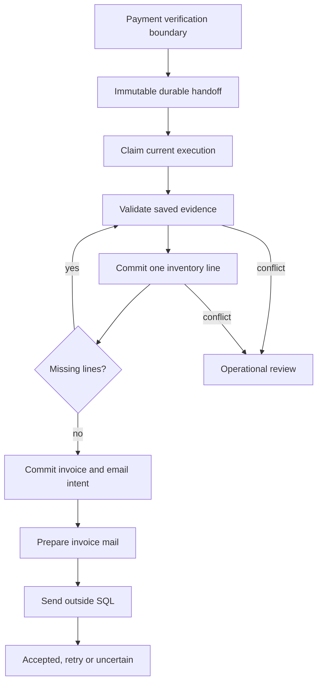
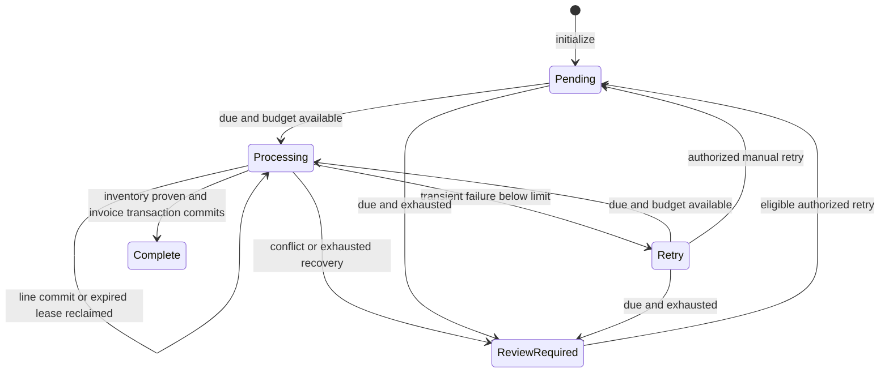
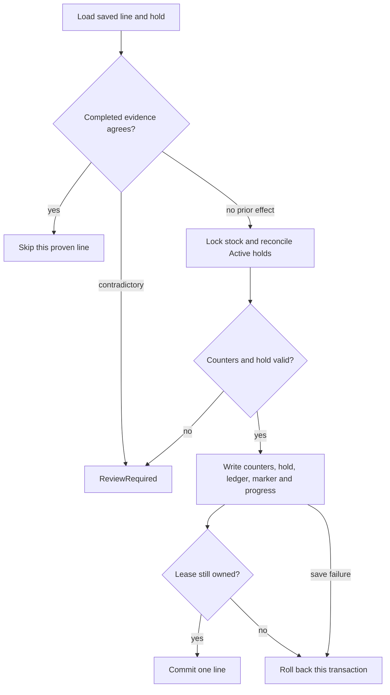
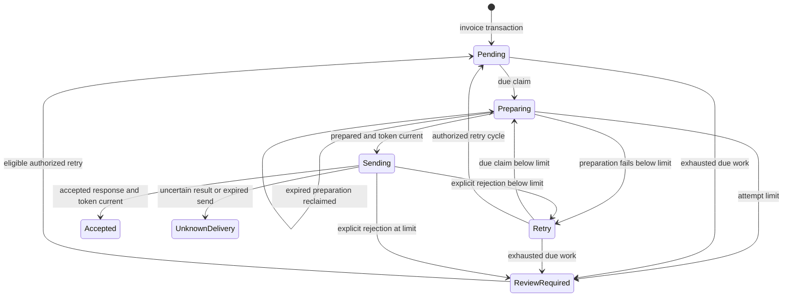
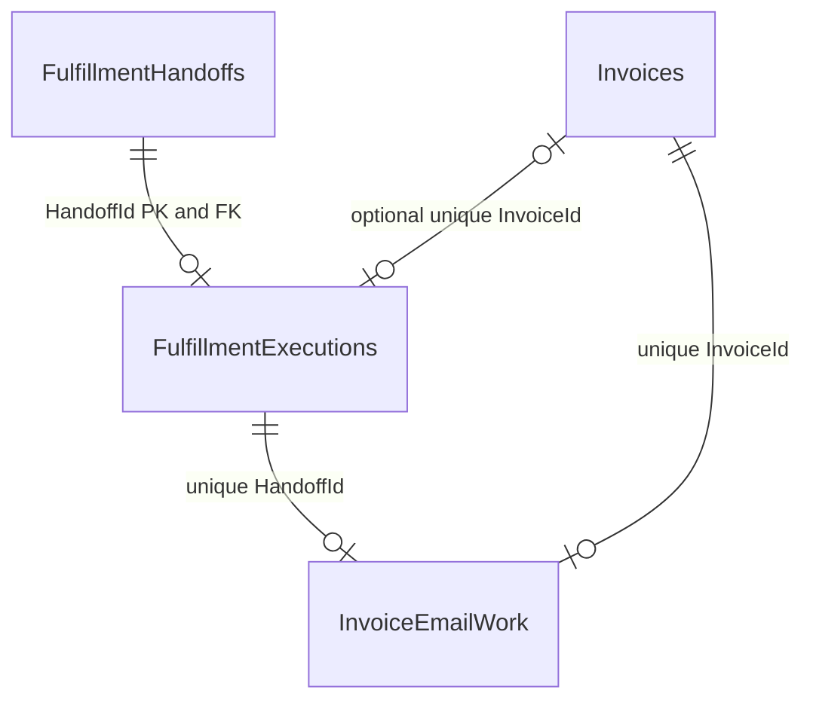
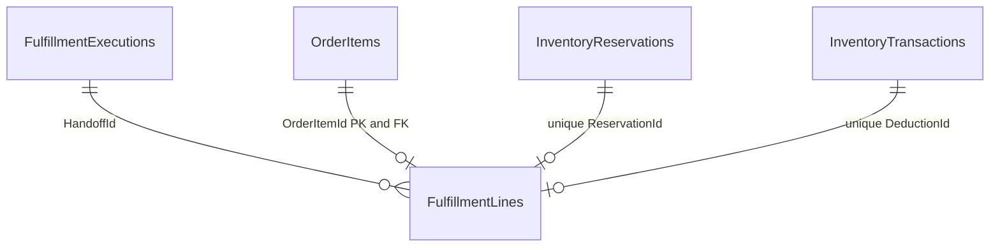
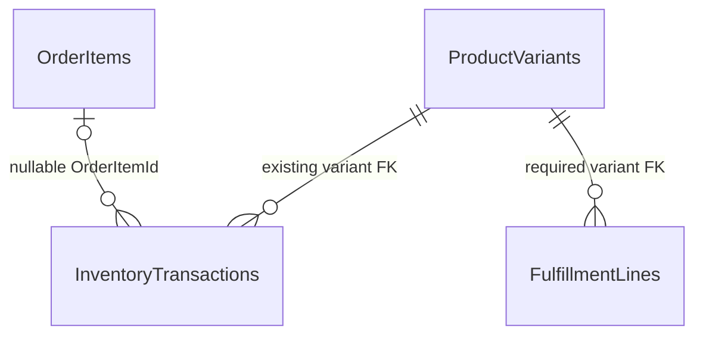

# After Payment: Recoverable Inventory, Invoices and Email in LiliShop

## A paid order can still be unfinished

A customer pays for three order lines. The server commits the stock movement for the first line, then stops. When another process takes over, it must answer three questions: **what committed, what remains, and what evidence permits the next effect?** Starting the whole order again could deduct stock twice. Treating the first deduction as proof of completion could leave two purchased lines untouched.

This is a hypothetical failure scenario, not a report of a production incident. It explains why receiving payment and processing an order need separate durable records.

The [companion checkout article](0068_Durable_Checkout_and_Verified_Payments_in_LiliShop.md) explains the earlier boundary. A signed payment receipt was checked against a saved purchase, and payment verification committed a recorded fulfillment handoff. The handoff deliberately stopped before downstream stock, invoice and email work. This article follows the consumer that now processes that handoff.

Here, **fulfillment** means committing purchased stock, issuing a valid invoice and recording durable work to email it. Physical dispatch, carrier tracking and delivery confirmation are outside this implementation. A completed processing record does not say that a parcel or email has reached the customer.

The same synthetic order will help us follow the design. Every name, identifier, amount and timing example below is invented.

| Saved line | Variant | Quantity | Saved unit price | Saved line amount |
| --- | --- | ---: | ---: | ---: |
| 101: shirt | 201 | 2 | 30 EUR | 60 EUR |
| 102: mug | 202 | 1 | 15 EUR | 15 EUR |
| 103: bag | 203 | 3 | 10 EUR | 30 EUR |

The saved subtotal is 105 EUR, saved shipping is 5 EUR and saved total is **110 EUR**. Order `7001` has three reservations and one already-verified payment attempt. The prices, currency and address come from the existing purchase and order snapshots. This fulfillment change reuses that earlier work; it does not recalculate the purchase from today's catalog or delivery prices.

## The solution from the top down



Arrows show cooperation, not one large transaction. Payment verification is an earlier transaction. Every stock line has its own transaction. Invoice creation, email intent and execution completion share another transaction. Rendering and mail transport happen outside those SQL boundaries. The loop can continue under the same valid claim; after interruption, a later claim resumes it.

The key is **durable work**: unfinished instructions live in SQL rather than only in a process or a best-effort enqueue. A **transaction** makes one chosen group of database writes commit or roll back together. **Idempotency** means a repeated logical operation does not create another protected effect. Here the protected inventory identity is a saved order line plus movement type, not “this process ran once.” There is no global exactly-once execution promise.

The database stores both the effect and the evidence needed to recognize it. The worker can then repeat validation, skip a proven completed line and perform only missing work. When evidence disagrees, it records a review condition instead of inventing a repair.

### A first reading path

For a first pass, read the problem, the four truths, [one line transaction](#one-line-is-one-local-transaction), [invoice boundary](#one-invoice-transaction-also-records-email-work), [uncertain mail](#why-uncertain-mail-stops-automatic-sends) and [restart scenarios](#following-the-order-through-failures). Return to the database and method appendices when tracing the implementation.

- [Four truths and their records](#four-truths-and-the-records-that-own-them)
- [Evidence and claims](#the-worker-proves-eligibility-before-effects)
- [Leases, retries and scheduling](#a-lease-is-temporary-permission-to-work)
- [Per-line inventory](#one-line-is-one-local-transaction)
- [Invoices and email intent](#one-invoice-transaction-also-records-email-work)
- [Email states and uncertainty](#email-has-its-own-state-machine)
- [Database relationships](#database-relationships)
- [Operator API and Angular](#recovery-through-the-api-and-angular)
- [Complete scenarios](#following-the-order-through-failures)
- [Tests and evidence](#what-the-recorded-tests-establish)
- [Deployment and remaining limits](#schema-initialization-and-activation-are-different)
- [Glossary](#glossary)
- [Appendix A: schema fields and constraints](#appendix-a-schema-fields-and-constraints)
- [Appendix B: files and cooperating types](#appendix-b-files-and-cooperating-types)
- [Appendix C: methods and frontend members](#appendix-c-methods-and-frontend-members)
- [Appendix D: reproducibility and sources](#appendix-d-reproducibility-and-sources)

## Four truths and the records that own them

A single “success” flag cannot explain this purchase. The implementation keeps several facts apart:

| Question | Durable authority | Example value |
| --- | --- | --- |
| Was payment verified for the saved purchase? | Checkout session, attempt, signed inbox facts and paid order | `PaymentVerified` / `PaymentReceived` |
| What originally requested downstream work? | Immutable `FulfillmentHandoff` | Kind `FulfillVerifiedPaymentV1`, historical state `BlockedAwaitingA5` |
| What processing is complete now? | `FulfillmentExecution`, `FulfillmentLines`, inventory evidence and invoice | `Processing` at `Inventory`, then `Complete` at `Invoice` |
| What is known about invoice mail? | `InvoiceEmailWork` | `Pending`, `Accepted` or `UnknownDelivery`, among other states |

The original handoff remains immutable. Its state text records the boundary at which it was created. It is not rewritten when the consumer runs. Current processing status belongs to the separate execution record, whose primary key is also the handoff foreign key. An old `BlockedAwaitingA5` label can therefore coexist correctly with a `Complete` execution. The [entity definitions][records] and [configuration][config] establish this separation.

A **reservation**, or hold, records units set aside for one attempt. **Physical stock** is `QuantityOnHand`; **reserved stock** is `QuantityReserved`. Reserving two shirts does not remove them physically. Consuming those shirts reduces both values. Available-to-sell units are physical minus reserved.

A **ledger** is the movement history. `Deduct` changes physical stock; `Reserve` and `ReleaseReservation` concern the reserved counter. Their signed deltas must be interpreted by type. Summing every delta together would mix different counters and give the wrong meaning.

For the example, assume no other Active reservations share its variants:

| Variant | Physical before | Reserved before | Physical after consumption | Reserved after |
| --- | ---: | ---: | ---: | ---: |
| 201 | 10 | 2 | 8 | 0 |
| 202 | 8 | 1 | 7 | 0 |
| 203 | 12 | 3 | 9 | 0 |

Other customers' Active holds would also contribute to the reserved total. The worker must reconcile all Active holds for a variant before consuming this attempt's exact hold.

## The worker proves eligibility before effects

The [evidence validator][evidence] follows the recorded chain from handoff to attempt, session and order. It does not accept an order ID and a browser claim that payment succeeded.

`LoadAsync` checks the expected handoff kind and historical label; the session/order/attempt association and flow versions; verified session and paid order states; owner/buyer agreement with an actual account; immutable payment identity and verification fields; and the saved purchase hash. It locates the signed-inbox record by account and event identity, checks its type, mode, absence of a review reason and facts hash, then uses the existing `CheckoutService.Matches(..., true)` validation for captured payment facts.

The purchase must have nonempty, positive, distinct variant lines. Saved order lines must match quantities, unit prices, product identity/name/picture, SKU, variant description and attributes. Order subtotal, shipping, total, currency, delivery-method identity and address must agree with the saved purchase; the attempt amount in minor units must agree too. Mutable catalog prices are not consulted as new authority.

The holds must match attempt, variant, quantity, provider identity and original expiry exactly. Expiry time remains evidence of the original association. A verified hold is not released merely because that time is now in the past. The validator also rejects deductions without a usable saved-line identity and unexpected completion markers. `StepAsync` additionally rejects live-mode or unexpected-account processing.

One subtle distinction matters: **initialization is not eligibility approval**. `InitializeAsync` selects up to 100 handoffs that lack an execution and inserts Pending records. Its selection query does not perform this full evidence validation. The first effect-bearing step performs it. A malformed association may have an execution record and still enter review without an inventory effect. The normal producer creates version-1 handoffs; initialization is not an automatic importer for arbitrary historical paid orders.

The validator raises a `FulfillmentConflict` with a safe reason code for recognized contradictions. The consumer rolls the local transaction back and records `ReviewRequired` separately. Unexpected failures use `processing_temporarily_unavailable` and the retry policy. Cancellation requested by the caller propagates; durable leases make abandoned work discoverable later. If even failure recording cannot commit, the previous Processing lease remains the recovery checkpoint.

## A lease is temporary permission to work

A **lease** gives one worker permission until a deadline. A random **token** distinguishes that claim from a later claim for the same work. A **revision** is a monotonically advanced value used to reject stale administrative updates and as an EF concurrency token. Tokens and revisions solve related but different problems: a retry form uses a revision; an effect-bearing worker uses its token, state and lease deadline.

The [consumer][worker] acquires the existing checkout control row first, using `CheckoutService.BeginAsync`. That helper opens a SQL Server transaction, clears EF tracking and takes an update/hold lock on control row 1. It serializes participating checkout and fulfillment operations across application instances. The per-execution claim is therefore database-backed even though the selection query does not itself contain a row-lock hint.

The exact ownership predicate is small:

Exact excerpt from [Main/LiliShop.Infrastructure/Checkout/FulfillmentService.cs](https://github.com/jahanalem/LiliShop-backend-dotnet/blob/214077e34636c2f4ccdc491ac1120dd5f7ffe72e/Main/LiliShop.Infrastructure/Checkout/FulfillmentService.cs#L66-L66):

```csharp
    private bool Own(FulfillmentExecution e, WorkClaim claim) => e.State == "Processing" && e.LeaseToken == claim.Token && e.LeaseUntil > Now;
```

The worker takes the oldest due eligible record, ordered by next-attempt time, creation time and identity. It assigns a new token, sets a two-minute lease, increments lifetime and cycle attempts, advances revision/update time and commits before doing a step. A second claimant waits for the same control lock and then sees the committed claim. It cannot also claim that unexpired execution.

Each local step reacquires control first and loads fresh tracked state. It checks ownership at the beginning and again before publishing the line or overall completion. A successful line extends the lease by two minutes. An expired token cannot become current again by writing a result. The old worker returns without committing its pending local transaction.

Clearing tracking is deliberate: an EF context may otherwise retain old state even after another transaction commits. It also creates a rule for cooperating code: never carry unsaved progress across `BeginAsync`, because that helper discards tracked objects. The new invoice path joins the current context/transaction and does not open a nested transaction or call the clearing helper halfway through issuance.

### Execution states and stages



These are execution states. `Inventory` and `Invoice` are stages inside that state machine; hold and email states are separate. Only an eligible idle retry/review record can be manually reset to Pending. Complete has no supported retry/force transition. The diagram describes service transitions, not all combinations allowed by the SQL state-membership check.

Stages do not identify all progress on their own. During Inventory, line markers identify committed lines. The last line transaction advances Stage to Invoice. A later step verifies all markers again before invoice work. Execution remains Processing until the invoice transaction finishes.

### Retry timing and attempt budgets

A **retry** repeats an eligible unfinished operation after a known failure. It is not permission to ignore contradictory evidence. The source computes its delay as:

Exact excerpt from [Main/LiliShop.Infrastructure/Checkout/FulfillmentService.cs](https://github.com/jahanalem/LiliShop-backend-dotnet/blob/214077e34636c2f4ccdc491ac1120dd5f7ffe72e/Main/LiliShop.Infrastructure/Checkout/FulfillmentService.cs#L27-L27):

```csharp
    internal static DateTimeOffset RetryAt(DateTimeOffset now, int attempts) => now.AddSeconds(Math.Min(1800, 30 * Math.Pow(2, Math.Min(attempts - 1, 6))));
```

For consecutive failures in one cycle, the delays are 30, 60, 120, 240, 480, 960 and 1,800 seconds. The eighth attempt reaches review instead of another automatic cycle. The cap and the eight-claim budget are separate rules. Attempts count claims, not individual stock lines or network calls.

Before selecting healthy work, the claim code sweeps up to 100 due/expired records whose cycle count is at least eight into review. Candidate selection also requires a cycle count below eight. One exhausted row therefore cannot simply cause the batch to stop before healthy rows are considered. A manual retry clears the safe failure reason, resets `CycleAttempts` to zero and makes the same record due now. It retains lifetime `Attempts`, completed line evidence and any existing invoice.

### Scheduling and controls

`Program.cs` registers `FulfillmentMaintenance.RunAsync` as the minutely recurring job `verified-fulfillment-recovery`. [Dependency registration][di] gives each scope one context and shared concrete invoice/preparation services. The maintenance job first initializes missing records, then runs bounded loops: up to 100 execution claims, up to 102 step calls per claim, then up to 100 mail claims. The checkout quote already limits distinct lines to 100. Each claimed item receives a fresh scope, and exceptions inside either item loop are caught so the next item can be considered. Initialization is outside those per-item catches; a shared initialization/database failure can still stop that invocation.

Hangfire's timer causes repeated opportunities to poll. It is not the only copy of the work. If an immediate enqueue is lost, SQL still contains Pending, due Retry or expired Processing work. Reentrant jobs are a general [Hangfire requirement](https://docs.hangfire.io/en/latest/best-practices.html); the local identity and transaction rules make repetition safe for the specific database effects here.

The worker is additionally gated by explicit isolated-processing configuration, nonlive mode, a `LiliShop_A4_A5_` database prefix and `FulfillmentControls.Enabled`. The CLR option and seeded control default to false. Checkout-start pause is separate: already-verified processing does not test `StartsPaused` or `NewFlowEnabled`. It can continue when new starts are paused, provided its own worker gate is open. Closing the worker gate stops new work at checked boundaries; it cannot revoke a request already sent to an external service.

This is a conservative shared-lock design, not a measured high-throughput system. Effect paths acquire control before stock and invoice-sequence work. Stock adjustments and legacy release do not acquire control after taking stock locks, avoiding that reverse ordering. SQL locking and deadlock behavior under production load still need measurement.

## One line is one local transaction

The smallest durable stock effect is a **saved order line**, identified by `OrderItem.Id`. Variant identity alone is insufficient: two orders may buy the same variant. “Any deduction for order 7001” is also insufficient: one of its three lines may have committed.

For line 101, the worker requires reservation 301 to belong to the correct attempt, variant 201 and quantity 2. It locks variant 201's inventory row before comparing its reserved counter with the sum of all Active reservations. It requires `QuantityOnHand >= QuantityReserved >= 2` and equality between the reserved counter and that sum.

The physical and reserved decrement uses one guarded SQL update:

Exact excerpt from [Main/LiliShop.Infrastructure/Checkout/FulfillmentService.cs](https://github.com/jahanalem/LiliShop-backend-dotnet/blob/214077e34636c2f4ccdc491ac1120dd5f7ffe72e/Main/LiliShop.Infrastructure/Checkout/FulfillmentService.cs#L92-L95):

```csharp
                    var affected = await db.InventoryItems.Where(x => x.Id == stock.Id && x.QuantityOnHand >= x.QuantityReserved && x.QuantityReserved >= item.Quantity)
                        .ExecuteUpdateAsync(x => x.SetProperty(v => v.QuantityOnHand, v => v.QuantityOnHand - item.Quantity)
                            .SetProperty(v => v.QuantityReserved, v => v.QuantityReserved - item.Quantity), ct);
                    Require(affected == 1, "stock_shortage");
```

The update affects one row or fails the invariant. EF's `ExecuteUpdateAsync` executes immediately and bypasses ordinary tracked updates. The explicit surrounding transaction is what joins that SQL statement to later `SaveChangesAsync` calls; separate save calls alone would not create this whole boundary. This distinction is described in [EF's set-based update documentation](https://learn.microsoft.com/en-us/ef/core/saving/execute-insert-update-delete) and [transaction documentation](https://learn.microsoft.com/en-us/ef/core/saving/transactions).

Within that same transaction, the worker changes the hold to Committed, inserts a `Deduct` ledger row and a `ReleaseReservation` row, both carrying `OrderItemId = 101`, then creates its immutable `FulfillmentLine` marker. It advances progress/revision and commits. Two saves inside the transaction do not create a committed gap between effect and marker. If lines are still missing, the step also requires Inventory stage, a null execution InvoiceId and no existing invoice for the order; an invoice-before-inventory contradiction goes to review.



The write node and commit are one local transaction. The diagram compresses repeated evidence checks; a missing marker plus any existing ledger effect or a non-Active hold is contradictory, not a fresh line.

### Proving an earlier line before skipping it

`CompletedAsync` does more than find a marker. A valid marker must belong to this handoff and match variant, quantity and reservation. The hold must be Committed. There must be exactly two line-identified ledger rows, with the correct order, variant and negative quantity: one Deduct row with the marker's `DeductionId`, and one ReleaseReservation row.

If the marker is absent, the only fresh case is **no line-identified ledger rows and an Active hold**. A committed hold without a marker is not permission to deduct again. Likewise, a marker with a mismatched ledger is not accepted as completion. These branches produce review reasons such as `incomplete_line_evidence` and `completed_line_evidence_conflict`.

SQL uniqueness reinforces the validation. The filtered unique ledger index protects `(OrderItemId, Type)` when the line identity is present. The marker's primary key protects one marker per line, and unique reservation/deduction indexes prevent sharing those references between markers. Foreign keys protect row existence. Application guards reject tracked changes/deletes of markers, audits and identified effects, including an attempt to erase the original line identity. None of these protections alone proves the full financial/stock association; validation supplies that part. They are also not protection against an unrestricted database administrator or arbitrary direct SQL.

### Before commit and immediately after commit

If the server stops after changing a counter but before commit, SQL rolls back that line transaction. No marker survives, and the hold remains Active. A later worker can attempt the whole line again.

If the server stops immediately after line 101 commits, its counters, Committed hold, two ledger rows and marker survive together. Execution may still say Processing with a lease that later expires. A new claimant validates line 101 and skips it, then consumes lines 102 and 103. This is recovery from actual partial order progress, not merely a demonstration that an all-lines transaction can roll back.

### Legacy expiry and the remaining legacy boundary

The change also fixes a narrower legacy race in [InventoryService][inventory]. Two expiry/cancel invocations could both load the same Active legacy hold before either committed. A later invocation could then subtract its quantity again from a counter that still included another purchase's reserved units.

The legacy release primitive now locks the stock row, reloads the hold inside the transaction and proceeds only if it is still Active and has no checkout-attempt ownership. A stale invocation returns false. If the guarded decrement fails, it throws and keeps the hold intact rather than terminating inconsistent evidence. The deterministic regression loads the two stale copies before resolving either; it does not depend on a random sleep.

This fix is not a rewrite of all historical inventory paths. Legacy `DeductForOrderAsync` now fails for ambiguous existing deductions, unknown variant identity and shortage instead of reporting whole-order success. However, its older sale path still saves hold status separately from the counter/ledger commit. Concurrent legacy writers and their cutover remain a release concern. Version-1 orders use the constrained consumer, while inconsistent counters are detected and reviewed. No automatic historical repair or guessed line identity was added.

## One invoice transaction also records email work

Once all three lines are proven complete, the next step enters the invoice stage. The new internal method is `InvoiceService.IssueForFulfillmentAsync(Guid handoffId, Guid token, DateTimeOffset now, CancellationToken ct)`. It requires a current SQL transaction and a Processing execution at Invoice stage with the matching unexpired token. It reloads purchase evidence and verifies every line again.

The old public `CreateInvoiceForOrderAsync(Order order)` remains a different path. It may return an existing invoice, but still refuses to issue a new version-1 invoice. The legacy reconcile sweep also remains limited to version-0 paid orders. Adding a consumer did not remove the old issuance guard or expose an operator shortcut around it.

Invoice content reuses the established builder. Saved order amounts, currency, address and purchased line snapshots supply the financial content. Seller profile, numbering series and tax presentation follow the existing rules. For example, the current address model lacks an order country, so the builder still uses the seller's home country as its fallback. The change does not claim a new tax/country implementation or complete reconstruction of every historical invoice.

Number allocation increments the existing `InvoiceNumberSequences` row on the same connection/transaction. A missing series is created under its unique SeriesKey constraint before incrementing. Existing invoice constraints protect unique OrderId and InvoiceNumber. The fulfillment control lock also serializes this new path with other participating consumers; the sequence's SQL updates and invoice uniqueness protect the shared allocator when legacy issuance also exists.

If an invoice already exists, the consumer validates saved buyer/order date/address, currency/shipping/total, number/sequence basics and all matching lines, then reuses it. It does not replace invoice content or assign another number. This is reconciliation of an existing valid invoice, not adoption of any invoice with the same OrderId.

The caller then records durable mail intent and completion:

Exact excerpt from [Main/LiliShop.Infrastructure/Checkout/FulfillmentService.cs](https://github.com/jahanalem/LiliShop-backend-dotnet/blob/214077e34636c2f4ccdc491ac1120dd5f7ffe72e/Main/LiliShop.Infrastructure/Checkout/FulfillmentService.cs#L112-L119):

```csharp
                var mail = await db.InvoiceEmailWork.SingleOrDefaultAsync(x => x.InvoiceId == invoice.Id, ct);
                if (mail == null) db.InvoiceEmailWork.Add(new() { Id = Guid.NewGuid(), HandoffId = claim.Id, InvoiceId = invoice.Id,
                    CreatedAt = Now, UpdatedAt = Now, NextAttemptAt = Now });
                else Require(mail.HandoffId == claim.Id, "email_identity_conflict");
                if (!Own(e, claim)) return false;
                e.InvoiceId = invoice.Id; e.State = "Complete"; e.CompletedAt = Now; e.Reason = null;
                e.LeaseToken = null; e.LeaseUntil = null; Touch(e);
                await db.SaveChangesAsync(ct); await tx.CommitAsync(ct); return false;
```

The invoice may have been saved earlier inside the same transaction by `IssueForFulfillmentAsync`. Only the final transaction commit makes a newly allocated number, invoice, email work and execution completion durable together. If the mail-work insertion fails, the new invoice and allocation roll back too. Previously committed stock lines remain completed and are not deducted on the next invoice attempt.

```mermaid
sequenceDiagram
    participant Worker as Fulfillment worker
    participant SQL as SQL transaction
    participant Invoice as Invoice service
    Worker->>SQL: Lock control and verify claim
    Worker->>Invoice: Issue with handoff and token
    Invoice->>SQL: Validate all lines; reuse or allocate and save
    Worker->>SQL: Add unique email work; set Complete
    Worker->>SQL: Commit invoice, intent and progress
```

All SQL messages in this focused sequence use the same local transaction. No rendering or transport participates. A valid existing invoice can be returned instead of allocating one; its content stays unchanged.

**Complete means:** required inventory line effects are proven, one valid invoice exists and one durable invoice-email instruction exists. It does not include a successful mail request. The old best-effort post-commit `EnqueueInvoiceEmail` remains for legacy issuance; the new issuance path never calls it. Otherwise both delivery paths could send the same invoice.

## Email has its own state machine

An invoice is a durable document. An email is an external operation. Even if the invoice transaction committed, the next process may stop before sending, or the provider may accept a request while its response is lost. These need separate outcomes.

The mail worker uses two small boundaries around external work:

1. Claim the same logical instruction as Preparing, with attempts, token and two-minute lease committed.
2. Render/compose outside SQL locks. Recheck ownership and completed execution, then commit Sending before transport. Persist the outcome afterward only while the same token still owns an unexpired send.

[InvoiceEmailService.PrepareAsync][mail-prep] reuses invoice loading, the existing admin PDF-rendering path, buyer culture lookup, localized composer, order URL and PDF attachment. PDF labels use the shop's InvoiceCulture; email body culture uses the buyer preference or configured fallback. Invoice PDF rendering here returns bytes through the existing renderer; this path does not establish a new Cloudinary upload workflow. Preparation failure is not marked as successful email work.

The preparation interface accepts an invoice ID and has no cancellation token or explicit rendering deadline. Its lease can expire while rendering continues; the later ownership check prevents that stale preparation from sending. Rendering capacity and calls that take too long remain operational limits.

```mermaid
sequenceDiagram
    participant Worker as Mail worker
    participant SQL as SQL
    participant Prep as Shared preparation
    participant Provider as Mail transport
    Worker->>SQL: Claim Preparing; commit
    Worker->>Prep: Render and compose outside transaction
    Prep-->>Worker: PDF attachment and message
    Worker->>SQL: Recheck token; commit Sending
    Worker->>Provider: Send with operation correlation
    Provider-->>Worker: Acceptance, rejection or uncertainty
    Worker->>SQL: Persist result only if still owned
```

Four participants keep the external boundary visible. No transaction spans the rendering or provider calls. A lost final persistence step leaves Sending available for uncertainty recovery rather than an automatic replacement send.

### Transport classification is deliberately conservative

The new [SendGridInvoiceMailTransport][transport] implements `IInvoiceMailTransport`. It reads existing SendGrid configuration, constructs the message/attachments, and includes the instruction GUID as `invoice_operation`. It does not call `IEmailService` or the old [SendGrid-to-SMTP fallback][legacy-email]. The previous boolean adapter could return false after an exception even if an external acceptance was possible, causing fallback to risk another send.

| Observed boundary/result | Transport outcome | Durable worker behavior |
| --- | --- | --- |
| Missing configured key/sender, or message preparation throws before network | `Rejected` with a safe reason | Retry/backoff, eventually ReviewRequired |
| HTTP 400, 401, 403, 404, 405, 413 or 429 | `Rejected` / `mail_provider_rejected` | Retry/backoff, eventually ReviewRequired |
| HTTP 202 | `Accepted` | AcceptedAt recorded if the send claim remains current |
| Other response, exception or uncertain timeout | `UnknownDelivery` | Review outcome; no automatic replacement send |

The worker gives transport a linked cancellation token with a 60-second deadline. This is a local request bound, not proof that a remote provider did or did not accept. The transport catches exceptions and returns uncertainty; the worker also classifies an escaping transport exception that way.

The implementation maps explicit rejections to a bounded retry cycle, including configuration/authentication rejections that may need an operator fix. It does not pretend all those errors will resolve on their own. Rejected is a transport result, not a stored email State value.

The exact response mapping is:

Exact excerpt from [Main/LiliShop.Infrastructure/Checkout/InvoiceMailTransport.cs](https://github.com/jahanalem/LiliShop-backend-dotnet/blob/214077e34636c2f4ccdc491ac1120dd5f7ffe72e/Main/LiliShop.Infrastructure/Checkout/InvoiceMailTransport.cs#L37-L40):

```csharp
            var status = (int)response.StatusCode;
            if (status == 202) return new("Accepted");
            if (status is 400 or 401 or 403 or 404 or 405 or 413 or 429) return new("Rejected", "mail_provider_rejected");
            return new("UnknownDelivery", "mail_response_uncertain");
```

[SendGrid's Mail Send API](https://www.twilio.com/docs/sendgrid/api-reference/mail-send/mail-send) returns acceptance for processing. In this implementation HTTP 202 sets Accepted, which proves only that the provider accepted the request observed by the worker. It does not prove inbox arrival, reading, or successful delivery to every recipient.

### Why uncertain mail stops automatic sends



Accepted and UnknownDelivery deliberately have no automatic outgoing retry edge. An expired Preparing claim can be reclaimed because no send was authorized yet. An expired Sending claim becomes UnknownDelivery because the provider may already have accepted. Those are different recovery decisions.

The claim code first moves up to 100 abandoned Sending rows to UnknownDelivery, clears their token/lease and writes `send_interrupted`. It then handles exhausted preparation/retry candidates and selects healthy work. Outcome persistence checks expected state, token and deadline. A late acceptance cannot overwrite uncertainty recorded by another recovery invocation.

An **uncertain external outcome** means the application cannot prove whether the remote effect occurred. The operation GUID helps correlate logs or an investigation, but this integration supplies no provider-enforced idempotency key or automatic status lookup. A running external call cannot be remotely fenced by changing a SQL token. The design instead prevents a replacement send and refuses a stale local result.

There is no uncertain-mail resend endpoint or supported operator resend action. Retry accepts only Retry or ReviewRequired. UnknownDelivery is excluded, both in API behavior and the UI. An operator can investigate; a future deliberate resend design would need explicit authority, audit and a possible-duplicate explanation. None of that is a current feature.

## Database relationships

The following ER diagrams show **SQL-enforced foreign keys only**. Every displayed new FK uses Restrict in the EF model, emitted as `ON DELETE NO ACTION` for SQL Server. Nullable associations are marked optional. Application-only relationships are explained separately so they do not look like database guarantees.



An execution must reference a handoff. An invoice reference on execution is optional until completion and unique when present. Each email-work row must reference an execution and invoice, with a unique index on each. SQL does not by itself prove that the execution's invoice is the same as the email row's invoice; the services check the association.



One execution has zero or more committed line markers. Each marker identifies one saved order item, one hold and one deduction. The table also has a required FK from `ProductVariantId` to `ProductVariants`, omitted from this small drawing to keep it narrow and listed in the constraint appendix.



The existing ProductVariants-to-InventoryTransactions FK retains Cascade deletion in the model. The new line FKs restrict linked deletions; this is not a new universal claim that every historical ledger row is undeletable at SQL level. `InventoryTransactions.OrderId` remains a plain correlation value, not an Orders FK. Its new nullable OrderItemId has an actual FK.

`FulfillmentAudits.HandoffId` and `EmailWorkId` are **application-only references**, with no FK on either. Only HandoffId has an index. Control audits leave both null. `FulfillmentControls` is a singleton unrelated by FK to executions. Actor is an application-recorded string, not a users FK. These choices preserve audit records without requiring their targets to be traversable entities.

The complete [schema appendix](#appendix-a-schema-fields-and-constraints) lists fields, nullability, defaults, identity behavior, exact index/constraint names and field owners. The applied migration changes the five new tables and adds one nullable column/index/FK to InventoryTransactions; it does not change the existing invoice or stock-counter schemas.

### Synthetic records at two checkpoints

Use handoff `00000000-0000-0000-0000-000000007001` for order 7001, and assume the first valid claim starts at an invented time T0. IDs in this table are teaching identifiers, not output copied from a test database.

| Record/evidence | After line 101 commits | After a later worker resumes all work |
| --- | --- | --- |
| Original handoff | `FulfillVerifiedPaymentV1`, `BlockedAwaitingA5` | Unchanged |
| Execution | Processing / Inventory; one line completed; token A | Complete / Invoice; invoice 9001; token and lease null |
| Line 101 marker | OrderItemId 101, hold 301, deduction 501, quantity 2 | Same marker |
| Line 102 marker | Absent | OrderItemId 102, hold 302, deduction 503, quantity 1 |
| Line 103 marker | Absent | OrderItemId 103, hold 303, deduction 505, quantity 3 |
| Holds 301, 302, 303 | Committed, Active, Active | Committed, Committed, Committed |
| Identified ledger rows | 501 Deduct -2; 502 ReleaseReservation -2, both line 101 | Same rows plus 503/504 for line 102 and 505/506 for line 103 |
| Invoice | Absent | One valid invoice, example number `EX-2026-000001`, 110 EUR |
| Email work | Absent | One Pending logical instruction for invoice 9001 |
| Payment state | PaymentReceived / PaymentVerified | Unchanged |

At the partial checkpoint, reserved counters are 0, 1 and 3 for the three variants; physical counters are 8, 8 and 12. After inventory completion they are 0, 0 and 0 reserved, and 8, 7 and 9 physical. A later provider acceptance updates only mail outcome/attempt metadata. It does not create a second invoice or alter those counters.

The synthetic records show selected fields. Required identities, saved purchase and signed verification evidence are assumed already valid; a matching number in this table alone would not authorize execution. No example is a script for repairing missing evidence.

## Recovery through the API and Angular

### HTTP contract

The [controller][controller] inherits the `api/[controller]` route and requires authentication. It applies no-store response caching. SuperAdmin is the existing privileged role used for operations. Customer status uses the authenticated numeric NameIdentifier and checkout ownership; a browser-supplied owner ID is not accepted.

| Method and route | Access and input | Successful response | Relevant rejection/error behavior |
| --- | --- | --- | --- |
| GET `/api/fulfillment/orders/{orderId:int}` | Authenticated numeric owner of a CheckoutSession with that OrderId | Safe owner processing DTO | 401 if numeric actor invalid; 404 for absent/not-owned order; generic 503 on unexpected non-abort failure |
| GET `/api/fulfillment` | SuperAdmin; page=1, pageSize=25, optional state | `{ page, pageSize, count, data }` | 422 `invalid_page` for page outside 1..100000 or pageSize below 1; pageSize above 100 is capped |
| GET `/api/fulfillment/{id:guid}` | SuperAdmin; handoff ID | Handoff identities, execution, markers, email and audit | 404 `work_not_found`; generic 503 |
| POST `/api/fulfillment/{id:guid}/retry` | SuperAdmin; `{ revision, reason, email }`, email defaults false | `{ accepted: true }` | 422 invalid/blank reason; 503 isolated-only; 404 work/mail absent; 409 eligibility, work or mail conflict |
| GET `/api/fulfillment/control` | SuperAdmin | Control entity `{ id, enabled, revision }` | Authentication/role failure or generic 503 |
| PUT `/api/fulfillment/control` | SuperAdmin; `{ revision, enabled, reason }` | Updated control entity | 422 reason; 409 revision conflict; enabling outside isolation gives 503 |

Framework authentication/authorization produces 401/403 before controller logic as appropriate; route constraints/model binding may reject malformed routes/bodies before the action. Known `CheckoutProblem` failures return a safe `{ code }`. Unexpected non-abort errors return `fulfillment_temporarily_unavailable`, not raw exception details. No endpoint accepts payment amounts or a force-paid/force-complete instruction.

List includes handoffs without execution rows as Pending/Inventory, using left joins. It orders by handoff CreatedAt then ID and applies Skip/Take. A nonblank state normally filters exact execution state. `UnknownDelivery` is the special email-state filter. The API does not validate other strings against a known enum; an unrecognized value normally matches nothing. It does not offer every mail-state filter: email ReviewRequired can coexist with execution Complete and is inspected in detail or an all/Complete listing.

Detail exposes lease expiry but never the lease token. It returns line identities, variants, quantities, reservation/deduction references and timestamps; total line count; execution/mail states and timing/attempt data; and the latest 100 handoff-linked audit records. Control changes are audited with null HandoffId, so those control audits are not returned by an individual handoff detail endpoint. There is no separate control-audit history endpoint in this addition.

List/detail/customer views compose several queries rather than one snapshot-read transaction. They are operational views and may briefly observe progress between commits; the effects themselves retain the stronger transaction rules. Repeating a read obtains current state.

### An admin retry from button to SQL

An operator opens `/admin/fulfillment/{id}`. The parent admin route first applies `RequireAtLeastAdminPanelViewerRole`; the fulfillment child also applies the existing authGuard with `RequireSuperAdminRole`. Those UI guards improve navigation behavior, while the API independently enforces SuperAdmin.

The [component][admin] loads detail/control through the Angular [FulfillmentService][http]. It permits a retry only for Retry or ReviewRequired, requires a trimmed nonempty reason, selects the relevant execution/mail revision, and sets a busy signal before HTTP. Another click while busy produces no extra request. A successful response clears the reason and reloads detail. An error clears busy and shows a common conflict/error label; it does not pretend the mutation succeeded or silently refresh the revision and resubmit.

```mermaid
sequenceDiagram
    participant Operator as SuperAdmin UI
    participant API as Fulfillment API
    participant SQL as SQL
    Operator->>API: Read detail and current revision
    Operator->>API: Retry with revision and reason
    API->>SQL: Lock control; recheck evidence and idle state
    API->>SQL: Reset bounded cycle; append audit; commit
    API-->>Operator: Accepted, or 409 conflict
```

This action resumes the same logical work. It does not replace completed stock markers, issue a duplicate invoice, edit verified money or approve UnknownDelivery. API revision checks still protect against two tabs or two operators whose buttons are individually disabled correctly.

Worker enable/disable uses a separate control revision with the same reason/busy pattern. A retry can be recorded while processing is disabled; it remains durable until the worker gate permits a later claim. Disabling does not alter payment, invoice or stock effects already committed.

### A customer read from route to safe status

The existing success route accepts `checkout` in the query string and relies on the authenticated parent route. Its earlier correction removed the obsolete `state.order` dependency. That correction and eight Router cases predate the fulfillment change; they are not newly invented fulfillment features.

On initialization or the manual refresh button, [CheckoutSuccessComponent][status] clears its checkout/progress/error signals and cancels its previous progress request. It reads payment status using the saved checkout ID. Only a PaymentVerified response with OrderId causes a second owner-authorized fulfillment status request. It never prepares or confirms payment from this status page. An absent checkout ID shows a recovery message without sending a payment request.

The owner endpoint returns:

```json
{
  "orderId": 7001,
  "paymentReceived": true,
  "processing": "Complete",
  "completedLines": 3,
  "totalLines": 3,
  "invoiceId": 9001,
  "email": "UnknownDelivery"
}
```

This is a synthetic response shape. `processing` maps Complete and ReviewRequired explicitly; other or absent execution states map to Pending. `email` exposes Accepted, UnknownDelivery and ReviewRequired explicitly; other or absent mail states map to Pending. Customer responses omit internal reason codes, audit, attempts, tokens, provider facts and other customers' progress. The numeric checkout-owner check is separate from existing invoice reads' buyer-email ownership rule.

The [status template][status-html] presents payment, processing and email as different statements, with completed/total line counts. It retains the order link even when mail is unsuccessful or uncertain; existing invoice access remains on the order page. The new customer panel does not add a direct PDF-download implementation. If progress access fails, payment's known status remains visible with a processing-unavailable message. A later failed payment-status read leaves stale order/progress cleared.

Refresh here is **manual**, not periodic polling. The admin page loads on route changes and explicit load/filter/action events; it also has no added polling timer. The older payment-confirmation component's polling is a different mechanism. Another detail is that refresh clears data immediately but does not reset the message signal to Checking before the new result arrives, so the previous sentence can remain during that request. The article does not claim a stronger loading-state reset than the code provides.

The [frontend DTOs][dto] describe safe projections. The worker-control DTO ignores the server's extra Id, and the displayed audit DTO uses a subset of the server audit fields. `MailProgress` derives from WorkProgress with stage/completedAt omitted, so its invoiceId type is wider than the actual required mail reference. These are TypeScript projection choices, not additional persisted state machines.

### Localization and presentation limits

New templates call `t(name)`, which uses the runtime catalog key `Fulfillment.<name>` and a centralized English fallback map when the translation service returns the key. The seed appends 73 English entries while retaining all 6,382 existing entries. Supported languages did not all receive new translated sentences. Unknown labels fall back to the name itself. Currency and nullable historical amounts continue to use the existing order/invoice presentation paths.

The admin nav adds a queue item to the existing admin navigation list. That item is not filtered out for every lesser admin role; navigation and API guards still deny unauthorized access. The page supplies list filter/pagination, detail, line/audit tables, reason input, retry controls and invoice link. Its mail section shows attempts, reason and next attempt but not every timestamp exposed by the API. It does not invent shipment or inbox-delivered labels.

## Following the order through failures

Each scenario below continues order 7001. Timings are examples, while the named tests are actual source references. A “crash” means process interruption at a chosen checkpoint, not proof of a real incident.

### Normal processing, followed by separate acceptance

Initial evidence is PaymentVerified, the matching paid order and three Active holds. Initialization creates Pending execution; a claim becomes Processing/Inventory. The first three steps commit lines 101, 102 and 103, one transaction at a time. The last line advances stage to Invoice. The next step commits invoice 9001, Pending email work and Complete execution.

The mail worker later claims Preparing, renders the existing PDF, commits Sending and receives a synthetic Accepted transport result. Only that later mail transaction records AcceptedAt. The inventory/invoice checkpoint was already complete before this request. `ConcurrentClaimsHaveOneOwnerAndOneCompleteEffect` and `RenderFailureAndKnownRejectionRetryOneLogicalMailWithoutOtherEffects` cover the corresponding effect and mail transitions, with a fake transport rather than an actual provider.

### Restart before a line commits

The claim is durable, but no line is committed. A ledger/marker insertion failure occurs after the stock update inside the open transaction. Rollback restores counters and Active hold state, leaving no new marker or deduction. A recordable transient error enters Retry; if the process is simply lost, lease expiry permits reclamation. The next worker performs line 101 once. `LocalFailureRollsBackCountersHoldLedgerAndMarker` injects failures for both InventoryTransactions and FulfillmentLines. `LeaseExpiryInsideLocalTransactionRollsBackEveryLineEffect` additionally advances the controlled clock after a save inside the transaction and proves the final lease fence rolls all effects back.

### Restart after the first line commits

The [partial checkpoint](#synthetic-records-at-two-checkpoints) contains marker 101 and its exact effect evidence, while the other holds are Active. The process stops before the next step. After token A expires, token B is claimed. An old-token step returns without an effect. The new worker validates marker 101 and commits 102 and 103, then completes the invoice stage. `ThreeLineTerminationResumesMissingLinesAndFencesOldWorker` checks the three-line resume and final reserved counters.

The difference from the previous scenario is committed evidence. Recovery does not delete marker 101 to make the order look fresh, and it does not assume lines 102 and 103 are complete merely because some deduction exists.

### Restart after all stock but before invoice completion

All three markers and Committed holds survive; stage is Invoice. Failure to insert the invoice or email intent rolls back the new invoice transaction. A later due retry sees all inventory evidence and performs only invoice work. The existing sequence allocation is in that transaction, so failed allocation/issuance is not a separately consumed number. `InvoiceFailureRetriesWithoutInventoryAndCommitsOneMailInstruction` and `LostEmailIntentSaveRollsBackInvoiceAndNumberThenRecovers` exercise these boundaries.

`ExistingInvoiceProgressIsReconciledWithoutReissue` resets synthetic execution progress after completion and proves an existing valid invoice is reused. It does not simulate every possible corruption or deletion of email work; the ordinary crash gap is closed by the transaction, not by a claim that the test deleted and recreated every record.

### Two claimants and a stale completion

Two instances compete for the due execution. The SQL control lock allows one current claim; the other observes no available unexpired work. After the owner stops, lease expiry permits another token. Old-token state/effect writes are rejected, including the checked in-transaction expiry case. `ConcurrentClaimsHaveOneOwnerAndOneCompleteEffect`, the three-line test and the in-transaction lease test support these different points. They demonstrate protected SQL effects, not globally once-only method invocation.

### Stock evidence disagrees

Suppose variant 202's reserved counter no longer matches all Active holds, or the expected hold is missing. The worker does not consume another customer's reservation, add guessed stock or issue an invoice. Earlier committed line 101 stays committed; payment stays received; execution enters ReviewRequired with a safe reason. The operator can inspect references but cannot force complete, change signed facts or fabricate a missing marker through this API.

`InvalidEvidenceBecomesPaidReviewWithoutInvoice` covers missing hold, counter, shortage, saved snapshot, owner, verification and version corruption as separate theory cases. `CorruptCompletedEvidenceNeverDeductsAgain` changes a committed hold behind its marker and checks that another deduction is not added. Those test fixtures deliberately use direct SQL to create invalid evidence; those statements are not an operator repair runbook.

### Preparation fails before send

Inventory/invoice completion and one email instruction already exist. Rendering throws while Preparing. No transport call occurs. The result becomes Retry, keeping the same instruction GUID and invoice. After its due time a new claim renders again and may proceed. After eight claims it needs review; an eligible manual retry can open another bounded cycle. The render/rejection test checks no send on render failure, later rejected/accepted results and unchanged stock/invoice effects.

### Provider acceptance may have happened

Sending is durable, and the transport may have accepted the message. A timeout or failure to persist Accepted leaves uncertainty. Recovery changes expired Sending to UnknownDelivery and never starts a replacement send. A late response cannot change that to Accepted after ownership has been lost. `AmbiguousSendOrLostAcceptedPersistenceNeverAutoResends` has two cases: a returned uncertain outcome and a SQL failure when persisting Accepted. `LateTransportAcceptanceCannotOverwriteUnknownAfterLeaseExpiry` pauses the fake transport and checks a late acceptance. `StalePreparationCannotSendAfterAnotherWorkerReclaims` covers the earlier, safe-to-reclaim preparation phase.

An actual inbox arrival remains unknown in all these fake-transport tests. Operators must not treat absence of an acceptance timestamp as proof that nothing was sent.

### An eligible operator retry and a stale form

Suppose invoice persistence had a temporary failure that is now resolved. Execution is Retry at Invoice stage and revision 7 in this illustrative branch. The operator reads that revision and submits a reason. The service rechecks eligibility, changes the same execution to Pending, resets its cycle budget and appends RetryProcessing audit. Completed lines and lifetime attempts remain.

A second operator still submitting revision 7 receives 409 because the first action advanced revision. The API cannot be used to retry Complete, an active Processing claim or UnknownDelivery email. `ConcurrentManualRetryRequiresRevisionAndAppendOnlyAudit`, the real HTTP test and the Angular reason/revision/double-click case cover these layers. The caller must reload a conflict; the UI does not silently force a new revision through.

### Customer access while mail needs attention

Execution is Complete and invoice 9001 is valid, while email is Retry, ReviewRequired or UnknownDelivery. The owner status read reports payment, processing and mail separately. The order/invoice is still accessible; successful email is not an authorization condition. The new customer Router cases load server-derived completion/uncertainty and handle progress failure. Existing invoice-owner logic supplies the document access. No mail failure changes PaymentReceived back to PaymentFailed.

## What the recorded tests establish

This documentation task **inspected retained artifacts and current test/source files; it did not rerun application tests, reset fixtures or integrations**. The available TRX, logs, command metadata, hashes and Newman result independently agree with the reported totals. “Inspected” below means artifact/source review, not a newly executed integration run.

| Retained check | Inspected result | Interpretation |
| --- | --- | --- |
| Full backend Release tests | 445 passed, 0 failed, 0 skipped | Includes 36 existing checkout SQL cases and 30 fulfillment SQL/HTTP/upgrade cases |
| Full Angular suite | 298 passed in 67 files | Includes eight earlier status Router cases and nine newly added fulfillment cases |
| Backend Release build and frontend production build | Passed | Compilation/bundling evidence; not external-provider acceptance evidence |
| EF model comparison | No pending model changes | Recorded migration/snapshot agreement |
| Safe Newman | 26 requests, 105 assertions, 0 failures | Existing safe coverage, with mutation/external flags false |

The backend count is the prior 411 plus four initial regression cases plus 30 SQL cases. One of the 30 is a further historical expiry regression. Thus five historical regressions and 29 new SQL contract cases are represented; subsets are not additional tests on top of 445. The frontend count is the earlier 281 plus eight already-added routing cases plus nine fulfillment cases. The 40-test checkout subset is included in the full run. Newman assertions are not xUnit or Angular test cases.

Historical red evidence is retained: four initial behavior failures before fixes, and the stale legacy release failure alongside a passing upgrade test. These differ from setup/compile failures. Intermediate diagnostics include fixture-reset FKs, UTF-8 compilation, synthetic upgrade account/model setup, a wrong existing-invoice assertion and the final guard's scope on pre-migration inserts. The final passing full run followed their corrections. No application behavior is changed by this article to make the story fit those results.

### Guarantee-to-evidence matrix

All following names are methods in [FulfillmentSqlA5Tests.cs][sql-tests]. Artifact-inspected status is **passed in the retained final run** for every listed row. Theory cases expand the 22 methods to 30 cases; the exact expanded names are retained in the verification note.

| Guarantee / boundary | Exact test method | Test type | Evidence and limit |
| --- | --- | --- | --- |
| One claim and protected line effect | `ConcurrentClaimsHaveOneOwnerAndOneCompleteEffect` | SQL concurrency | Two separate claim paths behind a barrier; one winner; single invoice/line effect. Not a load/capacity test. |
| Partial progress and stale token | `ThreeLineTerminationResumesMissingLinesAndFencesOldWorker` | SQL recovery / controlled clock | Three committed stages across contexts; first marker survives, old token fails, missing lines finish. |
| Expiry during a local transaction | `LeaseExpiryInsideLocalTransactionRollsBackEveryLineEffect` | SQL + EF save interceptor | Clock advances after an inner save; final lease fence rolls counters/hold/ledger/marker back. |
| Local atomicity | `LocalFailureRollsBackCountersHoldLedgerAndMarker` | SQL trigger failure, two cases | Ledger or marker insert fault; counters and hold remain unchanged; later retry succeeds. |
| Invalid purchase/financial/stock evidence | `InvalidEvidenceBecomesPaidReviewWithoutInvoice` | SQL, seven theory cases | missing_hold, counter, shortage, snapshot, owner, unverified and version become paid review without invoice. |
| Corrupted prior completion | `CorruptCompletedEvidenceNeverDeductsAgain` | SQL injected inconsistency | Mismatch does not add a second deduction; existing partial effect retained for review. |
| Shared variants, adjustment and expiry | `TwoOrdersAdjustmentAndExpirySerializeWithoutOversell` | SQL concurrent contexts | Two purchases plus guarded adjustment/expiry produce expected physical/reserved counters. Bounded scenario, not all legacy interleavings. |
| Verified expiry, pause and replay | `VerifiedExpiryPauseAndDuplicateSuccessNeverReleaseConsumedStock` | SQL + signed synthetic facts | Paused new starts do not stop verified recovery; expiry/cancel/repeated success do not release consumed holds. |
| Stale legacy release | `A5RegressionStaleLegacyExpiryCannotReleaseVerifiedReservedUnitsTwice` | SQL historical regression | Two preloaded Active copies; second resolution fails; new-flow reserved units remain intact. Behavioral red and green inspected. |
| Invoice failure after stock | `InvoiceFailureRetriesWithoutInventoryAndCommitsOneMailInstruction` | SQL trigger failure | Stock stays completed; invoice retry creates one number/instruction. |
| Invoice/email-intent atomicity | `LostEmailIntentSaveRollsBackInvoiceAndNumberThenRecovers` | SQL trigger failure | Outbox insertion failure rolls newly issued invoice/allocation back; later success without stock repetition. |
| Existing invoice reconciliation | `ExistingInvoiceProgressIsReconciledWithoutReissue` | SQL progress reset | Valid invoice identity reused after synthetic execution reset; does not exercise every form of outbox deletion. |
| Initialization, gate and poison item | `RepeatedInitializationWorkerControlsAndPoisonBackoffPreserveHealthyWork` | SQL gate/eligibility cases | Initialization repeats without duplicates; corrupt association enters review while healthy work completes. Does not test fairness of the separate inbox. |
| Exhausted-budget fairness | `ExhaustedItemsDoNotHideHealthyProcessingOrEmail` | SQL selection and controlled clock | Budget-exhausted execution/mail rows reviewed while healthy work is claimed; manual bounded cycle restart retains effects. |
| Rendering, explicit rejection, acceptance | `RenderFailureAndKnownRejectionRetryOneLogicalMailWithoutOtherEffects` | SQL with fake preparation/transport | No call on render failure; bounded rejection retry and acceptance preserve one logical mail/invoice. Not actual SendGrid HTTP classification coverage. |
| Uncertain send and lost acceptance persistence | `AmbiguousSendOrLostAcceptedPersistenceNeverAutoResends` | SQL + fake transport, two cases | Returned uncertainty or SQL Accepted-save failure; no replacement send and uncertain retry denied. |
| Stale preparation | `StalePreparationCannotSendAfterAnotherWorkerReclaims` | SQL + controlled barriers/clock | Reclaimed preparation sends once; stale renderer cannot authorize transport. |
| Late external result | `LateTransportAcceptanceCannotOverwriteUnknownAfterLeaseExpiry` | SQL + paused fake transport | Late Accepted cannot overwrite recorded uncertainty. Provider-side revocation/idempotency remains unverified. |
| Operator concurrency and immutable audit | `ConcurrentManualRetryRequiresRevisionAndAppendOnlyAudit` | SQL concurrent mutations | One of two same-revision retries accepted, append-only audit mutation rejected. |
| SQL uniqueness and legacy entry points | `SqlUniquenessAndLegacyEntryPointsProtectEffects` | SQL constraints + actual services | Duplicate line effect rejected; old new-flow issuance/mail/deduction side doors blocked; clearing line identity cannot edit an effect; handoff remains immutable. |
| Owner/role/reason/revision HTTP | `RealHttpOperationsEnforceOwnerRoleReasonRevisionAndSafeCustomerStatus` | Local Kestrel + SQL + test auth | Real endpoint route/policy/service behavior, 401/403/404/422/409 and safe owner projection. Not actual identity-provider login. |
| Actual schema upgrade | `ActualA4UpgradePreservesVerifiedBlockedMoneyAndHistoricalInvoice` | Real SQL migrations and synthetic snapshots | Actual preceding schema then new migration; historic financial/invoice equality, repeat init, partial resume and review. Partial markers exist only after expansion. |

Historical regression methods outside that fixture:

- [InventoryServiceTests][inventory-tests]: `A5Regression_PartialLegacyDeductionRequiresReviewInsteadOfWholeOrderSuccess`, `A5Regression_AmbiguousLegacyVariantRequiresReview`, `A5Regression_ShortageRequiresReviewInsteadOfSilentSuccess`.
- [InvoiceEmailServiceTests][mail-tests]: `A5Regression_FalseGatewayResultCannotCountAsSuccessfulMail`.

These are unit/in-memory/mocked-service boundaries, not proof of SQL races. The stale expiry case above supplies the fifth historical regression on actual SQL Server.

The nine new Angular cases are in [fulfillment.routes.spec.ts][router-tests]: three role variants of `protects the actual admin lazy route from %s`, plus `renders the real paginated list and sends its filter to the server`; `requires reason and revision and suppresses repeated retry clicks`; `shows uncertain email with invoice access and no permitted resend`; `changes only the separately revisioned worker control`; `loads customer completion and uncertain mail from authorized reads without resubmitting payment`; and `keeps known payment separate when processing access fails and clears stale order on payment auth failure`.

They use RouterTestingHarness, actual production route/guard/component/service code, a shell replacing admin layout, mocked account/policy services and HttpTestingController responses. They are Router/component/HTTP-contract tests, not a live authenticated browser session. The eight preceding [status-route cases][prior-router-tests] include direct/reload navigation without state.order, server-only authority, missing ID and anonymous access. Existing six [success component tests][status-tests] are retained with new service/translation dependencies; they are not six additional new tests.

Safe Newman remains an existing conditional collection run with external/mutation flags false. Real SendGrid/SMTP, recipient delivery, real Stripe sandbox/SCA, remote webhook transport and unrestricted production concurrency are **not verified**. No new test rerun was performed for this article.

SQL tests use actual SQL Server and separate contexts/connections. Controlled clocks, completion sources, SQL triggers and EF interceptors create deterministic checkpoints. Invoice rendering and mail/provider outcomes are injected doubles in the new workflow tests. The HTTP test starts local Kestrel with real controllers/SQL services and a synthetic authentication handler; it is not a live identity-provider login or full browser-to-provider payment flow.

The real upgrade test migrates an empty dedicated database to the preceding checkout schema, seeds synthetic verified blocked handoffs and a historical USD invoice, then applies the new migration. Serialized financial and historical-invoice snapshots are equal before/after schema expansion. It then initializes twice, interrupts a new line transaction between committed steps, resumes one execution and reviews a deliberately mismatched other order. A separate fresh path applies all 46 migrations. Partial fulfillment markers are created after their schema exists, not falsely attributed to the earlier schema.

These SQL fixtures are **destructive to their dedicated synthetic test databases**. They must never be pointed at ordinary data, and a database must never be renamed or a guard weakened to make admission pass. Reproduction requires verified dedicated connections, the correct migration history, synthetic accounts/payment facts, injected mail transport and the documented local runtime prerequisites. The retained `A5_IMPLEMENTATION_REPORT.md` and `A5_artifacts/helpers/` form the existing local runbook. They are identified in the verification note, not invented remote downloads; this documentation does not execute their commands.

Existing dependency warnings and UI-test diagnostics remain visible in the retained logs. The .NET build reports known warnings for the existing Pkcs package. Angular logs retain tracking, missing social-icon and SignalR negotiation-teardown diagnostics also present in the earlier run; runner configuration only selects one thread worker. There is no new evidence here of zero operational warnings or a clean real-provider end-to-end run.

## Schema, initialization and activation are different

The migration is additive: five new tables and the nullable ledger identity/index/FK. It seeds a disabled control but does not backfill historical money, rewrite signed facts, mutate handoffs or issue invoices. Existing null OrderItemId values remain null. The evidence available for an old order may simply be insufficient to prove per-line completion.

Schema deployment makes the storage available. Initialization creates missing Pending execution records under the gate. Activation permits claims and effects. Those are separate operations. The recorded isolated validation did not upgrade the ordinary development database. Its final inventory reports closed test starts and worker controls, and stopped dedicated services. This article inspected that closure evidence without connecting to those databases or asserting that it can observe their live settings today.

Current source still blocks ordinary/live activation. Configuration and an Enabled row do not override the database-prefix/nonlive checks or the existing checkout confirmation restrictions. Compatible-worker deployment, verified backups/history, stock/hold review and deliberate operational approval belong to a later release procedure. No upgrade/enable command is supplied or executed here.

### Boundaries that remain open work

The separate [payment inbox recovery job][old-maintenance] loops over inbox items without the new fulfillment per-item catch. A repeated exception can interrupt that invocation and delay later recovery. Fulfillment's independent loops do not fix that other queue or prove its fairness. It remains a release dependency.

Legacy inventory writers retain the separate hold-status save boundary described earlier. The legacy invoice/email path also retains its best-effort enqueue behavior; the durable email intent guarantee is specific to the new constrained fulfillment path. Cutover must coordinate those writers and review old ambiguous stock evidence. Reporting an old deduction conflict is not the same as automatically repairing it or enrolling every historical order into this queue.

Shared control-lock contention, batch duration, 100-item limits, two-minute leases, rendering time and 60-second transport timing have not been load-tested. A long external preparation or a full batch can occupy a worker invocation; the minutely schedule is not an execution-time or backlog SLA. Monitoring/alerts, capacity limits, unknown-mail investigation and a separately authorized ordinary enablement path still need operational work.

Actual Stripe sandbox/SCA, remote webhook delivery, real SendGrid/SMTP acceptance and recipient delivery, provider status lookups and external upload paths were not verified by this local evidence. Supported-language additions need translation review. Future checks and recommendations are not current implemented features. The code completes a bounded processing contract while leaving those release decisions explicit.

## Glossary

| Term | Meaning in this guide |
| --- | --- |
| Fulfillment | Purchased inventory commitment, invoice and durable invoice-mail work; excludes physical dispatch/delivery. |
| Handoff | Immutable instruction/evidence created with verified payment. |
| Execution | Current mutable processing state associated uniquely with that handoff. |
| Reservation / hold | Units reserved for an attempt; Active units contribute to the reserved counter. |
| Physical / reserved stock | Units present versus units promised; consumption decrements both. |
| Ledger effect | Typed, signed movement associated with the relevant counter and, for new consumption, a saved line. |
| Idempotency | Repetition cannot add another protected effect for the same stable identity under the documented constraints. |
| Transaction | Chosen local SQL writes that commit or roll back together. |
| Durable work | An unfinished logical instruction retained in SQL across process loss. |
| Lease / token | Time-bounded work ownership and the identity of its current claim. |
| Revision | Version advanced by mutations and checked against stale requests. |
| Retry / review | Repeat eligible unfinished work later, versus stop for evidence/operator investigation. |
| Accepted / UnknownDelivery | Observed provider acceptance, versus an external outcome that cannot safely be inferred. Neither proves inbox delivery. |

## Appendix A: schema fields and constraints

The types below are SQL Server column types, not C# type names. Nullable means SQL NULL is permitted. **No column in this migration receives a SQL DEFAULT constraint.** CLR initializers and migration seed values are distinguished in the behavior notes. Only audit Id uses a new SQL IDENTITY. Ledger Id already used IDENTITY. The migration has no financial backfill.

### FulfillmentAudits

| Column | SQL type | Nullable | Default / generation | Purpose, writer and reader |
| --- | --- | --- | --- | --- |
| `Id` | `bigint` | No | IDENTITY(1,1) | SQL bigint IDENTITY(1,1); append-only record ordering key used by detail history. |
| `HandoffId` | `uniqueidentifier` | Yes | No SQL default | RetryAsync sets the target; control actions leave null. Application-only correlation, indexed but not an FK. |
| `EmailWorkId` | `uniqueidentifier` | Yes | No SQL default | RetryAsync sets only for email retry. Application-only optional correlation, no FK/index added. |
| `Action` | `nvarchar(60)` | No | No SQL default; CLR empty string | Retry/control writes RetryProcessing, RetryEmail, EnableWorker or DisableWorker. SQL limits length, not membership. |
| `Actor` | `nvarchar(100)` | No | No SQL default; CLR empty string | Service records authenticated numeric actor as a string; API supplies identity. No user FK. |
| `Reason` | `nvarchar(250)` | No | No SQL default; CLR empty string | Operator supplies a trimmed, nonblank reason up to 250 characters; stored with the mutation. No SQL nonblank check. |
| `PreviousRevision` | `bigint` | No | No SQL default; CLR 0 | Mutation records the expected prior revision; supports later stale-update/audit explanation. |
| `Revision` | `bigint` | No | No SQL default; CLR 0 | Mutation records resulting work/control revision; not itself an EF concurrency token on this append-only audit. |
| `CreatedAt` | `datetimeoffset` | No | No SQL default | Mutation records the injected clock time in the same transaction as its state change. |

Constraints and relationships:

- `CONSTRAINT [PK_FulfillmentAudits] PRIMARY KEY ([Id])`.

Indexes in addition to the primary key:

| Exact name | Unique | Columns / filter |
| --- | --- | --- |
| `IX_FulfillmentAudits_HandoffId` | No | `[HandoffId]` |

There are deliberately no FKs for HandoffId, EmailWorkId or Actor. They are correlation fields validated/assigned by the application. Handoff retry detail reads only its latest 100 linked audit rows; null-target control audits remain stored but are not exposed by a dedicated history endpoint. Audit writes are append-only through the tracked context.

### FulfillmentControls

| Column | SQL type | Nullable | Default / generation | Purpose, writer and reader |
| --- | --- | --- | --- | --- |
| `Id` | `int` | No | No SQL default; seed/CLR 1 | Explicit singleton key 1; model says ValueGeneratedNever. Control/Enabled queries expect this row. |
| `Enabled` | `bit` | No | No SQL default; seed/CLR false | Seed is false; authorized ControlAsync writes it. Worker gates read it independently from checkout-start pause. |
| `Revision` | `bigint` | No | No SQL default; seed/CLR 0 | ControlAsync advances it; expected revision and EF concurrency token reject stale control mutations. |

Constraints and relationships:

- `CONSTRAINT [PK_FulfillmentControls] PRIMARY KEY ([Id])`.
- `CONSTRAINT [CK_FulfillmentControl_Singleton] CHECK ([Id]=1)`.

Indexes in addition to the primary key:

| Exact name | Unique | Columns / filter |
| --- | --- | --- |

The key plus Id=1 check gives at most one row. Migration seeds (1,false,0); the application expects that row to exist. SQL does not prevent removing it through direct administration. Revision is a concurrency token; enabling/disabling appends a separate audit record under the shared control-first transaction.

### FulfillmentExecutions

| Column | SQL type | Nullable | Default / generation | Purpose, writer and reader |
| --- | --- | --- | --- | --- |
| `HandoffId` | `uniqueidentifier` | No | No SQL default | Initializer copies the existing handoff ID; worker, invoice path and controller use this immutable processing identity. PK/FK prevents two executions for one handoff. |
| `State` | `nvarchar(40)` | No | No SQL default; CLR Pending | Initializer writes Pending; claim/step/failure/retry write current processing state. Controller reads it independently from the historical handoff label. |
| `Stage` | `nvarchar(40)` | No | No SQL default; CLR Inventory | Starts Inventory; last line or invoice step writes Invoice. Worker/invoice guard uses this progress boundary. |
| `Revision` | `bigint` | No | No SQL default; CLR 0 | Worker/retry advances on mutations; expected revision rejects stale operator requests and EF marks it as a concurrency token. |
| `LeaseToken` | `uniqueidentifier` | Yes | No SQL default | Claim writes a random GUID; owned completion/failure or exhausted sweep clears it. Step checks equality. Not returned by the API. |
| `LeaseUntil` | `datetimeoffset` | Yes | No SQL default | Claim/line extension writes the two-minute deadline; claim and step compare it to the injected clock. Completion/failure clears it. |
| `Attempts` | `int` | No | No SQL default; CLR 0 | Claim increments lifetime claims; manual retry preserves this history. API exposes it. |
| `CycleAttempts` | `int` | No | No SQL default; CLR 0 | Claim increments current bounded cycle; manual retry resets to zero. Claim/failure enforce the eight-attempt budget. |
| `NextAttemptAt` | `datetimeoffset` | No | No SQL default | Initializer/manual retry sets due now; failure applies backoff. Claim selects due Pending/Retry work. |
| `Reason` | `nvarchar(100)` | Yes | No SQL default | Failure/sweep writes a safe code; successful line/completion/manual retry clears it. Admin reads it; customer does not. |
| `CreatedAt` | `datetimeoffset` | No | No SQL default | Initializer records clock time; immutable tracked identity field and claim tie-breaker. |
| `UpdatedAt` | `datetimeoffset` | No | No SQL default | Touch writes clock time whenever execution progress changes; admin reads it. |
| `CompletedAt` | `datetimeoffset` | Yes | No SQL default | Final invoice transaction writes completion time. Null for initial unfinished work; public retry cannot reset Complete. |
| `InvoiceId` | `int` | Yes | No SQL default | Final invoice transaction writes the validated invoice reference; optional/unique until processing completes. Invoice and status readers use it. |

Constraints and relationships:

- `CONSTRAINT [PK_FulfillmentExecutions] PRIMARY KEY ([HandoffId])`.
- `CONSTRAINT [CK_Fulfillment_State] CHECK ([State] IN ('Pending','Processing','Retry','ReviewRequired','Complete') AND [Stage] IN ('Inventory','Invoice') AND [Attempts]>=0 AND [CycleAttempts]>=0)`.
- `CONSTRAINT [FK_FulfillmentExecutions_FulfillmentHandoffs_HandoffId] FOREIGN KEY ([HandoffId]) REFERENCES [FulfillmentHandoffs] ([Id]) ON DELETE NO ACTION`.
- `CONSTRAINT [FK_FulfillmentExecutions_Invoices_InvoiceId] FOREIGN KEY ([InvoiceId]) REFERENCES [Invoices] ([Id]) ON DELETE NO ACTION`.

Indexes in addition to the primary key:

| Exact name | Unique | Columns / filter |
| --- | --- | --- |
| `IX_FulfillmentExecutions_State_NextAttemptAt` | No | `[State], [NextAttemptAt]` |

Allowed State strings: Pending, Processing, Retry, ReviewRequired, Complete. Allowed Stage strings: Inventory, Invoice. The check also requires nonnegative lifetime/cycle attempts. Revision is a concurrency token. It does not enforce all state transitions, lease/token pairing, timestamp order or completed-invoice eligibility; services do. A handoff has zero or one execution; each execution has exactly one handoff. Optional InvoiceId is unique, so an invoice has zero or one execution reference.

### FulfillmentLines

| Column | SQL type | Nullable | Default / generation | Purpose, writer and reader |
| --- | --- | --- | --- | --- |
| `OrderItemId` | `int` | No | No SQL default | Line step copies the stable saved line ID; evidence validator uses it as the one-marker-per-line PK/FK. Never generated as a new line identity. |
| `HandoffId` | `uniqueidentifier` | No | No SQL default | Line step links the execution; worker/detail counts and validates markers for that handoff. |
| `ProductVariantId` | `int` | No | No SQL default | Line step copies the exact saved variant; validator compares it with order and ledger. Required variant FK. |
| `Quantity` | `int` | No | No SQL default | Line step copies purchased units; positive SQL check plus application equality with saved line/hold/ledger. |
| `ReservationId` | `int` | No | No SQL default | Line step copies the consumed hold ID; unique FK prevents two markers sharing one hold. |
| `DeductionId` | `int` | No | No SQL default | Line step records the newly saved Deduct row ID; unique FK plus validation distinguishes the actual deduction from the release row. |
| `CompletedAt` | `datetimeoffset` | No | No SQL default | Line step records clock time within its transaction; immutable evidence returned in admin detail. |

Constraints and relationships:

- `CONSTRAINT [PK_FulfillmentLines] PRIMARY KEY ([OrderItemId])`.
- `CONSTRAINT [CK_FulfillmentLine_Quantity] CHECK ([Quantity]>0)`.
- `CONSTRAINT [FK_FulfillmentLines_FulfillmentExecutions_HandoffId] FOREIGN KEY ([HandoffId]) REFERENCES [FulfillmentExecutions] ([HandoffId]) ON DELETE NO ACTION`.
- `CONSTRAINT [FK_FulfillmentLines_InventoryReservations_ReservationId] FOREIGN KEY ([ReservationId]) REFERENCES [InventoryReservations] ([Id]) ON DELETE NO ACTION`.
- `CONSTRAINT [FK_FulfillmentLines_InventoryTransactions_DeductionId] FOREIGN KEY ([DeductionId]) REFERENCES [InventoryTransactions] ([Id]) ON DELETE NO ACTION`.
- `CONSTRAINT [FK_FulfillmentLines_OrderItems_OrderItemId] FOREIGN KEY ([OrderItemId]) REFERENCES [OrderItems] ([Id]) ON DELETE NO ACTION`.
- `CONSTRAINT [FK_FulfillmentLines_ProductVariants_ProductVariantId] FOREIGN KEY ([ProductVariantId]) REFERENCES [ProductVariants] ([Id]) ON DELETE NO ACTION`.

Indexes in addition to the primary key:

| Exact name | Unique | Columns / filter |
| --- | --- | --- |
| `IX_FulfillmentLines_DeductionId` | Yes | `[DeductionId]` |
| `IX_FulfillmentLines_HandoffId` | No | `[HandoffId]` |
| `IX_FulfillmentLines_ProductVariantId` | No | `[ProductVariantId]` |
| `IX_FulfillmentLines_ReservationId` | Yes | `[ReservationId]` |

Quantity must be positive. A line marker has one execution, saved item, variant, reservation and deduction row; inverse cardinalities are many for execution/variant and zero-or-one for item/reservation/deduction. OrderItemId is explicitly ValueGeneratedNever. SQL proves existence/uniqueness, while CompletedAsync proves that the referenced row is the correct Deduct effect and the hold actually belongs to the attempt. All tracked marker updates/deletes are rejected.

### InvoiceEmailWork

| Column | SQL type | Nullable | Default / generation | Purpose, writer and reader |
| --- | --- | --- | --- | --- |
| `Id` | `uniqueidentifier` | No | No SQL default | Invoice transaction creates a stable instruction GUID; mail claims use it and transport sends it as correlation. It is not provider-enforced idempotency. |
| `HandoffId` | `uniqueidentifier` | No | No SQL default | Invoice transaction binds the unique execution; retry/detail and mail completion checks use it. Immutable tracked identity. |
| `InvoiceId` | `int` | No | No SQL default | Invoice transaction binds the unique issued invoice; preparation loads that invoice. Immutable tracked identity. |
| `State` | `nvarchar(40)` | No | No SQL default; CLR Pending | Invoice transaction begins Pending; worker writes preparation/send/result/review states, operator retry can return eligible idle work to Pending. |
| `Revision` | `bigint` | No | No SQL default; CLR 0 | Mail Touch/manual retry advances it; EF concurrency token and expected revision protect operator email retry. |
| `LeaseToken` | `uniqueidentifier` | Yes | No SQL default | Claim writes current GUID; state/token/deadline fence preparation and result persistence. Cleared on outcome/review. |
| `LeaseUntil` | `datetimeoffset` | Yes | No SQL default | Claim and Sending transition write two-minute deadlines; claim/Own checks distinguish abandoned preparation from abandoned send. |
| `Attempts` | `int` | No | No SQL default; CLR 0 | Claim increments lifetime preparation claims, not a count of successful sends; manual retry preserves it. |
| `CycleAttempts` | `int` | No | No SQL default; CLR 0 | Claim increments bounded-cycle claims; retry resets zero; budget exhaustion enters review. |
| `NextAttemptAt` | `datetimeoffset` | No | No SQL default | Invoice creation/manual retry sets now; known rejection/render failure sets backoff. Claim uses it for Pending/Retry selection. |
| `Reason` | `nvarchar(100)` | Yes | No SQL default | Worker stores safe render/rejection/uncertainty/limit code; accepted result/manual retry clears it. |
| `CreatedAt` | `datetimeoffset` | No | No SQL default | Invoice transaction records instruction creation; immutable tracked identity field and due-work tie-breaker. |
| `UpdatedAt` | `datetimeoffset` | No | No SQL default | Touch/manual retry records clock time on mail state changes. |
| `SendStartedAt` | `datetimeoffset` | Yes | No SQL default | Preparing-to-Sending transaction writes the latest send start; no transport call is authorized before that durable state. |
| `AcceptedAt` | `datetimeoffset` | Yes | No SQL default | Only an owned Accepted result writes this timestamp; absence is not proof that no external send happened. |

Constraints and relationships:

- `CONSTRAINT [PK_InvoiceEmailWork] PRIMARY KEY ([Id])`.
- `CONSTRAINT [CK_InvoiceEmailWork_State] CHECK ([State] IN ('Pending','Preparing','Retry','Sending','Accepted','ReviewRequired','UnknownDelivery') AND [Attempts]>=0 AND [CycleAttempts]>=0)`.
- `CONSTRAINT [FK_InvoiceEmailWork_FulfillmentExecutions_HandoffId] FOREIGN KEY ([HandoffId]) REFERENCES [FulfillmentExecutions] ([HandoffId]) ON DELETE NO ACTION`.
- `CONSTRAINT [FK_InvoiceEmailWork_Invoices_InvoiceId] FOREIGN KEY ([InvoiceId]) REFERENCES [Invoices] ([Id]) ON DELETE NO ACTION`.

Indexes in addition to the primary key:

| Exact name | Unique | Columns / filter |
| --- | --- | --- |
| `IX_InvoiceEmailWork_HandoffId` | Yes | `[HandoffId]` |
| `IX_InvoiceEmailWork_InvoiceId` | Yes | `[InvoiceId]` |
| `IX_InvoiceEmailWork_State_NextAttemptAt` | No | `[State], [NextAttemptAt]` |

Allowed State strings: Pending, Preparing, Retry, Sending, Accepted, ReviewRequired, UnknownDelivery. Attempts must be nonnegative. Each row requires one invoice and one execution; each parent has at most one work row because its FK is also uniquely indexed. Revision is a concurrency token. No constraint requires the invoice to match execution.InvoiceId or verifies external acceptance; services handle that. Id/HandoffId/InvoiceId/CreatedAt are immutable tracked identity fields.

### InventoryTransactions

| Column | SQL type | Nullable | Default / generation | Purpose, writer and reader |
| --- | --- | --- | --- | --- |
| `Id` | `int` | No | IDENTITY(1,1) | Existing int IDENTITY key; line marker references the Deduct ID. |
| `CreatedDate` | `datetimeoffset` | Yes | No SQL default | Existing BaseEntity nullable timestamp. ShopDbContext.UpdateTimestamps fills it on normal new movement inserts using UTC system time, separately from injected fulfillment clock fields. |
| `Delta` | `int` | No | No SQL default | Signed units; new consumption writes -quantity for Deduct and separately for ReleaseReservation. Interpretation depends on Type. |
| `ModifiedDate` | `datetimeoffset` | Yes | No SQL default | Existing BaseEntity nullable timestamp. Normal new identified effects remain append-only; this field does not authorize editing their history. |
| `OrderId` | `int` | Yes | No SQL default | Existing optional order correlation. It has an index, but deliberately no FK to Orders; validator checks the association. |
| `OrderItemId` | `int` | Yes | No SQL default | New nullable saved-line FK. Worker sets it on both consumption effects. Historical nulls remain null and outside the filtered unique index. |
| `PerformedBy` | `nvarchar(256)` | Yes | No SQL default | Existing optional initiator string. New fulfillment movements use fulfillment; legacy inventory writers use their existing actor conventions. |
| `ProductVariantId` | `int` | No | No SQL default | Movement writer records exact variant; existing required variant FK. Fulfillment validator compares it with saved line/hold. |
| `Reason` | `nvarchar(500)` | Yes | No SQL default | Existing optional movement context; new reservation release writes Verified hold committed. Deduction may leave it null. |
| `Type` | `nvarchar(50)` | No | No SQL default | Existing enum converted to string. Receive, Adjust, Reserve, ReleaseReservation, Deduct and Refund are CLR values; no SQL enum-membership check is added. |

Constraints and relationships:

- `CONSTRAINT [PK_InventoryTransactions] PRIMARY KEY ([Id]) (existing)`.
- `CONSTRAINT [FK_InventoryTransactions_ProductVariants_ProductVariantId] FOREIGN KEY ([ProductVariantId]) REFERENCES [ProductVariants] ([Id]) ON DELETE CASCADE (existing)`.
- `CONSTRAINT [FK_InventoryTransactions_OrderItems_OrderItemId] FOREIGN KEY ([OrderItemId]) REFERENCES [OrderItems] ([Id]) ON DELETE NO ACTION (new)`.

Indexes in addition to the primary key:

| Exact name | Unique | Columns / filter |
| --- | --- | --- |
| `IX_InventoryTransactions_OrderId` | No | `[OrderId] (existing)` |
| `IX_InventoryTransactions_ProductVariantId_Id` | No | `[ProductVariantId], [Id] (existing)` |

New filtered uniqueness is `(OrderItemId, Type)` only where OrderItemId is not null. It permits one Deduct and one ReleaseReservation for a line; it does not permit two of either type for that identity. It does not make historical null-identity movements idempotent or prove Delta/OrderId/hold agreement. Existing variant deletion is Cascade; the new item FK is Restrict/NO ACTION. New identified movement updates/deletes are blocked by checking both current and original OrderItemId, whereas legacy null-identity rows are outside that particular guard.

### Migration and model artifacts

The Up migration adds storage/constraints and seeds disabled control. Down removes that storage and the ledger identity/index/FK; it is destructive reversal, not a safe financial rollback procedure. The generated Designer and ShopDbContextModelSnapshot describe the same model and were checked against the migration/generated SQL. Repetitive generated property code is not copied into the narrative. Existing order, invoice, reservation and counter schemas are reused; only InventoryTransactions changes among existing tables.

In addition to the new references above, existing Invoices has unique OrderId/InvoiceNumber and an Orders FK with Restrict; InvoiceNumberSequences has unique SeriesKey. Those earlier constraints and saved-money rules support issuance but were not introduced by this migration.

## Appendix B: files and cooperating types

### Changed production files

Added means introduced relative to the captured implementation baseline; modified means an existing file changed. The commits now contain these files. Reused infrastructure is listed separately. Generated artifacts remain in the inventory even where repeating their property boilerplate adds no teaching value.

| Repository-relative source | Change | Responsibility / coverage |
| --- | --- | --- |
| [backend `Main/LiliShop.Domain/Entities/Checkout/FulfillmentRecords.cs`][records] | Added | New entities and every property; historical handoff is reused, not weakened. [Section](#appendix-a-schema-fields-and-constraints). |
| [backend `Main/LiliShop.Infrastructure/Checkout/FulfillmentService.cs`][worker] | Added | New options/claim/request records and consumer; eligibility, per-line and invoice orchestration, retry/control. [Section](#a-lease-is-temporary-permission-to-work). |
| [backend `Main/LiliShop.Infrastructure/Checkout/FulfillmentEvidence.cs`][evidence] | Added | New conflict/grouping types and all four validator methods. [Section](#the-worker-proves-eligibility-before-effects). |
| [backend `Main/LiliShop.Infrastructure/Checkout/FulfillmentMaintenance.cs`][maintenance] | Added | New independent poll, scope/batch limits and item catches; initialization exception boundary. [Section](#scheduling-and-controls). |
| [backend `Main/LiliShop.Infrastructure/Checkout/InvoiceEmailWorker.cs`][mail] | Added | New ownership/recovery/preparation/send/result worker and private helpers. [Section](#email-has-its-own-state-machine). |
| [backend `Main/LiliShop.Infrastructure/Checkout/InvoiceMailTransport.cs`][transport] | Added | New message/result records, both interfaces and classified SendGrid adapter. [Section](#transport-classification-is-deliberately-conservative). |
| [backend `Main/LiliShop.API/Controllers/FulfillmentController.cs`][controller] | Added | New owner/role endpoint actions, wrapper, actor and safe projections. [Section](#http-contract). |
| [backend `Main/LiliShop.Infrastructure/Data/Config/FulfillmentConfiguration.cs`][config] | Added | All five configuration overloads; complete keys/FKs/indexes/checks/concurrency/seed. [Section](#appendix-a-schema-fields-and-constraints). |
| [backend `Main/LiliShop.Infrastructure/Data/Migrations/20261023100434_A5_RecoverableFulfillment.cs`][migration] | Added | Up/Down and every changed table/constraint, including existing ledger extension. [Section](#migration-and-model-artifacts). |
| [backend `Main/LiliShop.Infrastructure/Data/Migrations/20261023100434_A5_RecoverableFulfillment.Designer.cs`][designer] | Added | Generated target model checked structurally; repeated property boilerplate grouped with schema, not copied. [Section](#migration-and-model-artifacts). |
| [backend `Main/LiliShop.Infrastructure/Data/Migrations/ShopDbContextModelSnapshot.cs`][snapshot] | Modified | Generated current model compared with migration/SQL; repeated schema boilerplate grouped. [Section](#migration-and-model-artifacts). |
| [backend `Main/LiliShop.Infrastructure/Data/ShopDbContext.cs`][db] | Modified | New DbSets, changed tracked guards, original/current ledger identity protection; existing save/timestamp behavior distinguished. [Section](#methods-in-shopdbcontextcs). |
| [backend `Main/LiliShop.Domain/Entities/InventoryTransaction.cs`][ledger] | Modified | New nullable OrderItemId; all existing ledger columns/context documented. [Section](#inventorytransactions). |
| [backend `Main/LiliShop.Infrastructure/Data/Config/InventoryTransactionConfiguration.cs`][ledger-config] | Modified | Filtered unique line/type index and restrictive line FK; earlier variant/order mapping retained. [Section](#inventorytransactions). |
| [backend `Main/LiliShop.Infrastructure/Services/InventoryService.cs`][inventory] | Modified | Changed legacy DeductForOrderAsync and ApplyReleaseAsync; old caller and sale boundary explained. [Section](#legacy-expiry-and-the-remaining-legacy-boundary). |
| [backend `Main/LiliShop.Infrastructure/Services/InvoiceService.cs`][invoice] | Modified | New constrained issuance plus reused legacy public guard, number allocator and snapshot builder. [Section](#one-invoice-transaction-also-records-email-work). |
| [backend `Main/LiliShop.Infrastructure/Services/InvoiceEmailService.cs`][mail-prep] | Modified | New shared PrepareAsync/interface; guarded legacy send and false-gateway failure; reused culture resolution. [Section](#email-has-its-own-state-machine). |
| [backend `Main/LiliShop.API/Extensions/ApplicationServiceExtensions.cs`][di] | Modified | Concrete scoped service reuse, options/workers/transport bindings. [Section](#scheduling-and-controls). |
| [backend `Main/LiliShop.API/Program.cs`][program] | Modified | Independent minutely job registration; old inbox job remains separate. [Section](#scheduling-and-controls). |
| [backend `Main/LiliShop.Infrastructure/Data/SeedData/localization-entries.json`][seed] | Modified | 73 English additions and all 6,382 existing entries preserved; no full-language-translation claim. [Section](#localization-and-presentation-limits). |
| [frontend `src/app/shared/models/fulfillment.ts`][dto] | Added | Every new interface/property/union/composition, including narrower projections. [Section](#angular-dto-fields). |
| [frontend `src/app/core/services/fulfillment.service.ts`][http] | Added | All six service methods, HttpClient and environment base URL. [Section](#methods-in-fulfillmentservicets). |
| [frontend `src/app/core/i18n/fulfillment-text.ts`][labels] | Added | Central fallback dictionary and fulfillmentText lookup; keys covered as data. [Section](#localization-and-presentation-limits). |
| [frontend `src/app/core/i18n/translation-keys.ts`][keys] | Modified | Generated key inventory refreshed; repetitive union entries grouped rather than treated as methods. [Section](#localization-and-presentation-limits). |
| [frontend `src/app/features/admin-area/admin/fulfillment/fulfillment.component.ts`][admin] | Added | Injected dependencies, state and all lifecycle/load/action/helper methods. [Section](#an-admin-retry-from-button-to-sql). |
| [frontend `src/app/features/admin-area/admin/fulfillment/fulfillment.component.html`][admin-html] | Added | Reason/control/list/detail/audit/progress/invoice widgets and action disabling. [Section](#localization-and-presentation-limits). |
| [frontend `src/app/features/admin-area/admin/fulfillment/fulfillment.routes.ts`][routes] | Added | Empty/detail child routes use same standalone component. [Section](#an-admin-retry-from-button-to-sql). |
| [frontend `src/app/features/admin-area/admin/admin.routes.ts`][admin-parent] | Modified | New lazy child policy under retained existing admin parent authentication. [Section](#an-admin-retry-from-button-to-sql). |
| [frontend `src/app/features/admin-area/admin/admin.component.ts`][admin-nav] | Modified | New queue nav item, with visibility distinguished from authorization. [Section](#localization-and-presentation-limits). |
| [frontend `src/app/features/user-area/checkout/checkout-success/checkout-success.component.ts`][status] | Modified | New progress request/mapping and translation/subscription handling; actual refresh limits. [Section](#a-customer-read-from-route-to-safe-status). |
| [frontend `src/app/features/user-area/checkout/checkout-success/checkout-success.component.html`][status-html] | Modified | Distinct processing/email display and preserved order link, no shipment claims. [Section](#a-customer-read-from-route-to-safe-status). |

### Cooperating types

| Source / type | Responsibility and dependencies |
| --- | --- |
| [FulfillmentExecution / FulfillmentLine / InvoiceEmailWork / FulfillmentControl / FulfillmentAudit][records] | Mutable execution/mail/control, immutable per-line/audit evidence; all fields in Appendix A. Dependencies/member contracts are detailed in Appendix C. |
| [FulfillmentOptions / WorkClaim / FulfillmentRetry / FulfillmentControlUpdate / FulfillmentService][worker] | Configuration, owned claim, reasoned revision requests and local effect orchestration. Dependencies/member contracts are detailed in Appendix C. |
| [FulfillmentConflict / FulfillmentPurchase / FulfillmentEvidence][evidence] | Safe business-conflict classification, grouped saved evidence, invariant checking. Dependencies/member contracts are detailed in Appendix C. |
| [FulfillmentMaintenance][maintenance] | Fresh-scope SQL polling and per-item loop exception isolation. Dependencies/member contracts are detailed in Appendix C. |
| [PreparedInvoiceMail / IInvoiceMailPreparation / InvoiceMailResult / IInvoiceMailTransport / SendGridInvoiceMailTransport][transport] | Shared prepared message, transport seam and conservative external outcome classification. Dependencies/member contracts are detailed in Appendix C. |
| [InvoiceEmailWorker][mail] | Mail state/lease transitions around rendering and network operations. Dependencies/member contracts are detailed in Appendix C. |
| [FulfillmentController][controller] | Owner-safe reads and SuperAdmin operational contract; not a payment authority. Dependencies/member contracts are detailed in Appendix C. |
| [FulfillmentConfiguration][config] | Five EF model configuration implementations with schema protections. Dependencies/member contracts are detailed in Appendix C. |
| [A5_RecoverableFulfillment][migration] | Additive Up and generated destructive Down; no financial backfill. Dependencies/member contracts are detailed in Appendix C. |
| [InvoiceService (changed existing class)][invoice] | Constrained new issuance reuses earlier builder, allocator and document reads. Dependencies/member contracts are detailed in Appendix C. |
| [InvoiceEmailService (changed existing class)][mail-prep] | Shared preparation and guarded legacy send. Dependencies/member contracts are detailed in Appendix C. |
| [InventoryService (changed existing class)][inventory] | Explicit legacy conflicts and serialized stale-hold release. Dependencies/member contracts are detailed in Appendix C. |
| [ShopDbContext (changed existing class)][db] | Five entity sets and narrowed append-only/identity guards. Dependencies/member contracts are detailed in Appendix C. |
| [FulfillmentService (Angular)][http] | Typed HTTP client distinct from the same-named backend service. Dependencies/member contracts are detailed in Appendix C. |
| [FulfillmentComponent][admin] | Operational list/detail, reasoned actions, revision/busy checks and local view state. Dependencies/member contracts are detailed in Appendix C. |
| [CheckoutSuccessComponent (changed existing component)][status] | Server-derived customer processing and mail display. Dependencies/member contracts are detailed in Appendix C. |
| [CustomerProcessing / WorkProgress / MailProgress / FulfillmentRow / FulfillmentDetail / FulfillmentPage / WorkerControl][dto] | Typed frontend projections; all fields in Appendix C. Dependencies/member contracts are detailed in Appendix C. |

### Changed and added tests

| Source | Change | Coverage |
| --- | --- |
| [backend `Main/Applications/Lili.Shop.Tests/Services/FulfillmentSqlA5Tests.cs`][sql-tests] | Added | All 30 SQL/HTTP/upgrade cases and fixture boundaries; fake provider/mail distinguished. |
| [backend `Main/Applications/Lili.Shop.Tests/Services/InventoryServiceTests.cs`][inventory-tests] | Modified | Three historical legacy regression additions and relevant changed expectations. |
| [backend `Main/Applications/Lili.Shop.Tests/Services/InvoiceEmailServiceTests.cs`][mail-tests] | Modified | False-gateway regression and preserved rendering/composition unit context. |
| [frontend `src/app/features/admin-area/admin/fulfillment/fulfillment.routes.spec.ts`][router-tests] | Added | Nine new Router/service/template/auth/reason/revision/unknown-outcome/control/status cases. |
| [frontend `src/app/features/user-area/checkout/checkout-success/checkout-success.component.spec.ts`][status-tests] | Modified | Existing six component cases gain service/translation dependencies; not counted as six new cases. |
| [frontend `src/app/features/user-area/checkout/checkout.routes.spec.ts`][prior-router-tests] | Modified | Existing eight Router cases retained; success adds fulfillment GET flush, does not recreate earlier route fix. |

### Earlier infrastructure reused

| Source | Existing responsibility |
| --- | --- |
| [CheckoutService][checkout], [CheckoutProtocol][protocol], [checkout records][checkout-records] | Control-first transaction/cleared tracking, saved purchase/amount/facts matching, paid attempt/session/handoff identity and existing admission restrictions. |
| [CheckoutInboxService][inbox] and [CheckoutMaintenance][old-maintenance] | Signed receipt classification, financial verification and independent earlier recovery; its exception-fairness concern remains. |
| [Invoice configuration][invoice-config] and [sequence configuration][sequence-config] | Existing unique invoice/order/number and series protection, not newly invented guarantees. |
| [UnitOfWork][uow], [BaseEntity][base] and [movement enum][movement-enum] | Existing shared context/transaction access, timestamp fields and typed counter effects. |
| [Legacy fallback][legacy-email] and [legacy SendGrid adapter][legacy-sendgrid] | Existing boolean/fallback behavior inspected to explain why new mail transport does not call it. |
| [BaseApiController][base-controller] | Existing API route and validation/response context. |
| [Checkout routes][prior-routes], [authGuard][auth] and [policy names][policy] | Earlier corrected success route, authenticated parent and existing policy mechanism. Actual route correction belongs to the preceding source history. |

## Appendix C: methods and frontend members

The rows below are accurate method references, with input/output and caller. They intentionally summarize algorithms instead of copying large files. `ct` means CancellationToken. Reused helpers are marked so their earlier behavior is not attributed to this change. Exact declarations remain available through pinned source links.

### Methods in FulfillmentService.cs

Source: [backend `Main/LiliShop.Infrastructure/Checkout/FulfillmentService.cs`][worker].

| Member / role | Inputs and output | Caller / authorization | Algorithm, boundary and errors |
| --- | --- | --- | --- |
| `Now` — Clock accessor | No input; DateTimeOffset | All worker paths | No transaction by itself. Reads the injected TimeProvider; keeps lease/backoff tests deterministic. |
| `IsIsolated` — Isolation predicate | No input; bool | Initializer, claim, step, retry/control, mail worker | Requires explicit AllowIsolatedTestProcessing, nonlive configuration and the required database prefix; does not inspect checkout-start flags. |
| `EnabledAsync` — Worker-control read | CancellationToken; Task<bool> | Initializer/claim/step and send authorization | Combines isolation with singleton Enabled. Usually read under control-first transaction. False stops work without changing payment. |
| `RetryAt` — Backoff policy | now and cycle-attempt count; DateTimeOffset | Failure recorder and mail FinishAsync | Pure calculation: 30 seconds doubling, capped at 1,800 seconds, with bounded exponent. Budget exhaustion is checked separately. |
| `Reason` — Operator input validation | reason string; void or CheckoutProblem | RetryAsync and ControlAsync | Nonblank trimmed input with length at most 250. Throws 422 operator_reason_required before mutation. |
| `InitializeAsync` — Missing execution creation | Optional CancellationToken; Task<int> | Maintenance initialization or isolated harness | Returns zero outside the gate. Clears tracking/locks control via BeginAsync, inserts up to 100 missing execution identities, saves and commits. Selection does not approve eligibility. |
| `ClaimAsync` — Due execution claim | Optional CancellationToken; Task<WorkClaim?> | Maintenance execution loop | Under control lock, reviews exhausted due/expired records, selects healthy due/expired work, writes Processing/token/two-minute lease/counters/revision, commits. Null means no claim; sweep changes still commit. |
| `Touch` — Execution metadata mutation | execution entity; void | Claim, line, completion, failure, retry | Increments Revision and writes UpdatedAt. Only caller transaction makes it durable. |
| `Own` — Execution ownership check | execution and WorkClaim; bool | Step/failure recorder | Pure predicate for Processing, matching token and LeaseUntil greater than current time. WorkClaim.Id is validated by the caller load. |
| `StepAsync` — One bounded local effect | claim and optional CancellationToken; Task<bool> | Maintenance step loop / recovery tests | False includes completion, no ownership/gate, review or stopped retry; it is not a generic failure flag. Locks/reloads, validates financial/line evidence, commits at most one line and returns true, or commits invoice/intent/Complete and returns false. Cancellation propagates; other errors roll back then classify separately. |
| `RecordFailureAsync` — Post-rollback failure checkpoint | claim, safe reason, review flag, token; Task | StepAsync exception handler | New control-first transaction clears stale tracking. Only a still-owned claim may write Retry/ReviewRequired, due time and cleared ownership. It cannot overwrite a reclaimed worker. A failure here propagates to maintenance; original lease remains recoverable. |
| `RetryAsync` — Audited idle retry | handoff Guid, actor int, FulfillmentRetry, optional token; Task | SuperAdmin retry endpoint | Validates reason/isolation and current evidence under control lock. Selects execution or email revision based on input.Email; only Retry/ReviewRequired accepted. Resets cycle/due/reason, preserves lifetime/effects, appends audit and commits. 404/409/422/503 are safe CheckoutProblem errors. |
| `ControlAsync` — Audited operational switch | actor int, FulfillmentControlUpdate, optional token; Task<FulfillmentControl> | SuperAdmin PUT control | Reason and expected control revision required; enabling requires isolation, disabling does not. Locks control-first, advances singleton revision, appends targetless audit and commits. Does not start payments or alter verified work. |

### Methods in FulfillmentEvidence.cs

Source: [backend `Main/LiliShop.Infrastructure/Checkout/FulfillmentEvidence.cs`][evidence].

| Member / role | Inputs and output | Caller / authorization | Algorithm, boundary and errors |
| --- | --- | --- | --- |
| `Require` — Invariant classifier | condition bool, safe reason; void | Evidence checks and consumer | False throws FulfillmentConflict; no persistence or authority by itself. |
| `LoadAsync` — Purchase/evidence load | ShopDbContext, handoff Guid, token; Task<FulfillmentPurchase> | Step, internal issuance and retry eligibility | Reads durable handoff/attempt/session/order/inbox/purchase/holds. Checks identities, signed facts hash/money/owner/lines and unexpected old effects. Caller owns transaction. Recognized contradictions throw safe conflict; missing/corrupt unparseable rows may surface as unexpected failures. |
| `CompletedAsync` — Line-effect verification | db, FulfillmentPurchase, OrderItem, token; Task<bool> | Step and internal issuance | Returns false only for no marker, no identified effects and Active hold. Returns true only for exact marker, Committed hold and two correct effects. Contradictions throw; never creates evidence or skips a partial line blindly. |
| `ValidateInvoice` — Existing invoice validation | Invoice and saved Order; void | Internal invoice reuse branch | Checks saved buyer/date/address/money and matching lines plus nonblank invoice number/positive sequence. Does not overwrite historical content or reconstruct every seller/tax field. |

### Methods in FulfillmentMaintenance.cs

Source: [backend `Main/LiliShop.Infrastructure/Checkout/FulfillmentMaintenance.cs`][maintenance].

| Member / role | Inputs and output | Caller / authorization | Algorithm, boundary and errors |
| --- | --- | --- | --- |
| `RunAsync` — Independent recurring poll | No arguments; Task | Minutely Hangfire registration | Initializes in one scope, then bounded execution/mail loops with fresh scope per claimed item. Catches each loop item exception and logs a safe warning. Initialization/shared database failure is outside these catches. No immediate enqueue is required for correctness. |

### Methods in InvoiceEmailWorker.cs

Source: [backend `Main/LiliShop.Infrastructure/Checkout/InvoiceEmailWorker.cs`][mail].

| Member / role | Inputs and output | Caller / authorization | Algorithm, boundary and errors |
| --- | --- | --- | --- |
| `Now` — Mail clock accessor | No input; DateTimeOffset | Mail state paths | Uses the same injected TimeProvider; no persistence. |
| `Touch` — Mail revision/timestamp update | InvoiceEmailWork; void | Claim/transitions/result | Increments Revision and UpdatedAt; caller persists. |
| `Own` — Mail state/claim fence | InvoiceEmailWork, WorkClaim, expected state; bool | Preparing/read, send authorization, FinishAsync | Requires expected state, same token and unexpired lease; cannot remotely revoke an already-issued external request. |
| `ClaimAsync` — Mail recovery and claim | Optional token; Task<WorkClaim?> | Maintenance mail loop | Under gate/control lock: expired Sending becomes UnknownDelivery; exhausted due/expired safe work becomes ReviewRequired; oldest healthy work becomes Preparing with new token/lease/attempts. Persists recovery sweeps even if no new claim. |
| `ProcessAsync` — Render and external send orchestration | claim and optional token; Task | Maintenance mail loop | No-tracking ownership read, then preparation outside SQL. Preparation failure calls FinishAsync as Rejected. Reopens control-first transaction, rechecks gate/ownership/Complete invoice association, commits Sending. Calls transport with a linked 60-second deadline outside SQL, then records result. Lost state persistence leaves Sending; caller cancellation may leave it for uncertainty recovery. |
| `FinishAsync` — Owned mail outcome persistence | claim, expected state, InvoiceMailResult, token; Task | ProcessAsync render/send branches | New control-first transaction; stale state/token/deadline returns without mutation. Accepted is allowed only after Sending; Rejected becomes bounded Retry/review; other outcomes become UnknownDelivery. Clears ownership and commits; persistence errors propagate. |

### Methods in InvoiceMailTransport.cs

Source: [backend `Main/LiliShop.Infrastructure/Checkout/InvoiceMailTransport.cs`][transport].

| Member / role | Inputs and output | Caller / authorization | Algorithm, boundary and errors |
| --- | --- | --- | --- |
| `PrepareAsync` — Preparation interface contract | int invoiceId; Task<PreparedInvoiceMail> | InvoiceEmailWorker via IInvoiceMailPreparation | Interface has no CancellationToken. Implemented by shared InvoiceEmailService; no SQL transaction is supplied by worker. |
| `SendAsync` — Transport interface and implementation | Guid operationId, PreparedInvoiceMail, CancellationToken; Task<InvoiceMailResult> | InvoiceEmailWorker via IInvoiceMailTransport | SendGrid implementation builds message/attachments and custom correlation, classifies pre-send failures, exact HTTP responses and exceptions. No SMTP fallback/status lookup/provider-idempotency contract; catches uncertain network failures conservatively. |

### Methods in InvoiceService.cs

Source: [backend `Main/LiliShop.Infrastructure/Services/InvoiceService.cs`][invoice].

| Member / role | Inputs and output | Caller / authorization | Algorithm, boundary and errors |
| --- | --- | --- | --- |
| `IssueForFulfillmentAsync` — New constrained issuance | Guid handoffId, Guid token, DateTimeOffset now, CancellationToken; Task<Invoice> | FulfillmentService.StepAsync only in the new path | Requires current ShopDbContext SQL transaction, Processing/Invoice claim and all completed lines. Reuses a validated existing invoice, or calls existing series allocator and builder, saves without committing. Caller couples durable email/completion. Does not enqueue legacy email. |
| `CreateInvoiceForOrderAsync` — Reused public legacy boundary | Order; Task<OperationResult<Invoice>> | Legacy invoice callers/reconcile | Unchanged guard returns existing invoice before refusing a new version-1 issue. Legacy new issuance uses its own UnitOfWork transaction and best-effort email enqueue. Not permission to bypass new fulfillment eligibility. |
| `AllocateNextSequenceValueAsync` — Reused number allocator | string seriesKey; Task<int> | Legacy creation and constrained issuance | Conditional SQL increment, lazy unique series creation, scalar read on same transaction. Caller owns transaction; rollback reverses this allocation. Does not provide a universal legal no-gap numbering guarantee. |
| `BuildInvoice` — Reused snapshot builder | Order, series key, sequence, issue date; Invoice | Both issuance paths | Uses saved amounts/address/lines, seller profile, existing gross/zero-tax representation and home-country fallback. No database/network call in builder. |
| `GetInvoicePdfForAdminAsync` — Reused PDF preparation path | int invoiceId; Task<OperationResult<InvoicePdfDto>> | PrepareAsync and existing authorized document path | Loads lines, renders configured culture/labels to bytes and returns file data. Worker calls a service method, not an admin HTTP impersonation. Rendering/composition stays outside worker SQL lock. |

### Methods in InvoiceEmailService.cs

Source: [backend `Main/LiliShop.Infrastructure/Services/InvoiceEmailService.cs`][mail-prep].

| Member / role | Inputs and output | Caller / authorization | Algorithm, boundary and errors |
| --- | --- | --- | --- |
| `SendInvoiceEmailAsync` — Changed legacy send entry | int invoiceId; Task | Existing legacy Hangfire email jobs | Missing invoice logs and returns. Actual ShopDbContext lookup rejects flow-version-1 invoice send before legacy gateway. Otherwise shared PrepareAsync then bool gateway; false now throws rather than silently succeeding. Legacy fallback semantics remain outside the new durable worker. |
| `PrepareAsync` — New reusable message preparation | int invoiceId; Task<PreparedInvoiceMail> | Mail worker and legacy send | Loads invoice, calls existing PDF path, requires successful nonnull result, resolves culture, composes invoice body/link and attaches PDF. Returns To/Subject/Html/Attachments; no send, no new invoice allocation. Throws on missing invoice/render/composition problems. |
| `ResolveBuyerCultureAsync` — Reused culture helper | buyer email; Task<string?> | PrepareAsync | Uses account PreferredLanguageCode or seller InvoiceCulture; catches lookup errors, logs and returns fallback. This does not translate all new UI keys automatically. |

### Methods in InventoryService.cs

Source: [backend `Main/LiliShop.Infrastructure/Services/InventoryService.cs`][inventory].

| Member / role | Inputs and output | Caller / authorization | Algorithm, boundary and errors |
| --- | --- | --- | --- |
| `DeductForOrderAsync` — Changed legacy completion reporting | Order; Task<OperationResult> | Legacy inventory callers | Version-1 guard remains. Any old deduction now reports ambiguous review failure, as do multiple/unknown variants and shortage. It does not assign guessed OrderItemId values or repair ordinary data. Remaining hold-status/counter save boundary limits this legacy path. |
| `ApplyReleaseAsync` — Changed stale-hold release primitive | InventoryReservation, InventoryReservationStatus; Task<bool> | Legacy ReleaseIntentReservationsAsync and ReleaseExpiredReservationsAsync | UnitOfWork transaction. SQL Server stock lock then tracked hold reload; only still-Active null-attempt hold proceeds. Counter decrement, release ledger and terminal hold commit together. Stale hold returns false after rollback; shortage throws and preserves hold. Does not release attempt-owned verified stock. |
| `ReleaseIntentReservationsAsync` — Reused legacy cancel entry | paymentIntentId, asExpired=false; Task<OperationResult> | Legacy cancellation paths | Selects only Active null-attempt holds and invokes changed release primitive. Does not turn a caller-supplied provider ID into new-flow fulfillment authority. |
| `ReleaseExpiredReservationsAsync` — Reused legacy expiry sweep | No arguments; Task<int> | Existing scheduled legacy expiry | Selects only expired Active null-attempt holds; loops through release primitive. Return count is selected expired rows, not a newly strengthened count of successful terminal transitions. |

### Methods in ShopDbContext.cs

Source: [backend `Main/LiliShop.Infrastructure/Data/ShopDbContext.cs`][db].

| Member / role | Inputs and output | Caller / authorization | Algorithm, boundary and errors |
| --- | --- | --- | --- |
| `ValidateCheckoutSnapshots` — Changed write guard | No arguments; void or InvalidOperationException | ShopDbContext.SaveChanges / SaveChangesAsync | Existing evidence/money protections remain. For Modified/Deleted entries, marker/audit and current-or-original identified ledger effects are append-only. Execution identity HandoffId/CreatedAt and mail identity Id/HandoffId/InvoiceId/CreatedAt are immutable and protected from deletion. These rules do not intercept arbitrary direct SQL/ExecuteUpdate. |
| `SaveChangesAsync` — Reused async save pipeline | optional CancellationToken; Task<int> | All tracked persistence | Runs checkout/financial guards then existing timestamps before base EF save. New DbSets expose five entity sets; trivial accessors are grouped here, with fields in Appendix A. |
| `SaveChanges` — Reused synchronous save pipeline | No input; int | Existing synchronous callers | Same validation/timestamp ordering. Not a replacement for caller-owned multi-operation transactions. |

### Methods in FulfillmentController.cs

Source: [backend `Main/LiliShop.API/Controllers/FulfillmentController.cs`][controller].

| Member / role | Inputs and output | Caller / authorization | Algorithm, boundary and errors |
| --- | --- | --- | --- |
| `Actor` — Authenticated actor accessor | No input; positive int or CheckoutProblem | Customer and mutation actions | Parses NameIdentifier as positive numeric ID, otherwise 401. Role checks are controller attributes; the customer SQL ownership query uses this numeric actor. |
| `Run` — Safe action wrapper | Func<Task<object>>; Task<ActionResult> | Every action body | Returns Ok for the projection; maps CheckoutProblem to status and safe code. Unexpected non-aborted failure becomes generic 503. It does not swallow request-abort cancellation into a success response. |
| `Customer` — Owner-safe status action | orderId int, CancellationToken; Task<ActionResult> | GET orders/{orderId:int} | No-store authenticated read; session/order ownership or 404; separate reads project payment/processing/line counts/invoice/mail. No internal error/audit/provider facts. Not a snapshot read transaction. |
| `List` — Operational list action | page=1, pageSize=25, optional state/token; Task<ActionResult> | GET base route; SuperAdmin | Validates/caps pagination; left joins uninitialized handoffs, filters execution state or special UnknownDelivery email state, orders and pages. Counts and rows are separate reads. |
| `Detail` — Operational detail action | Guid id, CancellationToken; Task<ActionResult> | GET {id:guid}; SuperAdmin | Reads handoff or 404, optional execution/mail, line evidence, total lines and latest 100 linked audits. Explicit projection excludes tokens. No SQL mutation. |
| `Retry` — Retry HTTP adapter | Guid id, FulfillmentRetry input, CancellationToken; Task<ActionResult> | POST {id:guid}/retry; SuperAdmin | Passes Actor and expected revision/reason to service; returns accepted true only after commit. Does not force completion or send uncertain mail. |
| `Control` — GET and PUT control overloads | GET: CancellationToken; PUT: FulfillmentControlUpdate and token; Task<ActionResult> | SuperAdmin control routes | GET projects actual singleton entity; PUT passes Actor to audited service. Both use safe wrapper; exact fields/errors are in the HTTP table. |

### Methods in fulfillment.service.ts

Source: [frontend `src/app/core/services/fulfillment.service.ts`][http].

| Member / role | Inputs and output | Caller / authorization | Algorithm, boundary and errors |
| --- | --- | --- | --- |
| `status` — Owner request | orderId: number; inferred Observable<CustomerProcessing> | CheckoutSuccessComponent | GET safe owner endpoint. Existing HTTP authentication/interceptors supply credentials; it cannot mark payment verified. |
| `list` — Queue request | page=1, state=empty; inferred Observable<FulfillmentPage> | Admin load | GET with HttpParams page/pageSize 25/state. Backend enforces actual bounds/roles. |
| `detail` — Detail request | id: string; inferred Observable<FulfillmentDetail> | Admin load | Encodes identifier in path; GET, no local authority/validation beyond typed response. |
| `retry` — Audited retry request | id, revision, reason, email=false; Observable of accepted bool shape | Admin retry | POST exact expected-revision payload; error remains observable for component handling. |
| `control` — Control request | No arguments; inferred Observable<WorkerControl> | Admin initialization | GET separately revisioned worker control. |
| `updateControl` — Control mutation request | revision: number, enabled: boolean, reason: string; Observable<WorkerControl> | Admin toggle | PUT exact reason/revision body; no change to checkout-start settings. |

### Methods in fulfillment.component.ts

Source: [frontend `src/app/features/admin-area/admin/fulfillment/fulfillment.component.ts`][admin].

| Member / role | Inputs and output | Caller / authorization | Algorithm, boundary and errors |
| --- | --- | --- | --- |
| `t` — Catalog/fallback accessor | name: string; string | Admin template | Delegates to shared fulfillmentText; no financial state mutation. |
| `ngOnInit` — Route/control initialization | No arguments; void | Angular lifecycle | Subscribes paramMap with takeUntilDestroyed, clears detail and loads current route; loads control independently and marks common error on failure. |
| `load` — Explicit view refresh | No arguments; void | Initialization, filter, page, refresh and successful mutation | Clears error and requests detail when id exists, otherwise page/filter list. Uses destroy-scoped subscription. No timer or switchMap cancellation of overlapping reads is added. |
| `filter` — Filter change | No arguments; void | Template select | Resets page to 1 and loads the chosen state. |
| `move` — Pagination change | delta: number; void | Template Previous/Next | Changes page then loads. Template disables invalid edge buttons; server still checks numeric page bounds. |
| `canRetry` — UI state predicate | optional state string; boolean | Template and retry | Only Retry or ReviewRequired. It is a UI check; server rechecks revision/evidence/state. |
| `retry` — Reasoned retry handler | email=false; void | Retry buttons | Chooses execution/mail detail revision, requires idle retryable state/reason/not busy, sets busy, POSTs once. Success clears reason and reloads; error clears busy and marks error without resubmitting. |
| `toggle` — Reasoned worker control handler | No arguments; void | Worker toggle button | Requires loaded control, reason and not busy; PUTs inverse enabled with control revision, updates local control/reloads on success; error shows common conflict. Not checkout-start enablement. |

### Methods in checkout-success.component.ts

Source: [frontend `src/app/features/user-area/checkout/checkout-success/checkout-success.component.ts`][status].

| Member / role | Inputs and output | Caller / authorization | Algorithm, boundary and errors |
| --- | --- | --- | --- |
| `t` — Customer catalog/fallback accessor | name: string; string | Status component/template | Uses shared fulfillmentText for payment/processing/mail messages. |
| `ngOnInit` — Initial status read | No arguments; void | Angular lifecycle | Calls refresh once; no new fulfillment polling timer. |
| `refresh` — Changed server-status read | No arguments; void | Initialization/manual button | Clears checkout/progress/error data and unsubscribes prior progress, reads snapshot checkout query. Missing ID returns message; otherwise cancels prior payment-status subscription, loads payment and then owner progress only for verified order. Error renders safe messages; no payment preparation/confirmation. |
| `ngOnDestroy` — Subscription cleanup | No arguments; void | Angular lifecycle | Unsubscribes payment-status and processing subscriptions; does not create or cancel a financial operation. |

### Methods in fulfillment-text.ts

Source: [frontend `src/app/core/i18n/fulfillment-text.ts`][labels].

| Member / role | Inputs and output | Caller / authorization | Algorithm, boundary and errors |
| --- | --- | --- | --- |
| `fulfillmentText` — Shared translation fallback | TranslationService, name: string; string | Admin and customer t methods | Translates Fulfillment.name; if the catalog returns the key, uses the centralized English value or name. The map is display content, not payment authority. |

### Constructors, records, component state and integration members

| Type or integration | Dependencies / members and workflow role |
| --- | --- |
| FulfillmentExecution, FulfillmentLine, InvoiceEmailWork, FulfillmentControl, FulfillmentAudit | All persisted properties, defaults and writer/reader responsibilities are listed individually in Appendix A. These POCO types have no business methods; repetitive get/set accessors are grouped rather than reproduced. |
| FulfillmentOptions | AllowIsolatedTestProcessing defaults false. DI binds section Fulfillment; only source and approved environment supply the gate. |
| WorkClaim | Id is handoff ID for execution work and email-work ID for mail work. Token is the specific claim GUID. It is an internal service value, not a public admin DTO. |
| FulfillmentRetry / FulfillmentControlUpdate | Retry: Revision, Reason, Email=false. Control: Revision, Enabled, Reason. Caller input requests an allowed transition, never financial eligibility. |
| FulfillmentConflict / FulfillmentPurchase / FulfillmentEvidence | Conflict carries a safe reason through an internal Exception. Purchase groups Handoff, Session, Attempt, Order, Purchase and Holds for repeated validation. Static evidence helpers do not inject a provider/browser. |
| FulfillmentService | Primary constructor receives ShopDbContext, CheckoutService, concrete InvoiceService, fulfillment/payment options and TimeProvider. Fields are those dependencies; Now and isolation/control predicates are described above. |
| FulfillmentMaintenance | IServiceScopeFactory and logger; fresh scopes avoid leaking one failed item's context state into the next. Has no in-memory authoritative queue. |
| InvoiceEmailWorker | Same scoped db/control helper and fulfillment gate, IInvoiceMailPreparation, IInvoiceMailTransport, TimeProvider. SQL ownership surrounds external work rather than covering it with an open transaction. |
| PreparedInvoiceMail / InvoiceMailResult | Prepared: To, Subject, Html, EmailAttachment[] Attachments. Result: Outcome string and optional Reason=null. Outcome Rejected is not a stored State; worker maps it to Retry/review. |
| IInvoiceMailPreparation / IInvoiceMailTransport / SendGridInvoiceMailTransport | Preparation signature and transport signature appear above. Transport receives IConfiguration and uses existing sender/key setting names; values are not included in documentation. |
| InvoiceService dependencies | Existing UnitOfWork supplies the shared ShopDbContext; logger records failures; seller options provide series/profile/culture; IInvoiceDocumentRenderer and localizer serve existing PDFs; IBackgroundJobClient serves only the legacy post-commit enqueue path. Its new internal method adds no separate context or provider dependency. |
| InventoryService dependencies | Existing IUnitOfWork and ILogger are passed through BaseService. New release locking/reload uses the actual shared ShopDbContext when the provider is SQL Server; no process-local lock or separate context is introduced. |
| InvoiceEmailService | UnitOfWork, invoice service, composer, legacy gateway, link builder, UserManager, seller options and logger are reused. New interface shares preparation; legacy gateway is used only by the guarded legacy send method. |
| FulfillmentController | ShopDbContext plus FulfillmentService; class-level Authorize and no-store; each operational action adds SuperAdmin. BaseApiController supplies route/model-validation context. |
| FulfillmentConfiguration.Configure overloads | One overload per new entity maps all fields, keys, constraints, indexes, FKs, concurrency tokens and the disabled seed. Appendix A lists exact results. |
| InventoryTransactionConfiguration.Configure | Adds filtered unique line/type index and restrictive line FK while preserving variant/order indexes and legacy mapping. InventoryTransaction gains nullable OrderItemId; other properties are earlier infrastructure. |
| ShopDbContext DbSets | FulfillmentExecutions, FulfillmentLines, InvoiceEmailWork, FulfillmentControls, FulfillmentAudits expose the new entities. ValidateCheckoutSnapshots changes as described; saved-money guards remain earlier infrastructure. |
| ApplicationServiceExtensions registration | Registers concrete InvoiceService/InvoiceEmailService once per scope, maps existing interfaces and preparation interface back to the same instances, binds fulfillment options, registers workers/maintenance/transport. Program registers the independent minutely recovery job. |
| Angular FulfillmentService | Injected HttpClient and environment-derived API base. Methods above return cold HTTP Observables; no in-memory work authority or timer. |
| FulfillmentComponent state | Injects service, TranslationService, ActivatedRoute, DestroyRef. Signals list/detail/control hold nullable projections; busy/error are booleans. filters contains empty/all, Pending, Processing, Retry, ReviewRequired, Complete, UnknownDelivery. reason/state/page/id support input and routing. t and lifecycle/action methods are above. |
| FulfillmentComponent template | FormsModule reason/filter inputs, Material action buttons, DatePipe times, RouterLink detail/invoice navigation, progress and audit tables. Retry/control buttons check busy and reason; retry also checks state. UnknownDelivery text explains no resend. |
| CheckoutSuccessComponent state/template | Checkout and processing signals, processingError, message, payment/progress subscriptions; injected route/checkout service plus new fulfillment/translation helpers. Template maps distinct payment/processing/email facts, manual refresh and existing order access. Existing stylesheet is unchanged. |
| FULFILLMENT_ROUTES and admin integration | Empty and :id child paths use the same standalone component. Existing admin parent/auth policy is retained; new fulfillment child requires SuperAdmin. Nav adds Fulfillment.Queue. |
| fulfillmentFallback, localization seed and generated keys | Central 73-key English fallback; existing runtime service decides lookup. Seed appends English entries; generator updates translation-keys.ts. Generated union/enumeration entries are covered as data, not new business methods. |

### Angular DTO fields

| Interface | Exact fields / composition |
| --- | --- |
| CustomerProcessing | orderId, paymentReceived, processing (Pending/ReviewRequired/Complete), completedLines, totalLines, invoiceId nullable, email (Pending/Accepted/UnknownDelivery/ReviewRequired). |
| WorkProgress | state, stage, revision, attempts, cycleAttempts, leaseUntil nullable, nextAttemptAt, reason nullable, updatedAt, completedAt nullable, invoiceId nullable. Times are strings in JSON. |
| MailProgress | Extends Omit<WorkProgress, stage or completedAt>; adds id, sendStartedAt nullable, acceptedAt nullable. invoiceId is typed nullable by inheritance although actual mail schema requires it. |
| FulfillmentRow | id, orderId, attemptId, createdAt, state, stage, revision, attempts, reason nullable, nextAttemptAt, invoiceId nullable, emailState. |
| FulfillmentDetail | id, orderId, attemptId, createdAt, execution nullable, totalLines, email nullable; lines each contain orderItemId/productVariantId/quantity/reservationId/deductionId/completedAt; audit each contains id/action/actor/reason/createdAt. The server audit has extra fields ignored by this projection. |
| FulfillmentPage | page, pageSize, count, data: FulfillmentRow[]. |
| WorkerControl | enabled, revision; server Id is ignored by this client projection. |

All interfaces live in [fulfillment.ts][dto]. They do not create SQL constraints or authorize access. Exact unions and optionality should be read there when extending a client.

## Appendix D: reproducibility and sources

The documented backend source is commit `214077e34636c2f4ccdc491ac1120dd5f7ffe72e`; frontend source is `66273c85a6363d7a06cc8c42b638473c209f1fd6`. Both original application checkouts were clean at this documentation capture. The owner committed the implementation after the recorded run; per-file SHA-256 comparison confirms all 612 retained backend and 434 frontend fingerprints match that validated state. This documentation task created no application commit.

The existing documentation checkout was at `f5880ab6ac0daf96d68564d1902fdfc4e6193528`, with prior local index edits and untracked articles 0066–0068. Article 0068's local bytes matched the fetched published blob `aa3595f5845346eb853a9b641aebfa0076ec563d` before this companion note. Its historical implementation boundary is preserved, with only a scope/companion link added. Filename 0069 was free; the index's next display number is 70 under its existing convention.

[Documentation verification](0069_Documentation_Verification.md) records full coverage, evidence inspection, discrepancies and checks. The [sanitized source manifest](0069_Source_Manifest.json) contains repository-relative paths and hashes for the documented source and selected evidence. It excludes machine paths, credentials and private operational records. Pinned source links below are confirmed available commits containing the documented code. If future source differs, update links and manifest only after checking the owner's actual committed content; do not point to an older commit that lacks the change.

| Reference | Pinned repository-relative source |
| --- | --- |
| `records` | [backend `Main/LiliShop.Domain/Entities/Checkout/FulfillmentRecords.cs`][records] |
| `worker` | [backend `Main/LiliShop.Infrastructure/Checkout/FulfillmentService.cs`][worker] |
| `evidence` | [backend `Main/LiliShop.Infrastructure/Checkout/FulfillmentEvidence.cs`][evidence] |
| `maintenance` | [backend `Main/LiliShop.Infrastructure/Checkout/FulfillmentMaintenance.cs`][maintenance] |
| `mail` | [backend `Main/LiliShop.Infrastructure/Checkout/InvoiceEmailWorker.cs`][mail] |
| `transport` | [backend `Main/LiliShop.Infrastructure/Checkout/InvoiceMailTransport.cs`][transport] |
| `controller` | [backend `Main/LiliShop.API/Controllers/FulfillmentController.cs`][controller] |
| `config` | [backend `Main/LiliShop.Infrastructure/Data/Config/FulfillmentConfiguration.cs`][config] |
| `migration` | [backend `Main/LiliShop.Infrastructure/Data/Migrations/20261023100434_A5_RecoverableFulfillment.cs`][migration] |
| `designer` | [backend `Main/LiliShop.Infrastructure/Data/Migrations/20261023100434_A5_RecoverableFulfillment.Designer.cs`][designer] |
| `snapshot` | [backend `Main/LiliShop.Infrastructure/Data/Migrations/ShopDbContextModelSnapshot.cs`][snapshot] |
| `db` | [backend `Main/LiliShop.Infrastructure/Data/ShopDbContext.cs`][db] |
| `ledger` | [backend `Main/LiliShop.Domain/Entities/InventoryTransaction.cs`][ledger] |
| `ledger-config` | [backend `Main/LiliShop.Infrastructure/Data/Config/InventoryTransactionConfiguration.cs`][ledger-config] |
| `inventory` | [backend `Main/LiliShop.Infrastructure/Services/InventoryService.cs`][inventory] |
| `invoice` | [backend `Main/LiliShop.Infrastructure/Services/InvoiceService.cs`][invoice] |
| `mail-prep` | [backend `Main/LiliShop.Infrastructure/Services/InvoiceEmailService.cs`][mail-prep] |
| `di` | [backend `Main/LiliShop.API/Extensions/ApplicationServiceExtensions.cs`][di] |
| `program` | [backend `Main/LiliShop.API/Program.cs`][program] |
| `seed` | [backend `Main/LiliShop.Infrastructure/Data/SeedData/localization-entries.json`][seed] |
| `sql-tests` | [backend `Main/Applications/Lili.Shop.Tests/Services/FulfillmentSqlA5Tests.cs`][sql-tests] |
| `inventory-tests` | [backend `Main/Applications/Lili.Shop.Tests/Services/InventoryServiceTests.cs`][inventory-tests] |
| `mail-tests` | [backend `Main/Applications/Lili.Shop.Tests/Services/InvoiceEmailServiceTests.cs`][mail-tests] |
| `checkout` | [backend `Main/LiliShop.Infrastructure/Checkout/CheckoutService.cs`][checkout] |
| `protocol` | [backend `Main/LiliShop.Infrastructure/Checkout/CheckoutProtocol.cs`][protocol] |
| `inbox` | [backend `Main/LiliShop.Infrastructure/Checkout/CheckoutInboxService.cs`][inbox] |
| `old-maintenance` | [backend `Main/LiliShop.Infrastructure/Checkout/CheckoutMaintenance.cs`][old-maintenance] |
| `checkout-records` | [backend `Main/LiliShop.Domain/Entities/Checkout/CheckoutRecords.cs`][checkout-records] |
| `base` | [backend `Main/LiliShop.Domain/Entities/BaseEntity.cs`][base] |
| `movement-enum` | [backend `Main/LiliShop.Domain/Enums/InventoryTransactionType.cs`][movement-enum] |
| `invoice-config` | [backend `Main/LiliShop.Infrastructure/Data/Config/InvoiceConfiguration.cs`][invoice-config] |
| `legacy-email` | [backend `Main/LiliShop.Infrastructure/Services/External/Email/FallbackEmailService.cs`][legacy-email] |
| `legacy-sendgrid` | [backend `Main/LiliShop.Infrastructure/Services/External/Email/SendGridEmailService.cs`][legacy-sendgrid] |
| `sequence-config` | [backend `Main/LiliShop.Infrastructure/Data/Config/InvoiceNumberSequenceConfiguration.cs`][sequence-config] |
| `uow` | [backend `Main/LiliShop.Infrastructure/Repositories/UnitOfWork.cs`][uow] |
| `base-controller` | [backend `Main/LiliShop.API/Controllers/BaseApiController.cs`][base-controller] |
| `dto` | [frontend `src/app/shared/models/fulfillment.ts`][dto] |
| `http` | [frontend `src/app/core/services/fulfillment.service.ts`][http] |
| `labels` | [frontend `src/app/core/i18n/fulfillment-text.ts`][labels] |
| `keys` | [frontend `src/app/core/i18n/translation-keys.ts`][keys] |
| `admin` | [frontend `src/app/features/admin-area/admin/fulfillment/fulfillment.component.ts`][admin] |
| `admin-html` | [frontend `src/app/features/admin-area/admin/fulfillment/fulfillment.component.html`][admin-html] |
| `routes` | [frontend `src/app/features/admin-area/admin/fulfillment/fulfillment.routes.ts`][routes] |
| `admin-parent` | [frontend `src/app/features/admin-area/admin/admin.routes.ts`][admin-parent] |
| `admin-nav` | [frontend `src/app/features/admin-area/admin/admin.component.ts`][admin-nav] |
| `router-tests` | [frontend `src/app/features/admin-area/admin/fulfillment/fulfillment.routes.spec.ts`][router-tests] |
| `status` | [frontend `src/app/features/user-area/checkout/checkout-success/checkout-success.component.ts`][status] |
| `status-html` | [frontend `src/app/features/user-area/checkout/checkout-success/checkout-success.component.html`][status-html] |
| `status-tests` | [frontend `src/app/features/user-area/checkout/checkout-success/checkout-success.component.spec.ts`][status-tests] |
| `prior-router-tests` | [frontend `src/app/features/user-area/checkout/checkout.routes.spec.ts`][prior-router-tests] |
| `prior-routes` | [frontend `src/app/features/user-area/checkout/checkout.routes.ts`][prior-routes] |
| `auth` | [frontend `src/app/core/guards/auth.guard.ts`][auth] |
| `policy` | [frontend `src/app/shared/models/policy.ts`][policy] |

### Diagram and documentation validation boundary

The diagrams were checked against source, exact states, SQL/application relationships, code fences and internal links. No installed compatible Mermaid parser/renderer was found in the inspected project/runtime tools; Mermaid version is therefore unavailable and **visual rendering was not verified**. No tools or project dependencies were installed. Structural/manual review is not a substitute claim for rendered verification. The companion verification note records the exact checks and remaining visual-review gap.

External framework references explain local transaction and job semantics; implementation claims and test evidence come from LiliShop source and retained artifacts. The article distinguishes what code permits, what a synthetic test exercises and what an actual provider has not established.


[records]: https://github.com/jahanalem/LiliShop-backend-dotnet/blob/214077e34636c2f4ccdc491ac1120dd5f7ffe72e/Main/LiliShop.Domain/Entities/Checkout/FulfillmentRecords.cs
[worker]: https://github.com/jahanalem/LiliShop-backend-dotnet/blob/214077e34636c2f4ccdc491ac1120dd5f7ffe72e/Main/LiliShop.Infrastructure/Checkout/FulfillmentService.cs
[evidence]: https://github.com/jahanalem/LiliShop-backend-dotnet/blob/214077e34636c2f4ccdc491ac1120dd5f7ffe72e/Main/LiliShop.Infrastructure/Checkout/FulfillmentEvidence.cs
[maintenance]: https://github.com/jahanalem/LiliShop-backend-dotnet/blob/214077e34636c2f4ccdc491ac1120dd5f7ffe72e/Main/LiliShop.Infrastructure/Checkout/FulfillmentMaintenance.cs
[mail]: https://github.com/jahanalem/LiliShop-backend-dotnet/blob/214077e34636c2f4ccdc491ac1120dd5f7ffe72e/Main/LiliShop.Infrastructure/Checkout/InvoiceEmailWorker.cs
[transport]: https://github.com/jahanalem/LiliShop-backend-dotnet/blob/214077e34636c2f4ccdc491ac1120dd5f7ffe72e/Main/LiliShop.Infrastructure/Checkout/InvoiceMailTransport.cs
[controller]: https://github.com/jahanalem/LiliShop-backend-dotnet/blob/214077e34636c2f4ccdc491ac1120dd5f7ffe72e/Main/LiliShop.API/Controllers/FulfillmentController.cs
[config]: https://github.com/jahanalem/LiliShop-backend-dotnet/blob/214077e34636c2f4ccdc491ac1120dd5f7ffe72e/Main/LiliShop.Infrastructure/Data/Config/FulfillmentConfiguration.cs
[migration]: https://github.com/jahanalem/LiliShop-backend-dotnet/blob/214077e34636c2f4ccdc491ac1120dd5f7ffe72e/Main/LiliShop.Infrastructure/Data/Migrations/20261023100434_A5_RecoverableFulfillment.cs
[designer]: https://github.com/jahanalem/LiliShop-backend-dotnet/blob/214077e34636c2f4ccdc491ac1120dd5f7ffe72e/Main/LiliShop.Infrastructure/Data/Migrations/20261023100434_A5_RecoverableFulfillment.Designer.cs
[snapshot]: https://github.com/jahanalem/LiliShop-backend-dotnet/blob/214077e34636c2f4ccdc491ac1120dd5f7ffe72e/Main/LiliShop.Infrastructure/Data/Migrations/ShopDbContextModelSnapshot.cs
[db]: https://github.com/jahanalem/LiliShop-backend-dotnet/blob/214077e34636c2f4ccdc491ac1120dd5f7ffe72e/Main/LiliShop.Infrastructure/Data/ShopDbContext.cs
[ledger]: https://github.com/jahanalem/LiliShop-backend-dotnet/blob/214077e34636c2f4ccdc491ac1120dd5f7ffe72e/Main/LiliShop.Domain/Entities/InventoryTransaction.cs
[ledger-config]: https://github.com/jahanalem/LiliShop-backend-dotnet/blob/214077e34636c2f4ccdc491ac1120dd5f7ffe72e/Main/LiliShop.Infrastructure/Data/Config/InventoryTransactionConfiguration.cs
[inventory]: https://github.com/jahanalem/LiliShop-backend-dotnet/blob/214077e34636c2f4ccdc491ac1120dd5f7ffe72e/Main/LiliShop.Infrastructure/Services/InventoryService.cs
[invoice]: https://github.com/jahanalem/LiliShop-backend-dotnet/blob/214077e34636c2f4ccdc491ac1120dd5f7ffe72e/Main/LiliShop.Infrastructure/Services/InvoiceService.cs
[mail-prep]: https://github.com/jahanalem/LiliShop-backend-dotnet/blob/214077e34636c2f4ccdc491ac1120dd5f7ffe72e/Main/LiliShop.Infrastructure/Services/InvoiceEmailService.cs
[di]: https://github.com/jahanalem/LiliShop-backend-dotnet/blob/214077e34636c2f4ccdc491ac1120dd5f7ffe72e/Main/LiliShop.API/Extensions/ApplicationServiceExtensions.cs
[program]: https://github.com/jahanalem/LiliShop-backend-dotnet/blob/214077e34636c2f4ccdc491ac1120dd5f7ffe72e/Main/LiliShop.API/Program.cs
[seed]: https://github.com/jahanalem/LiliShop-backend-dotnet/blob/214077e34636c2f4ccdc491ac1120dd5f7ffe72e/Main/LiliShop.Infrastructure/Data/SeedData/localization-entries.json
[sql-tests]: https://github.com/jahanalem/LiliShop-backend-dotnet/blob/214077e34636c2f4ccdc491ac1120dd5f7ffe72e/Main/Applications/Lili.Shop.Tests/Services/FulfillmentSqlA5Tests.cs
[inventory-tests]: https://github.com/jahanalem/LiliShop-backend-dotnet/blob/214077e34636c2f4ccdc491ac1120dd5f7ffe72e/Main/Applications/Lili.Shop.Tests/Services/InventoryServiceTests.cs
[mail-tests]: https://github.com/jahanalem/LiliShop-backend-dotnet/blob/214077e34636c2f4ccdc491ac1120dd5f7ffe72e/Main/Applications/Lili.Shop.Tests/Services/InvoiceEmailServiceTests.cs
[checkout]: https://github.com/jahanalem/LiliShop-backend-dotnet/blob/214077e34636c2f4ccdc491ac1120dd5f7ffe72e/Main/LiliShop.Infrastructure/Checkout/CheckoutService.cs
[protocol]: https://github.com/jahanalem/LiliShop-backend-dotnet/blob/214077e34636c2f4ccdc491ac1120dd5f7ffe72e/Main/LiliShop.Infrastructure/Checkout/CheckoutProtocol.cs
[inbox]: https://github.com/jahanalem/LiliShop-backend-dotnet/blob/214077e34636c2f4ccdc491ac1120dd5f7ffe72e/Main/LiliShop.Infrastructure/Checkout/CheckoutInboxService.cs
[old-maintenance]: https://github.com/jahanalem/LiliShop-backend-dotnet/blob/214077e34636c2f4ccdc491ac1120dd5f7ffe72e/Main/LiliShop.Infrastructure/Checkout/CheckoutMaintenance.cs
[checkout-records]: https://github.com/jahanalem/LiliShop-backend-dotnet/blob/214077e34636c2f4ccdc491ac1120dd5f7ffe72e/Main/LiliShop.Domain/Entities/Checkout/CheckoutRecords.cs
[base]: https://github.com/jahanalem/LiliShop-backend-dotnet/blob/214077e34636c2f4ccdc491ac1120dd5f7ffe72e/Main/LiliShop.Domain/Entities/BaseEntity.cs
[movement-enum]: https://github.com/jahanalem/LiliShop-backend-dotnet/blob/214077e34636c2f4ccdc491ac1120dd5f7ffe72e/Main/LiliShop.Domain/Enums/InventoryTransactionType.cs
[invoice-config]: https://github.com/jahanalem/LiliShop-backend-dotnet/blob/214077e34636c2f4ccdc491ac1120dd5f7ffe72e/Main/LiliShop.Infrastructure/Data/Config/InvoiceConfiguration.cs
[legacy-email]: https://github.com/jahanalem/LiliShop-backend-dotnet/blob/214077e34636c2f4ccdc491ac1120dd5f7ffe72e/Main/LiliShop.Infrastructure/Services/External/Email/FallbackEmailService.cs
[legacy-sendgrid]: https://github.com/jahanalem/LiliShop-backend-dotnet/blob/214077e34636c2f4ccdc491ac1120dd5f7ffe72e/Main/LiliShop.Infrastructure/Services/External/Email/SendGridEmailService.cs
[sequence-config]: https://github.com/jahanalem/LiliShop-backend-dotnet/blob/214077e34636c2f4ccdc491ac1120dd5f7ffe72e/Main/LiliShop.Infrastructure/Data/Config/InvoiceNumberSequenceConfiguration.cs
[uow]: https://github.com/jahanalem/LiliShop-backend-dotnet/blob/214077e34636c2f4ccdc491ac1120dd5f7ffe72e/Main/LiliShop.Infrastructure/Repositories/UnitOfWork.cs
[base-controller]: https://github.com/jahanalem/LiliShop-backend-dotnet/blob/214077e34636c2f4ccdc491ac1120dd5f7ffe72e/Main/LiliShop.API/Controllers/BaseApiController.cs
[dto]: https://github.com/jahanalem/LiliShop-frontend-angular/blob/66273c85a6363d7a06cc8c42b638473c209f1fd6/src/app/shared/models/fulfillment.ts
[http]: https://github.com/jahanalem/LiliShop-frontend-angular/blob/66273c85a6363d7a06cc8c42b638473c209f1fd6/src/app/core/services/fulfillment.service.ts
[labels]: https://github.com/jahanalem/LiliShop-frontend-angular/blob/66273c85a6363d7a06cc8c42b638473c209f1fd6/src/app/core/i18n/fulfillment-text.ts
[keys]: https://github.com/jahanalem/LiliShop-frontend-angular/blob/66273c85a6363d7a06cc8c42b638473c209f1fd6/src/app/core/i18n/translation-keys.ts
[admin]: https://github.com/jahanalem/LiliShop-frontend-angular/blob/66273c85a6363d7a06cc8c42b638473c209f1fd6/src/app/features/admin-area/admin/fulfillment/fulfillment.component.ts
[admin-html]: https://github.com/jahanalem/LiliShop-frontend-angular/blob/66273c85a6363d7a06cc8c42b638473c209f1fd6/src/app/features/admin-area/admin/fulfillment/fulfillment.component.html
[routes]: https://github.com/jahanalem/LiliShop-frontend-angular/blob/66273c85a6363d7a06cc8c42b638473c209f1fd6/src/app/features/admin-area/admin/fulfillment/fulfillment.routes.ts
[admin-parent]: https://github.com/jahanalem/LiliShop-frontend-angular/blob/66273c85a6363d7a06cc8c42b638473c209f1fd6/src/app/features/admin-area/admin/admin.routes.ts
[admin-nav]: https://github.com/jahanalem/LiliShop-frontend-angular/blob/66273c85a6363d7a06cc8c42b638473c209f1fd6/src/app/features/admin-area/admin/admin.component.ts
[router-tests]: https://github.com/jahanalem/LiliShop-frontend-angular/blob/66273c85a6363d7a06cc8c42b638473c209f1fd6/src/app/features/admin-area/admin/fulfillment/fulfillment.routes.spec.ts
[status]: https://github.com/jahanalem/LiliShop-frontend-angular/blob/66273c85a6363d7a06cc8c42b638473c209f1fd6/src/app/features/user-area/checkout/checkout-success/checkout-success.component.ts
[status-html]: https://github.com/jahanalem/LiliShop-frontend-angular/blob/66273c85a6363d7a06cc8c42b638473c209f1fd6/src/app/features/user-area/checkout/checkout-success/checkout-success.component.html
[status-tests]: https://github.com/jahanalem/LiliShop-frontend-angular/blob/66273c85a6363d7a06cc8c42b638473c209f1fd6/src/app/features/user-area/checkout/checkout-success/checkout-success.component.spec.ts
[prior-router-tests]: https://github.com/jahanalem/LiliShop-frontend-angular/blob/66273c85a6363d7a06cc8c42b638473c209f1fd6/src/app/features/user-area/checkout/checkout.routes.spec.ts
[prior-routes]: https://github.com/jahanalem/LiliShop-frontend-angular/blob/66273c85a6363d7a06cc8c42b638473c209f1fd6/src/app/features/user-area/checkout/checkout.routes.ts
[auth]: https://github.com/jahanalem/LiliShop-frontend-angular/blob/66273c85a6363d7a06cc8c42b638473c209f1fd6/src/app/core/guards/auth.guard.ts
[policy]: https://github.com/jahanalem/LiliShop-frontend-angular/blob/66273c85a6363d7a06cc8c42b638473c209f1fd6/src/app/shared/models/policy.ts
