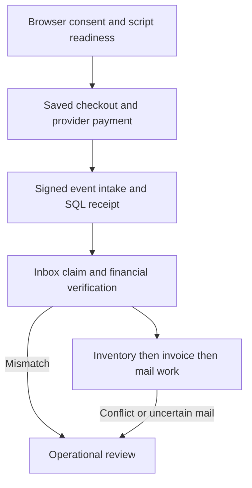
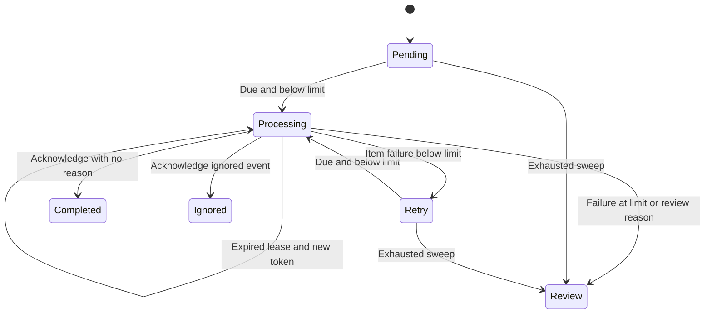
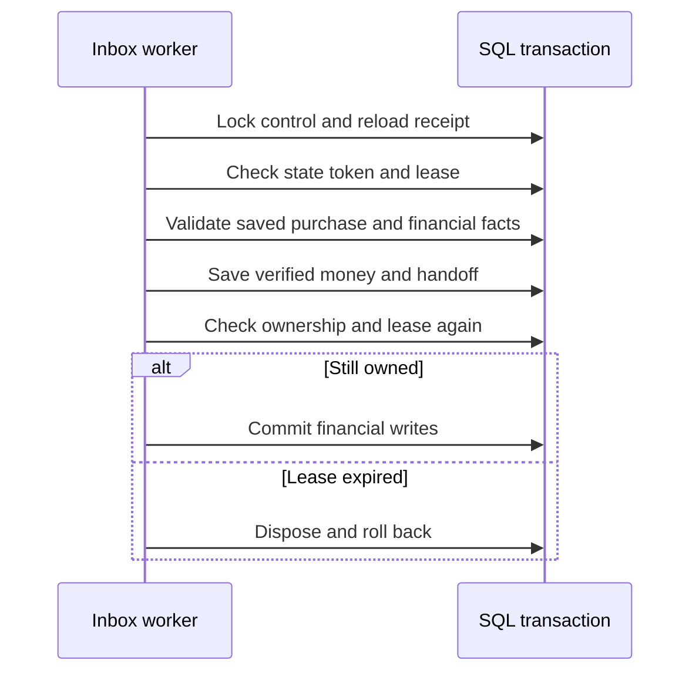
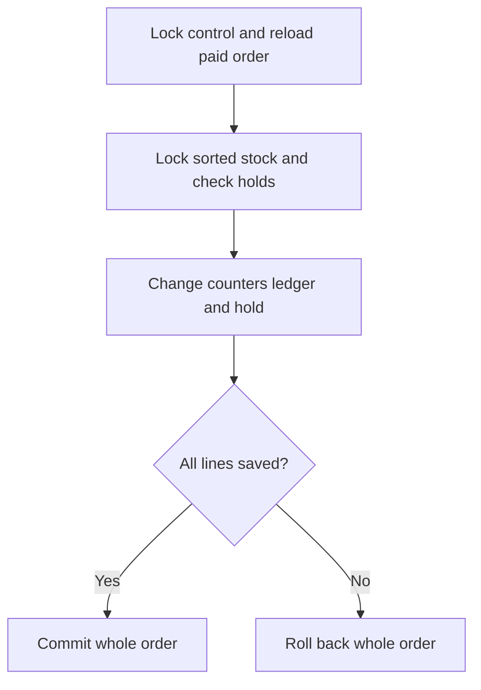
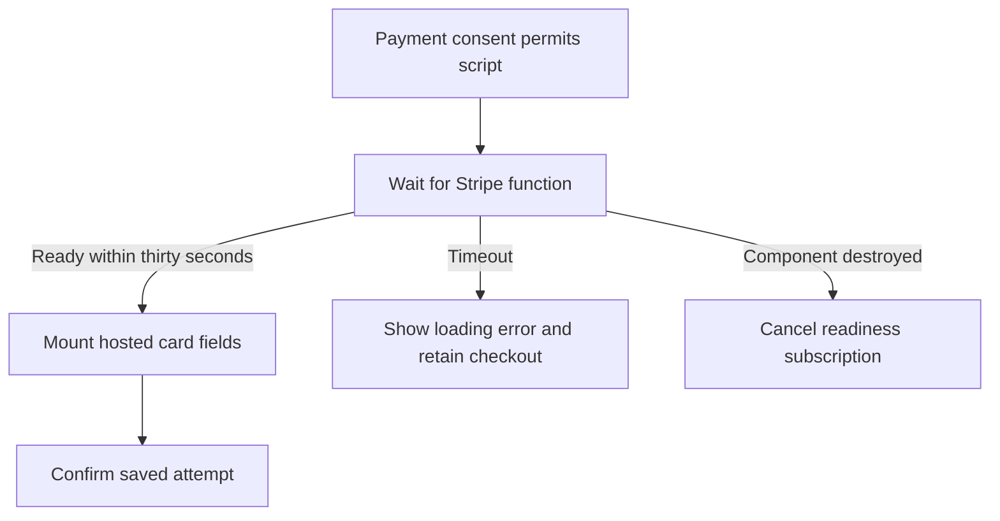
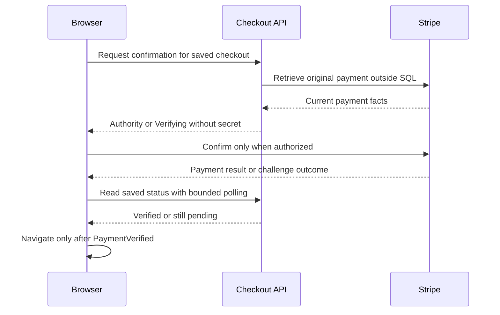
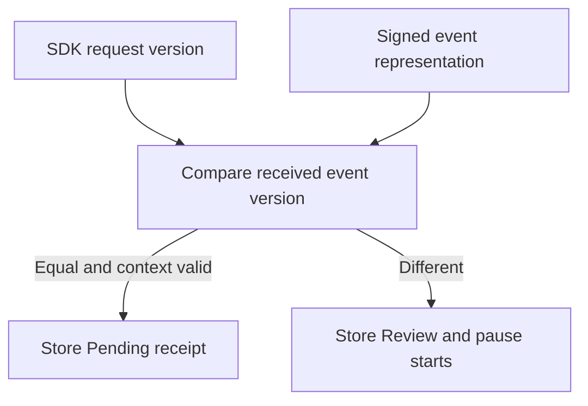
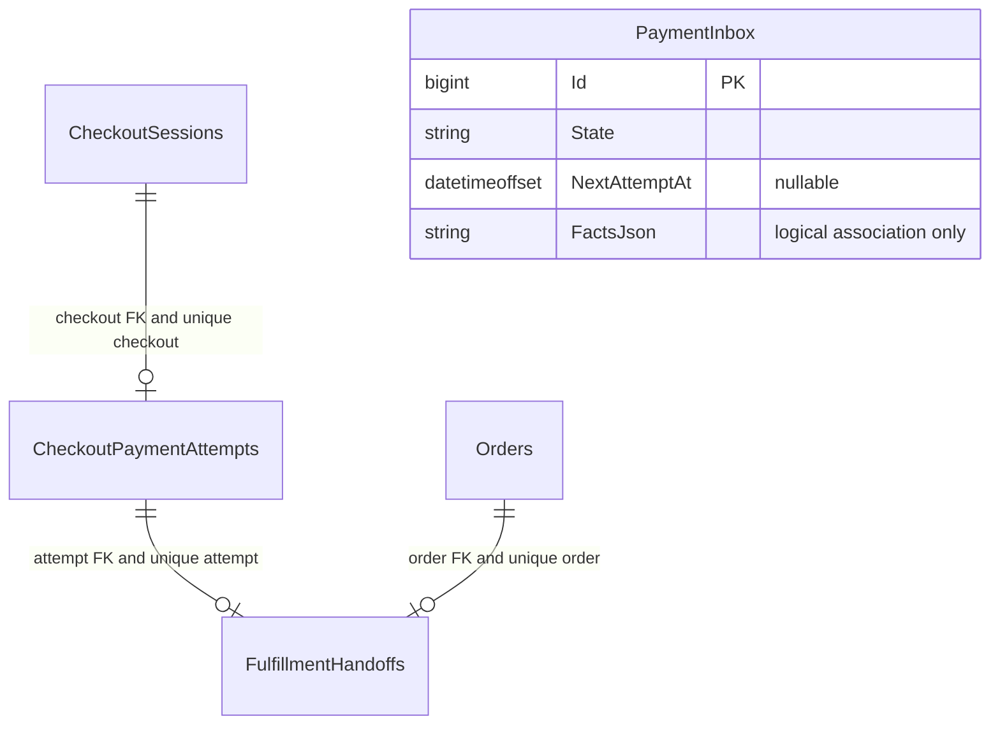
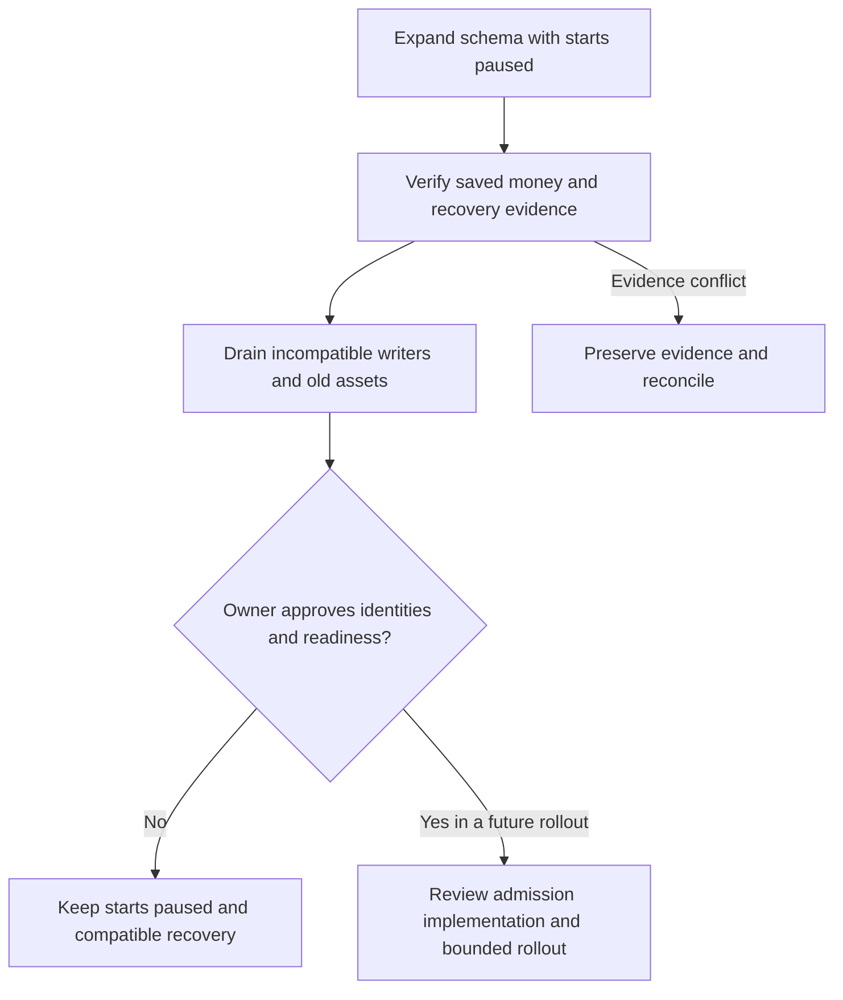

# Testing and Hardening Checkout and Order Recovery in LiliShop

## One purchase crosses several failure boundaries

A customer buys two shirts at 20 EUR each, a cap for 10 EUR and a mug for 10 EUR, with 5 EUR shipping. The saved agreement is **40 + 10 + 10 + 5 = 65 EUR**, or **6,500 minor units**. Payment, stock, invoice and email should eventually agree with that saved purchase. They cannot all commit together: Stripe, SQL Server, the browser and a mail server are separate systems.

The same illustrative order has three saved lines. Stock examples below focus on the shirt row unless another line is named. This lets us follow both a two-unit stock movement and a restart after only one of the three lines committed.

| Saved line | Quantity and price | Saved amount | Physical / reserved before | Physical / reserved after sale |
| --- | --- | ---: | --- | --- |
| Shirt | 2 × 20 EUR | 40 EUR | 100 / 2 | 98 / 0 |
| Cap | 1 × 10 EUR | 10 EUR | 12 / 1 | 11 / 0 |
| Mug | 1 × 10 EUR | 10 EUR | 8 / 1 | 7 / 0 |

Subtotal is 60 EUR and saved shipping is 5 EUR. Retained tests use their own declared fixtures, including a one-line two-unit purchase at 30 EUR per unit; those different test datasets are identified as evidence rather than presented as this exact illustrative order.

Five failures make this problem concrete:

| Failure | What the customer or operator sees | Evidence that may already exist | Harm from a careless response |
| --- | --- | --- | --- |
| A malformed payment receipt comes before a healthy receipt | One customer's payment remains unverified while recovery repeatedly fails | Both receipts are in SQL, but only one has readable financial facts | The healthy customer waits indefinitely or pays again |
| An older stock operation saves counters before its hold status | Processing reports failure, although physical stock has fallen | A deduction and changed counters exist beside an Active reservation | Retrying can deduct twice or release reserved stock incorrectly |
| Stripe accepts payment before the browser's waiting window ends | The payment form remains open after the customer completed payment | Stripe has a successful payment and SQL may still have a Ready checkout | A misleading ready message invites another confirmation |
| The customer opens checkout before Stripe.js finishes loading | Card fields fail to mount on a fast direct visit | Consent exists, but the allowed script is still loading | Reload appears to fix an unpredictable integration problem |
| A signed provider event uses an unsupported API version | Intake accepts the receipt durably, but starts become paused | An authentic receipt with incompatible facts is retained for review | Treating authenticity as compatibility can release an unsupported purchase |

These are teaching scenarios. The poison-receipt failure, split legacy stock failure, short browser wait and late script race also have retained failing regressions. The version mismatch occurred during actual sandbox integration. None is presented as a production incident. All identifiers and stock examples in this tutorial are illustrative; private customer data and actual provider references are omitted.

### The responsibilities from the top down



This is a responsibility map, not one transaction. Browser readiness has no SQL transaction. Provider requests occur outside SQL. Receipt intake has its own transaction. Claim, financial application and acknowledgment use separate short transactions. New-flow stock processing commits one saved line at a time; invoice issuance and mail intent share a later transaction. A mail send happens outside SQL after a Sending record commits.

A **transaction** makes its grouped database writes commit or roll back together. **Durable** means a record survives the process that created it. **Idempotency** means repeating a logical operation does not create another protected effect. These local guarantees do not create one shared transaction across SQL and external providers.

The [checkout companion](0068_Durable_Checkout_and_Verified_Payments_in_LiliShop.md) teaches the original purchase and financial boundaries. The [fulfillment companion](0069_Recoverable_Fulfillment_Inventory_Invoices_and_Email_in_LiliShop.md) teaches resumable stock, invoice and mail work. This article explains the later hardening and the integration evidence that exposed gaps between those parts.

### Why passing unit tests was not enough

A unit test replaces collaborators so that one piece can be examined. A component test can replace Stripe, HTTP and Router together. Those tests are valuable, but their replacements cannot establish that a real script loads after consent, that a hosted authentication challenge works, that a webhook version matches the SDK, or that a real mailbox receives an attachment.

One actual event arrived at 05:15:18 UTC; local verification followed at 05:16:03 UTC, about 45 seconds later. The browser had only about 30 seconds of status checks. Every isolated happy path could pass while that customer journey still stopped at the payment form. The solution combines local transaction guarantees, bounded recovery, retained identity and tests at each real boundary. Its tradeoffs include serialized SQL control locks, conservative review states, bounded waiting and manual decisions when external outcomes are unknown.

### Source snapshot and first reading path

The implementation described here is frozen at backend [`9b0aca800d363720c4a3c2dc3af263e468a2b19c`](https://github.com/jahanalem/LiliShop-backend-dotnet/commit/9b0aca800d363720c4a3c2dc3af263e468a2b19c) and frontend [`d9990375008d817797bfbd887fbde9a016413b3a`](https://github.com/jahanalem/LiliShop-frontend-angular/commit/d9990375008d817797bfbd887fbde9a016413b3a), inspected on 24 October 2026. Both working trees were clean. Source links below are pinned to these commits. Earlier executed tests are identified by their own source phase, rather than attributed automatically to every later edit. See the [verification note](0070_Documentation_Verification.md) and [source manifest](0070_Source_Manifest.json) for hashes, provenance and limits.

For a first reading:

1. Follow the 65 EUR purchase through [receipt recovery](#receipt-recovery-keeps-healthy-work-moving) and [financial fencing](#a-financial-commit-needs-current-ownership).
2. Compare [legacy atomic stock](#legacy-stock-needs-a-whole-order-transaction) with the newer per-line mechanism.
3. Follow [the browser journey](#the-browser-must-wait-without-inventing-success), [version alignment](#provider-versions-are-part-of-the-contract) and [mail outcomes](#email-has-two-current-delivery-paths).
4. Read [the worked failures](#following-the-same-purchase-through-failures), [evidence ladder](#what-the-retained-tests-establish) and [release boundary](#restore-and-cutover-preserve-external-truth).
5. Use the appendices to trace a particular method, field, package or changed file.

### Table of contents

- [Receipt recovery](#receipt-recovery-keeps-healthy-work-moving)
- [Financial commit fencing](#a-financial-commit-needs-current-ownership)
- [Legacy inventory and coexistence](#legacy-stock-needs-a-whole-order-transaction)
- [Browser startup, readiness and payment](#the-browser-must-wait-without-inventing-success)
- [Stripe versions and real integration](#provider-versions-are-part-of-the-contract)
- [Mail orchestration and delivery evidence](#email-has-two-current-delivery-paths)
- [Schema and recovery time](#a-small-schema-change-supports-bounded-recovery)
- [Dependencies and PDF rendering](#dependency-security-and-pdf-compatibility-are-different-changes)
- [Worked failures](#following-the-same-purchase-through-failures)
- [Tests and their limits](#what-the-retained-tests-establish)
- [Restore and cutover](#restore-and-cutover-preserve-external-truth)
- [Glossary](#glossary)
- [Appendix A: methods and contracts](#appendix-a-methods-and-contracts)
- [Appendix B: database reference](#appendix-b-database-reference)
- [Appendix C: change and coverage inventory](#appendix-c-change-and-coverage-inventory)
- [Appendix D: package versions and evidence](#appendix-d-package-versions-and-evidence)
- [Current state](#current-state-and-open-decisions)

## Receipt recovery keeps healthy work moving

An **inbox** is a durable table of received instructions or facts. Here `PaymentInbox` holds a safe projection of a signed Stripe event, its identity and payload hash, and mutable recovery information. A **poison receipt** is a row whose processing repeatedly fails, for example because stored financial JSON is malformed. The application must preserve that row while allowing later healthy work to proceed.

### Intake commits before acknowledgment

`PaymentsController.StripeWebhook` reads the body and Stripe signature, then calls `CheckoutInboxService.ReceiveAsync`. This endpoint is not customer-token authenticated; Stripe's signature authenticates the event. The request limit is 1,048,576 bytes. Missing webhook context returns 503; invalid signatures or malformed payloads return 400. A database failure returns 503, so the provider can retry. An HTTP 2xx response is allowed only after receipt storage commits. [Sources: webhook][b-payments], [inbox][b-inbox].

Intake constructs the event with `throwOnApiVersionMismatch: false`, then explicitly compares `receipt.ApiVersion` with `StripeConfiguration.ApiVersion`. That parser option allows an incompatible signed receipt to be retained; it does **not** authorize incompatible financial processing. An account or mode mismatch becomes `provider_context_mismatch`; a version mismatch becomes `unsupported_api_version`. Both store Review and pause starts.

For a direct-account event, a missing event Account uses the configured expected account. Connected-account events retain their reported account and must agree with the expected context. IDs and event/version strings are bounded before persistence. Only mapped payment facts are stored: payment identity, status, amount, received amount, currency, mode, account and purchase metadata. The raw body, card data, billing data and client secret are not stored in this table.

The unique `(ProviderAccount, EventId)` index handles event identity. A replay with the same payload hash reuses the row. The same identity with a different hash becomes `event_identity_payload_conflict` and Review, and pauses starts. No replacement body is written. A new event ID for the same payment still needs logical-effect protection; event uniqueness alone cannot prevent a second financial effect.

### Claims choose due work, not just unfinished work

The previous maintenance loop awaited claim, application and acknowledgment without a per-item exception boundary. A JSON exception from the first receipt escaped the invocation. The healthy payment behind it had no chance in that invocation. The red regression `A6PoisonReceiptDoesNotStopHealthyReceipt` demonstrated this through real SQL and maintenance. The green result leaves the poison row in Retry and the healthy checkout PaymentVerified with one handoff.

Current `ClaimAsync` starts a control-first transaction and applies two separate rules:

- A housekeeping sweep moves at most 100 exhausted eligible rows to Review. Pending and Retry rows with at least eight claims qualify; Processing rows qualify only when their lease has expired. It clears claim/retry fields and records completion time. It preserves an existing reason, otherwise using `inbox_attempts_exhausted`.
- Selection independently requires `DeliveryAttempts < 8`. Pending or Retry must have `NextAttemptAt == null` or a due time. Processing must have an expired lease. Candidates are ordered by `Id`; one is claimed.

That independent attempt predicate matters. Suppose 205 exhausted rows come before 105 fresh poison rows and then the healthy purchase. Sweeping only the first 100 exhausted rows must not leave the next 105 eligible for new claims. The regression `A6MorePoisonThanBatchAndExhaustedSweepStillReachHealthyWork` runs two bounded maintenance batches: all 205 exhausted rows become Review, 105 poison rows back off in Retry, and the healthy purchase verifies. Future retries cannot repeatedly occupy the head of the same immediate queue.

The exact selector excerpt is below. `Now` comes from `TimeProvider`, which lets tests move time without sleeping. [Source][b-inbox].

```csharp
var row = await db.PaymentInbox.Where(x => x.DeliveryAttempts < AttemptLimit
    && ((x.State == "Pending" || x.State == "Retry") && (x.NextAttemptAt == null || x.NextAttemptAt <= Now)
        || x.State == "Processing" && x.LeaseUntil <= Now))
    .OrderBy(x => x.Id).FirstOrDefaultAsync(ct);
```

A claim creates a new random `LeaseToken`, sets State to Processing, sets a two-minute `LeaseUntil`, increments `DeliveryAttempts`, and clears `NextAttemptAt`. It also clears the two generic prior processing reasons before a new attempt. The claim transaction commits before work begins. A **lease** is temporary permission to work; a **token** distinguishes this claimant from an earlier worker. Neither says that financial work has completed.

### Retry, review and terminal states



The self-transition means reclamation by a later claim. It is not permission for the stale token to commit. Expired exhausted Processing rows also enter Review during sweeping. Intake may create Review directly for incompatible context/version or conflicting event identity; those intake transitions are described above rather than added to this processing diagram.

`ProcessOneAsync` returns false if no claim exists. After a successful claim it attempts `ApplyAsync` then `AcknowledgeAsync`. If an item throws, it records `inbox_payload_invalid` for a JSON exception or `inbox_processing_failed` for another exception. `RecordFailureAsync` reloads state under the control lock and checks State, token and lease before changing anything. An eligible claim becomes Retry until its eighth attempt; then it becomes Review. Backoff is `min(1800, 30 × 2^(DeliveryAttempts − 1))` seconds: 30, 60, 120, 240, 480, 960, 1800, with the final claimed failure entering Review. A future retry time is not overdue work.

**Quarantine** in this implementation means the same row is in Review and excluded from automatic claims. There is no separate quarantine table, financial replay UI, automatic reset or new override endpoint. Review is terminal for this automatic selector, not proof that an operator has resolved the money.

### A failure can fail to record

The financial transaction may roll back successfully, followed by a second database failure while saving Retry. In that case the already committed Processing claim remains. `ProcessOneAsync` logs a safe message and permits the maintenance loop to attempt later items. After lease expiry, another claimant can recover the row. The regression `A6FailureRecordingFailureLeavesClaimFencedAndHealthyWorkProgresses` injects a failure while saving Retry; it verifies that the healthy purchase progresses, the poison claim stays fenced, and recovery later increments its claim count.

This exception boundary begins **after** `ClaimAsync`. A database outage during claiming still propagates as infrastructure failure. Caller-requested cancellation is rethrown both during processing and failure recording. It is not converted into a successful item outcome. If cancellation or infrastructure failure leaves a committed claim, lease recovery remains the durable path. Logs added here use local inbox identity and safe codes; they avoid raw provider/customer payloads and exception messages that might contain sensitive data.

## A financial commit needs current ownership

The 65 EUR purchase is not paid locally because the browser reports success or because intake stored a signed event. `ApplyAsync` must find the attempt named in immutable metadata, lock the saved session, and prove financial agreement. The full check is in `CheckoutService.Matches` and `BoundAsync`. [Sources: checkout][b-checkout], [inbox][b-inbox].

It checks the provider payment identity, expected account and mode, currency, 6,500 requested and received minor units for success, checkout/attempt IDs, flow version `1` and the saved purchase hash. It also checks saved order identity, address, buyer, prices, lines, shipping, total, currency, active holds, exact quantities, expiry and stock counters. The order must be Pending, the session Ready and unexpired, and the holds must still support the saved purchase.

If those facts agree, one transaction writes the attempt's `VerifiedAt`, `VerifiedEventId` and `VerifiedFactsHash`, changes the checkout to PaymentVerified and order to PaymentReceived, and adds one `FulfillmentHandoff`. It does not deduct physical stock, issue an invoice or send mail. The original immutable handoff still uses the historical text `BlockedAwaitingA5`; current execution progress belongs to a separate fulfillment record.

### Locks, tokens, leases and revisions have different jobs

`CheckoutService.BeginAsync` clears tracked entities, requires SQL Server, begins a transaction, and reads singleton `CheckoutControls` with `UPDLOCK,HOLDLOCK`. Clearing the tracker avoids trusting values loaded before a competing worker committed. That common control lock serializes cooperating short operations. `LockedSessionAsync` then locks the specific checkout. There is no provider request under those SQL locks.

The token plus an unexpired lease proves current worker ownership. `CheckoutControl.Revision` instead prevents stale administrative control updates; its audit records why starts changed. Fulfillment and email have their own revisions for UI retry/control conflicts. `PaymentInbox` has **no revision column**: its ownership fence is State/token/lease under the shared lock. These mechanisms should not be treated as interchangeable.



`SaveChangesAsync` sends SQL commands within the transaction. It is not the final commit. The added check immediately afterward prevents those commands becoming durable if the lease expired while saving. The test `A6LeaseExpiresDuringFinancialWritesAndTransactionRollsBack` advances the clock from an interceptor after financial persistence. It observes no handoff and a still-Ready checkout. Acknowledge with the stale token cannot finish the receipt; a later claim verifies once.

```csharp
await db.SaveChangesAsync(ct);
// The transaction rolls back even after SaveChanges if the worker lost its time budget.
if (inbox.State != "Processing" || inbox.LeaseToken != token || inbox.LeaseUntil <= Now) return;
await tx.CommitAsync(ct);
```

Acknowledgment is a later transaction. A worker can stop after financial commit and before acknowledging the receipt. Reapplication sees the already verified attempt and matching handoff; it must not create a second protected effect. A stale failure event cannot reverse verified money or release its holds. A later success with conflicting verified facts or a missing handoff becomes `verified_evidence_conflict`. The attempt and handoff constraints protect logical identity independently of event-ID deduplication.

For unsupported event types, Apply records `ignored_event_type`; acknowledgment sets Ignored. A missing mapped object records `missing_payment_facts` and pauses starts. An unknown attempt records `unmatched_or_legacy_payment`. These are retained observations, not a fallback into the retired legacy payment writer.

### Pausing starts preserves recovery

`Admit` blocks new Start, ordinary preparation/resume and confirmation when controls are disabled or starts paused. Signed intake, inbox claims, verification, acknowledgments and failure recovery do not call that admission gate. Maintenance can also recover preparation with `recovery: true`, preserving an already issued provider key. Customer status remains an authorized read. Thus stopping new purchases does not abandon accepted payments. Fulfillment and mail have separate environment and worker gates; pausing starts does not automatically disable paid-order recovery.

## Legacy stock needs a whole-order transaction

The newer fulfillment consumer has stable order-line identities and a durable completion record per line. Older version-0 stock work often has only an order-level deduction. Its failure boundary was different: a primitive committed counters and ledger, then its caller saved the reservation as Committed. A failure in that last save left the database describing two different outcomes.

Physical stock is `QuantityOnHand`; reserved stock is `QuantityReserved`, units set aside for purchases. Available-to-sell is physical minus reserved. A **ledger** records movements, while a reservation's status says whether its hold is Active, Committed, Released or Expired. A Reserve/ReleaseReservation delta changes reserved meaning; a Deduct changes physical meaning. Adding every ledger delta as if they changed the same counter would be wrong.

For the tutorial purchase's shirt line, physical stock began at 100 and reserved stock at 2. The old primitive could commit physical 98, reserved 0 and deduction evidence, while the hold remained Active after the caller failed. The retained single-line red fixture observed physical 98 despite the operation reporting failure. The corrected test injects the same hold-save fault and observes physical 100, reserved 2, Active hold and no deduction. After removing the fault, retry produces physical 98, reserved 0 and one deduction in that fixture. The whole-order algorithm also rolls back other lines in the illustrative three-line purchase; that extension follows the transaction boundary in source, not a claim that this particular fault fixture had three lines. Replaying a completed legacy sale is rejected for review. [Source: `InventoryService`][b-inventory].



All nodes after the first transaction begins and before Commit belong to the same whole-order SQL boundary. The diagram omits variant mapping locks to stay small; the order below includes them.

### Eligibility and lock order

`DeductForOrderAsync(Order order)` rejects version-1 orders and an already active caller transaction. On SQL Server it then:

1. Begins its own transaction and marks the scoped `legacySaleTransaction` flag.
2. Locks CheckoutControls first, matching new-flow financial/fulfillment ordering.
3. Reloads the persisted order and saved lines. It requires version 0, PaymentReceived, a nonempty PaymentIntent association and exactly one order using that association.
4. Resolves historical lines without a saved variant only when their product has exactly one variant. Candidate mapping rows are locked; ambiguous options require review.
5. Locks all distinct stock rows in ascending variant ID order. For each, `QuantityReserved` must equal the sum of all Active holds, and physical stock must cover reserved stock.
6. Rejects any prior order-level Deduct evidence because it cannot prove every old saved line completed.
7. Reloads the purchase's legacy Active hold after locks, then applies every saved line, hold status and remainder release within this transaction.
8. Releases unused legacy holds and commits only after all lines succeed. Failure rolls back and clears tracked state in `finally`.

The flag belongs to a scoped unit of work, not a shared global transaction. The service is not intended for concurrent calls on that same instance. `ApplyCommitAsync`, `ApplyMovementAsync`, `ApplyReservedReleaseAsync` and `ApplyReleaseAsync` join only this operation's transaction. Otherwise each primitive owns its usual transaction. `ApplyReserveAsync` follows the same ownership pattern. No unrelated caller's transaction is silently committed.

### Protect the other customer's reservation

`ApplyCommitAsync` reduces physical and reserved counters together, with this additional guard:

```csharp
var affected = await _unitOfWork.Repository<InventoryItem>()
    .GetByCriteria(i => i.ProductVariantId == variantId
        && i.QuantityOnHand >= quantitySold
        && i.QuantityReserved >= reservedTake
        && i.QuantityOnHand - quantitySold >= i.QuantityReserved - reservedTake)
```

This selected excerpt ends at the guarded query; the conditional UPDATE, ledger writes and transaction code are omitted here and explained in the method table.

Suppose physical stock is 5, this legacy order holds only 1 but wants 2, and another verified checkout holds 4. Taking 2 while releasing only the old order's 1 would leave physical 3 against reserved 4. The new predicate rejects it. `A6LegacyCannotConsumeAnotherVerifiedCheckoutsReservedUnits` verifies unchanged physical/reserved 5/5 and no legacy deduction, while the other checkout remains verified.

If the saved line lacks a hold, a negative `ApplyMovementAsync` still requires remaining physical stock to cover reserved units. If a hold is larger than the purchased line, the operation commits the used portion and releases the remainder in the same transaction. If a removed line left an unused hold, the final legacy release frees it. An insufficient counter raises a conflict rather than setting the hold terminal without evidence.

`ApplyReleaseAsync` locks stock and reloads a hold before expiry/release. If another transaction already committed it, release does nothing. The barrier test `A6LegacyExpiryWaitsAcrossTheCounterLedgerAndHoldBoundary` stops sale after ledger save, starts expiry from a stale context, then permits sale to finish. Expiry reloads Committed and cannot release twice. The contention test also runs a legacy sale, verified new fulfillment, expiry and a stock adjustment together: from 100 units, two two-unit sales and adjustment −95 leave 1 physical, 0 reserved and exactly two deductions.

### Why old null line IDs remain null

An old deduction with `OrderItemId == null` is evidence of some order-level work. It is not enough to invent a stable link to a particular saved line. Rewriting that historical row would manufacture evidence. Legacy replay therefore returns failure/review rather than an unsupported success or another deduction. Payment remains PaymentReceived even when stock processing needs review.

New version-1 fulfillment instead commits one exact saved line with its reservation, deduction and `FulfillmentLine` evidence. The SQL filtered `(OrderItemId, Type)` uniqueness and completion relations make missing-line resumption possible. See [the per-line transaction in the fulfillment article](0069_Recoverable_Fulfillment_Inventory_Invoices_and_Email_in_LiliShop.md#one-line-is-one-local-transaction). A whole-order transaction for ambiguous legacy evidence and a per-line transaction for new durable evidence solve different recovery problems.

Updated code cannot repair a still-running old binary. An old worker may still commit the primitive independently, even after the expanded schema exists. Safe coexistence requires compatible writers and a deliberate drain/cutover. Schema compatibility alone is insufficient.

## The browser must wait without inventing success

The frontend uses signals for local reactive values, such as loading, current checkout and pending confirmation. HTTP/status streams and the two timers are RxJS subscriptions. A subscription must be canceled when its component stops, so a late callback cannot mount fields or navigate a destroyed page. [Payment component][f-payment] and [retained checkout service][f-checkout].

### Anonymous startup must publish a result

`AccountService.currentUserSource` is a `ReplaySubject<IUser | null>(1)`: it remembers the last published user, including an explicit anonymous null. The route guard waits for that stream. Previously `AppComponent.loadCurrentUser()` returned immediately when there was no token, without publishing null. A fresh direct protected route could wait indefinitely.

The fix calls the existing `AccountService.loadCurrentUser(token)` even when token is null. That null-aware method resets the user state and returns `of(null)` before making an account request. The guard can then redirect to login and preserve a return URL. A token-bearing startup still loads the account normally. This is a completed anonymous-state result, not relaxed authorization. The retained AppComponent regression and real anonymous Cypress case both cover this boundary. [App startup][f-app], [account state][f-account], [guard][f-auth].

### Consent and asynchronous script readiness

The existing consent code in `src/index.html` loads `https://js.stripe.com/v3/` asynchronously only when payment consent permits it. `getStripeInstance` remains synchronous and throws if the global is absent. Direct entry can create the component before the allowed script finishes loading. The old immediate call made these two correct pieces race.

Current `ngAfterViewInit` mounts immediately if `window.Stripe` is a function. Otherwise it checks readiness every 100 ms, takes the first ready result and times out after 30 seconds. It does not insert its own script or grant consent. [Consent loader][f-index], [helper][f-stripe], [component][f-payment].

```typescript
if (typeof window.Stripe === 'function') { this.mountCardElements(); return; }
// The consent-controlled script loads asynchronously, including on direct entry and reload.
this.stripeReady=timer(0,100).pipe(filter(()=>typeof window.Stripe==='function'),take(1),
  timeout({first:30000})).subscribe({
    next:()=>this.mountCardElements(),
    error:()=>this.statusMessage.set('Payment form could not load. Allow payment cookies and reload to try again. Your saved checkout is retained.')
  });
```

`mountCardElements` checks `destroyed`, creates the three hosted number/expiry/CVC elements, mounts them and registers change handlers. A theme effect updates resolved colors because provider frames cannot read the application's CSS variables. On timeout the customer sees a recoverable payment-form message and the saved checkout remains. `ngOnDestroy` cancels the readiness subscription and status polling, and destroys mounted elements. The two new readiness regressions prove mounting after asynchronous availability and no late mount after destruction. They are not a test of every network failure or script initialization exception.



Consent denial does not gain a bypass from this diagram. The timer observes readiness; it cannot make a denied script appear.

### A bounded payment wait with an honest pending state

`submitOrder` ignores repeated clicks while loading, destroyed or `confirmationPending`. It prepares/resumes the saved checkout, asks the server for confirmation authority, and only then calls `stripe.confirmCardPayment` with hosted card data. If there is no client secret, it checks server status instead. Neither a returned PaymentIntent nor a query parameter authorizes local paid status.

When the browser returns succeeded or processing without an error, `confirmationPending` becomes true. The button remains disabled and a still-Ready server view says to wait for server confirmation and use Resume saved checkout. The local boolean is not a durable paid flag; it prevents another confirmation in this mounted component. After a reload, retained identities and server confirmation checks carry that responsibility.

The old poll was `timer(0,2000).pipe(take(15), ...)`, about 30 seconds. Current polling uses 61 ticks, starting immediately and every two seconds through about two minutes. `exhaustMap` skips a new tick while a prior HTTP request is still active. Therefore 61 ticks are an upper bound on scheduled opportunities, not a guarantee of 61 completed requests or a precise wall-clock deadline if HTTP itself stalls. The code does not keep polling forever.

```typescript
this.polling=timer(0,2000).pipe(take(61),exhaustMap(()=>this.checkoutService.status(id))).subscribe({
  next: view => this.acceptStatus(view),
  error: () => this.statusMessage.set('Payment status is unavailable. Your saved checkout is retained; please check again.')
});
```

`acceptStatus` navigates to `checkout/success?checkout=...` only for server PaymentVerified. It stops polling on PaymentVerified, ReviewRequired, Expired or Cancelled. A status error retains identity and asks the customer to check again. Manual Resume performs one preparation/status action; it is not an unbounded background loop. A timeout never authorizes discarding an uncertain attempt or creating a replacement charge.

The regression `observes server verification beyond the first thirty seconds` makes local success arrive after the old limit. `keeps submitted payment pending without another confirmation or paid claim` verifies the second UI rule. Both failed first and passed after the focused change. The real observed minute-scheduled recovery delay explains why those regressions matter.



This sequence condenses the confirmation path. Provider retrieval is outside the API's short authorization transactions. The provider sends its signed event through the separate inbox boundary; a browser result does not directly execute financial verification. No-secret and failed-authentication branches do not authorize a new payment identity.

### Retain the purchase across reload and return

`CheckoutService.prepareCheckout` waits for the current authenticated user and creates an owner-scoped storage key. It stores request identity and a normalized input fingerprint **before** the first HTTP request. With a known checkout ID it posts `/resume`; without one it repeats Start with the same RequestKey. A changed fingerprint is `checkout_input_changed`, not permission to erase the old purchase. `cancelSavedCheckout` refuses to discard an unresolved first response and clears identity only after server Cancelled.

The server independently verifies numeric owner identity and returns 404 for another owner. Storage and URL IDs are correlations, not authorization. After PaymentVerified, `finishVerified` clears only the matching saved identity and the unchanged basket that was paid for. A different or edited basket in another tab is preserved.

The current success route uses the real authentication guard and does not require ephemeral `navigation.extras.state.order`. The old `successMatchGuard` helper remains in source, but is not the current success route's guard. The component reads the `checkout` query parameter and asks the authorized server for status. Direct open and reload work without reposting payment. Its fulfillment panel calls a separate processing API after verified payment; **Check again is manual refresh**, not the payment component's two-minute polling timer. Two inventory lines completed means two stock lines, not two email tasks or delivery. Email pending can remain beside completed stock/invoice work. [Routes][f-routes], [success component][f-success], [processing service][f-fulfillment].

## Provider versions are part of the contract

A valid signature proves the body came from the expected signing context. It does not prove that the application's SDK understands that body's API version. Keep four version sources separate:

| Version source | Role | Observed value or behavior |
| --- | --- | --- |
| Stripe.net SDK/request constant | Shapes requests and the application compatibility check | 52.1.1 expected `2026-06-24.dahlia`; 53.0.0 expects `2026-09-30.endive` |
| Event body `api_version` | Version of the signed event representation actually received | Earlier default listener delivered `2026-01-28.clover` |
| Account default / endpoint settings | Provider configuration that influences event/request representations | Not changed during the validation; never assume it equals the SDK |
| CLI listener selection | Local forwarding behavior | CLI 1.55.1 with tested `--latest` actually delivered endive |

The initial SDK 52.1.1 did not match either the default clover receipts or the listener's then-latest endive receipts. They were retained in Review and starts paused. Later owner package updates selected Stripe.net 53.0.0. The actual listener/event version was checked again and matched endive. This was a verified pairing at that time, not a permanent property of `--latest`.



The event also passes signature, account/mode and later money/purchase checks. This diagram isolates the version boundary; equality alone cannot verify payment.

The retained CLI help supports explicit event selection, `--events-from @self`, `--latest` and `--forward-to`. It has no listen API-version pinning option. The exercised command shape was:

```text
stripe listen --events-from @self --events payment_intent.succeeded,payment_intent.payment_failed --latest --forward-to http://127.0.0.1:6001/api/payments/webhook --skip-update
```

This documents historical test behavior, not a ready-to-run release pin. Future SDK/CLI changes need another exact comparison. Credentials, signing material and account identifiers are intentionally absent. No public endpoint, shared account default or signature/version check was changed to obtain a pass.

Stripe.net 53 also changed the create-options property used by both the new provider and legacy payment helper to `AllowedPaymentMethodTypes`. The new provider continues to select card, automatic capture, immutable purchase metadata and the original idempotency key. Its explicitly constructed client validates the retrieved account; live mode and non-test credentials remain rejected. The frontend production publishable key was corrected to the matching test context, addressing a browser `No such payment_intent` failure. No key is reproduced here. [New provider][b-provider], [legacy payment helper][b-payment-service], [production configuration source][f-prod].

### What the actual sandbox runs proved

**Stripe Elements** are provider-hosted payment fields. **Strong Customer Authentication (SCA)** is an additional authentication step, such as the hosted challenge used in these tests.

The later browser tests drove actual Stripe Elements card fields and hosted authentication frames through the Angular application. Authentication success, failed authentication and card decline passed in a final three-scenario run. Reload/direct-status assertions checked that no second creation request appeared. The test browser used `chromeWebSecurity=false` for frame interaction; the normal application's CSP and financial checks remained unchanged.

Ten independent test PaymentIntents were retained across successful and failed test attempts. Four captured 6,500 EUR minor units each; six were unpaid with zero received. Each captured attempt had exactly one handoff, one saved-line completion, one two-unit deduction, one invoice and one durable mail intent. The unpaid attempts had none. This is actual provider plus SQL evidence. It is separate from the earlier server-only confirmation using test PaymentMethod IDs and from signed-fixture tests.

An abandonment run observed requires_action with zero received, navigation away, status reload, no paid claim and no fulfillment. It then failed an incorrect test expectation: it waited for a second Start POST while the application correctly used `/resume`. A separate continuation restored only synthetic browser correlations and completed the **same** request, checkout, attempt and PaymentIntent. It ended with one verified fulfillment and no replacement creation. The corrected full fresh-abandonment test was **not** rerun as one seamless case. These are complementary observations, not one claimed automated pass. A literal operating-system browser-window crash was not tested.

An API restart after completed processing preserved the ten associations and their effects. Crash after pending intake, duplicate/distinct events, lost acknowledgment, stale claims and deliberate fault ordering were tested separately with real SQL and deterministic signed fixtures. No actual remote duplicate or intentionally delayed provider redelivery was injected. Observed queue delay is real, but it does not cover every remote retry mechanism.

### The original capture remains unresolved

Use the neutral alias **Original capture** for the earlier 65 EUR sandbox purchase. The provider says succeeded and received 6,500 minor units. Locally its checkout remained Ready but expired, its hold was Active but expired, its old clover receipt remained Review, and there was no verified handoff or invoice. A read-only reconciliation preserved those facts and hashes.

Retrieving the original Event with a newer version header still returned its original version. Another old failure event also had different representations between CLI rendering and Event retrieval. Equal event IDs do not imply equal bodies. Rewriting the old version, replacing immutable facts or clearing Review would erase the reason the verifier stopped. The normal verifier also rejects an expired purchase/hold. New successful payments do not close Original capture.

A separately reviewed late-capture reconciliation policy and audited implementation are still required. Current source/evidence contains no approved late-capture writer, replacement charge, refund, extended reservation or final repair for that case. Documenting that boundary is part of a correct engineering result.

## Email has two current delivery paths

The intended architecture is **SendGrid first, with Gmail/SMTP fallback when the primary send fails**. Gmail is currently the usable fallback; SendGrid remains the preferred primary for a future store. A paid subscription is not a prerequisite for documenting that architecture. The important question is which caller reaches which orchestration.

### General and legacy mail use the existing fallback

`ApplicationServiceExtensions` registers `SendGridEmailService`, `SmtpEmailService` and `IEmailService` as `FallbackEmailService`. The fallback materializes attachments once, calls SendGrid, returns on true, and calls SMTP only when that primary method returns false. If SMTP also returns false, the fallback throws `InvalidOperationException`. There is no surrounding catch that directly converts an arbitrary thrown primary call into fallback. In the concrete primary service, however, its broad catch logs and returns false for exceptions, as well as returning false for non-success HTTP status. [Registration][b-di], [fallback][b-fallback], [SendGrid service][b-sendgrid-email], [SMTP service][b-smtp-email].

```csharp
bool isSuccess = await _primaryService.SendEmailAsync(to, subject, htmlContent, materializedAttachments);

if (isSuccess)
{
    return true;
}

// 2. Fallback to native SMTP
_logger.LogWarning("Primary email service failed. Executing SMTP fallback.");
bool fallbackSuccess = await _fallbackService.SendEmailAsync(to, subject, htmlContent, materializedAttachments);
```

`SmtpEmailService` reads SMTP configuration, creates a TLS-enabled `SmtpClient`, attaches byte arrays through owned streams and returns true after `SendMailAsync` completes. Missing configuration and caught exceptions return false. The boolean interface cannot tell a caller whether false means a known pre-send failure, rejection, timeout, or a lost response after possible acceptance.

General notification/account mail reaches `IEmailService`. Legacy `InvoiceEmailService.SendInvoiceEmailAsync(int invoiceId)` also prepares the invoice PDF/content and calls this interface. It explicitly rejects version-1 invoices, because their send must follow durable mail work. Thus the application **does** have SendGrid-first SMTP fallback; it is not used by every invoice path. [Invoice email][b-invoice-email], [notification caller][b-notification], [account mail caller][b-user-service].

### Durable invoice work uses a separate transport

The same registration file separately maps `IInvoiceMailTransport` to `SendGridInvoiceMailTransport`. `InvoiceEmailWorker` injects that interface and `IInvoiceMailPreparation`. Preparation reuses `InvoiceEmailService.PrepareAsync` for PDF and localized message, but does not call its legacy sending method. Therefore it does not enter `FallbackEmailService` merely because the preparation class also has an `IEmailService` dependency. [Worker][b-mail-worker], [transport contract][b-mail-transport].

```csharp
services.AddScoped<LiliShop.Infrastructure.Checkout.IInvoiceMailTransport, LiliShop.Infrastructure.Checkout.SendGridInvoiceMailTransport>();
```

The durable SendGrid transport preserves three outcomes:

| Observation | Transport result | Worker response |
| --- | --- | --- |
| Missing configuration or message construction failure | Rejected with a safe reason | Bounded Retry, or ReviewRequired at cycle limit |
| HTTP 202 | Accepted | Accepted and `AcceptedAt`, while still owned |
| HTTP 400, 401, 403, 404, 405, 413 or 429 | Rejected | Same bounded retry policy |
| Other HTTP status, including an uncertain server response | UnknownDelivery | Stop automatic sends |
| Transport exception, cancellation or timeout after Sending | UnknownDelivery | Stop automatic sends, or leave Sending for lease recovery if result persistence fails |

`operationId` is a custom correlation argument. The code explicitly does not claim provider-supported send idempotency. That distinction is why replacing the transport with the old boolean fallback without further design would lose safety information.

The worker first claims Preparing, renders outside SQL, then reloads and checks environment gates, enabled control, ownership and completed processing. Only then does it commit Sending with a fresh two-minute lease. The external call has a linked 60-second deadline. Its final result is persisted only while the same token/expected state/lease is owned. If a Sending result is lost, later claim housekeeping records UnknownDelivery and never sends automatically again. Preparing can be reclaimed because no external send was authorized yet. Accepted work cannot be reclaimed.

`ClaimOneAsync(Guid workId)` narrows both claim selection and abandoned/exhausted housekeeping to one work identity. It supports a bounded targeted operator/test invocation; it is not a new HTTP send endpoint. `TargetedMailClaimDoesNotSendOrMutateOtherWorkAndCannotResendAcceptedMail` covers this isolation and accepted-work exclusion.

### What the one-message SMTP validation established

The later validation had explicit authorization for exactly one synthetic invoice and one recipient delivery check. A new isolated fixture used deterministic synthetic payment evidence, then real checkout, inbox, stock, invoice preparation and durable worker transitions. It did **not** create a Stripe payment. A task-scoped `IInvoiceMailTransport` override selected Gmail SMTP with TLS. A consumed one-send permit and exact work/recipient guard bounded the invocation; no SendGrid attempt or automatic fallback occurred in that test.

The SMTP call completed and the durable work became Accepted with Attempts=1, CycleAttempts=1 and one transport call. A subsequent claim check returned no work and sent nothing. An independent mailbox search for that exact message found the invoice and PDF attachment. Gmail classified it **Spam**. Attachment filename/type/byte size were observed; a prior preparation-render hash was not asserted to identify the exact delivered bytes because repeat PDF metadata may differ.

This establishes SMTP/server acceptance and observed receipt of one PDF message. It does not establish Inbox placement, broad deliverability, SMTP idempotency or normal application transport selection. It supersedes the earlier authorization/SendGrid-only mail-test blocker for that SMTP test. It does not turn the persistent durable registration into a fallback registration.

The remaining discrepancy is specific: **durable invoice mail does not currently participate in the intended SendGrid-first/Gmail-fallback orchestration**, while general and legacy mail do. Future review should preserve that provider priority and decide how a fallback can be safe after known rejection while retaining UnknownDelivery after ambiguous outcomes. This documentation task changes no registration and sends no message.

### Why ambiguous primary failure can produce duplicates

In the general boolean path, SendGrid might accept a message and the response might be lost. The primary catches the exception and returns false; fallback then tries SMTP. Both servers may have accepted a copy. This is a source-derived risk, not a demonstrated duplicate incident. SMTP failure itself can also be ambiguous. A later caller/job retry can repeat that operation.

The durable path is more conservative: unknown outcome stops automatic retries rather than switching provider. Neither architecture gives a global exactly-once delivery promise. A future fallback design must distinguish known non-acceptance from possible acceptance and define review behavior; blindly treating every exception as “nothing sent” would break that contract.

## A small schema change supports bounded recovery

The only new schema expansion in this hardening range is migration `20261023192357_A6_PaymentInboxRecovery`. Existing checkout, fulfillment, reservation, ledger and invoice tables come from earlier migrations. Later formatting/import changes to those migration files do not create new tables. [Migration][b-migration], [entity][b-records], [configuration][b-config], [snapshot][b-snapshot].

`Up` adds nullable `PaymentInbox.NextAttemptAt` of SQL type `datetimeoffset`, with no SQL default, backfill, foreign key or check constraint. It creates nonunique index `IX_PaymentInbox_State_NextAttemptAt_Id` on `(State, NextAttemptAt, Id)`. Existing rows remain null and therefore immediately due when Pending/Retry and below the limit. A fabricated default timestamp could delay old work or give false history.

```csharp
migrationBuilder.AddColumn<DateTimeOffset>(
    name: "NextAttemptAt",
    table: "PaymentInbox",
    type: "datetimeoffset",
    nullable: true);

migrationBuilder.CreateIndex(
    name: "IX_PaymentInbox_State_NextAttemptAt_Id",
    table: "PaymentInbox",
    columns: new[] { "State", "NextAttemptAt", "Id" });
```

The index supports state/due-time selection, while the inherited `(State, LeaseUntil)` index supports expired claims. Selection still orders globally by `Id`; the compound index does not promise a sort-free plan for every disjunction or workload. No new claim about an optimizer plan is made. The inherited unique account/event index handles receipt identity, not fairness or logical financial effects.

| Illustrative time | State | Claims | NextAttemptAt | Meaning |
| --- | --- | ---: | --- | --- |
| Before migration | Pending | 0 | Column absent | Old receipt awaits processing |
| After expansion | Pending | 0 | null | Immediately due, no invented historical schedule |
| 12:00:00 claim | Processing | 1 | null | Token and lease through 12:02:00 commit |
| 12:00:01 failure | Retry | 1 | 12:00:31 | Not due for 30 seconds |
| 12:00:32 reclaim | Processing | 2 | null | New token replaces old ownership |
| After successful application/ack | Completed | 2 | null | Financial observation/application is acknowledged |

This is a synthetic timeline. It is not a reproduction of provider timestamps.



Only solid relations shown above are SQL foreign keys. `PaymentInbox.FactsJson` contains logical checkout/attempt metadata; there is no PaymentInbox-to-attempt FK. Other inherited order/session/attempt relations are listed in the earlier articles and [Appendix B](#appendix-b-database-reference). The isolated inbox box is intentional.

Schema expansion, creation of execution rows, runtime worker enablement and permission to start purchases are four separate actions. A migration does not validate every old receipt or enable the shop. `Down` removes the index and column; its existence does not make rollback safe after new code or external effects depend on them.

## Dependency security and PDF compatibility are different changes

The first hardening run retained existing Pkcs advisory warnings. Owner package updates then brought SqlClient to 7.1.1, which resolved `System.Security.Cryptography.Pkcs` 9.0.18 transitively, including through EF Core SqlServer. The focused remediation added an explicit Infrastructure reference to **9.0.21** on the existing 9.x line. Direct means listed by this project; transitive means selected through another package's dependency graph. [Infrastructure project][b-infra-project].

Both reviewed Microsoft advisories identify 9.0.0–9.0.20 as affected and 9.0.21 as patched on that line. One concerns costly `EnvelopedCms.Decode` attribute processing on Windows; the other repeated X.509 parsing in `SignedCms.CheckSignature`. The retained audit changed from affected resolution to no reported vulnerable packages in the audited solution. That is a negative result from the advisory database and dependency graph used then, not a proof that no vulnerability exists anywhere. [Decode advisory](https://github.com/advisories/GHSA-2fmv-rv2c-59x7), [signature advisory](https://github.com/advisories/GHSA-846f-f764-76mx).

Installed-binary inspection found SqlClient's `VirtualizationBasedSecurityEnclaveProviderBase.GetSigningCertificate` constructing and decoding SignedCms and reading certificates. No direct application CMS calls were found. Isolated test connections did not configure enclave attestation; that does not rule out every future deployment's reachability. A separate harness passed synthetic SignedCms sign/verify and EnvelopedCms encrypt/decrypt round trips with product version 9.0.21. The complete later SQL/identity/invoice/mail suite passed with that resolution. No vulnerability warning was suppressed to obtain it.

### The invoice library update

QuestPDF changed from 2026.7.1 in the preceding fulfillment snapshot to **2026.9.1** before the later full suite. Its old glyph-check property became obsolete in 2026.9. The final source replaces:

```csharp
QuestPDF.Settings.CheckIfAllTextGlyphsAreAvailable = false;
```

with this exact current line:

```csharp
QuestPDF.Settings.ThrowOnMissingTextGlyphs = false;
```

A **glyph** is a drawable shape for a character. False preserves the existing policy: missing text glyphs do not throw, so a document can contain missing-character boxes instead of failing rendering. It does not add fonts or guarantee complete Persian, Arabic, Chinese or other script coverage. The static constructor also selects the Community license; rendering still builds a PDF from the saved invoice and labels. This obsolete-property warning was an API compatibility issue, not a security vulnerability. [Renderer][b-renderer].

The 481-case full suite already used the updated package versions and Pkcs 9.0.21, but preceded this one-line glyph-setting rename. The immediately subsequent Release build after the rename succeeded with 0 warnings and 0 errors in the retained conversation record. It was not a rerun of the full test suite. No package version changed after that full suite in the chosen final commit: it committed the already tested Pkcs reference and the later rename. The documentation checks compare that fact with retained dependency metadata; they do not silently restore packages or run external tests. The package inventory and exact evidence limits are in [Appendix D](#appendix-d-package-versions-and-evidence).

Frontend full-suite output also contains existing icon/SignalR diagnostics. A zero-error test exit is not a claim that every tool log was silent. The earlier frontend baseline failed because its API dependency stopped during execution despite individual assertions passing; a complete rerun passed. Lifecycle failures remain part of the evidence history.

## Following the same purchase through failures

The following branches start from the same illustrative three-line, 65 EUR purchase. They are alternatives, not a claim that one real order experienced all of them. Its money remains a saved snapshot throughout recovery, not a recalculation from changed catalog prices. Supporting tests may use a smaller or differently priced fixture to isolate a boundary.

| Branch | Committed evidence before interruption | Failure and recovery action | Expected final evidence and support |
| --- | --- | --- | --- |
| Normal execution | Checkout/attempt, provider identity, saved order and three holds | Signed success becomes a receipt, then verification and fulfillment run | One verified attempt/handoff, three line effects, shirt physical 98/reserved 0, one invoice and mail intent. Actual sandbox single-line effects and `ThreeLineTerminationResumesMissingLinesAndFencesOldWorker` support their respective boundaries |
| Poison before healthy work | Malformed predecessor and this healthy signed success both in PaymentInbox | JSON failure backs off predecessor; bounded maintenance continues | Poison Retry, healthy PaymentVerified and one handoff. `A6PoisonReceiptDoesNotStopHealthyReceipt`; larger batch contract adds 205 exhausted/105 poison rows |
| Saving the failure also fails | Processing claim committed, financial transaction not committed | Failure-recording transaction rolls back; continue later items and reclaim after lease | Poison remains Processing until expiry, then retries under a new token; healthy work completes. `A6FailureRecordingFailureLeavesClaimFencedAndHealthyWorkProgresses` |
| Lease expires during financial SQL writes | Receipt claim committed | Clock passes lease after SaveChanges; final fence refuses commit | No paid-order/handoff writes survive; stale acknowledge does nothing; new claim verifies once. `A6LeaseExpiresDuringFinancialWritesAndTransactionRollsBack` |
| Legacy hold-save failure | Paid version-0 order and Active holds | A hold-save failure rolls back the whole sale | Shirt physical/reserved remain 100/2; other lines also roll back. Retry consumes the three saved lines; replay requires review. The retained single-line fault test `A6LegacyHoldSaveFailureRollsBackCountersAndLedgerBeforeRetry` proves its injected hold boundary; the whole-order scope is explicit in source |
| Local verification takes longer | Stripe succeeded, signed receipt committed, SQL checkout may still be Ready | Browser keeps pending submission and checks for about two minutes; manual Resume remains possible | Only server PaymentVerified navigates; no renewed confirmation after local success in the mounted component. Two rendered regressions plus actual observed delay |
| Stripe.js is late | Consent exists; checkout correlation may already be retained | Readiness subscription observes script availability or reports timeout; destroy cancels it | Hosted fields mount once when ready, never after destroy. Two readiness regressions; actual provider run covers mounted integration |
| Authentication is abandoned | Same attempt requires_action and received amount is zero | Navigate away, reload status, later resume original identity and complete challenge | No paid claim while unpaid; continuation later gives one verified handoff/invoice without new creation. Actual abandonment observations plus separate continuation; full corrected single-case rerun absent |
| Mail outcome is unknown | Invoice and intent, then Sending committed | Provider may accept before response/persistence loss | UnknownDelivery, no automatic resend; payment and invoice remain valid. Durable synthetic transport/failure tests support this; actual SMTP test demonstrated acceptance, not injected uncertainty |
| Restored partial processing | Three saved lines, one committed line, uncertain mail fixture and historical money | Restore into a new target, verify equality, reclaim expired execution and process missing lines | Exactly three line effects, one invoice and one mail intent for resumed work; existing UnknownDelivery count unchanged and no sends. `A6RestoredPartialWorkResumesWithoutRepeatingInventoryOrUnknownMail` |

For the final branch, partial progress is a durable fact. The resumed worker validates a line marker against its reservation and exact deduction/release pair. It skips a completed line only when that evidence agrees. It does not assume that “a previous worker ran” means all lines finished. Likewise, missing historical shipping/total stays unresolved instead of borrowing today's shipping cost.

An additional transient financial-save test creates a fault on handoff insert. After rollback it observes Retry due in 30 seconds and no handoff. After advancing 31 seconds, it verifies once; repeating the same event and a distinct event leaves one protected financial effect. An eight-interrupted-claim test exhausts a poison row and confirms that pausing starts still permits another valid payment's recovery. These extend the table without inventing remote production failures.

## What the retained tests establish

This writing task inspected execution records and source. It did **not** rerun application, destructive SQL, provider or mail tests. “Passed” below means a retained run passed in the identified source phase. Newly executed checks are documentation hashes, references, excerpts, diagrams and preservation checks only.

### A testing ladder with different authorities

| Layer | What it can establish here | What it cannot establish alone |
| --- | --- | --- |
| Unit and rendered component tests | Input/state logic, timeout behavior, disabled controls, no navigation from client-only success | Actual provider frames, real script timing, real route wiring or SQL locking |
| SQL fault/concurrency tests | Transaction rollback, constraints, token fencing, counter/ledger agreement under controlled races | Stripe's actual event representation or remote send acceptance |
| Authenticated HTTP/application browser tests | Router/guard wiring, owner 404, production JWT/security-stamp checks, operator revision/audit | Hosted provider authentication when it is replaced or absent |
| Real Stripe Elements/events | Hosted fields/challenge, real signed versioned intake, captured/unpaid provider state and matching SQL effects | Every possible remote duplicate, crash or late-event timing |
| SMTP call | One real server accepted this prepared message | Mailbox placement or exactly-once delivery |
| Independent recipient observation | That specific PDF message reached the mailbox and was classified Spam | Inbox placement, future deliverability or persistent transport registration |

### Counts and source phases

| Phase | Backend | Frontend | Browser and API | Source/evidence boundary |
| --- | --- | --- | --- | --- |
| Initial hardening | 461 passed, zero skipped | 298 passed in 67 files on the final successful rerun | 13 application Cypress cases; safe Newman 26 requests/105 assertions | Backend preceding fulfillment reference plus initial hardening edits, later committed in `d4d4463`; frontend initial auth fix, later `536b03f`. Earlier provider mismatch/SCA failures remain failures |
| Follow-up final | 481 passed, zero failed/skipped | 302 passed in 67 files | 13 application cases, 3 actual Elements scenarios, separate 1-case retained-attempt continuation; Newman again 26/105 | Backend `3b5fe89` plus Pkcs 9.0.21; frontend `a531588` plus readiness/polling/provider-test edits later committed in the chosen final HEADs |
| Authorized synthetic SMTP validation | Fixture/worker assertions passed; no full-suite rerun | Not rerun | One real SMTP invocation and independent mailbox observation | Task-scoped transport override; synthetic payment evidence, unchanged persistent application registration |
| Glyph API rename | Release build passed, 0 warnings/errors in the preceding maintenance check | Not rerun | No payment/mail test added | One renderer property rename after the full run; no later package version change |

The 13 application browser cases consist of four real HTTP/SQL status/authorization/retry cases and nine existing mocked login/registration cases. They are not thirteen provider-hosted payment tests. The three Elements scenarios and the continuation are separate runs; neither assertions nor repetitions are added to full-suite totals. The initial 82 SQL cases were already included in 461. Safe Newman flags kept destructive/external operations disabled; 105 assertions are not 105 endpoint cases.

Source-hash comparison is useful here: **623 of 624 backend files** in the retained follow-up source inventory match the chosen current tree byte-for-byte. The only difference is the later QuestPDF property rename. All **439 frontend files** in that inventory match. Thus the later package versions were present during the 481-case run; the rename has only the later build evidence. This comparison does not rerun tests or prove every runtime/environment matches.

### Guarantee-to-evidence matrix

Exact test names are kept, including historical labels, so a developer can find them in pinned source. B is backend `Main/Applications/Lili.Shop.Tests/Services/`; F paths start at the frontend repository root. SQL cases use deterministic signed fixtures/provider doubles unless explicitly described as actual provider evidence.

| Claim | Exact test or retained record | Scenario/result | Limit |
| --- | --- | --- | --- |
| A poison receipt cannot stop the next healthy one | B `RecoverySqlA6Tests.cs`: `A6PoisonReceiptDoesNotStopHealthyReceipt` | Retained red: exception/healthy unverified; final SQL green: Retry plus one verified handoff | Controlled malformed stored facts, not a production event |
| Exhausted rows do not starve later batches | B `RecoverySqlA6Contracts.cs`: `A6MorePoisonThanBatchAndExhaustedSweepStillReachHealthyWork` | 205 exhausted, 105 poison, two batches, healthy verified | Declared finite dataset |
| Financial save retry is delayed and unique | Same file: `A6TransientFinancialSaveFailureBacksOffThenVerifiesOnce` | Injected SQL handoff failure, 30-second backoff, later one effect despite repeated/distinct events | Signed fixtures, not remote redelivery |
| Failed failure recording preserves fencing | Same file: `A6FailureRecordingFailureLeavesClaimFencedAndHealthyWorkProgresses` | Interceptor failure, healthy progress, poison reclaimed after lease | Deliberate database persistence fault |
| Crashed claims exhaust and pause preserves recovery | Same file: `A6RepeatedCrashClaimsAreBoundedAndPauseDoesNotStopRecovery` | Eight interrupted claims; healthy payment verifies while starts paused | Controlled clock and interrupted operations |
| Lease expiry rolls financial writes back | Same file: `A6LeaseExpiresDuringFinancialWritesAndTransactionRollsBack` | After-save clock jump, no financial commit, later recovery once | Precise injected boundary |
| Competing inbox workers preserve one effect | Same file: `A6ConcurrentInboxWorkersKeepOneFinancialEffect` | Four contexts, two success event IDs and poison rows | Real local SQL, bounded concurrency |
| Legacy stock/hold/ledger commit together | B `RecoverySqlA6Tests.cs`: `A6LegacyHoldSaveFailureRollsBackCountersAndLedgerBeforeRetry` | Retained red and green fault, restart/replay assertions | Current writer, not old running binary |
| Other verified holds are protected | B `RecoverySqlA6Boundaries.cs`: `A6LegacyCannotConsumeAnotherVerifiedCheckoutsReservedUnits` | Physical/reserved 5/5 preserved | Specific contention boundary |
| Expiry reload prevents double release | Same file: `A6LegacyExpiryWaitsAcrossTheCounterLedgerAndHoldBoundary` | Controlled barrier and stale context | Sale/expiry interleaving, not all scheduler orders |
| Legacy/new/adjustment coexist under updated writers | B `RecoverySqlA6Contracts.cs`: `A6LegacySaleCompetesWithVerifiedFulfillmentExpiryAndAdjustment`, `A6LegacyDuplicateWorkersCannotDeductTwice` | Exactly two sales plus adjustment, and one legacy winner | Compatible current binaries only |
| Pause before Sending prevents transport | B `RecoverySqlA6Boundaries.cs`: `A6WorkerPauseDuringPreparationPreventsExternalSendAndRecoveryRemainsPossible` | Zero calls while paused, later one acceptance | Synthetic transport |
| Development policy stays narrow | B `DevelopmentTestCheckoutTests.cs` and `DevelopmentTestCheckoutSqlTests.cs` | Exact context, wrong environment/keys/defaults, separate processing/mail flags, idempotency/pause/verification pass | Does not implement ordinary/live admission |
| Targeted mail does not touch other work | B `TargetedInvoiceMailSqlTests.cs`: `TargetedMailClaimDoesNotSendOrMutateOtherWorkAndCannotResendAcceptedMail` | Target-only housekeeping/claim and accepted-work exclusion pass | Internal method, not public endpoint |
| Restored work resumes safely | B `RecoverySqlA6Restore.cs`: `A6RestoredPartialWorkResumesWithoutRepeatingInventoryOrUnknownMail` | Three final lines, invoice/intent, unchanged uncertain mail | Synthetic restore, no reversal of external effects |
| Anonymous direct route finishes login redirection | F `src/app/app.component.spec.ts`, `cypress/e2e/checkout-recovery-a6.cy.ts` | Initial red browser/unit evidence, final pass without anonymous account call | Authenticated route/SQL cases separately tested |
| Late verification retains pending authority | F payment rendered spec: `observes server verification beyond the first thirty seconds`, `keeps submitted payment pending without another confirmation or paid claim` | Two retained reds then greens | Mocked Stripe/HTTP component timing |
| Late script initialization is bounded/canceled | Same spec: `mounts card fields when asynchronously loaded Stripe.js becomes ready`, `does not mount deferred card fields after the checkout is destroyed` | Two retained reds then greens | Does not prove all script-load failure types |
| Reload and owner access use actual routing/server | F `cypress/e2e/checkout-recovery-a6.cy.ts` plus `checkout.routes.spec.ts` | Direct/reload, no extra payment POST, other owner 404, anonymous redirect and operator audit pass | Four real HTTP browser cases; route/component tests have their own doubles |
| Hosted authentication/decline reach correct effects | F `cypress/provider/checkout-elements-a6-followup.cy.ts` and retained final run | 3/3: successful authentication, failed authentication, decline | Test mode; frame-specific browser configuration |
| Abandoned payment retains identity | F `checkout-abandon-a6-followup.cy.ts`, `checkout-resume-a6-followup.cy.ts` | Unpaid navigation observed; separate continuation 1/1 and one fulfillment | Full corrected fresh-abandonment case not rerun; no literal OS crash |
| Completed provider effects survive API restart | Retained before/after restart equality and effects/ledger results | Four captured/six unpaid associations unchanged | Completed-effects restart, not pending remote-intake crash |
| PDF/API/crypto regressions work on patched graph | B renderer, invoice, identity and full-suite tests; crypto harness | Full suite and CMS round trips passed; audit no reported vulnerable packages | No enclave-attestation deployment test; glyph rename later build only |
| Real SMTP acceptance and receipt are separate | Retained SMTP durable outcome and independent mailbox result | One call, Accepted, PDF found in Spam | Scoped override, no SendGrid-first durable fallback proof |

The source manifest maps these files to exact links and hashes. The verification note includes sanitized execution-record hashes and counters instead of publishing private logs, recipient links, provider IDs or operational database identities.

### A bounded capacity observation

The initial local experiment declared eight one-line purchases, 110 poison plus 110 exhausted receipts, four workers, at most 240 inbox operations, at most 32 fulfillment steps and a 90-second deadline. Healthy work completed with one invoice and one synthetic accepted mail per order. Physical stock moved from 100 to 84 after eight two-unit purchases; reserved stock reconciled to zero. Remaining unhealthy rows were 110 Retry and 110 Review. A separate 50-sample, 200 ms database-scoped observer saw at most three blocked requests and a 141 ms wait. No SQL deadlock exception was observed in that run.

These bounded local SQL Express results are useful regression/diagnostic evidence. They do not size a production store, include real provider/mail latency, rule out waits outside sampling, or establish an SLA. The singleton lock is a deliberate correctness tradeoff that needs workload review at deployment scale.

## Restore and cutover preserve external truth

A migration rehearsal proves a specific transition on a specific fixture. It does not mean restoring old rows reverses Stripe or mail servers. After a restore, an external payment or accepted email can still exist even if the restored SQL record is older.

### What the rehearsals actually checked

The empty-database rehearsal applied the current migration chain, reaching 47 migrations with starts disabled/paused and workers disabled. The preceding-schema rehearsal created the actual earlier fulfillment schema, copied only synthetic data into matching columns, checked constraints, then applied the new inbox migration. Before/after financial and recovery snapshots compared equal.

Historical fixtures included an invoice with USD 7 goods plus USD 3 shipping, a separate genuinely absent shipping/total snapshot, partial stock progress, Pending/Retry/UnknownDelivery mail and an in-flight attempt. The USD agreement remained USD 10. Missing shipping and total remained null; they were not replaced by an illustrative EUR tariff. Repetitive migrations did not authorize financial backfill.

The backup used COPY_ONLY and CHECKSUM. SQL `RESTORE VERIFYONLY WITH CHECKSUM`, a real restore to a new disposable target without WITH REPLACE, DBCC CHECKDB, equality checks and partial-work resumption passed. Initial backup file permissions prevented a direct SHA-256 read; no ACL was changed. The later rehearsal did not attempt that file SHA. SQL page/backup checksum verification and a full backup-file SHA are different checks. Other retained artifacts have their own SHA manifests.

After restore, the partial three-line execution resumed to exactly three line effects, one invoice and one mail intent. UnknownDelivery stayed unchanged and nothing was sent. The test uses an explicit restore gate and retained synthetic handoff; it is not safe to point resetting race fixtures at that database or an ordinary shop database.

### Expansion is not activation

Current checkout admission supports isolated test policy and an explicit Development test policy. `CheckoutEnvironment.AllowsDevelopmentTests` requires Development, explicit opt-in, nonlive mode, exact configured data-source/database strings and expected test/signing/account prefixes. Processing and actual email have separate Development opt-ins plus enabled SQL worker control. The provider also retrieves and checks the actual account. This is a narrow development binding, not generalized production admission. [Environment policy][b-environment], [fulfillment gates][b-fulfillment].

The **proposed** general admission design would bind enabled-by-default-false, deployment/environment, verified SQL server/database identity, approved provider account/mode, exact request/event API versions, flow version, migration floor, compatible backend/worker/frontend hashes and an audited approval identity/revision. Names such as `Admission.Enabled` are design proposals, not available settings in this source. No broad live activation switch exists; the current provider rejects live mode.



The Yes branch is a proposed future decision, not a completed deployment or authorization. A safe cutover inventories every API, worker, Hangfire job, webhook endpoint and frontend asset. The proposed drain gate requires zero incompatible processes/jobs for two consecutive one-minute polls, accounted-for active claims and Sending work, reconciled stock and captured-payment backlog, and exact source/asset agreement. New schema does not fix old financial or legacy stock writers.

Starts can stay paused while compatible intake and paid-work recovery remain available. Preserve issued request/checkout/attempt/provider identities and secrets through the cutover. A timeout is not a reason to create new identities. Worker disable stops new claims/rechecked effects; it cannot recall an external email already accepted. A stale frontend must not reinterpret an old timeout as authority to start again.

### Proposed alerts need owner approval

The admission design proposes first-occurrence alerts for new Review, UnknownDelivery and failure-recording errors. Duplicate effects, lost durable receipts, stock inconsistency or money mismatch require immediate starts pause and incident review. It proposes warning on due backlog older than 120 seconds across two one-minute samples and paging after 300 seconds across five samples, while reporting future scheduled retries separately.

Suggested p95 checks require at least 100 completed operations in a rolling 15-minute window. Proposed 5-second local verification-to-handoff and 30-second worker execution limits exclude queue wait and external mail, and must persist across two windows. These are design starting points, not implemented alert settings, approved capacity or measured service promises. The owner still needs to choose deployment identities, activation authority, drain ownership, backup/reconciliation ownership, expected workload and thresholds.

After verified money, line effects, invoice or Sending work, rolling forward under compatible code is safer than restoring old state and restarting an incompatible writer. A reviewed incident plan must reconcile external effects after any restore point. Never automatically resend uncertain mail, release verified/consumed holds, rewrite receipt versions or declare old unresolved money fixed because a backup restored successfully.

## Glossary

| Term | Meaning in this tutorial |
| --- | --- |
| Acknowledgment | The HTTP or worker response that confirms a specific boundary. Intake 2xx confirms durable receipt, not paid status |
| Admission | Permission to start/prepare/confirm a purchase in the current environment and control state |
| Attempt | Stable local financial identity for one saved checkout, associated with one provider payment |
| Backoff | A delay before another automatic attempt, increasing after repeated failures |
| Claim / lease / token | Committed temporary work ownership, its expiry and the claimant identity used to reject stale work |
| CMS / Pkcs | Cryptographic Message Syntax APIs for signed/enveloped content; a dependency here also used by a SqlClient certificate path |
| Durable | Saved so it survives the process that created it |
| Effect / evidence | A stock/money/invoice change and the saved facts used to prove that it already happened |
| Fence | A check that prevents an old claimant from committing after its permission has expired or changed |
| Fulfillment | Local stock processing, invoice issuance and recording mail work; not parcel dispatch or recipient delivery |
| Glyph | Drawable character shape supplied by a font |
| Handoff | Immutable instruction created with verified payment, consumed by separate fulfillment execution |
| Idempotency | Repeating a logical operation does not create another protected effect; not a promise that every external send executes exactly once |
| Inbox | Durable signed receipt storage plus recovery state |
| Ledger | Append-only movement evidence, interpreted by movement type rather than summing unrelated counters |
| Minor unit | Currency's small unit, here a cent: 65 EUR = 6,500 minor units |
| Poison receipt / quarantine | Repeatedly failing row; quarantine here means retaining it in Review outside automatic claims |
| Reservation / hold | Units set aside without yet reducing physical stock |
| Revision | Administrative concurrency number for stale UI/control updates, distinct from a worker token |
| SCA | Strong Customer Authentication, such as a provider-hosted authentication challenge |
| Snapshot | Saved agreement/evidence that later catalog or shipping changes must not rewrite |
| SQL constraint | Database-enforced relation/uniqueness/check; application JSON associations are not automatically SQL FKs |
| UnknownDelivery | External mail may have been accepted, so automatic resend stops |

## Appendix A: methods and contracts

Paths in this appendix are repository-relative. Backend root is the repository containing `Main/`; frontend root contains `src/` directly. `ct` means `CancellationToken`, normally defaulted on public service operations. Short excerpts above are verbatim selected source; tables describe algorithms in prose, not compilable replacement code.

### Inbox and financial collaborators

`CheckoutInboxService` takes `ShopDbContext`, `CheckoutService`, payment options, `TimeProvider` and optional logger. `CheckoutService` takes the SQL context, provider interface, clock, payment/seller options and optional host environment. All mutations below use the actual source's shared short transaction helper unless stated otherwise.

| Signature / member | Caller and input/output | Algorithm, side effects and failure/recovery |
| --- | --- | --- |
| `Task ReceiveAsync(string raw, string signature, CancellationToken ct = default)` | Webhook controller; raw signed body → durable receipt or error | Validate signature/identity/context/version, hash body, dedupe or mark conflict, commit before 2xx. Bad signature/payload 400; absent context/SQL failure 503. No financial writes |
| `Task<(long Id, Guid Token)?> ClaimAsync(CancellationToken ct = default)` | ProcessOne/test probes; returns one claim or null | Control transaction, bounded exhausted sweep, independent attempt/due/expired selector, new two-minute token and incremented count. Claim errors propagate |
| `Task ApplyAsync(long id, Guid token, CancellationToken ct = default)` | ProcessOne/recovery tests; returns no value | Ownership check, event/facts match, saved purchase/hold checks, financial writes/handoff and final ownership check before commit. No-op for stale claim; exceptions roll transaction back |
| `Task AcknowledgeAsync(long id, Guid token, CancellationToken ct = default)` | ProcessOne after Apply | Fresh lock and ownership, Completed/Ignored/Review based on reason, CompletedAt and cleared lease. Separate commit permits financial-before-ack crash recovery |
| `Task<bool> ProcessOneAsync(CancellationToken ct = default)` | Maintenance; false means no claim | Claim outside item catch, Apply then Acknowledge, safe item failure classification, nested failure-record catch. True means a claimed item was handled/attempted, not verified payment |
| `Task RecordFailureAsync(long id, Guid token, string code, CancellationToken ct)` (private) | ProcessOne catch | Reload and own-check; Retry/due backoff or Review at eight; clear lease, save. Lost persistence leaves committed claim for expiry |
| `AttemptLimit`, `Now` | Inbox internal helpers | Constant 8; injected UTC clock. No inbox row revision is introduced |
| `Task RunAsync()` on `CheckoutMaintenance` | Minutely Hangfire job | Up to 100 ProcessOne calls, then up to 100 expired hold-bearing sessions, then up to 50 recoverable preparations. Infrastructure failure can end invocation; durable rows survive |
| `Task<(IDbContextTransaction Transaction, CheckoutControl Control)> BeginAsync(CancellationToken ct)` | Checkout, inbox, fulfillment/mail writers | Clear tracker, require SQL Server, begin transaction, lock singleton UPDLOCK/HOLDLOCK; dispose on lock failure. Callers own disposal/commit |
| `Task<CheckoutSession> LockedSessionAsync(Guid id, CancellationToken ct)` | Checkout and verifier | Locked row or `checkout_not_found` 404 |
| `bool IsTestEnvironment`, `void Admit(CheckoutControl control)`, `void Own(CheckoutSession session, int owner)` | Start/prepare/confirmation | Isolated or exact Development test policy; controls gate with 503; owner mismatch 404. No general/live policy |
| `Task<CheckoutView> StartAsync(int owner, CheckoutStart raw, CancellationToken ct = default)` | POST checkout | Normalize/hash, admit, enforce owner RequestKey/fingerprint, verify confirmed buyer, quote snapshot, save checkout and one attempt, commit then prepare. Conflicting key 409, invalid purchase 422 |
| `Task<PurchaseSnapshot> QuoteAsync(CheckoutStart input, CancellationToken ct)` (private) | Start | Server catalog/variant/stock/delivery/currency, translation snapshots, merge same resolved variants, enforce quantity/money support. Does not trust browser prices |
| `Task<CheckoutView> PrepareAsync(int owner, Guid id, CancellationToken ct = default, bool recovery = false)` | Start, Resume, maintenance recovery | Claim original preparation/23-hour creation-key window, call create/retrieve outside SQL, own-check then bind saved order and holds atomically. Lost response retains original key; expiry/conflict review instead of new identity |
| `Task<CheckoutView> StatusAsync(int owner, Guid id, CancellationToken ct = default)` | Owner GET/status | Clear tracker, no-tracking owner read, return snapshot-derived view; 404 for absent/other owner, no payment call or write |
| `Task<ConfirmationView> ConfirmationAsync(int owner, Guid id, CancellationToken ct = default)` | POST confirmation | Admission/owner/bound purchase checks, retrieve provider outside lock, recheck before releasing secret. Provider succeeded/processing returns Verifying with no secret; supported confirmable state can return original secret |
| `bool Matches(CheckoutSession s, CheckoutPaymentAttempt a, ProviderFacts f, bool captured)` | Preparation/confirmation/inbox/evidence loader | Exact payment/context/money/metadata match; captured=true also demands succeeded and exact received amount |
| `Task<bool> BoundAsync(CheckoutSession s, CheckoutPaymentAttempt a, CancellationToken ct)` | Confirmation and inbox success | Hash, saved order, address, line, amount, currency, stock and exact active unexpired holds. Read validation under caller's transaction; false requires stop/review |
| `void Review(CheckoutSession session, CheckoutControl control, string reason)`, `void Pause(CheckoutControl c, string reason)` | Provider/financial conflicts | Preserve already PaymentVerified state, record review reason, pause starts, increment control revision and append audit. Does not erase capture |
| `CheckoutView View(CheckoutSession s, CheckoutPaymentAttempt a)` | Service response paths | Parse immutable PurchaseJson; expose saved money/state/identities, not a client secret |
| `Task<CheckoutView> CancelAsync(int owner, Guid id, CancellationToken ct = default)` | Owner POST cancel | Release only unverified holds, set Cancelled, clear preparation lease; cannot undo a captured remote payment |
| `Task ReleaseAsync(CheckoutPaymentAttempt a, CancellationToken ct)` | Cancel/expiry | Return immediately for verified attempt; sorted active holds, guarded reserved decrement, release status/ledger in caller transaction |
| `Task ExpireAsync(Guid id, CancellationToken ct = default)` | Maintenance | Expired unverified purchase releases holds and marks Ready/Preparing as Expired; verified work excluded |
| `Task<CheckoutControl> UpdateControlAsync(int actor, ControlUpdate input, CancellationToken ct = default)` | SuperAdmin PUT control | Required reason ≤250 trimmed characters, current revision or 409, mutate controls plus audit in one commit |

Exact files: [inbox][b-inbox], [checkout][b-checkout], [maintenance][b-maintenance], [protocol][b-protocol]. These methods mostly reuse the purchase contract taught in 0068; hardening changes claim/failure/final-fence behavior and adds the narrow Development environment policy.

### Legacy inventory operations

All methods below belong to `Main/LiliShop.Infrastructure/Services/InventoryService.cs`, which implements `IInventoryService` through the scoped `IUnitOfWork` and logger. `OperationResult` carries a success/failure code rather than converting processing failure into a different payment status. Version-1 work belongs to the separate consumer. [Source][b-inventory].

| Signature | Caller/input/output | Transaction, effects and limits |
| --- | --- | --- |
| `Task<OperationResult> DeductForOrderAsync(Order order)` | Internal legacy inventory processing and tests; saved order → outcome | Own whole-order transaction, control/mapping/sorted stock locks, paid/provider association, active-hold sums, no prior ambiguous deduction, all saved lines/holds/ledger. Roll back/clear tracker on any failure. Replay may return review failure |
| `Task<OperationResult<InventoryItem>> AdjustAsync(int variantId, int delta, string reason, string? performedBy = null)` | Stock adjustment API/service | Require nonzero delta/reason and stock row; guarded ApplyMovement, return refreshed item or failure. Cannot reduce physical below reserved |
| `Task<OperationResult> ReserveForIntentAsync(string paymentIntentId, IReadOnlyList<(int VariantId, int Quantity, string Sku)> lines, TimeSpan timeToLive)` | Internal legacy PaymentService preparation | Release old legacy holds, reserve each guarded line, release created holds if a later one fails. This compensation flow is not the newer atomic saved-checkout preparation contract |
| `Task<OperationResult> ReleaseIntentReservationsAsync(string paymentIntentId, bool asExpired = false)` | Legacy preparation/sale/cancel paths | Select only null CheckoutAttemptId Active holds, call release primitive. Within whole-order sale it joins that transaction |
| `Task<int> ReleaseExpiredReservationsAsync()` | Five-minute legacy reservation job | Select legacy Active rows past expiry, lock/reload each in ApplyRelease; return selected count, which is not necessarily a count of newly released rows after races |
| `Task<int> GetActiveReservedQuantityAsync(string paymentIntentId, int variantId)` | Internal legacy stock lookup | Sum matching legacy Active holds; read only |
| `Task<OperationResult<Pagination<InventoryTransaction>>> GetTransactionsAsync(int variantId, int pageIndex, int pageSize)` | Inventory history reader | Validate paging, cap size at 100, newest ledger rows; no writes |
| `Task<bool> ApplyReserveAsync(int variantId, int quantity, string paymentIntentId, DateTimeOffset expiresAt)` (protected) | ReserveForIntent | Conditional reserved increment, hold+Reserve ledger+save. Own transaction unless scoped legacy sale owns it |
| `Task<bool> ApplyReleaseAsync(InventoryReservation hold, InventoryReservationStatus finalStatus)` (protected) | Intent/expiry release | Stock lock then hold reload, Active/legacy guard, reserved decrement+ReleaseReservation ledger+terminal hold; counter conflict throws. Joins whole-order boundary if owned |
| `Task<bool> ApplyCommitAsync(int variantId, int quantitySold, int reservedTake, int orderId)` (protected) | Legacy sale with a hold | Atomic physical/reserved decrement and protection of other reserved units, Deduct and ReleaseReservation ledger. Caller hold-save now shares transaction |
| `Task<bool> ApplyReservedReleaseAsync(int variantId, int quantity)` (protected) | Legacy hold remainder | Guard reserved decrease plus remainder ledger; joins sale transaction |
| `Task<bool> ApplyMovementAsync(int variantId, int delta, InventoryTransactionType type, string? reason, int? orderId, string? performedBy)` (protected) | Adjustment or sale without hold | Conditional physical change plus ledger, no negative available-to-sell. Primitive-owned transaction outside whole-order legacy work |

`legacySaleTransaction` is the changed transaction-ownership field. Historical nullable OrderItemId remains nullable. The referenced interface [IInventoryService][b-inventory-interface] defines the public contract; no new public inventory endpoint was added by this hardening.

### Provider, protocol and environment

| Type/member and actual path | Inputs/output and caller | Important behavior |
| --- | --- | --- |
| `CheckoutEnvironment.AllowsDevelopmentTests(string dataSource, string database, CheckoutPaymentOptions settings, IHostEnvironment? environment)` in [CheckoutEnvironment.cs][b-environment] | Checkout/fulfillment environment gates → bool | Development only, explicit opt-in, exact names, nonlive, required prefixes. Data-source compare ignores case; database compare is ordinal |
| `StripeCheckoutProvider.ClientAsync(CancellationToken ct)` in [StripeCheckoutProvider.cs][b-provider] | Create/Retrieve → scoped StripeClient | Reject live/non-test/missing account context; GET account and compare. No global StripeConfiguration key mutation |
| `Task<ProviderPayment> CreateAsync(ProviderRequest request, CancellationToken ct)` | ICheckoutProvider called after preparation claim commits | Check context again, create card PaymentIntent with original key/metadata, map facts plus secret. Network exceptions preserve uncertain creation in checkout service |
| `Task<ProviderPayment> RetrieveAsync(string paymentIntentId, CancellationToken ct)` | Preparation/confirmation | Same validated account client, original provider identity, no replacement object |
| `ProviderFacts Map(PaymentIntent intent, string account)` | Intake and provider methods | Safe immutable projection; absent metadata becomes empty and later cannot match saved evidence |
| `CheckoutProtocol.Json<T>`, `Hash(string)`, `Parse<T>` in [CheckoutProtocol.cs][b-protocol] | Shared saved-evidence helpers | System.Text.Json and uppercase SHA-256 UTF-8 hash; missing/invalid JSON throws, inbox handles item failure |
| `long Minor(decimal total, string currency)` | Quote/validation | EUR/USD/GBP only, exact two-place valid saved money, minima 50/50/30 minor units and max 999999.99; throws 422 for unsupported values |
| `CheckoutStart Normalize(CheckoutStart input)` | Start | Required nonempty key/address, bounded lines/quantity, trimmed address and basket ID, sorted/merged product/variant inputs. No browser price input |
| `PaymentService.CreateOrUpdatePaymentIntentAsync(CustomerBasket basket, decimal shippingPrice)` (private) in [PaymentService.cs][b-payment-service] | Reused legacy internal preparation | Sum decimal line+shipping, one rounding to cents, AllowedPaymentMethodTypes card on creation, amount-only update on existing ID. Public legacy checkout route remains retired |

### Fulfillment, invoice and mail collaborators

These are reused from the fulfillment design except for explicit Development processing/mail gates and the targeted claim addition. Their purpose is included because financial hardening is incomplete without its consumers. See the earlier article for the full inherited line/invoice validation reference.

| Signature / type | Caller/dependencies and output | Boundary, side effects and recovery |
| --- | --- | --- |
| `Task<int> FulfillmentService.InitializeAsync(CancellationToken ct = default)` | Maintenance; SQL context/checkout/invoice/options/clock | Under enabled policy/control, create at most 100 missing executions for immutable handoffs. Does not fulfill or enable controls |
| `Task<WorkClaim?> ClaimAsync(CancellationToken ct = default)` | FulfillmentMaintenance | Due Pending/Retry or expired Processing below eight cycle claims; exhausted sweep; new token/two-minute lease, revisions/counts saved |
| `Task<bool> StepAsync(WorkClaim claim, CancellationToken ct = default)` | Bounded worker loop | Enabled/owned check and complete evidence validation; at most one inventory line per call; then invoice+mail intent+Complete transaction. Final ownership checks roll effects back if stale |
| `Task RecordFailureAsync(WorkClaim claim, string reason, bool review, CancellationToken ct)` | Step catch | While owned, Retry for transient failure or ReviewRequired for evidence conflict, backoff and cleared lease. Payment truth retained |
| `Task RetryAsync(Guid id, int actor, FulfillmentRetry input, CancellationToken ct = default)` | SuperAdmin recovery API | Required reason/revision, no active lease, revalidate evidence; reset bounded cycle and append audit. Email retry excludes Accepted/UnknownDelivery and does not override money/stock conflicts |
| `Task<FulfillmentControl> ControlAsync(int actor, FulfillmentControlUpdate input, CancellationToken ct = default)` | SuperAdmin worker control | Current revision/reason plus environment eligibility on enabling; control/audit commit together |
| `CanProcess`, `CanSendMail`, `EnabledAsync`, `RetryAt`, `Reason`, `Own`, `Touch` | Service/worker helpers in [FulfillmentService.cs][b-fulfillment] | Isolated versus exact Development policy, separate email opt-in, persisted enabled control, capped exponential retries, required reason, state/token/time fence and revision timestamp updates |
| `FulfillmentEvidence.LoadAsync(ShopDbContext db, Guid id, CancellationToken ct)` | Step/retry/invoice, returns `FulfillmentPurchase` | Cross-check handoff/verified receipt/purchase/order/holds and reject unknown deduction/line identities; no invention of missing history |
| `CompletedAsync(ShopDbContext db, FulfillmentPurchase p, OrderItem item, CancellationToken ct)`, `ValidateInvoice(Invoice i, Order o)`, `Require(bool valid, string reason)` | Evidence checks in [FulfillmentEvidence.cs][b-evidence] | Require matching line marker, Committed hold, exact deduction/release pair and invoice snapshot. Throws `FulfillmentConflict` for review rather than guessing |
| `Task<Invoice> InvoiceService.IssueForFulfillmentAsync(Guid handoffId, Guid token, DateTimeOffset now, CancellationToken ct)` | Step's existing invoice transaction | Require current Invoice-stage lease, all lines complete; validate/reuse invoice or allocate number/build/save one. No separate commit or legacy enqueue |
| `Task<int> AllocateNextSequenceValueAsync(string seriesKey)` (protected), `BuildSeriesKey`, `FormatInvoiceNumber`, `BuildInvoice` | Internal invoice collaborators in [InvoiceService.cs][b-invoice-service] | Allocate series sequence transactionally and build immutable seller/buyer/line/money snapshot from saved order; invoice/order uniqueness reused |
| `CreateInvoiceForOrderAsync`, `ReconcileMissingInvoicesAsync`, `EnqueueInvoiceEmail` | Reused legacy invoice paths | Version-1 issuance/reconciliation cannot bypass durable fulfillment; legacy enqueue calls legacy email. Not a new recovery shortcut |
| `GetInvoicePdfForOrderForCurrentUserAsync`, `GetInvoicePdfForAdminAsync`, `LoadInvoiceWithLinesAsync`, `RenderPdf`, `BuildLabels` | Owner/admin invoice readers and mail preparation | Authorize appropriate read, load saved invoice/lines, localize labels and render bytes; rendering does not mark email accepted |
| `Task RunAsync()` on [FulfillmentMaintenance][b-fulfillment-maintenance] | Minutely job, scoped DI factory/logger | Initialize, up to 100 processing claims with at most 102 steps each, then up to 100 mail claims; safe per-item catches retain leases/retry evidence |
| `Task<WorkClaim?> InvoiceEmailWorker.ClaimAsync(CancellationToken ct = default)` | Normal maintenance | Calls ClaimCoreAsync(null); due/preparing below-limit claims, abandoned Sending becomes UnknownDelivery |
| `Task<WorkClaim?> ClaimOneAsync(Guid workId, CancellationToken ct = default)` | Bounded targeted invocation/tests | Calls ClaimCoreAsync(workId); restricts housekeeping and selection to the exact work |
| `Task<WorkClaim?> ClaimCoreAsync(Guid? workId, CancellationToken ct)` (private) | Both claim entry points | CanSendMail/enabled, current control-first state, attempts/revision/token/two-minute Preparing lease; no network call |
| `Task ProcessAsync(WorkClaim claim, CancellationToken ct = default)` | Maintenance/targeted runner | Render outside SQL, recheck ownership/control/completion, commit Sending, send outside SQL with 60-second deadline, finish. Render failure is known rejection before send |
| `Task FinishAsync(WorkClaim claim, string expected, InvoiceMailResult result, CancellationToken ct)` (private) | Process and preparation failure | Persist only owned expected state; Accepted, bounded Retry/ReviewRequired or UnknownDelivery; clear lease/touch revision. Lost persistence leaves recoverable Preparing or uncertain Sending |
| `Task<PreparedInvoiceMail> IInvoiceMailPreparation.PrepareAsync(int invoiceId)` | Durable worker; implemented by [InvoiceEmailService][b-invoice-email] | Actual admin PDF renderer plus localized message, buyer culture/default, byte attachment; no external send |
| `Task SendInvoiceEmailAsync(int invoiceId)` | Legacy jobs | Skip missing invoice, reject version 1, prepare then call general fallback interface. Gateway failure throws for job retry |
| `Task<InvoiceMailResult> IInvoiceMailTransport.SendAsync(Guid operationId, PreparedInvoiceMail mail, CancellationToken ct)` | Durable worker | Three-outcome contract; registered SendGrid implementation maps status/exception as described, uses operation correlation without idempotency |
| `Task<bool> IEmailService.SendEmailAsync(string to, string subject, string htmlContent, IEnumerable<EmailAttachment>? attachments = null)` | General/legacy callers | Registered FallbackEmailService primary false → SMTP; concrete services catch failures into false. Distinct from durable outcome contract |
| `byte[] QuestPdfInvoiceRenderer.Render(Invoice invoice, InvoiceLabels labels, string cultureCode)` | InvoiceService | Resolve culture, format saved currency/money/dates, compose A4 header/content/footer, generate PDF. Static constructor sets license and renamed false glyph policy |
| `ComposeHeader`, `ComposeContent`, `HeaderCell`, `BodyCell`, `ResolveCulture` | Renderer private helpers | Seller/buyer/title, saved lines/totals/tax notes, table styling and culture fallback; reused layout, no payment/SQL/network effects |

For exact reused signatures not expanded in this table, follow the pinned source links or the [fulfillment method appendix](0069_Recoverable_Fulfillment_Inventory_Invoices_and_Email_in_LiliShop.md#appendix-c-methods-and-frontend-members). The source manifest marks reused files; their inclusion does not attribute them to the later change set.

### DTOs and meaningful fields

These contracts live in [CheckoutProtocol.cs][b-protocol], [FulfillmentService.cs][b-fulfillment], [InvoiceMailTransport.cs][b-mail-transport] and frontend [checkout][f-checkout-model]/[fulfillment][f-fulfillment-model] models. A DTO is a data transfer object: a response/request shape, not a new database table.

| Contract | Fields and meaning |
| --- | --- |
| `CheckoutPaymentOptions` | ExpectedAccountId, LiveMode and secure SecretKey/WebhookSecret define provider context; AllowIsolatedTestConfirmation is the isolated policy; EnableDevelopmentTestCheckout, DevelopmentTestDataSource and DevelopmentTestDatabase are the narrow local opt-in. Configuration alone does not enable SQL controls |
| `CheckoutLineInput`, `CheckoutStart` | ProductId, optional ProductVariantId and Quantity; RequestKey, optional BasketId, DeliveryMethodId, ShipToAddress, Lines. Prices/paid status are not accepted from the client |
| `PurchaseLine`, `PurchaseSnapshot` | Resolved ProductId/VariantId, quantity/unit price and catalog/variant labels; version, delivery/address, canonical lines, subtotal/shipping/total/currency. Serialized and hashed saved agreement |
| `CheckoutView` | Id, AttemptId, State, optional OrderId, ExpiresAt, saved Subtotal/Shipping/Total/Currency and optional ReviewReason. Verifying can be a response projection while a successful provider result waits for local verification; it is not an independent proof of payment |
| `ConfirmationView` | Checkout plus optional ClientSecret; secret only after current confirmation authorization, not part of ordinary status/inbox storage |
| `ProviderRequest` | CheckoutId, AttemptId, PurchaseHash, AmountMinor, Currency, Account, LiveMode, IdempotencyKey. Immutable create agreement across uncertain retries |
| `ProviderFacts`, `ProviderPayment` | PaymentIntentId, Status, Amount, AmountReceived, Currency, LiveMode, Account, CheckoutId, AttemptId, Version, PurchaseHash; provider payment adds optional secret outside persisted safe projection |
| `ControlUpdate` | Revision, NewFlowEnabled, StartsPaused and Reason; SuperAdmin optimistic control update |
| `FulfillmentOptions` | AllowIsolatedTestProcessing, EnableDevelopmentTestProcessing and EnableDevelopmentTestEmail. Isolated policy differs from the explicit Development mail opt-in |
| `WorkClaim` | Id and Token; bounded work authority, not a durable completion DTO |
| `FulfillmentRetry`, `FulfillmentControlUpdate` | Revision/Reason and Email selector for retry; Revision/Enabled/Reason for control. Email=true cannot retry UnknownDelivery |
| `PreparedInvoiceMail`, `InvoiceMailResult` | To/Subject/Html/Attachments are prepared send content; Outcome plus optional Reason is Accepted/Rejected/UnknownDelivery for durable transport |
| `CustomerProcessing` | Order identity, paymentReceived, processing status, completedLines/totalLines, optional invoiceId and email status. Counts describe saved inventory lines, not mail operations |

`CheckoutProblem` carries HTTP Status and safe Code. Controllers map it explicitly; unexpected non-cancellation failures return a generic 503. `FulfillmentConflict` is internal evidence disagreement for paid review, not a new public payment authority.

### HTTP routes and authorization

No new public endpoint was introduced for inbox replay, financial override, targeted mail sending or general admission. The hardening reuses these contracts. Both authenticated controllers disable response caching. [Checkout controller][b-checkout-controller], [fulfillment controller][b-fulfillment-controller], [payments controller][b-payments].

| Route | Authority and response | Relevant failure behavior |
| --- | --- | --- |
| `POST /api/checkout` | Authenticated confirmed buyer; CheckoutStart → CheckoutView | 422 invalid input, 409 key/stock conflict, 503 paused/environment or infrastructure |
| `GET /api/checkout/{id:guid}` | Authenticated owner → saved CheckoutView | Other owner/not found 404; no provider call or new purchase |
| `POST /api/checkout/{id:guid}/resume` | Same owner → prepare original checkout | Admission still applies; retains original identity/key |
| `POST /api/checkout/{id:guid}/confirmation` | Same owner/current saved purchase → ConfirmationView | Rechecks controls/holds/provider facts; Verifying has no secret; no client paid assertion accepted |
| `POST /api/checkout/{id:guid}/cancel` | Same owner → resulting view | Local unverified hold release, not remote refund/cancel authority |
| `GET/PUT /api/checkout/control` | SuperAdmin; current control / audited ControlUpdate | Required reason and revision conflict 409 |
| `GET /api/checkout/audit` | SuperAdmin; local diagnostic counts/samples | Pending backlog now includes Retry; does not discover remote orphans |
| `POST /api/payments/webhook` | Valid signed Stripe body, no customer token → 2xx after storage | 400 invalid signature/payload, 503 unpersisted/context problem. Incompatible signed context/version can durably store Review and return 2xx |
| `POST /api/payments/{basketId}` | Authenticated legacy route | 409 `legacy_checkout_retired`, no restored old checkout path |
| `GET /api/fulfillment/orders/{orderId:int}` | Authenticated owner via checkout association → CustomerProcessing | Another owner 404; Complete concerns processing, email remains independent |
| `GET /api/fulfillment` | SuperAdmin; page/pageSize/state queue projection | Bounded paging; UnknownDelivery filter applies to email state |
| `GET /api/fulfillment/{id:guid}` | SuperAdmin detail, line evidence, execution/mail revisions and recent audit | Missing work 404 |
| `POST /api/fulfillment/{id:guid}/retry` | SuperAdmin + FulfillmentRetry → accepted | Stale revision/active lease/evidence/unsafe email state rejects; cannot force payment |
| `GET/PUT /api/fulfillment/control` | SuperAdmin; read or audited worker-control update | Environment gate and current revision; independent of starts pause |

### Frontend members and callers

| File/member | Dependencies, input/output and effect |
| --- | --- |
| [AppComponent][f-app] `loadCurrentUser(): Promise<void>` | Storage token → firstValueFrom account load, now even for null. Publishes startup completion for guard; no anonymous account HTTP call |
| [AccountService][f-account] `loadCurrentUser(token: string | null)`, `resetCurrentUserState`, `currentUser$` | Null resets/publishes anonymous; token loads account and publishes user. ReplaySubject(1) supplies latest known state to auth and checkout identity |
| [authGuard][f-auth] | CanMatch stream: anonymous login redirect, authenticated without policy allowed, policy route checks role. returnUrl is navigation aid, not authorization |
| [CheckoutService][f-checkout] `storageKey`, `read`, `prepareCheckout`, `retainedStatus` | Owner-scoped saved RequestKey/fingerprint/checkoutId; reject malformed storage/changed input; persist before HTTP; resume known ID rather than create another |
| Same service `status`, `finishVerified`, `resumeSavedCheckout`, `confirmation`, `cancelSavedCheckout` | Authorized GET and confirmation/resume/cancel HTTP contracts; only server verified state may clear matching identity/basket; failures retain uncertainty |
| Same service `getDeliveryMethods` | Server delivery reader, sorted by price; maps failed read to empty array with existing navigation/error handling. Does not choose authoritative shipping money for the server |
| [CheckoutPaymentComponent][f-payment] `ngOnInit`, `ngAfterViewInit`, `mountCardElements`, `ngOnDestroy` | Retained-status subscription, bounded script readiness, hosted-field mount and teardown. Destroy flag prevents async continuation on a dead component |
| Same component `submitOrder`, `pollStatus`, `acceptStatus` | Form/basket → saved checkout → authorized secret → provider confirmation → bounded server reads. No client-only success navigation |
| Same component `resumeSavedCheckout`, `cancelSavedCheckout` | Manual operations with loading guard; accept resulting state or retained-identity message. Resume is not permanent polling |
| Same component `onChange`, `isActivatedSubmitButton`, validity/loading/confirmationPending signals | Hosted field completeness, form validity and state gate button; named activation method returns disabling conditions used by template |
| Same component `buildStripeElementStyle`, `resolveThemeColor` | Read theme colors through a temporary DOM probe; push explicit colors into hosted fields. Existing rendering helper, no payment decision |
| [CheckoutSuccessComponent][f-success] `ngOnInit`, `refresh`, `ngOnDestroy`, `t` | Query checkout ID → authorized status → separate fulfillment read after PaymentVerified. Manual Check again, separate request subscriptions, translated presentation, cleanup |
| [FulfillmentService frontend][f-fulfillment] | Owner `status` and admin list/detail/retry/control HTTP calls; presentation does not bypass server revision/role checks |
| [FulfillmentComponent][f-admin] `ngOnInit`, `load`, `filter`, `move`, `canRetry`, `retry`, `toggle`, `t` | Reused operator UI reads list/detail/control, filters and pages, requires reason/current revision for retry/toggle, and refreshes after success. Signals expose busy/error/progress; takeUntilDestroyed cancels streams. Server remains authoritative |
| [checkout routes][f-routes] and [parent layout][f-layout] | Success component accepts direct/reloaded query correlation under parent authGuard; no ephemeral order navigation state required |
| [stripe helper][f-stripe] and [index consent loader][f-index] | Synchronous instance constructor depends on already allowed/loaded Stripe global; consent code remains the script loader |

## Appendix B: database reference

### Complete receipt row at this snapshot

This table distinguishes SQL defaults from CLR initializers. Unless stated otherwise there is **no SQL default constraint**. Nonnullable entity strings initialize to empty, State to Pending and DeliveryAttempts to 0 in C#; intake supplies actual immutable facts. SQL does not itself enforce every string state or JSON/purchase association. Source-level append-only/snapshot guards in `ShopDbContext` apply to cooperating EF writes; direct SQL is not automatically covered by them.

| PaymentInbox column | SQL type / nullable | Writer, reader and reason |
| --- | --- | --- |
| Id | bigint NOT NULL, IDENTITY(1,1), PK | SQL identity; selector orders by this stable ingestion identity |
| ProviderAccount | nvarchar(100) NOT NULL | Intake, immutable; account-scoped event uniqueness and verification |
| EventId | nvarchar(100) NOT NULL | Intake, immutable; replay identity and verified receipt reference by application query |
| EventType | nvarchar(100) NOT NULL | Intake, immutable; succeeded/failed/ignored dispatch |
| ApiVersion | nvarchar(100) NOT NULL | Intake, immutable; compatibility evidence, never rewritten to make an old event pass |
| LiveMode | bit NOT NULL | Intake, immutable; mode binding |
| ReceivedAt | datetimeoffset NOT NULL | Intake clock, immutable; backlog age/diagnostics |
| PayloadHash | nvarchar(64) NOT NULL | Intake SHA-256, immutable; detect different body under same event identity |
| FactsJson | nvarchar(max) NOT NULL | Safe serialized ProviderFacts or literal null, immutable; financial reader parses it. No raw payment/billing body or secret |
| State | nvarchar(40) NOT NULL | Intake/claim/failure/ack; Pending, Retry, Processing, Completed, Ignored, Review |
| Reason | nvarchar(100) NULL | Safe classification; conflicts or ignored/failure code. A generic retry reason can clear on claim; permanent evidence is preserved |
| LeaseToken | uniqueidentifier NULL | Claim UUID; checked in Apply/Acknowledge/failure; cleared on terminal/retry transitions |
| LeaseUntil | datetimeoffset NULL | Two-minute claim deadline; expired Processing can be reclaimed below attempt limit |
| DeliveryAttempts | int NOT NULL | Increment per committed claim, including crash/reclamation, maximum claim eligibility below 8 |
| **NextAttemptAt** | **datetimeoffset NULL**, new | Claim clears; failure sets due time; exhausted sweep clears; historical null immediately due for Pending/Retry |
| CompletedAt | datetimeoffset NULL | Ack or Review exhaustion/final failure timestamp; Retry clears it. Not proof of downstream fulfillment |

`PK_PaymentInbox` is the primary key. `IX_PaymentInbox_ProviderAccount_EventId` is unique. `IX_PaymentInbox_State_LeaseUntil` and the new `IX_PaymentInbox_State_NextAttemptAt_Id` are nonunique. There is no receipt FK, new check constraint, SQL retry default, lease rowversion or separate quarantine table. Processing with a null lease does not satisfy the expired selector; malformed/out-of-contract states need investigation, not an invented automatic repair.

`A6_PaymentInboxRecovery.Up` adds only the nullable column and due index. `Down` drops them. The generated Designer and `ShopDbContextModelSnapshot` include the same expansion; they are inspected model evidence, not extra new domain behavior.

### Inherited relations and mutable control facts

| Record/field group | Database/application contract reused | Why it matters to hardening |
| --- | --- | --- |
| CheckoutSession | Unique owner+RequestKey; optional unique OrderId with restricted Order FK; FlowVersion=1 check. Saved owner/buyer/request/purchase/expiry fields immutable in EF | Replays use one purchase; money does not drift while receipts retry |
| CheckoutPaymentAttempt | Unique CheckoutId FK, ProviderKey, and filtered account/mode/PaymentIntent identity; positive bounded AmountMinor check | One attempt/provider association and immutable amount/context; verified fields become write-once |
| FulfillmentHandoff | Unique attempt and order, restricted FKs to both; immutable Kind/State/CreatedAt and identity | A second event cannot create another logical fulfillment request |
| Orders | CheckoutAttemptId optional unique restricted FK; PaymentFlowVersion default 0; saved currency/subtotal/shipping/total and line snapshots | Distinguish old/new eligibility and preserve paid money during processing failure |
| InventoryItem | Physical/reserved counters and stock guards | Reserved equals Active-hold sum under compatible writers; physical must cover reserved |
| InventoryReservation | Attempt-qualified new holds versus null-attempt legacy holds; product variant/quantity/provider/expiry/status | New expiry excludes verified/consumed holds; legacy reload prevents double release |
| InventoryTransaction | Nullable historical OrderItemId; new saved-line FK and filtered unique order-item/type index from earlier fulfillment migration | Historical null is not backfilled by guessing; protected line effects remain unique |
| FulfillmentExecution/Line | Execution PK is handoff FK; line ties exact order item, hold and deduction; line evidence append-only | Per-line resumption differs from legacy whole-order rollback |
| Invoice/InvoiceEmailWork | One invoice per order; one mail work per invoice/handoff with restricted relations from earlier schema | Invoice+intent commit together; Accepted/UnknownDelivery are independent of inventory Complete |
| CheckoutControl/ControlAudit | Singleton Id=1 check, explicit disabled/paused seed, bigint revision and unique audited revision | Control-first lock plus stale-operator conflict; state changes do not rewrite immutable purchase evidence |
| FulfillmentControl/Audit | Separate singleton enabled control, revisions/reasons and append-only retry audit | Worker pause and bounded manual retry cannot force incompatible evidence |

These tables, relations, column types and full earlier migrations are documented in the [checkout database appendix](0068_Durable_Checkout_and_Verified_Payments_in_LiliShop.md#appendix-c-complete-database-reference) and [fulfillment database appendix](0069_Recoverable_Fulfillment_Inventory_Invoices_and_Email_in_LiliShop.md#appendix-a-schema-fields-and-constraints). No inherited table is presented as created by the inbox recovery migration.

## Appendix C: change and coverage inventory

The comparison starts at the preceding fulfillment references: backend `214077e34636c2f4ccdc491ac1120dd5f7ffe72e`, frontend `66273c85a6363d7a06cc8c42b638473c209f1fd6`. It ends at the source snapshot named at the top. This covers initial hardening, owner dependency updates and integration fixes, then readiness/polling and PDF compatibility. It is not just a diff of the last tiny commit.

| Change/component group | Added, modified, reused or proposed | Tutorial coverage and validation |
| --- | --- | --- |
| Inbox processor, receipt field/configuration, controller diagnostics | Modified | Receipt recovery, fencing, schema; poison/transient/failed-failure/lease/batch SQL regressions |
| Recovery migration + Designer + model snapshot | Added migration/Designer, modified snapshot | Appendix B and restore; new nullable due field/index only |
| Legacy InventoryService and transaction primitive ownership | Modified | Legacy narrative and method table; real hold-save fault and contention barriers |
| RecoverySqlA6 partial test files and fixture/restore gates | Added; base FulfillmentSqlA5Tests becomes partial | Worked scenarios/evidence ladder; full suite includes these, never double-counted |
| Anonymous AppComponent startup/spec and real recovery Cypress | Modified startup/spec, added browser cases | Anonymous publication, direct-route owner/admin contracts; red/green and actual browser |
| Stripe provider/legacy create property and production publishable-key context | Modified | Version boundary, card-only create/API compatibility, browser provider context; actual integration plus preserved negative context tests |
| CheckoutEnvironment, Development policy documentation and unit/SQL tests | Added policy/docs/tests; modified checkout/fulfillment/protocol gates | Narrow environment section and HTTP/method reference; explicit separate processing/email flags |
| InvoiceEmailWorker targeted claim and test | Modified worker, added test | Mail scope/isolation; no new send endpoint or implicit provider change |
| Payment component readiness/pending/polling, rendered spec, provider scenarios | Modified component/spec; added opt-in provider tests | Frontend narrative; four red/green tests, 3/3 Elements plus separate continuation |
| Project package references, Pkcs graph and QuestPDF setting | Modified | Dependency/PDF section, package table and evidence source phase |
| Formatting/import cleanup in other service/test/migration files | Modified source text, reused behavior | File inventory below; excluded from separate algorithm descriptions because executable logic is unchanged after token/import review |
| Existing purchase/evidence/invoice/mail/fallback/route types | Reused | Appendices A/B; companion articles and pinned current source. Reuse does not mean newly implemented fallback integration |
| General admission, deployment cutover, alerts, late-capture policy, durable fallback hardening | Proposed or unresolved | Release/current-state sections; no code/configuration implementation claimed |

The complete per-file inventory follows. Added/modified refers to Git status against those baselines, not a claim that a whole file's contents are new. Formatting/import-only rows keep their paths and hashes but omit repeated methods; inherited unchanged files appear separately in the source manifest. Generated model code is covered by actual schema comparison, not thousands of repeated property declarations. Unchanged HTML/CSS/translations and previously covered DTO boilerplate are not counted as new features.

| Repo | Change | Exact file | Coverage / exclusion reason |
| --- | --- | --- | --- |
| B | Modified | [`Main/Applications/Lili.Shop.Tests/API/ProductAttributesControllerTests.cs`][source-1] | Formatting/import-only; inherited algorithm |
| B | Modified | [`Main/Applications/Lili.Shop.Tests/API/ShopCurrencyA1Tests.cs`][source-2] | Formatting/import-only; inherited algorithm |
| B | Modified | [`Main/Applications/Lili.Shop.Tests/Lili.Shop.Tests.csproj`][source-3] | Package references; dependency appendix |
| B | Modified | [`Main/Applications/Lili.Shop.Tests/Services/BasketMappersTests.cs`][source-4] | Formatting/import-only; inherited algorithm |
| B | Modified | [`Main/Applications/Lili.Shop.Tests/Services/BasketServiceTests.cs`][source-5] | Formatting/import-only; inherited algorithm |
| B | Modified | [`Main/Applications/Lili.Shop.Tests/Services/CheckoutSqlA4Tests.cs`][source-6] | Formatting/import-only; inherited algorithm |
| B | Added | [`Main/Applications/Lili.Shop.Tests/Services/DevelopmentTestCheckoutSqlTests.cs`][source-7] | Added test/fixture; evidence matrix |
| B | Added | [`Main/Applications/Lili.Shop.Tests/Services/DevelopmentTestCheckoutTests.cs`][source-8] | Added test/fixture; evidence matrix |
| B | Modified | [`Main/Applications/Lili.Shop.Tests/Services/Discounts/DiscountLifecycleServiceTests.cs`][source-9] | Formatting/import-only; inherited algorithm |
| B | Modified | [`Main/Applications/Lili.Shop.Tests/Services/Email/EmailComposerTests.cs`][source-10] | Formatting/import-only; inherited algorithm |
| B | Modified | [`Main/Applications/Lili.Shop.Tests/Services/Email/UnsubscribeTokenTests.cs`][source-11] | Formatting/import-only; inherited algorithm |
| B | Modified | [`Main/Applications/Lili.Shop.Tests/Services/FulfillmentSqlA5Tests.cs`][source-12] | Modified regression/fixture; evidence matrix |
| B | Modified | [`Main/Applications/Lili.Shop.Tests/Services/InventoryServiceTests.cs`][source-13] | Formatting/import-only; inherited algorithm |
| B | Modified | [`Main/Applications/Lili.Shop.Tests/Services/InvoiceEmailServiceTests.cs`][source-14] | Formatting/import-only; inherited algorithm |
| B | Modified | [`Main/Applications/Lili.Shop.Tests/Services/InvoiceServiceTests.cs`][source-15] | Formatting/import-only; inherited algorithm |
| B | Modified | [`Main/Applications/Lili.Shop.Tests/Services/Localization/LocalizationAdminTests.cs`][source-16] | Formatting/import-only; inherited algorithm |
| B | Modified | [`Main/Applications/Lili.Shop.Tests/Services/Mappers/OrderCurrencyA1Tests.cs`][source-17] | Formatting/import-only; inherited algorithm |
| B | Modified | [`Main/Applications/Lili.Shop.Tests/Services/OrderMoneySnapshotA3Tests.cs`][source-18] | Formatting/import-only; inherited algorithm |
| B | Modified | [`Main/Applications/Lili.Shop.Tests/Services/OrderServicePaymentRetryA2Tests.cs`][source-19] | Formatting/import-only; inherited algorithm |
| B | Modified | [`Main/Applications/Lili.Shop.Tests/Services/ProductVariantServiceTests.cs`][source-20] | Formatting/import-only; inherited algorithm |
| B | Modified | [`Main/Applications/Lili.Shop.Tests/Services/QuestPdfInvoiceRendererTests.cs`][source-21] | Formatting/import-only; inherited algorithm |
| B | Added | [`Main/Applications/Lili.Shop.Tests/Services/RecoverySqlA6Boundaries.cs`][source-22] | Added test/fixture; evidence matrix |
| B | Added | [`Main/Applications/Lili.Shop.Tests/Services/RecoverySqlA6Contracts.cs`][source-23] | Added test/fixture; evidence matrix |
| B | Added | [`Main/Applications/Lili.Shop.Tests/Services/RecoverySqlA6Fixture.cs`][source-24] | Added test/fixture; evidence matrix |
| B | Added | [`Main/Applications/Lili.Shop.Tests/Services/RecoverySqlA6Restore.cs`][source-25] | Added test/fixture; evidence matrix |
| B | Added | [`Main/Applications/Lili.Shop.Tests/Services/RecoverySqlA6Tests.cs`][source-26] | Added test/fixture; evidence matrix |
| B | Added | [`Main/Applications/Lili.Shop.Tests/Services/TargetedInvoiceMailSqlTests.cs`][source-27] | Added test/fixture; evidence matrix |
| B | Modified | [`Main/Applications/Lili.Shop.Tests/Services/UnsafeCheckoutRegressionA4Tests.cs`][source-28] | Formatting/import-only; inherited algorithm |
| B | Modified | [`Main/LiliShop.API/Commands/OrderMoneySnapshotCommand.cs`][source-29] | Formatting/import-only; inherited algorithm |
| B | Modified | [`Main/LiliShop.API/Controllers/CheckoutController.cs`][source-30] | Modified behavior; methods/coverage matrix |
| B | Modified | [`Main/LiliShop.API/Controllers/FulfillmentController.cs`][source-31] | Formatting/import-only; inherited algorithm |
| B | Modified | [`Main/LiliShop.API/Controllers/PaymentsController.cs`][source-32] | Formatting/import-only; inherited algorithm |
| B | Modified | [`Main/LiliShop.API/Extensions/ApplicationServiceExtensions.cs`][source-33] | Formatting/import-only; inherited algorithm |
| B | Modified | [`Main/LiliShop.API/LiliShop.API.csproj`][source-34] | Package references; dependency appendix |
| B | Modified | [`Main/LiliShop.API/Program.cs`][source-35] | Formatting/import-only; inherited algorithm |
| B | Added | [`Main/LiliShop.API/README.DevelopmentCheckout.md`][source-36] | Development policy documentation |
| B | Modified | [`Main/LiliShop.Application/LiliShop.Application.csproj`][source-37] | Package references; dependency appendix |
| B | Modified | [`Main/LiliShop.Application/Mappers/ProductMapper.cs`][source-38] | Formatting/import-only; inherited algorithm |
| B | Modified | [`Main/LiliShop.Domain/Entities/Checkout/CheckoutRecords.cs`][source-39] | Modified behavior; methods/coverage matrix |
| B | Added | [`Main/LiliShop.Infrastructure/Checkout/CheckoutEnvironment.cs`][source-40] | Added environment policy; admission/methods |
| B | Modified | [`Main/LiliShop.Infrastructure/Checkout/CheckoutInboxService.cs`][source-41] | Modified behavior; methods/coverage matrix |
| B | Modified | [`Main/LiliShop.Infrastructure/Checkout/CheckoutMaintenance.cs`][source-42] | Formatting/import-only; inherited algorithm |
| B | Modified | [`Main/LiliShop.Infrastructure/Checkout/CheckoutProtocol.cs`][source-43] | Modified behavior; methods/coverage matrix |
| B | Modified | [`Main/LiliShop.Infrastructure/Checkout/CheckoutService.cs`][source-44] | Modified behavior; methods/coverage matrix |
| B | Modified | [`Main/LiliShop.Infrastructure/Checkout/FulfillmentService.cs`][source-45] | Modified behavior; methods/coverage matrix |
| B | Modified | [`Main/LiliShop.Infrastructure/Checkout/InvoiceEmailWorker.cs`][source-46] | Modified behavior; methods/coverage matrix |
| B | Modified | [`Main/LiliShop.Infrastructure/Checkout/StripeCheckoutProvider.cs`][source-47] | Modified behavior; methods/coverage matrix |
| B | Modified | [`Main/LiliShop.Infrastructure/Data/Config/CheckoutConfiguration.cs`][source-48] | Modified behavior; methods/coverage matrix |
| B | Modified | [`Main/LiliShop.Infrastructure/Data/Config/FulfillmentConfiguration.cs`][source-49] | Formatting/import-only; inherited algorithm |
| B | Modified | [`Main/LiliShop.Infrastructure/Data/Config/InventoryTransactionConfiguration.cs`][source-50] | Formatting/import-only; inherited algorithm |
| B | Modified | [`Main/LiliShop.Infrastructure/Data/Config/InvoiceConfiguration.cs`][source-51] | Formatting/import-only; inherited algorithm |
| B | Modified | [`Main/LiliShop.Infrastructure/Data/Migrations/20260713104305_AddLanguageTable.cs`][source-52] | Formatting/import-only; inherited algorithm |
| B | Modified | [`Main/LiliShop.Infrastructure/Data/Migrations/20260713111012_AddLocalizationEntries.cs`][source-53] | Formatting/import-only; inherited algorithm |
| B | Modified | [`Main/LiliShop.Infrastructure/Data/Migrations/20260713151330_AddBusinessDataTranslations.cs`][source-54] | Formatting/import-only; inherited algorithm |
| B | Modified | [`Main/LiliShop.Infrastructure/Data/Migrations/20260718022635_M0_AddProductAttributes.cs`][source-55] | Formatting/import-only; inherited algorithm |
| B | Modified | [`Main/LiliShop.Infrastructure/Data/Migrations/20260718081814_M1_AddProductVariants.cs`][source-56] | Formatting/import-only; inherited algorithm |
| B | Modified | [`Main/LiliShop.Infrastructure/Data/Migrations/20260718083908_M2_AddInventoryLedger.cs`][source-57] | Formatting/import-only; inherited algorithm |
| B | Modified | [`Main/LiliShop.Infrastructure/Data/Migrations/20260718132701_M4_AddInventoryReservations.cs`][source-58] | Formatting/import-only; inherited algorithm |
| B | Modified | [`Main/LiliShop.Infrastructure/Data/Migrations/20260719092237_M6_DropLegacySizeAndCharacteristics.cs`][source-59] | Formatting/import-only; inherited algorithm |
| B | Modified | [`Main/LiliShop.Infrastructure/Data/Migrations/20260720000000_M7A_AddInvoices.cs`][source-60] | Formatting/import-only; inherited algorithm |
| B | Modified | [`Main/LiliShop.Infrastructure/Data/Migrations/20260724120000_AddProductPhotoAttributeValues.cs`][source-61] | Formatting/import-only; inherited algorithm |
| B | Modified | [`Main/LiliShop.Infrastructure/Data/Migrations/20261022152136_A3_OrderMoneySnapshots.cs`][source-62] | Formatting/import-only; inherited algorithm |
| B | Modified | [`Main/LiliShop.Infrastructure/Data/Migrations/20261023053141_A4_DurableCheckout.cs`][source-63] | Formatting/import-only; inherited algorithm |
| B | Modified | [`Main/LiliShop.Infrastructure/Data/Migrations/20261023100434_A5_RecoverableFulfillment.cs`][source-64] | Formatting/import-only; inherited algorithm |
| B | Added | [`Main/LiliShop.Infrastructure/Data/Migrations/20261023192357_A6_PaymentInboxRecovery.Designer.cs`][source-65] | Generated model; schema appendix |
| B | Added | [`Main/LiliShop.Infrastructure/Data/Migrations/20261023192357_A6_PaymentInboxRecovery.cs`][source-66] | Added recovery schema; schema/restore |
| B | Modified | [`Main/LiliShop.Infrastructure/Data/Migrations/ShopDbContextModelSnapshot.cs`][source-67] | Generated model; schema appendix |
| B | Modified | [`Main/LiliShop.Infrastructure/Data/ShopDbContext.cs`][source-68] | Formatting/import-only; inherited algorithm |
| B | Modified | [`Main/LiliShop.Infrastructure/LiliShop.Infrastructure.csproj`][source-69] | Package references; dependency appendix |
| B | Modified | [`Main/LiliShop.Infrastructure/Services/ApplicationUserService.cs`][source-70] | Formatting/import-only; inherited algorithm |
| B | Modified | [`Main/LiliShop.Infrastructure/Services/BasketService.cs`][source-71] | Formatting/import-only; inherited algorithm |
| B | Modified | [`Main/LiliShop.Infrastructure/Services/Discounts/DiscountLifecycleService.cs`][source-72] | Formatting/import-only; inherited algorithm |
| B | Modified | [`Main/LiliShop.Infrastructure/Services/Email/EmailComposer.cs`][source-73] | Formatting/import-only; inherited algorithm |
| B | Modified | [`Main/LiliShop.Infrastructure/Services/Email/EmailLinkBuilder.cs`][source-74] | Formatting/import-only; inherited algorithm |
| B | Modified | [`Main/LiliShop.Infrastructure/Services/InventoryService.cs`][source-75] | Modified behavior; methods/coverage matrix |
| B | Modified | [`Main/LiliShop.Infrastructure/Services/InvoiceEmailService.cs`][source-76] | Formatting/import-only; inherited algorithm |
| B | Modified | [`Main/LiliShop.Infrastructure/Services/Invoices/QuestPdfInvoiceRenderer.cs`][source-77] | Modified behavior; methods/coverage matrix |
| B | Modified | [`Main/LiliShop.Infrastructure/Services/NotificationService.cs`][source-78] | Formatting/import-only; inherited algorithm |
| B | Modified | [`Main/LiliShop.Infrastructure/Services/OrderMoneySnapshotBackfill.cs`][source-79] | Formatting/import-only; inherited algorithm |
| B | Modified | [`Main/LiliShop.Infrastructure/Services/PaymentService.cs`][source-80] | Modified behavior; methods/coverage matrix |
| B | Modified | [`Main/LiliShop.Infrastructure/Services/ProductAttributeService.cs`][source-81] | Formatting/import-only; inherited algorithm |
| B | Modified | [`Main/LiliShop.Infrastructure/Services/ProductBrandService.cs`][source-82] | Formatting/import-only; inherited algorithm |
| B | Modified | [`Main/LiliShop.Infrastructure/Services/ProductService.cs`][source-83] | Formatting/import-only; inherited algorithm |
| B | Modified | [`Main/LiliShop.Infrastructure/Services/ProductTypeService.cs`][source-84] | Formatting/import-only; inherited algorithm |
| B | Modified | [`Main/LiliShop.Infrastructure/Services/ProductVariantService.cs`][source-85] | Formatting/import-only; inherited algorithm |
| F | Added | [`cypress/e2e/checkout-recovery-a6.cy.ts`][source-86] | Added test/fixture; evidence matrix |
| F | Added | [`cypress/provider/checkout-abandon-a6-followup.cy.ts`][source-87] | Added test/fixture; evidence matrix |
| F | Added | [`cypress/provider/checkout-elements-a6-followup.cy.ts`][source-88] | Added test/fixture; evidence matrix |
| F | Added | [`cypress/provider/checkout-resume-a6-followup.cy.ts`][source-89] | Added test/fixture; evidence matrix |
| F | Added | [`cypress/provider/stripe-sca.cy.js`][source-90] | Added test/fixture; evidence matrix |
| F | Modified | [`src/app/app.component.spec.ts`][source-91] | Modified regression/fixture; evidence matrix |
| F | Modified | [`src/app/app.component.ts`][source-92] | Modified behavior; methods/coverage matrix |
| F | Modified | [`src/app/features/user-area/checkout/checkout-payment/checkout-payment.component.ts`][source-93] | Modified behavior; methods/coverage matrix |
| F | Modified | [`src/app/features/user-area/checkout/checkout-payment/checkout-payment.rendered-a4.spec.ts`][source-94] | Modified regression/fixture; evidence matrix |
| F | Modified | [`src/environments/environment.prod.ts`][source-95] | Modified behavior; methods/coverage matrix |

## Appendix D: package versions and evidence

This table is generated from the actual project references at the preceding fulfillment baseline and chosen final source. Project abbreviations: API, Application, Infrastructure and Tests. All target .NET 10; this range does not change their framework target. Repeated package rows are grouped only when the before/after versions agree. An em dash means no earlier direct reference, not that a transitive package did not exist.

| Project | Package | Previous direct version | Chosen version |
| --- | --- | --- | --- |
| API | `Hangfire.AspNetCore` | 1.8.24 | 1.8.25 |
| API | `Hangfire.Core` | 1.8.24 | 1.8.25 |
| API | `Hangfire.SqlServer` | 1.8.24 | 1.8.25 |
| API | `Microsoft.AspNetCore.Authentication.Google` | 10.0.10 | 10.0.13 |
| API | `Microsoft.AspNetCore.Authentication.JwtBearer` | 10.0.10 | 10.0.13 |
| API | `Microsoft.EntityFrameworkCore.Design` | 10.0.10 | 10.0.13 |
| API | `Microsoft.Extensions.Caching.Hybrid` | 10.8.0 | 10.11.0 |
| API | `Microsoft.Extensions.Caching.StackExchangeRedis` | 10.0.10 | 10.0.13 |
| API | `Microsoft.OpenApi` | 3.9.0 | 3.11.0 |
| API | `NLog.Extensions.Logging` | 6.1.4 | 6.2.2 |
| API | `NLog.Web.AspNetCore` | 6.1.4 | 6.2.2 |
| API | `StackExchange.Redis` | 3.0.17 | 3.4.20 |
| API | `Swashbuckle.AspNetCore` | 10.2.3 | 10.3.1 |
| Application | `Microsoft.Extensions.Configuration.Abstractions` | 10.0.10 | 10.0.13 |
| Infrastructure | `CloudinaryDotNet` | 1.29.2 | 1.29.3 |
| Infrastructure | `Google.Apis.Auth` | 1.75.0 | 1.77.0 |
| Infrastructure | `Hangfire.Core` | 1.8.24 | 1.8.25 |
| Infrastructure | `Microsoft.AspNetCore.Identity.EntityFrameworkCore` | 10.0.10 | 10.0.13 |
| Infrastructure | `Microsoft.AspNetCore.JsonPatch.SystemTextJson` | 10.0.10 | 10.0.13 |
| Infrastructure | `Microsoft.Data.SqlClient` | 6.1.1 | 7.1.1 |
| Infrastructure | `Microsoft.EntityFrameworkCore.Abstractions` | 10.0.10 | 10.0.13 |
| Infrastructure | `Microsoft.EntityFrameworkCore.SqlServer` | 10.0.10 | 10.0.13 |
| Infrastructure | `Polly` | 8.7.0 | 8.8.0 |
| Infrastructure | `QuestPDF` | 2026.7.1 | 2026.9.1 |
| Infrastructure | `StackExchange.Redis` | 3.0.17 | 3.4.20 |
| Infrastructure | `Stripe.net` | 52.1.1 | 53.0.0 |
| Infrastructure | `System.Security.Cryptography.Pkcs` | — | 9.0.21 |
| Infrastructure | `System.IdentityModel.Tokens.Jwt` | 8.21.0 | 8.23.0 |
| Infrastructure | `Microsoft.EntityFrameworkCore.Design` | 10.0.10 | 10.0.13 |
| Tests | `FluentAssertions` | 8.10.0 | 8.11.0 |
| Tests | `Microsoft.EntityFrameworkCore.Sqlite` | 10.0.10 | 10.0.13 |
| Tests | `Microsoft.NET.Test.Sdk` | 18.8.1 | 18.11.0 |
| Tests | `MockQueryable.Moq` | 10.0.8 | 10.0.13 |
| Tests | `Moq` | 4.20.72 | 4.21.0 |
| Tests | `Stripe.net` | 52.1.1 | 53.0.0 |
| Tests | `xunit.runner.visualstudio` | 3.1.5 | 4.0.1 |
| Tests | `coverlet.collector` | 10.0.1 | 10.1.0 |

SendGrid remains 9.29.3, SQLite native test package remains 3.53.3 and xUnit remains 2.9.3; unchanged references are not implied to be upgrades. Angular 22.0.0, TypeScript 6.0.3, stripe-js 8.11.0, Vitest 4.1.8 and Cypress 15.16.0 are the retained frontend toolchain; no frontend dependency-manifest change occurs in this range.

The resolved dependency manifest retained during the later full run matches all current backend package references. There are **no package version updates after that full run** in this chosen snapshot. Only the renderer setting differs from the retained backend source inventory; its later build evidence is narrower than the full suite. The Pkcs product version, not only assembly version 9.0.0.0, identified the patched 9.0.21 binary.

The inspected reports are `A6_IMPLEMENTATION_REPORT.md`, `A6_DESIGN.md`, `A6_RELEASE_RUNBOOK.md`, `A6_FOLLOWUP_REPORT.md`, `A6_FOLLOWUP_PLAN.md`, `A6_ADMISSION_DESIGN.md`, `A6_RELEASE_RUNBOOK_FOLLOWUP_2026-10-24.md` and `A6_SMTP_VALIDATION_2026-10-24.md`. Later SMTP addenda supersede earlier test-mail authorization blockers for the one validated message. Their earlier Gmail-only wording is reconciled here with the owner's current explicit SendGrid-first/fallback policy; it is not evidence of a persistent transport change.

Sanitized evidence summaries, paths within retained packets, file hashes, source comparison and documentation check results are included in the [verification note](0070_Documentation_Verification.md) and [manifest](0070_Source_Manifest.json). Raw provider references, recipients, message URLs, SQL target identities, local paths and credentials are intentionally not part of this public packet. Those private execution files are not linked as if they were published repository files.

## Current state and open decisions

This is the state of the inspected source and retained evidence on 24 October 2026. “Tested” identifies specific evidence, not permission to activate a live store.

| Category | Current result | Boundary or remaining decision |
| --- | --- | --- |
| Implemented | Bounded inbox recovery/fairness and financial commit fencing; atomic legacy sale and reserved-unit protection; anonymous startup; narrow Development gates; targeted mail claim; readiness/pending/two-minute payment polling; Stripe/PDF API compatibility and Pkcs patch | Cooperating current code and documented environment/control gates |
| Tested with synthetic infrastructure | 481 backend, 302 frontend, 13 application browser cases with their stated mix, safe Newman, real SQL fault/concurrency, migration/equality/restore, partial resumption and mail uncertainty | Inspected prior execution records; tests were not rerun while writing; glyph rename has later build-only evidence |
| Tested with actual provider | Matching Stripe 53/endive pairing, actual Elements authentication success/failure/decline, retained-attempt continuation, four captured purchases with protected effects, completed-effects restart | Test mode; corrected full fresh-abandonment rerun, literal OS browser crash and intentional remote duplicate/delay injection absent |
| Tested with actual mail | Exactly one authorized synthetic Gmail SMTP send accepted; matching PDF independently observed in Spam | Task transport override, not Inbox guarantee or normal durable fallback wiring |
| Existing fallback | General/legacy IEmailService uses SendGrid first and SMTP after false; attachment materialization shared | Boolean failure can lose acceptance uncertainty and permit duplicate fallback sends |
| Unresolved durable mail scope | IInvoiceMailTransport remains registered to SendGrid-only transport | Review how durable invoices should join intended SendGrid-first/Gmail fallback while preserving known rejection versus UnknownDelivery; no registration change made here |
| Unresolved original money | Original capture remains paid remotely but locally expired/reviewed without verified fulfillment | Owner-reviewed late-capture reconciliation contract and audited recovery are still required; no automatic repair claimed |
| Proposed/design-only | General ordinary/live admission, deployment/asset/job drain gates and alert thresholds | Owner identities, authority, backup/reconciliation roles, workload/capacity approval and implementation review remain required |
| Release | **Blocked for general/live activation** | Successful sandbox, SMTP and security validation resolve their tested gates; they do not resolve the named money, durable fallback, admission and operational decisions |


[b-inbox]: https://github.com/jahanalem/LiliShop-backend-dotnet/blob/9b0aca800d363720c4a3c2dc3af263e468a2b19c/Main/LiliShop.Infrastructure/Checkout/CheckoutInboxService.cs
[b-checkout]: https://github.com/jahanalem/LiliShop-backend-dotnet/blob/9b0aca800d363720c4a3c2dc3af263e468a2b19c/Main/LiliShop.Infrastructure/Checkout/CheckoutService.cs
[b-maintenance]: https://github.com/jahanalem/LiliShop-backend-dotnet/blob/9b0aca800d363720c4a3c2dc3af263e468a2b19c/Main/LiliShop.Infrastructure/Checkout/CheckoutMaintenance.cs
[b-protocol]: https://github.com/jahanalem/LiliShop-backend-dotnet/blob/9b0aca800d363720c4a3c2dc3af263e468a2b19c/Main/LiliShop.Infrastructure/Checkout/CheckoutProtocol.cs
[b-payments]: https://github.com/jahanalem/LiliShop-backend-dotnet/blob/9b0aca800d363720c4a3c2dc3af263e468a2b19c/Main/LiliShop.API/Controllers/PaymentsController.cs
[b-checkout-controller]: https://github.com/jahanalem/LiliShop-backend-dotnet/blob/9b0aca800d363720c4a3c2dc3af263e468a2b19c/Main/LiliShop.API/Controllers/CheckoutController.cs
[b-fulfillment-controller]: https://github.com/jahanalem/LiliShop-backend-dotnet/blob/9b0aca800d363720c4a3c2dc3af263e468a2b19c/Main/LiliShop.API/Controllers/FulfillmentController.cs
[b-environment]: https://github.com/jahanalem/LiliShop-backend-dotnet/blob/9b0aca800d363720c4a3c2dc3af263e468a2b19c/Main/LiliShop.Infrastructure/Checkout/CheckoutEnvironment.cs
[b-provider]: https://github.com/jahanalem/LiliShop-backend-dotnet/blob/9b0aca800d363720c4a3c2dc3af263e468a2b19c/Main/LiliShop.Infrastructure/Checkout/StripeCheckoutProvider.cs
[b-fulfillment]: https://github.com/jahanalem/LiliShop-backend-dotnet/blob/9b0aca800d363720c4a3c2dc3af263e468a2b19c/Main/LiliShop.Infrastructure/Checkout/FulfillmentService.cs
[b-evidence]: https://github.com/jahanalem/LiliShop-backend-dotnet/blob/9b0aca800d363720c4a3c2dc3af263e468a2b19c/Main/LiliShop.Infrastructure/Checkout/FulfillmentEvidence.cs
[b-fulfillment-maintenance]: https://github.com/jahanalem/LiliShop-backend-dotnet/blob/9b0aca800d363720c4a3c2dc3af263e468a2b19c/Main/LiliShop.Infrastructure/Checkout/FulfillmentMaintenance.cs
[b-mail-worker]: https://github.com/jahanalem/LiliShop-backend-dotnet/blob/9b0aca800d363720c4a3c2dc3af263e468a2b19c/Main/LiliShop.Infrastructure/Checkout/InvoiceEmailWorker.cs
[b-mail-transport]: https://github.com/jahanalem/LiliShop-backend-dotnet/blob/9b0aca800d363720c4a3c2dc3af263e468a2b19c/Main/LiliShop.Infrastructure/Checkout/InvoiceMailTransport.cs
[b-inventory]: https://github.com/jahanalem/LiliShop-backend-dotnet/blob/9b0aca800d363720c4a3c2dc3af263e468a2b19c/Main/LiliShop.Infrastructure/Services/InventoryService.cs
[b-payment-service]: https://github.com/jahanalem/LiliShop-backend-dotnet/blob/9b0aca800d363720c4a3c2dc3af263e468a2b19c/Main/LiliShop.Infrastructure/Services/PaymentService.cs
[b-inventory-interface]: https://github.com/jahanalem/LiliShop-backend-dotnet/blob/9b0aca800d363720c4a3c2dc3af263e468a2b19c/Main/LiliShop.Application/Interfaces/Services/IInventoryService.cs
[b-invoice-service]: https://github.com/jahanalem/LiliShop-backend-dotnet/blob/9b0aca800d363720c4a3c2dc3af263e468a2b19c/Main/LiliShop.Infrastructure/Services/InvoiceService.cs
[b-invoice-email]: https://github.com/jahanalem/LiliShop-backend-dotnet/blob/9b0aca800d363720c4a3c2dc3af263e468a2b19c/Main/LiliShop.Infrastructure/Services/InvoiceEmailService.cs
[b-renderer]: https://github.com/jahanalem/LiliShop-backend-dotnet/blob/9b0aca800d363720c4a3c2dc3af263e468a2b19c/Main/LiliShop.Infrastructure/Services/Invoices/QuestPdfInvoiceRenderer.cs
[b-di]: https://github.com/jahanalem/LiliShop-backend-dotnet/blob/9b0aca800d363720c4a3c2dc3af263e468a2b19c/Main/LiliShop.API/Extensions/ApplicationServiceExtensions.cs
[b-fallback]: https://github.com/jahanalem/LiliShop-backend-dotnet/blob/9b0aca800d363720c4a3c2dc3af263e468a2b19c/Main/LiliShop.Infrastructure/Services/External/Email/FallbackEmailService.cs
[b-sendgrid-email]: https://github.com/jahanalem/LiliShop-backend-dotnet/blob/9b0aca800d363720c4a3c2dc3af263e468a2b19c/Main/LiliShop.Infrastructure/Services/External/Email/SendGridEmailService.cs
[b-smtp-email]: https://github.com/jahanalem/LiliShop-backend-dotnet/blob/9b0aca800d363720c4a3c2dc3af263e468a2b19c/Main/LiliShop.Infrastructure/Services/External/Email/SmtpEmailService.cs
[b-notification]: https://github.com/jahanalem/LiliShop-backend-dotnet/blob/9b0aca800d363720c4a3c2dc3af263e468a2b19c/Main/LiliShop.Infrastructure/Services/NotificationService.cs
[b-user-service]: https://github.com/jahanalem/LiliShop-backend-dotnet/blob/9b0aca800d363720c4a3c2dc3af263e468a2b19c/Main/LiliShop.Infrastructure/Services/ApplicationUserService.cs
[b-migration]: https://github.com/jahanalem/LiliShop-backend-dotnet/blob/9b0aca800d363720c4a3c2dc3af263e468a2b19c/Main/LiliShop.Infrastructure/Data/Migrations/20261023192357_A6_PaymentInboxRecovery.cs
[b-records]: https://github.com/jahanalem/LiliShop-backend-dotnet/blob/9b0aca800d363720c4a3c2dc3af263e468a2b19c/Main/LiliShop.Domain/Entities/Checkout/CheckoutRecords.cs
[b-config]: https://github.com/jahanalem/LiliShop-backend-dotnet/blob/9b0aca800d363720c4a3c2dc3af263e468a2b19c/Main/LiliShop.Infrastructure/Data/Config/CheckoutConfiguration.cs
[b-snapshot]: https://github.com/jahanalem/LiliShop-backend-dotnet/blob/9b0aca800d363720c4a3c2dc3af263e468a2b19c/Main/LiliShop.Infrastructure/Data/Migrations/ShopDbContextModelSnapshot.cs
[b-infra-project]: https://github.com/jahanalem/LiliShop-backend-dotnet/blob/9b0aca800d363720c4a3c2dc3af263e468a2b19c/Main/LiliShop.Infrastructure/LiliShop.Infrastructure.csproj
[f-app]: https://github.com/jahanalem/LiliShop-frontend-angular/blob/d9990375008d817797bfbd887fbde9a016413b3a/src/app/app.component.ts
[f-account]: https://github.com/jahanalem/LiliShop-frontend-angular/blob/d9990375008d817797bfbd887fbde9a016413b3a/src/app/core/services/account.service.ts
[f-auth]: https://github.com/jahanalem/LiliShop-frontend-angular/blob/d9990375008d817797bfbd887fbde9a016413b3a/src/app/core/guards/auth.guard.ts
[f-checkout]: https://github.com/jahanalem/LiliShop-frontend-angular/blob/d9990375008d817797bfbd887fbde9a016413b3a/src/app/core/services/checkout.service.ts
[f-payment]: https://github.com/jahanalem/LiliShop-frontend-angular/blob/d9990375008d817797bfbd887fbde9a016413b3a/src/app/features/user-area/checkout/checkout-payment/checkout-payment.component.ts
[f-success]: https://github.com/jahanalem/LiliShop-frontend-angular/blob/d9990375008d817797bfbd887fbde9a016413b3a/src/app/features/user-area/checkout/checkout-success/checkout-success.component.ts
[f-routes]: https://github.com/jahanalem/LiliShop-frontend-angular/blob/d9990375008d817797bfbd887fbde9a016413b3a/src/app/features/user-area/checkout/checkout.routes.ts
[f-layout]: https://github.com/jahanalem/LiliShop-frontend-angular/blob/d9990375008d817797bfbd887fbde9a016413b3a/src/app/features/user-area/user-layout.routes.ts
[f-stripe]: https://github.com/jahanalem/LiliShop-frontend-angular/blob/d9990375008d817797bfbd887fbde9a016413b3a/src/app/core/helpers/stripe-utils.ts
[f-index]: https://github.com/jahanalem/LiliShop-frontend-angular/blob/d9990375008d817797bfbd887fbde9a016413b3a/src/index.html
[f-prod]: https://github.com/jahanalem/LiliShop-frontend-angular/blob/d9990375008d817797bfbd887fbde9a016413b3a/src/environments/environment.prod.ts
[f-fulfillment]: https://github.com/jahanalem/LiliShop-frontend-angular/blob/d9990375008d817797bfbd887fbde9a016413b3a/src/app/core/services/fulfillment.service.ts
[f-checkout-model]: https://github.com/jahanalem/LiliShop-frontend-angular/blob/d9990375008d817797bfbd887fbde9a016413b3a/src/app/shared/models/checkout.ts
[f-fulfillment-model]: https://github.com/jahanalem/LiliShop-frontend-angular/blob/d9990375008d817797bfbd887fbde9a016413b3a/src/app/shared/models/fulfillment.ts
[f-admin]: https://github.com/jahanalem/LiliShop-frontend-angular/blob/d9990375008d817797bfbd887fbde9a016413b3a/src/app/features/admin-area/admin/fulfillment/fulfillment.component.ts
[source-1]: https://github.com/jahanalem/LiliShop-backend-dotnet/blob/9b0aca800d363720c4a3c2dc3af263e468a2b19c/Main/Applications/Lili.Shop.Tests/API/ProductAttributesControllerTests.cs
[source-2]: https://github.com/jahanalem/LiliShop-backend-dotnet/blob/9b0aca800d363720c4a3c2dc3af263e468a2b19c/Main/Applications/Lili.Shop.Tests/API/ShopCurrencyA1Tests.cs
[source-3]: https://github.com/jahanalem/LiliShop-backend-dotnet/blob/9b0aca800d363720c4a3c2dc3af263e468a2b19c/Main/Applications/Lili.Shop.Tests/Lili.Shop.Tests.csproj
[source-4]: https://github.com/jahanalem/LiliShop-backend-dotnet/blob/9b0aca800d363720c4a3c2dc3af263e468a2b19c/Main/Applications/Lili.Shop.Tests/Services/BasketMappersTests.cs
[source-5]: https://github.com/jahanalem/LiliShop-backend-dotnet/blob/9b0aca800d363720c4a3c2dc3af263e468a2b19c/Main/Applications/Lili.Shop.Tests/Services/BasketServiceTests.cs
[source-6]: https://github.com/jahanalem/LiliShop-backend-dotnet/blob/9b0aca800d363720c4a3c2dc3af263e468a2b19c/Main/Applications/Lili.Shop.Tests/Services/CheckoutSqlA4Tests.cs
[source-7]: https://github.com/jahanalem/LiliShop-backend-dotnet/blob/9b0aca800d363720c4a3c2dc3af263e468a2b19c/Main/Applications/Lili.Shop.Tests/Services/DevelopmentTestCheckoutSqlTests.cs
[source-8]: https://github.com/jahanalem/LiliShop-backend-dotnet/blob/9b0aca800d363720c4a3c2dc3af263e468a2b19c/Main/Applications/Lili.Shop.Tests/Services/DevelopmentTestCheckoutTests.cs
[source-9]: https://github.com/jahanalem/LiliShop-backend-dotnet/blob/9b0aca800d363720c4a3c2dc3af263e468a2b19c/Main/Applications/Lili.Shop.Tests/Services/Discounts/DiscountLifecycleServiceTests.cs
[source-10]: https://github.com/jahanalem/LiliShop-backend-dotnet/blob/9b0aca800d363720c4a3c2dc3af263e468a2b19c/Main/Applications/Lili.Shop.Tests/Services/Email/EmailComposerTests.cs
[source-11]: https://github.com/jahanalem/LiliShop-backend-dotnet/blob/9b0aca800d363720c4a3c2dc3af263e468a2b19c/Main/Applications/Lili.Shop.Tests/Services/Email/UnsubscribeTokenTests.cs
[source-12]: https://github.com/jahanalem/LiliShop-backend-dotnet/blob/9b0aca800d363720c4a3c2dc3af263e468a2b19c/Main/Applications/Lili.Shop.Tests/Services/FulfillmentSqlA5Tests.cs
[source-13]: https://github.com/jahanalem/LiliShop-backend-dotnet/blob/9b0aca800d363720c4a3c2dc3af263e468a2b19c/Main/Applications/Lili.Shop.Tests/Services/InventoryServiceTests.cs
[source-14]: https://github.com/jahanalem/LiliShop-backend-dotnet/blob/9b0aca800d363720c4a3c2dc3af263e468a2b19c/Main/Applications/Lili.Shop.Tests/Services/InvoiceEmailServiceTests.cs
[source-15]: https://github.com/jahanalem/LiliShop-backend-dotnet/blob/9b0aca800d363720c4a3c2dc3af263e468a2b19c/Main/Applications/Lili.Shop.Tests/Services/InvoiceServiceTests.cs
[source-16]: https://github.com/jahanalem/LiliShop-backend-dotnet/blob/9b0aca800d363720c4a3c2dc3af263e468a2b19c/Main/Applications/Lili.Shop.Tests/Services/Localization/LocalizationAdminTests.cs
[source-17]: https://github.com/jahanalem/LiliShop-backend-dotnet/blob/9b0aca800d363720c4a3c2dc3af263e468a2b19c/Main/Applications/Lili.Shop.Tests/Services/Mappers/OrderCurrencyA1Tests.cs
[source-18]: https://github.com/jahanalem/LiliShop-backend-dotnet/blob/9b0aca800d363720c4a3c2dc3af263e468a2b19c/Main/Applications/Lili.Shop.Tests/Services/OrderMoneySnapshotA3Tests.cs
[source-19]: https://github.com/jahanalem/LiliShop-backend-dotnet/blob/9b0aca800d363720c4a3c2dc3af263e468a2b19c/Main/Applications/Lili.Shop.Tests/Services/OrderServicePaymentRetryA2Tests.cs
[source-20]: https://github.com/jahanalem/LiliShop-backend-dotnet/blob/9b0aca800d363720c4a3c2dc3af263e468a2b19c/Main/Applications/Lili.Shop.Tests/Services/ProductVariantServiceTests.cs
[source-21]: https://github.com/jahanalem/LiliShop-backend-dotnet/blob/9b0aca800d363720c4a3c2dc3af263e468a2b19c/Main/Applications/Lili.Shop.Tests/Services/QuestPdfInvoiceRendererTests.cs
[source-22]: https://github.com/jahanalem/LiliShop-backend-dotnet/blob/9b0aca800d363720c4a3c2dc3af263e468a2b19c/Main/Applications/Lili.Shop.Tests/Services/RecoverySqlA6Boundaries.cs
[source-23]: https://github.com/jahanalem/LiliShop-backend-dotnet/blob/9b0aca800d363720c4a3c2dc3af263e468a2b19c/Main/Applications/Lili.Shop.Tests/Services/RecoverySqlA6Contracts.cs
[source-24]: https://github.com/jahanalem/LiliShop-backend-dotnet/blob/9b0aca800d363720c4a3c2dc3af263e468a2b19c/Main/Applications/Lili.Shop.Tests/Services/RecoverySqlA6Fixture.cs
[source-25]: https://github.com/jahanalem/LiliShop-backend-dotnet/blob/9b0aca800d363720c4a3c2dc3af263e468a2b19c/Main/Applications/Lili.Shop.Tests/Services/RecoverySqlA6Restore.cs
[source-26]: https://github.com/jahanalem/LiliShop-backend-dotnet/blob/9b0aca800d363720c4a3c2dc3af263e468a2b19c/Main/Applications/Lili.Shop.Tests/Services/RecoverySqlA6Tests.cs
[source-27]: https://github.com/jahanalem/LiliShop-backend-dotnet/blob/9b0aca800d363720c4a3c2dc3af263e468a2b19c/Main/Applications/Lili.Shop.Tests/Services/TargetedInvoiceMailSqlTests.cs
[source-28]: https://github.com/jahanalem/LiliShop-backend-dotnet/blob/9b0aca800d363720c4a3c2dc3af263e468a2b19c/Main/Applications/Lili.Shop.Tests/Services/UnsafeCheckoutRegressionA4Tests.cs
[source-29]: https://github.com/jahanalem/LiliShop-backend-dotnet/blob/9b0aca800d363720c4a3c2dc3af263e468a2b19c/Main/LiliShop.API/Commands/OrderMoneySnapshotCommand.cs
[source-30]: https://github.com/jahanalem/LiliShop-backend-dotnet/blob/9b0aca800d363720c4a3c2dc3af263e468a2b19c/Main/LiliShop.API/Controllers/CheckoutController.cs
[source-31]: https://github.com/jahanalem/LiliShop-backend-dotnet/blob/9b0aca800d363720c4a3c2dc3af263e468a2b19c/Main/LiliShop.API/Controllers/FulfillmentController.cs
[source-32]: https://github.com/jahanalem/LiliShop-backend-dotnet/blob/9b0aca800d363720c4a3c2dc3af263e468a2b19c/Main/LiliShop.API/Controllers/PaymentsController.cs
[source-33]: https://github.com/jahanalem/LiliShop-backend-dotnet/blob/9b0aca800d363720c4a3c2dc3af263e468a2b19c/Main/LiliShop.API/Extensions/ApplicationServiceExtensions.cs
[source-34]: https://github.com/jahanalem/LiliShop-backend-dotnet/blob/9b0aca800d363720c4a3c2dc3af263e468a2b19c/Main/LiliShop.API/LiliShop.API.csproj
[source-35]: https://github.com/jahanalem/LiliShop-backend-dotnet/blob/9b0aca800d363720c4a3c2dc3af263e468a2b19c/Main/LiliShop.API/Program.cs
[source-36]: https://github.com/jahanalem/LiliShop-backend-dotnet/blob/9b0aca800d363720c4a3c2dc3af263e468a2b19c/Main/LiliShop.API/README.DevelopmentCheckout.md
[source-37]: https://github.com/jahanalem/LiliShop-backend-dotnet/blob/9b0aca800d363720c4a3c2dc3af263e468a2b19c/Main/LiliShop.Application/LiliShop.Application.csproj
[source-38]: https://github.com/jahanalem/LiliShop-backend-dotnet/blob/9b0aca800d363720c4a3c2dc3af263e468a2b19c/Main/LiliShop.Application/Mappers/ProductMapper.cs
[source-39]: https://github.com/jahanalem/LiliShop-backend-dotnet/blob/9b0aca800d363720c4a3c2dc3af263e468a2b19c/Main/LiliShop.Domain/Entities/Checkout/CheckoutRecords.cs
[source-40]: https://github.com/jahanalem/LiliShop-backend-dotnet/blob/9b0aca800d363720c4a3c2dc3af263e468a2b19c/Main/LiliShop.Infrastructure/Checkout/CheckoutEnvironment.cs
[source-41]: https://github.com/jahanalem/LiliShop-backend-dotnet/blob/9b0aca800d363720c4a3c2dc3af263e468a2b19c/Main/LiliShop.Infrastructure/Checkout/CheckoutInboxService.cs
[source-42]: https://github.com/jahanalem/LiliShop-backend-dotnet/blob/9b0aca800d363720c4a3c2dc3af263e468a2b19c/Main/LiliShop.Infrastructure/Checkout/CheckoutMaintenance.cs
[source-43]: https://github.com/jahanalem/LiliShop-backend-dotnet/blob/9b0aca800d363720c4a3c2dc3af263e468a2b19c/Main/LiliShop.Infrastructure/Checkout/CheckoutProtocol.cs
[source-44]: https://github.com/jahanalem/LiliShop-backend-dotnet/blob/9b0aca800d363720c4a3c2dc3af263e468a2b19c/Main/LiliShop.Infrastructure/Checkout/CheckoutService.cs
[source-45]: https://github.com/jahanalem/LiliShop-backend-dotnet/blob/9b0aca800d363720c4a3c2dc3af263e468a2b19c/Main/LiliShop.Infrastructure/Checkout/FulfillmentService.cs
[source-46]: https://github.com/jahanalem/LiliShop-backend-dotnet/blob/9b0aca800d363720c4a3c2dc3af263e468a2b19c/Main/LiliShop.Infrastructure/Checkout/InvoiceEmailWorker.cs
[source-47]: https://github.com/jahanalem/LiliShop-backend-dotnet/blob/9b0aca800d363720c4a3c2dc3af263e468a2b19c/Main/LiliShop.Infrastructure/Checkout/StripeCheckoutProvider.cs
[source-48]: https://github.com/jahanalem/LiliShop-backend-dotnet/blob/9b0aca800d363720c4a3c2dc3af263e468a2b19c/Main/LiliShop.Infrastructure/Data/Config/CheckoutConfiguration.cs
[source-49]: https://github.com/jahanalem/LiliShop-backend-dotnet/blob/9b0aca800d363720c4a3c2dc3af263e468a2b19c/Main/LiliShop.Infrastructure/Data/Config/FulfillmentConfiguration.cs
[source-50]: https://github.com/jahanalem/LiliShop-backend-dotnet/blob/9b0aca800d363720c4a3c2dc3af263e468a2b19c/Main/LiliShop.Infrastructure/Data/Config/InventoryTransactionConfiguration.cs
[source-51]: https://github.com/jahanalem/LiliShop-backend-dotnet/blob/9b0aca800d363720c4a3c2dc3af263e468a2b19c/Main/LiliShop.Infrastructure/Data/Config/InvoiceConfiguration.cs
[source-52]: https://github.com/jahanalem/LiliShop-backend-dotnet/blob/9b0aca800d363720c4a3c2dc3af263e468a2b19c/Main/LiliShop.Infrastructure/Data/Migrations/20260713104305_AddLanguageTable.cs
[source-53]: https://github.com/jahanalem/LiliShop-backend-dotnet/blob/9b0aca800d363720c4a3c2dc3af263e468a2b19c/Main/LiliShop.Infrastructure/Data/Migrations/20260713111012_AddLocalizationEntries.cs
[source-54]: https://github.com/jahanalem/LiliShop-backend-dotnet/blob/9b0aca800d363720c4a3c2dc3af263e468a2b19c/Main/LiliShop.Infrastructure/Data/Migrations/20260713151330_AddBusinessDataTranslations.cs
[source-55]: https://github.com/jahanalem/LiliShop-backend-dotnet/blob/9b0aca800d363720c4a3c2dc3af263e468a2b19c/Main/LiliShop.Infrastructure/Data/Migrations/20260718022635_M0_AddProductAttributes.cs
[source-56]: https://github.com/jahanalem/LiliShop-backend-dotnet/blob/9b0aca800d363720c4a3c2dc3af263e468a2b19c/Main/LiliShop.Infrastructure/Data/Migrations/20260718081814_M1_AddProductVariants.cs
[source-57]: https://github.com/jahanalem/LiliShop-backend-dotnet/blob/9b0aca800d363720c4a3c2dc3af263e468a2b19c/Main/LiliShop.Infrastructure/Data/Migrations/20260718083908_M2_AddInventoryLedger.cs
[source-58]: https://github.com/jahanalem/LiliShop-backend-dotnet/blob/9b0aca800d363720c4a3c2dc3af263e468a2b19c/Main/LiliShop.Infrastructure/Data/Migrations/20260718132701_M4_AddInventoryReservations.cs
[source-59]: https://github.com/jahanalem/LiliShop-backend-dotnet/blob/9b0aca800d363720c4a3c2dc3af263e468a2b19c/Main/LiliShop.Infrastructure/Data/Migrations/20260719092237_M6_DropLegacySizeAndCharacteristics.cs
[source-60]: https://github.com/jahanalem/LiliShop-backend-dotnet/blob/9b0aca800d363720c4a3c2dc3af263e468a2b19c/Main/LiliShop.Infrastructure/Data/Migrations/20260720000000_M7A_AddInvoices.cs
[source-61]: https://github.com/jahanalem/LiliShop-backend-dotnet/blob/9b0aca800d363720c4a3c2dc3af263e468a2b19c/Main/LiliShop.Infrastructure/Data/Migrations/20260724120000_AddProductPhotoAttributeValues.cs
[source-62]: https://github.com/jahanalem/LiliShop-backend-dotnet/blob/9b0aca800d363720c4a3c2dc3af263e468a2b19c/Main/LiliShop.Infrastructure/Data/Migrations/20261022152136_A3_OrderMoneySnapshots.cs
[source-63]: https://github.com/jahanalem/LiliShop-backend-dotnet/blob/9b0aca800d363720c4a3c2dc3af263e468a2b19c/Main/LiliShop.Infrastructure/Data/Migrations/20261023053141_A4_DurableCheckout.cs
[source-64]: https://github.com/jahanalem/LiliShop-backend-dotnet/blob/9b0aca800d363720c4a3c2dc3af263e468a2b19c/Main/LiliShop.Infrastructure/Data/Migrations/20261023100434_A5_RecoverableFulfillment.cs
[source-65]: https://github.com/jahanalem/LiliShop-backend-dotnet/blob/9b0aca800d363720c4a3c2dc3af263e468a2b19c/Main/LiliShop.Infrastructure/Data/Migrations/20261023192357_A6_PaymentInboxRecovery.Designer.cs
[source-66]: https://github.com/jahanalem/LiliShop-backend-dotnet/blob/9b0aca800d363720c4a3c2dc3af263e468a2b19c/Main/LiliShop.Infrastructure/Data/Migrations/20261023192357_A6_PaymentInboxRecovery.cs
[source-67]: https://github.com/jahanalem/LiliShop-backend-dotnet/blob/9b0aca800d363720c4a3c2dc3af263e468a2b19c/Main/LiliShop.Infrastructure/Data/Migrations/ShopDbContextModelSnapshot.cs
[source-68]: https://github.com/jahanalem/LiliShop-backend-dotnet/blob/9b0aca800d363720c4a3c2dc3af263e468a2b19c/Main/LiliShop.Infrastructure/Data/ShopDbContext.cs
[source-69]: https://github.com/jahanalem/LiliShop-backend-dotnet/blob/9b0aca800d363720c4a3c2dc3af263e468a2b19c/Main/LiliShop.Infrastructure/LiliShop.Infrastructure.csproj
[source-70]: https://github.com/jahanalem/LiliShop-backend-dotnet/blob/9b0aca800d363720c4a3c2dc3af263e468a2b19c/Main/LiliShop.Infrastructure/Services/ApplicationUserService.cs
[source-71]: https://github.com/jahanalem/LiliShop-backend-dotnet/blob/9b0aca800d363720c4a3c2dc3af263e468a2b19c/Main/LiliShop.Infrastructure/Services/BasketService.cs
[source-72]: https://github.com/jahanalem/LiliShop-backend-dotnet/blob/9b0aca800d363720c4a3c2dc3af263e468a2b19c/Main/LiliShop.Infrastructure/Services/Discounts/DiscountLifecycleService.cs
[source-73]: https://github.com/jahanalem/LiliShop-backend-dotnet/blob/9b0aca800d363720c4a3c2dc3af263e468a2b19c/Main/LiliShop.Infrastructure/Services/Email/EmailComposer.cs
[source-74]: https://github.com/jahanalem/LiliShop-backend-dotnet/blob/9b0aca800d363720c4a3c2dc3af263e468a2b19c/Main/LiliShop.Infrastructure/Services/Email/EmailLinkBuilder.cs
[source-75]: https://github.com/jahanalem/LiliShop-backend-dotnet/blob/9b0aca800d363720c4a3c2dc3af263e468a2b19c/Main/LiliShop.Infrastructure/Services/InventoryService.cs
[source-76]: https://github.com/jahanalem/LiliShop-backend-dotnet/blob/9b0aca800d363720c4a3c2dc3af263e468a2b19c/Main/LiliShop.Infrastructure/Services/InvoiceEmailService.cs
[source-77]: https://github.com/jahanalem/LiliShop-backend-dotnet/blob/9b0aca800d363720c4a3c2dc3af263e468a2b19c/Main/LiliShop.Infrastructure/Services/Invoices/QuestPdfInvoiceRenderer.cs
[source-78]: https://github.com/jahanalem/LiliShop-backend-dotnet/blob/9b0aca800d363720c4a3c2dc3af263e468a2b19c/Main/LiliShop.Infrastructure/Services/NotificationService.cs
[source-79]: https://github.com/jahanalem/LiliShop-backend-dotnet/blob/9b0aca800d363720c4a3c2dc3af263e468a2b19c/Main/LiliShop.Infrastructure/Services/OrderMoneySnapshotBackfill.cs
[source-80]: https://github.com/jahanalem/LiliShop-backend-dotnet/blob/9b0aca800d363720c4a3c2dc3af263e468a2b19c/Main/LiliShop.Infrastructure/Services/PaymentService.cs
[source-81]: https://github.com/jahanalem/LiliShop-backend-dotnet/blob/9b0aca800d363720c4a3c2dc3af263e468a2b19c/Main/LiliShop.Infrastructure/Services/ProductAttributeService.cs
[source-82]: https://github.com/jahanalem/LiliShop-backend-dotnet/blob/9b0aca800d363720c4a3c2dc3af263e468a2b19c/Main/LiliShop.Infrastructure/Services/ProductBrandService.cs
[source-83]: https://github.com/jahanalem/LiliShop-backend-dotnet/blob/9b0aca800d363720c4a3c2dc3af263e468a2b19c/Main/LiliShop.Infrastructure/Services/ProductService.cs
[source-84]: https://github.com/jahanalem/LiliShop-backend-dotnet/blob/9b0aca800d363720c4a3c2dc3af263e468a2b19c/Main/LiliShop.Infrastructure/Services/ProductTypeService.cs
[source-85]: https://github.com/jahanalem/LiliShop-backend-dotnet/blob/9b0aca800d363720c4a3c2dc3af263e468a2b19c/Main/LiliShop.Infrastructure/Services/ProductVariantService.cs
[source-86]: https://github.com/jahanalem/LiliShop-frontend-angular/blob/d9990375008d817797bfbd887fbde9a016413b3a/cypress/e2e/checkout-recovery-a6.cy.ts
[source-87]: https://github.com/jahanalem/LiliShop-frontend-angular/blob/d9990375008d817797bfbd887fbde9a016413b3a/cypress/provider/checkout-abandon-a6-followup.cy.ts
[source-88]: https://github.com/jahanalem/LiliShop-frontend-angular/blob/d9990375008d817797bfbd887fbde9a016413b3a/cypress/provider/checkout-elements-a6-followup.cy.ts
[source-89]: https://github.com/jahanalem/LiliShop-frontend-angular/blob/d9990375008d817797bfbd887fbde9a016413b3a/cypress/provider/checkout-resume-a6-followup.cy.ts
[source-90]: https://github.com/jahanalem/LiliShop-frontend-angular/blob/d9990375008d817797bfbd887fbde9a016413b3a/cypress/provider/stripe-sca.cy.js
[source-91]: https://github.com/jahanalem/LiliShop-frontend-angular/blob/d9990375008d817797bfbd887fbde9a016413b3a/src/app/app.component.spec.ts
[source-92]: https://github.com/jahanalem/LiliShop-frontend-angular/blob/d9990375008d817797bfbd887fbde9a016413b3a/src/app/app.component.ts
[source-93]: https://github.com/jahanalem/LiliShop-frontend-angular/blob/d9990375008d817797bfbd887fbde9a016413b3a/src/app/features/user-area/checkout/checkout-payment/checkout-payment.component.ts
[source-94]: https://github.com/jahanalem/LiliShop-frontend-angular/blob/d9990375008d817797bfbd887fbde9a016413b3a/src/app/features/user-area/checkout/checkout-payment/checkout-payment.rendered-a4.spec.ts
[source-95]: https://github.com/jahanalem/LiliShop-frontend-angular/blob/d9990375008d817797bfbd887fbde9a016413b3a/src/environments/environment.prod.ts
