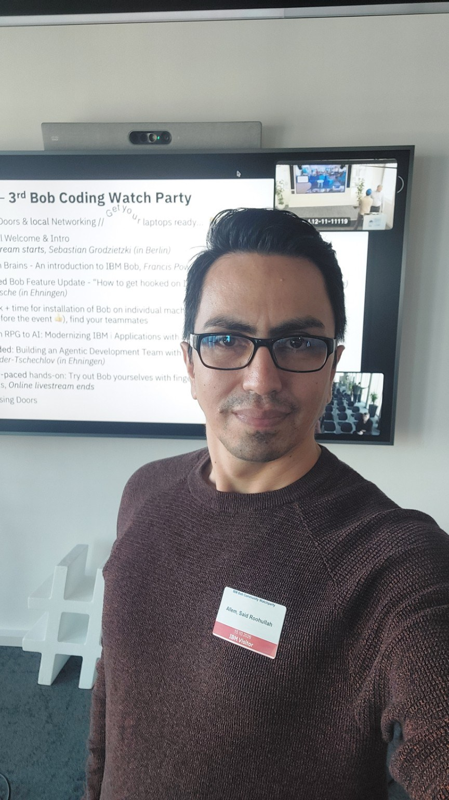
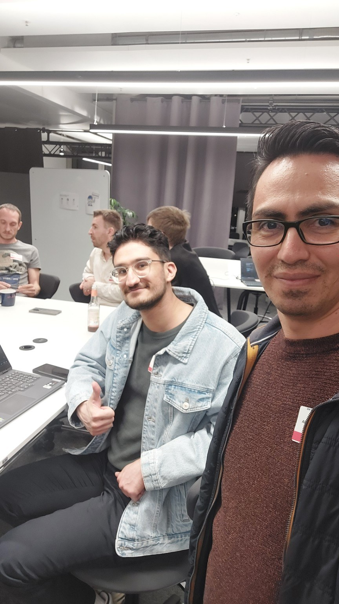
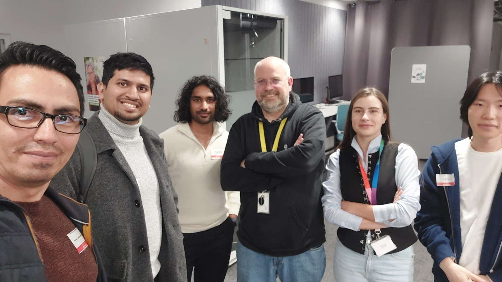

# An Evening with IBM Bob: AI Agents, Code Modernization, and Developer Connections

**15 October 2026 · IBM Frankfurt am Main, Germany**  
**Event:** [3rd Bob DACH Community Gathering & Coding Watch Party](https://luma.com/ulw8moy7)

  

On 15 October 2026, I attended the **IBM Bob Coding Watch Party** at the IBM office in Frankfurt. It was a hybrid community event, connecting people at different locations and online.

As a software developer working mainly with **C#/.NET and Angular**, I wanted to learn how AI agents can support real development projects. I was also happy to meet other developers, exchange ideas, and make new LinkedIn connections.

The event combined presentations, live demonstrations, technical questions, and time for hands-on experiments and networking.

## 1. Why IBM Bob Is More Than Code Completion

One important topic was the growing complexity of modern software. Applications often use many services, APIs, cloud platforms, and external dependencies. A change in one place can affect other parts of a system.

The speakers introduced **IBM Bob** as an AI development assistant designed for this wider challenge. While many coding tools focus on writing or completing code, Bob also aims to help developers understand large codebases, plan changes, test software, and modernize older applications.

For enterprise projects, the presentations highlighted explainable plans, controlled changes, and support for different deployment environments. The main idea was simple: **AI should help developers manage complexity, not create more of it.**

## 2. A Live Demo: Building a Web Synthesizer

One of my favorite demonstrations was by **Francis Powlesland**. He asked Bob to build a browser-based music synthesizer using the Web Audio API and information from Mozilla Developer Network tools.

Within a few minutes, Bob produced an interface with a keyboard, oscillators, filters, effects, and visual displays for audio signals. The interesting part was not only the generated code. Bob also used tools, including **Playwright**, to open the application in a browser and check how it behaved.

For me, this showed an important difference between generating code and checking a working application. Of course, a successful demo is not the same as a complete test strategy, but it was a useful example of an AI-supported development workflow.

## 3. ACP and Hooks: Integration and Control

We also learned about two technical features:

- **Agent Client Protocol (ACP):** A standard way for an editor or IDE to communicate with an AI agent. It uses **JSON-RPC 2.0** and supports two-way communication. Bob was demonstrated with tools such as IntelliJ IDEA and Obsidian. This makes it possible to use an agent without being limited to one editor.
- **Bob Hooks:** Actions that run automatically at specific points in an agent's workflow, such as before a tool is used or after a task finishes. Hooks can run commands or send HTTP requests. They can help with logging, checks, and control rules.

I found the Hooks example especially interesting. The presenter showed how events could be collected in a dashboard and discussed using extra checks to identify potentially dangerous commands. It was a good reminder that **automation needs clear limits and visibility**.

## 4. Modernizing Older IBM i Applications

Another session focused on **IBM i**, a platform still used by organizations with long-running business systems. Many applications were written years ago in languages such as RPG, and understanding or changing them can be difficult when experienced team members retire.

The demonstration showed Bob connecting to an IBM i environment, examining an older RPG program, and converting its source toward a newer RPG format. The presenter also started the compilation step, although that part was not completed during the available demo time.

What interested me most was the idea of using AI to **understand existing software before changing it**. This is important not only for IBM i, but also for many other legacy systems.

## 5. An AI Development Team with Different Roles

The most thought-provoking session for me was about building an **agentic software development team**.

Instead of giving one AI agent every task, the speakers showed a workflow with specialized agents:

**Feature request → Product Manager → Architect → Engineer → Reviewer → Human**

An **orchestrator** coordinates the process. Each agent has its own role and permissions. The team shares information through Markdown workflow files, while `SKILL.md` files describe how individual tasks should be performed.

In a demonstration using a to-do application, the agents worked on a feature requested through a GitHub issue. The workflow covered planning, architecture, implementation, and review. The session also showed how **Git worktrees** and Bob Shell could support work on separate features in parallel.

**Workshop code and practical guide:** The presenters also shared [Building an Agentic SDLC Workflow with Bob](https://github.com/tschechlovdev/watch-party-building-ai-agents), the public GitHub repository behind this hands-on example. It includes a Todo application (Flask backend and React frontend), sample feature requests, and step-by-step instructions for setting up the **Product Manager, Architect, Engineer, Reviewer, and Orchestrator** agents. Instead of using a complex external framework, the agents pass their results through a shared Markdown workflow document. The repository also explains optional GitHub Issues integration and how to work on different features in parallel using Git worktrees.

I especially appreciated having a practical resource to explore after the event. It helps turn the ideas from the presentation into something developers can try and learn from themselves.

The message I took from this session was that developers may spend more time **guiding, reviewing, and making decisions**, while agents handle selected implementation steps. However, human review remains important, especially before changes reach production.

## 6. Enterprise Deployment and Data Control

The presentations also covered Bob's architecture and options for enterprise use, including **regional cloud deployment**, **self-hosting**, and different AI models. The speakers explained how organizations can choose setups based on their requirements for data location, infrastructure, and control.

One detail worth noting is that model selection works differently depending on the setup: hosted services may route tasks between models, while self-hosted deployments can use models selected by the organization.

I appreciated that the discussion included practical questions about security, project context, automated tests, and the risks of AI-generated changes—not only the benefits of AI.

## 7. Conversations Beyond the Presentations

The personal highlight was meeting people with a shared interest in software development. I spoke with several participants, took selfies together, and exchanged LinkedIn contacts. These conversations were an important part of the evening for me.

  

  

And the view over Frankfurt was another nice memory from the venue.

  

## My Takeaways

I left the event with three main thoughts:

1. **AI coding tools become more useful when they understand the wider development process**, not only the next lines of code.
2. **Good engineering practices still matter.** Tests, permissions, code reviews, and human decisions are essential when AI agents make changes.
3. **Community matters too.** Technical events are an opportunity to learn from demonstrations and from conversations with other developers.

Thank you to the **IBM team, speakers, and everyone I met** for an interesting evening in Frankfurt. I look forward to exploring some of these ideas further in my own software projects.

---

*This is my personal summary of the event, based on the presentations and demonstrations I attended. It is not an official IBM publication.*
